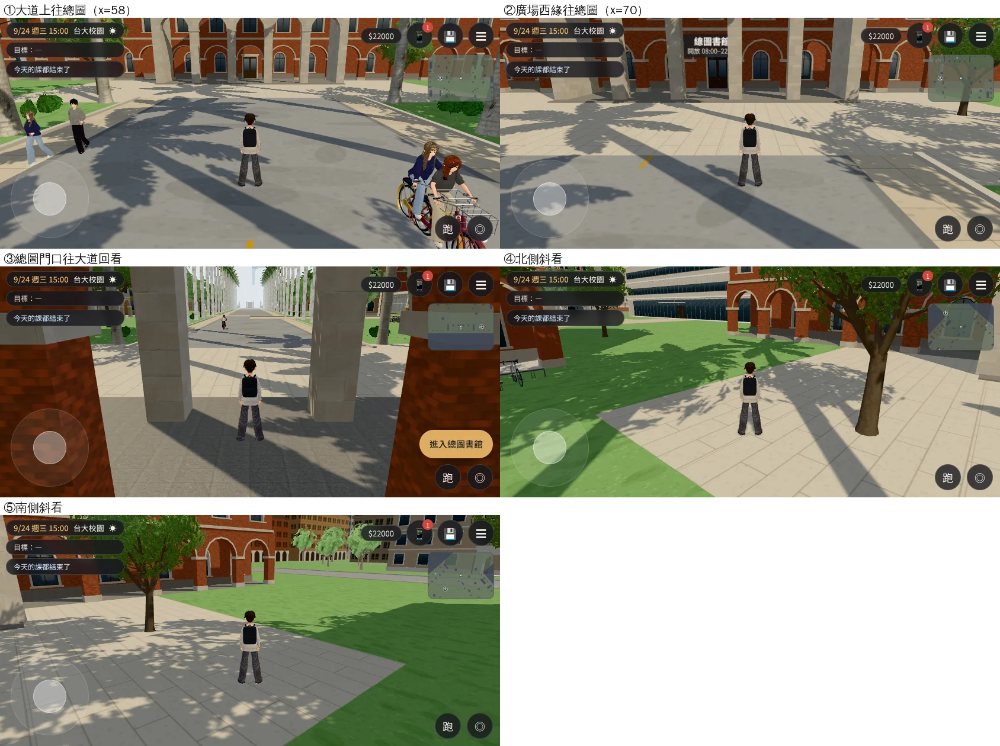
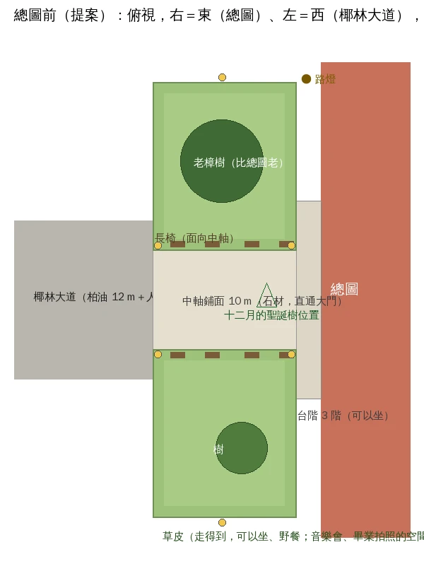

# X133 總圖前草皮規劃（LIB-LAWN-PLAN-1030；LAWWW2-B 2026-10-30）——規劃稿，還沒動模型

- **使用者原話**（10-30 04:4x 對 LAWWW-B，UA-LAWWW-1030-11）：照臺大校內地圖規劃總圖前草皮。
- **狀態**：規劃稿（PROPOSAL）。這一份只有現況截圖、平面配置提案、要回答的問題；模型、程式還沒做。建築、場景的 `ART_APPROVED` 只有使用者能標。

## 一、根據什麼

- **校內地圖**：使用者 10-09 給 LAWWW（帳號 A）的校總區平面圖（2025.10.13 版，D23）**不在 repo 裡**。D25 只記了壓縮後的位置關係：椰林大道東端＝總圖、正面朝西。
  - 這個工作階段的網路只通 GitHub，查不到官方地圖（map.ntu.edu.tw）、維基百科。
- **查得到的**：
  - 總圖在椰林大道的端點、校總區的幾何中心。
  - 總圖書館前草坪廣場辦過戶外音樂會。
  - 總圖北側出口連楓香道。
- **企劃已經用到「總圖前」的場景**（開發分支 src/data）：
  - 「你們坐在台階上，看總圖前面的人走來走去」；
  - 「總圖前面的樟樹比總圖老」「他在樟樹下等你」；
  - 「十二月。總圖前面的聖誕樹立起來了」；
  - 畢業典禮那天在總圖前看到子晴和芷若；
  - 學姊的跨年：總圖前（23:15）。

## 二、現況

- 椰林大道直接接到一片平的石板廣場（17×36 m），兩側是單色的草地和幾棵普通的樹。
- 沒有可以坐的地方、沒有台階、沒有樟樹，晚上沒有燈照在廣場上。

## 三、提案

- **中軸鋪面**：從椰林大道盡頭直通總圖大門，寬 10 m，石材鋪面；十二月在靠近大門的地方立聖誕樹（模型裡留一個預設藏起來的節點，劇情決定什麼時候顯示）。
- **兩塊草皮**：中軸南北各一塊，約 14×17 m。
  - 低路緣、草皮周圍一圈步道；草皮本身走得到、坐得到（野餐、音樂會、畢業拍照的空間）。
  - 北側草皮：一棵很大的老樟樹（企劃寫「比總圖老」），樹下可以等人。
  - 南側草皮：一棵中型的樹、草地留空。
- **長椅**：沿中軸兩側各四張，面向中軸。
- **路燈**：中軸四個角、草皮外緣兩盞，晚上中軸和長椅有燈光。
- **台階**：總圖大門前加三階寬台階（可以坐）。這要動總圖外觀和導航高度，先問：要不要做，還是用草皮邊的矮牆當坐的地方。
- **做法**：Blender 做草皮（不是單色）、鋪面、路緣、長椅、路燈、樟樹，匯出 GLB；遊戲端換掉現在的石板廣場、加導航阻擋，給 LAWWW-B patch；同角度改前改後。

## 四、要確認的（LAWWW-B 轉問使用者，或給我平面圖）

1. 使用者的校內地圖上，總圖前的草皮是什麼形狀？是一整塊，還是中軸兩邊各一塊？草皮和椰林大道之間有沒有路（例如南北向的路）？
2. 總圖大門前的台階要不要做（會動到總圖外觀和導航）？
3. 老樟樹的位置：北側草皮可以嗎？

在得到回答以前，我照第三節的提案做第一版（之後照地圖調整）。
