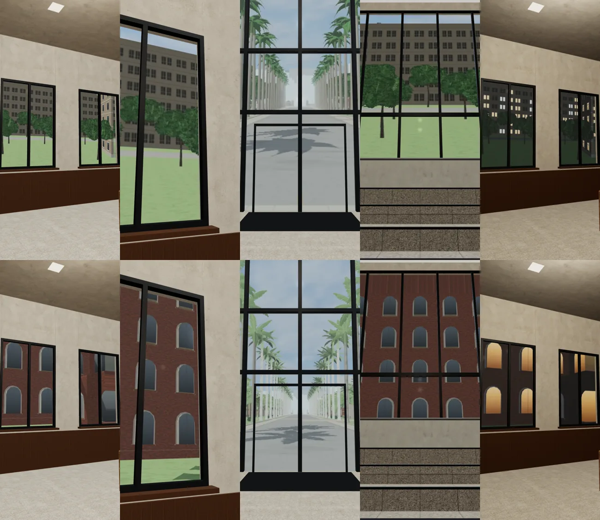
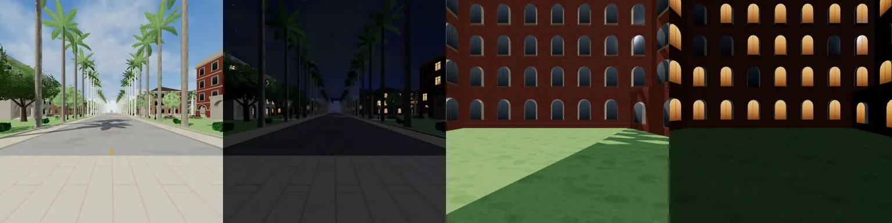
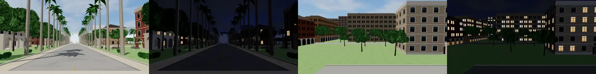

# ART-LIB-VIEW-1018：總圖窗景

LAWWW2-C，2026-10-18。
- 誰派的：LAWWW-C 05:59（使用者 06:2x「總圖窗景很假」）。做法我決定，導航不動。
- 狀態：`READY_FOR_ART_REVIEW`，使用者看過才算。

## 原本為什麼假
- 每一扇窗一張平面貼圖，景貼在窗上，走動時景跟著窗一起動，沒有遠近。
- 照片是很早以前拍的：
  - 側窗的景從 7 m 高往下看草地；
  - 對面是一棟方盒系館（套件還沒換成正式模型的年代）；
  - 樹貼在窗前、和窗一樣大。

## 現在
- **有景深的窗景**：一面牆一張大平面，窗洞以外被正式模型的牆擋住。
  - 用遊戲已經有的視差窗景（`W3.windowMat`，霖澤館在用），景在窗外 depth 公尺遠；
  - 走動、上下樓時，窗框和景的前後關係是對的。
- **照片重拍**（`tools/shots/library_views.py`）：視線高度、正對窗外，水平和垂直都是 90°，1024×1024。
  - 正面玻璃帷幕：從總圖門口（門廊柱子後面）往西的椰林大道，depth 35 m。
  - 側窗、大樓梯平台的大窗：總圖紅磚側翼和中庭草地，depth 14 m。總圖是 60 m 寬的大樓，大廳兩側看出去是中庭。
  - 晚上：側翼的窗戶亮燈，大道的路燈。
- 試做 2:1（垂直 53°）時，正面 9.6 m 高的玻璃往上看超出照片，上緣被拉長成一條條，所以改成 1:1。
- 只在正式室內模型載入後用（備用模型的牆沒有窗洞）。載入失敗照舊用原本一扇窗一張的平面。

## 遊戲內前後截圖
Playwright、iPhone 直向 390×844 模擬，LAWWW-C 分支 `ba6e9aa4`。
- 上排：改之前。
- 下排：改之後。
- 左到右：一樓側窗、側窗近看、正門往外、大樓梯平台的大窗、晚上的側窗。

照片：
- 新的：大道白天、晚上，中庭白天、晚上：

- 舊的：

## 交付
- patch：`docs/art-rebuild/second_ai/patches/library_views.diff`。
  - 只改 `src/library3d.js`：新增 `parallaxViews()`；正式模型載入後藏起舊平面、加有景深的大平面；`applyTime` 換白天、晚上的照片。
  - 對 LAWWW-C 分支 `ba6e9aa4`，`git apply --check` 乾淨。
- 照片：`assets/models/env/library_view_{avenue,lawn}_{day,night}.webp`，同檔名換掉。
- 重拍工具：`tools/shots/library_views.py`（相機位置、視角、1:1）。
- 導航、座位、互動點、劇情都沒動。

## 測試（套 patch 的樹）
- `node tests/nav_buildings_unit.js` ALL PASS。
- `python3 tests/flow_library_scene.py` ALL PASS：真實玩家流程，和小安去總圖二樓。
- 遊戲內 5 個鏡頭沒有 JS 錯誤。
- 沒測：iPhone 實機；`flow_library_floors.py`。

## 還沒做到的
- 景還是遊戲畫面拍的照片，不是真的 3D：
  - 窗外沒有會動的東西（樹不會動、沒有人走過）；
  - 天氣只有調色（雨天照片偏灰），沒有雨。
- 中庭是照遊戲裡總圖的紅磚外牆拍的，**不是**查證過的真實總圖中庭樣子。
- 3F 閱覽區（`library`）的窗景沒改。那是另一個區域、另一套畫的景。
