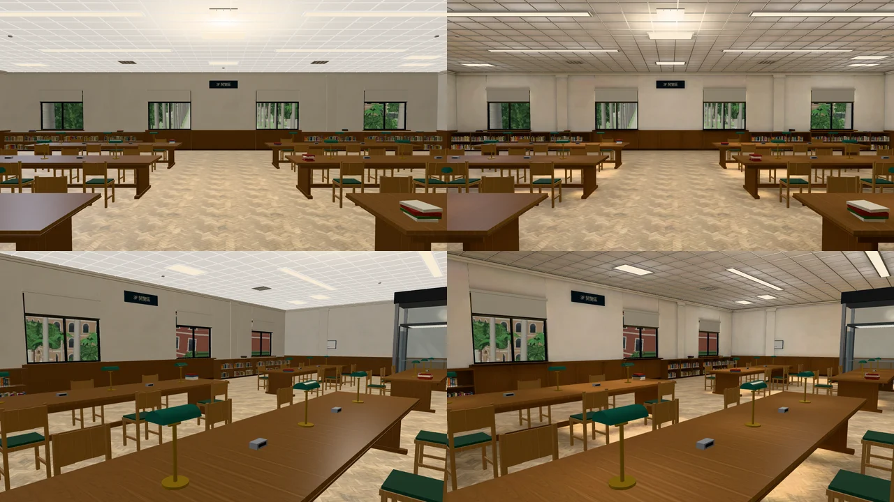
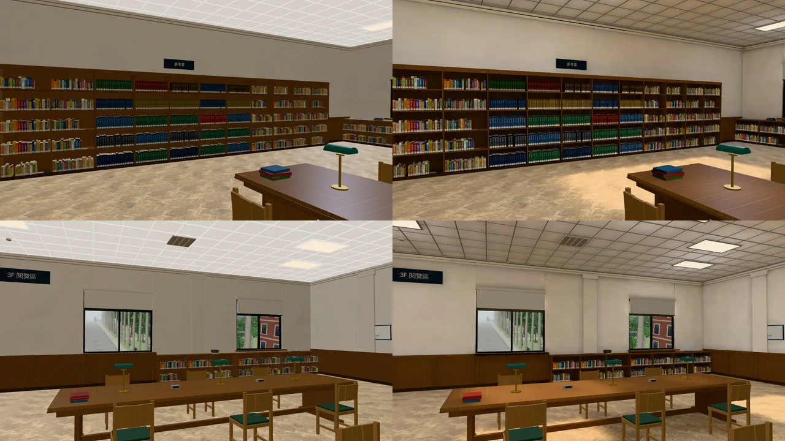
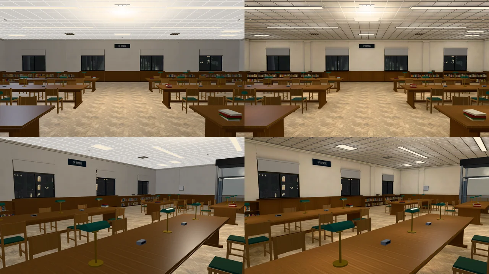
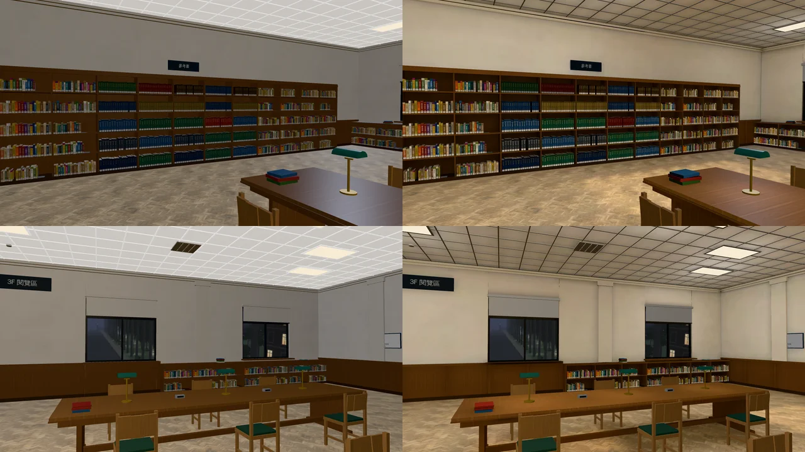
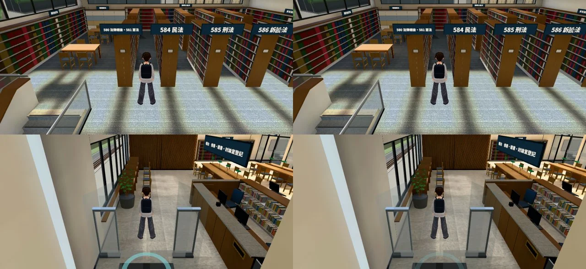

# 總圖 3F 閱覽區光照烘焙（ART-ECON-3D-GAP-1021 C；LAWWW2-B 2026-10-31）

- **起因**：ART-ECON-3D-GAP-1021 現況清單（`docs/art-rebuild/second_ai/ECON_3D_GAP_STATUS_1030.md`）的 C。
  - 經濟系那一年 10/16 19:00 那一場在這裡。
  - `library_3f.glb`（`zones3d.js` 的 `attachRoomGLB` 接）是正式模型，但沒有光照貼圖。
- **狀態**：`READY_FOR_ART_REVIEW`。建築、場景只有使用者能標 `ART_APPROVED`。
  - 截圖是 Playwright＋SwiftShader（電腦 1280×720），不是實機。
  - 讀檔放位置、藏玩家和 NPC 是 [捷徑]。
- **順便修的（我 10-30 交件的問題）**：烘焙工具匯出時沒寫 GPU instancing。
  - 法律學院圖書館的書因此從 27 個實例節點變成 800 個節點。見第五節。

## 一、怎麼套（給 LAWWW-B）

1. **換二進位**：
   - `assets/models/env/second_ai/library_3f.glb`；
   - 新的 `library_3f_lm_day.webp`、`library_3f_lm_night.webp`。
   - 模型和開發分支一樣，只多一套光照 UV 和 extras.lightmap。節點、三角形、書的 16 個 GPU 實例都不變。
   - `attachRoomGLB` 看到 extras.lightmap 就接（Z3.roomLightmap；和 Café、社科圖同一套），**遊戲程式不用改**。
2. **patch**：`docs/art-rebuild/second_ai/patches/library3f_lm_1031.patch`。
   - 新測試 `tests/library_3f_lm_unit.js`：
     - 光照貼圖兩張都在；
     - 地板、天花板、四面牆、長桌、書櫃有第二套 UV；
     - 燈框發光面、桌燈、燈罩、輕鋼架、椅子照舊即時光。
     - 開發分支原樣 FAIL（沒有光照貼圖、沒有第二套 UV），改後 ALL PASS。
   - 新測試 `tests/lm_instancing_unit.js`：用 `--keep-instances` 烘的模型（法圖、總圖 3F），書照舊是 GPU instancing、節點數沒有暴增。
     - 開發分支原樣 FAIL（法圖 800 節點、0 個實例），套第五節的法圖以後 ALL PASS。
   - 烘焙工具：
     - `bake_room.py`、`lm_fix_hidden.py`：匯出時保留 GPU instancing（第五節）；
     - 新的 `bake_library_3f.sh`；
     - 烘焙紀錄 `library_3f_lm.json`。
3. **法律學院圖書館**（第五節）：只換 `assets/models/env/lawlib_interior.glb`。光照貼圖兩張、烘焙紀錄和開發分支一模一樣，不用換。

## 二、白天、晚上的參數（遊戲內試了三版）

- **第一版**（燈暖白 1,0.97,0.92、長燈 12 W、方燈 9 W、沒有往上的點光源）：
  - 天花板整片咖啡色 (113,88,56)、牆偏桃色；白天比晚上暗。
  - 原因和普通教學館一樣：面光源只往下照。天花板只吃到人字拼地板、胡桃木桌櫃反彈上來的光，顏色越疊越暖。
- **第二版**（燈改晝光色；每盞燈下 0.9 m 一顆 6 W 點光源）：天花板 (128,109,86)，還是偏咖啡色，整間偏暗。
- **第三版**：燈晝光色 0.95,0.98,1.0；長燈 16 W、方燈 12 W；每盞燈下 0.9 m 的點光源 12 W（長燈兩顆、方燈一顆）。
- **定案**＝第三版，白天再調亮一點：
  - 天光 0.12、太陽 0.6、白天燈 1.0；
  - 白天整張乘 0.86,0.9,0.98（第三版是 0.8,0.84,0.92）。
  - 桌上綠色燈罩的桌燈照舊是暖黃（點光源，燈罩下方）。
- 參數都寫在 `bake_library_3f.sh` 開頭。

## 三、改前改後（同角度；左＝開發分支原樣（沒烘），右＝光照烘焙）

- 鏡頭：`tools/blender/env_second/shots/library3f_lm_shots.py`。①門口往北看整間 ②長桌（綠色檯燈）③西牆整面書架 ④後牆的窗和矮書櫃。
- 改前＝開發 `44337adcb` 原樣（到 `a54a7d860` 這幾個檔案都沒變）。

### 看得到的差別

- **有陰影了**：長桌下面、椅子下面、書櫃底下、牆角、柱子兩側。改前整間一樣亮，桌子像浮在地上。
- **天花板**：改前是一整片發亮的白板（自發光）；改後燈的四周亮、離燈遠的暗，輕鋼架的格子看得出來。
- **牆**：靠燈的地方亮，牆和天花板交接的地方暗一點。
- **晚上**：冷白的日光燈＋桌燈一圈暖黃。白天、晚上亮度差不多（圖書館白天燈照開），白天稍微偏冷。
- 牆面取樣（門口那張，窗中間的牆）：白天 (141,129,110) → (179,161,141)；晚上 (140,131,119) → (186,169,144)。

### 還不夠的（照實寫）

- 窗只在北牆，太陽照不進來：白天沒有窗邊的光斑，白天、晚上看起來差不多。
- 書、椅子、桌燈照舊是即時光：晚上離燈遠的書架，書會比旁邊的木櫃亮一點。
- 烘焙的太陽不會動：白天都是下午的位置。

## 四、檢查

- `lm_squash_scan.py`：朝室內被壓扁 **0 m²**。
- **效能**（`tools/blender/env_second/shots/interior_perf.py`，玩家鏡頭前、左、右、後各量一次；14:00；SwiftShader，手機實機沒量）：

| 位置 | draw call（前／左／右／後） | 三角形 |
|---|---|---|
| 門口 | 140／133／138／103 → **一樣** | 一樣（約 10 萬） |
| 長桌旁 | 149／147／121／118 → **一樣** | 一樣（約 10 萬） |

- 第一次量的時候沒藏路人：改後多了 80 次 draw call。查了是兩次量的路人不一樣（模型本身節點、三角形完全一樣）。
  - 效能腳本加了 `HIDE_NPC=1`（量以前把路人拿掉），上表是藏路人以後量的。
- 光照貼圖兩張共 206 KB（1024²）。

## 五、法律學院圖書館的書：GPU instancing 遺失（我 10-30 交件的問題）

- **怎麼發現的**：總圖 3F 試烘以後，書從 16 個實例節點變成 165 個節點。
  - 書照 `--keep-instances` 不展開、不烘，可是 `bake_room.py`、`lm_fix_hidden.py` 匯出時沒寫 `export_gpu_instances`。
  - Blender 匯出的時候把每一個實例寫成各自的節點；遊戲裡一個節點一次 draw call。
- **查了全部有光照貼圖的模型**：只有法律學院圖書館（10-30 LAWLIB-LM、LM-COLLAPSE 兩次都是我烘的）受影響。
  - 開發分支現在的 `lawlib_interior.glb`：800 節點、0 個實例。烘以前（`a743e092a`）是 137 節點、27 個實例。
  - 其他烘過的模型沒有用 `--keep-instances`，不受影響。
- **工具修好**：
  - `bake_room.py`：`--keep-instances` 時匯出也寫 GPU instancing。
  - `lm_fix_hidden.py`：輸入的 GLB 有 GPU instancing 才照樣寫回去。不能一律打開：其他模型共用網格的物件（遊戲照名字找的節點）會被改成實例。
- **法圖重烘**（`bake_lawlib.sh 512`，參數沒改）：
  - 137 節點、27 個實例（一、二樓的書，和烘以前同一組）。
  - **光照貼圖和開發分支逐像素相同**（白天、晚上兩張），烘焙紀錄 json 也相同：只要換 `lawlib_interior.glb`。
- **效能**（藏路人；`interior_perf.py` `HIDE_NPC=1`；14:00；SwiftShader，手機實機沒量）：

| 位置 | draw call（前／左／右／後） | 三角形（前／左／右／後） |
|---|---|---|
| 一樓入口 | 253／140／266／165 → 226／147／262／157 | 11.3／10.3／11.0／10.5 萬 → 17.8／10.9／20.3／11.6 萬 |
| 二樓書庫（584 民法前） | **1008／453／758／303 → 417／291／388／258** | 19.6／12.8／16.0／11.2 萬 → 20.2／17.4／20.1／17.3 萬 |

- 二樓書庫往前看 draw call 少了六成。三角形多一點：實例的書是整組一起畫，不像一本一個節點的時候，看不到的書會先被剔掉。
- 畫面一模一樣（同角度，左＝開發分支現在，右＝重烘）：

## 六、測試

- **全部 Node**（測試樹＝最新開發 `a54a7d860`＋這一包＋重烘的法圖）：780 支裡 778 過，2 支 FAIL，都不是這一包的：
  - `xinci_romance_unit.js`：用 `git show` 讀企劃線的稿，我這邊沒 fetch。fetch `claude/cool-heisenberg-o8kuqx` 以後 ALL PASS。
  - `r2y4b_events_unit.js`（PS1 台南的期末飯，地點字幕台南）：**開發分支原樣也 FAIL**（拿掉這一包重跑一樣），應該和 `a54a7d860`（walkPlace 地點字幕）有關，給你看。
- 新測試：
  - `library_3f_lm_unit.js`：開發分支原樣 FAIL 2（沒有光照貼圖、沒有第二套 UV），改後 ALL PASS。
  - `lm_instancing_unit.js`：開發分支原樣 FAIL（法圖 800 節點、0 個實例），換重烘的法圖以後 ALL PASS。
- patch 對最新開發 `a54a7d860` 用 `git apply --check` 檢查通過。
