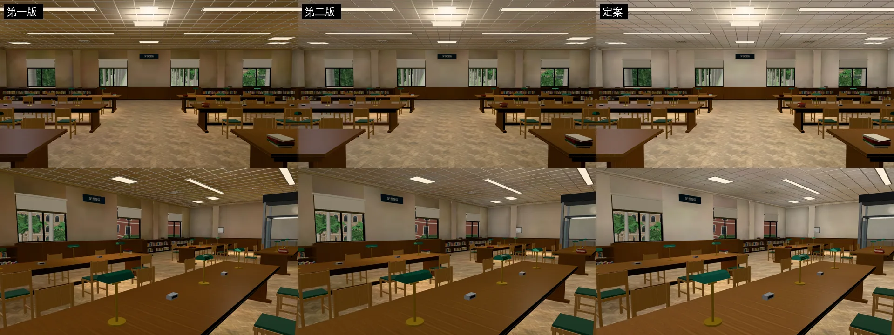

# 總圖 3F 閱覽區光照烘焙（ART-ECON-3D-GAP-1021 C；LAWWW2-B 2026-10-31）

- **起因**：ART-ECON-3D-GAP-1021 現況清單（`docs/art-rebuild/second_ai/ECON_3D_GAP_STATUS_1030.md`）的 C。
  - 經濟系那一年 10/16 19:00 那一場在這裡。`library_3f.glb`（`zones3d.js` 的 `attachRoomGLB`）有正式模型，但沒有光照貼圖。
- **狀態**：`READY_FOR_ART_REVIEW`。建築、場景只有使用者能標 `ART_APPROVED`。
  - 截圖是 Playwright＋SwiftShader（電腦 1280×720），不是實機。
  - 讀檔放位置、藏玩家和 NPC 是 [捷徑]。
- **順便修的（我自己 10-30 交件的問題）**：烘焙工具匯出時沒寫 GPU instancing，法律學院圖書館的書從 27 個實例節點變成 800 個節點。見第四節。

## 一、怎麼套（給 LAWWW-B）

（交件時補）

## 二、白天、晚上的參數（遊戲內試了三版）

- **第一版**（燈暖白 1,0.97,0.92、長燈 12 W、方燈 9 W、沒有往上的點光源）：
  - 天花板整片咖啡色 (113,88,56)、牆偏桃色；白天比晚上暗。
  - 原因和普通教學館一樣：面光源只往下照，天花板只吃到人字拼地板、胡桃木桌櫃反彈上來的光，顏色越疊越暖。
- **第二版**（燈改晝光色、每盞燈下 0.9 m 一顆 6 W 點光源）：天花板 (128,109,86)，還是偏咖啡色、整間偏暗。
- **定案（第三版）**：
  - 燈晝光色 0.95,0.98,1.0；長燈 16 W、方燈 12 W；
  - 每盞燈下 0.9 m 的點光源 12 W（長燈兩顆、方燈一顆）；
  - 天光 0.12、太陽 0.6、白天燈 1.0；白天整張乘 0.86,0.9,0.98（稍微偏冷）。
  - 桌上綠色燈罩的桌燈照舊是暖黃（點光源，燈罩下方）。

（後面交件時補）
