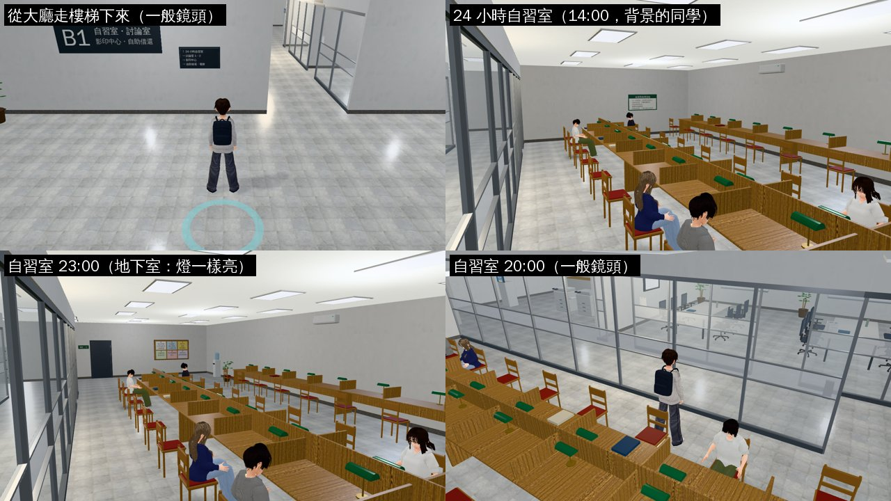
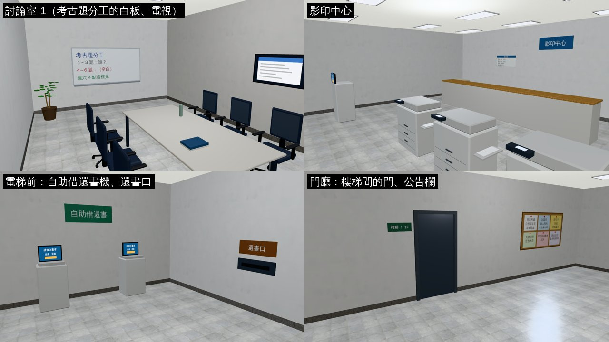
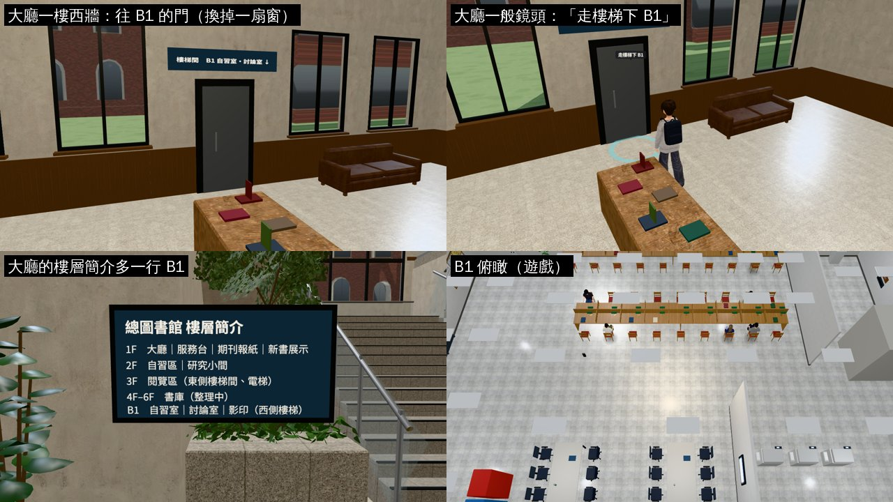
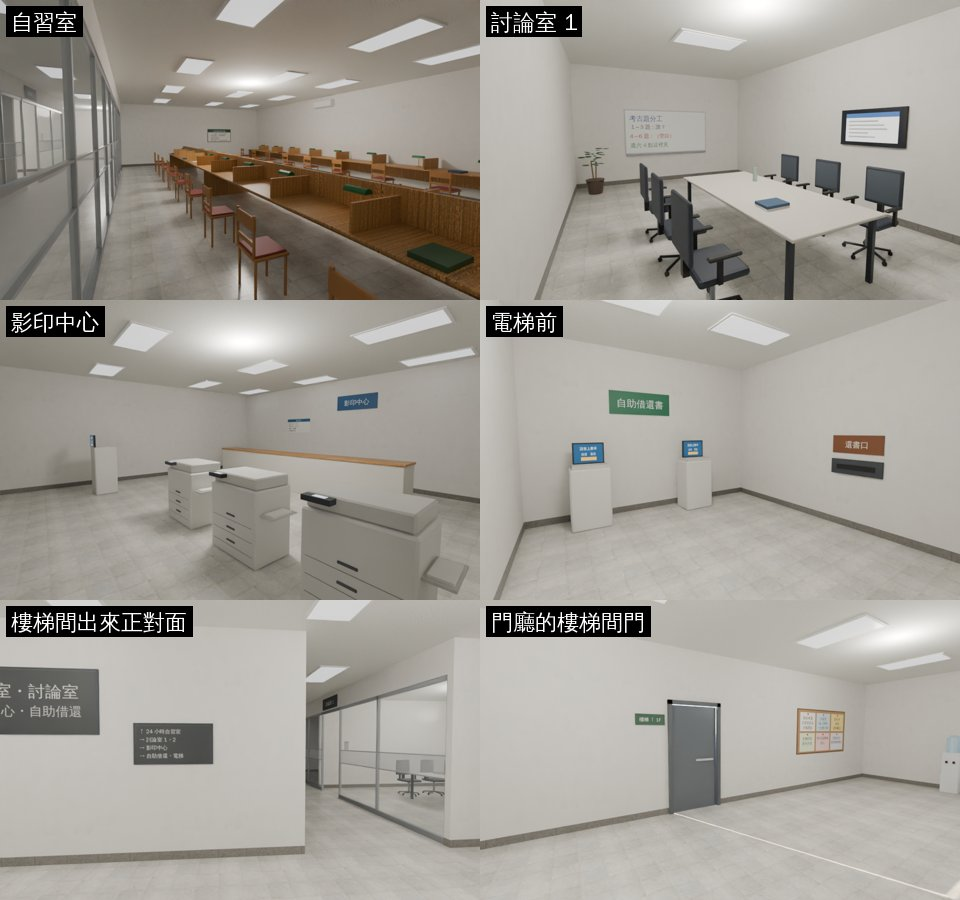

# CLOSED-SPACES-1023 第二項：總圖 B1

- **使用者原話**（2026-10-23，對 LAWWW2-B）：「遊戲裡任何現在關起來的空間都可以開始開發，例如進不去的討論室之類的。相關功能如何與劇情連接，請跟 AA 討論。」
  - 總圖 B1 是使用者 D46 提過的地方。
- **劇情用途**：AA_399 第 2 節（AA-B）。
  - 柏翰的考古題小組 → 討論室 1；國考讀書會 → 討論室 2。
  - 期末前的 24 小時自習室；自助借還書機。
- **分工**（LAWWW-B 10-23 17:4x）：
  - LAWWW2-B：模型、配置、區域、大廳一樓的門（`library_interior.py`、`library_layout.js`、`library3d.js`，D108）。
  - LAWWW-B：劇情接線（照 AA_399 第 2 節）。
- **進出**：LAWWW-B 選 **A**：大廳一樓西牆開樓梯間的門。電梯這一版不停 B1。
- **做的人**：LAWWW2-B。
- **狀態**：`READY_FOR_ART_REVIEW`。場景美術的 `ART_APPROVED` 只有使用者能標。

## 和提案不一樣的地方

- **門在 z −2.4，不是 z −3.2**：z −3.2 撞到大廳一樓西牆的窗（那一排窗每 2.4 m 一扇，z −2.4 那扇是 −3.2…−1.6）。
  - 改成把 z −2.4 那一扇窗換成門。B1 這一邊的門也在 z −2.4，上下對齊。

## 做了什麼

- **工具**：Blender bpy，`tools/blender/env_second/library_b1.py`（新）。
  - 沿用霖澤館 5F 的做法：`linze_upper.py` 的隔間牆、印刷品、辦公椅、白板；`lane118_shops.py` 的共用零件。
- **材質**：Poly Haven（CC0）：
  - 地板：淺色石英磚 `large_floor_tiles_02`。**沒有深色木地板**（使用者 10-23）。
  - 牆 `painted_plaster_wall`、踢腳板 `granite_tile_03`、天花板 `ceiling_interior`。
  - 長桌：淺色木紋 `wood_table_001`。
- **座標**：和總圖大廳同一套（x −12…12、z −9…9）；B1 地板 y＝0、天花板 3.2 m。地下室，沒有窗。
- **樣子**：照兩張 2D 背景 `assets/bg/ntu_lib_b1.webp`（自習室）、`library_b1.webp`（討論室）。

| 地方 | 位置 | 內容 |
|---|---|---|
| 24 小時自習室（北） | x −7…7.4、z −9…−1.2 | 靠北牆一排單面長桌（10 位）、中間一排雙面長桌（18 位，中間木隔板）。每個位子一盞綠色檯燈、木椅紅椅墊、座位之間矮隔板，有幾個位子留著書。 南側玻璃牆（中間一條霧面帶）＋玻璃門、刷卡機、門上「24 小時自習室」。西牆內側使用須知、冷氣。 |
| 討論室 1、2（南） | x −7…−2、−2…3；z 1.2…9 | 北側玻璃牆＋玻璃門、門上門牌、門旁預約表。 六人桌、六張辦公椅、南牆白板（1：考古題分工；2：申論題架構）、側牆電視、植物。 |
| 影印中心（東南） | x 3…12、z 1.2…9 | 櫃台、三台影印機、列印站、紙箱、價目表、招牌。 |
| 電梯前（東北） | x 7.4…12、z −9…−2.6 | 自助借還書機兩台（螢幕亮）、牆上的還書口。電梯門（和大廳同一個井）。 |
| 門廳（西） | x −12…−7 | 樓梯間的門（上 1F）、正對面的大「B1」樓層牌和指引、置物櫃（四座）、公告欄、飲水機、兩台飲料販賣機、長椅、植物。 |

- **隔間牆**：`WALL_P1`～`P7`，`partition=1`（鏡頭和玩家在牆的兩邊才淡出）。玻璃牆是 `WALL_P1_glass／frost`、`WALL_P4_glass／frost`。
- **大廳一樓**（`tools/blender/library_interior.py` 重建 `library_interior.glb`）：
  - 西牆 z −2.4 那一扇窗換成門洞＋灰色鋼門（和二樓往 3F 的樓梯間門一樣）、牆裙斷開。
  - 門上的字是遊戲畫的（`library_layout.js` 的 `signs`：「樓梯間　B1 自習室・討論室 ↓」）。
  - 和開發分支的 GLB 比：節點只多了門的三個（`L0_WALL_Wdoor_lb_*`），其他一樣。

## 遊戲接線（patch）

`docs/art-rebuild/second_ai/patches/library_b1_1023.patch`：

- `src/library_b1_3d.js`（新）：區域 `library_b1`。
  - 照霖澤館 3F～5F 的做法：`Z3.room`（沒有窗）＋配置的導航格、座位、互動點＋正式模型 `bldg.library_b1`（`Z3.attachRoomGLB`）。
  - 地下室的光：環境光固定，白天晚上一樣；太陽只留一點當主光。
  - 背景的同學 `LB1.populate`：只坐自習室，照時段人數不同，日期當種子。
- `src/data/library_b1_layout.js`（新）：配置。由 `library_b1.py --js` 產生，不要手改。
- `src/data/library_layout.js`：
  - `b1Door`（x −11.8、z −2.4、寬 1.1；spawn＝從 B1 上來站的位置）。
  - `signs` 多一塊門上的字。
- `src/library3d.js`：
  - 備用模型跳過那扇窗、畫一扇門。
  - 互動點「走樓梯下 B1」→ `library_b1`。
  - 樓梯旁的樓層簡介（畫的字和「看」的字）多一行 B1。
- `tools/blender/library_interior.py`：開門洞、門、牆裙斷開（重建的 GLB 在我的分支）。
- `index.html`：載入兩個新檔（在 `library3d.js` 後面）。
- `src/story3d.js`：兩行，進來（`populate`）、待著（`refreshSchedule`）叫 `LB1.populate`。寫法同霖澤館 3F、4F。
  - 這是劇情檔：要不要背景同學由 LAWWW-B 決定，拿掉這兩行就沒有。
- `src/guide3d.js`（大廳 ⇄ B1）、`src/placemap3d.js`（地圖釘＝總圖）、`src/data/places.js`（名字「總圖 B1 自習室・討論室」）。
- `tests/library_b1_unit.js`（新）。

## 給劇情接線用的（`LIBRARY_B1_LAYOUT`）

- **spots**：

  | 名字 | 位置 | 用途 |
  |---|---|---|
  | `disc1_head` | (−4.5, 6.4) 面向北 | 討論室 1 白板和桌子中間（柏翰講考古題） |
  | `disc1_door` | (−3.0, 2.0) 面向南 | 討論室 1 剛進門 |
  | `disc2_head` | (0.5, 6.4) | 討論室 2（國考讀書會） |
  | `disc2_door` | (2.0, 2.0) | 討論室 2 剛進門 |
  | `study_door` | (−5.0, −1.9) 面向北 | 自習室刷卡進門 |
  | `study_night` | (−0.7, −2.82) | 自習室中間那排南側的一個座位（期末前的夜）＝seats 裡同一個位子 |
  | `selfcheck` | (9.4, −7.7) 面向北 | 自助借還書機前 |
  | `stairs_door` | (−10.5, −2.4) 面向東 | 樓梯間門前（＝出生點） |
  | `copy_clerk` | (7.8, 8.0) | 影印櫃台後面的工讀生 |

- **seats**：42 個。
  - 自習室 28 個（`kind:'study'`；區域裡 `seat.room==='study24'`）。
  - 討論室 1、2 各 6 個（study；`room` 是 `disc1`／`disc2`）。
  - 門廳長椅 2 個。
- **interact id**：`selfcheck`、`disc1`、`disc2`、`study_door`、`notice`、`copy`、`copier`、`lockers`、`wb1`、`wb2`、`return_slot`、`elevator`。
  - `note` 都是暫定的字（AA 可以改）；`dev` 是給開發組的說明，不顯示。
- **rooms**：`study24`、`disc1`、`disc2`、`copy`、`lobby` 的範圍。

## 截圖（遊戲內，Playwright＋SwiftShader；不是 iPhone 實機）

### 自習室

- 背景的同學是 `LB1.populate` 坐的（路人）。
- 23:00 和 14:00 一樣亮：地下室沒有日光，環境光固定。

### 討論室、影印中心、借還書、門廳

### 大廳一樓

- 大廳一樓西牆 z −2.4 那扇窗換成門，門上的字「樓梯間　B1 自習室・討論室 ↓」。
- 樓層簡介多一行「B1　自習室｜討論室｜影印（西側樓梯）」，看的字也多一句。

### Blender 渲染（Cycles，不是遊戲畫面）

- 前四張是第一版模型。之後只加了門廳的大 B1 牌子、指引、兩台販賣機，補了樓梯間門的縫。

## 效能（同一個鏡頭的 draw call／三角形）

| 鏡頭 | calls | 三角形 | 說明 |
|---|---|---|---|
| 討論室 1 | 54 | 2.9 萬 | 只有模型 |
| 影印中心 | 35 | 2.8 萬 | 只有模型 |
| 從樓梯間下來（一般鏡頭） | 233 | 40.8 萬 | 多的是自習室六位背景同學（VRM） |
| 自習室 20:00（一般鏡頭） | 184 | 30.7 萬 | 同上 |

- 模型本身 2.9 萬三角形、16 種材質，GLB 2.5 MB。
- 人多的時候三角形主要是人物，和霖澤館 3F、4F 一樣。人數上限在 `LB1.want`：晚上八位，考試週加倍。

## 測試

| 測試 | 測試樹 | 結果 |
|---|---|---|
| `node tests/library_b1_unit.js`（新） | 開發 `700cb0b7f`＋patch；`f023a83f1`＋patch | ALL PASS |
| `node tests/nav_buildings_unit.js` | 同上 | ALL PASS |
| `guide_unit`、`guide_declutter_unit`、`placemap_unit`、`quick_travel_unit`、`zone_dispose_unit`、`zone_prewarm_unit` | `f023a83f1`＋patch | ALL PASS |
| `tests/reachability_all.py --zones library_hall,library_b1` | `700cb0b7f`＋patch | ALL PASS（93 個互動點、4 個出入口到達點） |
| `tests/flow_library_floors.py`（真實走路，不用 turbo） | `700cb0b7f`＋patch | ALL PASS（27 項） |
| 遊戲內截圖 15 張 | 同上 | 沒有 JS 例外 |
| Blender `navcheck` | — | 0 個問題（42 個座位） |

- `library_b1_unit` 沒有 B1 的時候：第 1 項 FAIL，後面不跑。
- patch 對 `700cb0b7f`、`f023a83f1` 都 `git apply --check` 過。

## 還沒決定、要 LAWWW-B 看的

1. **晚上怎麼進來**：總圖大廳 22:00 關（`places.js` 的 hours），B1 的 24 小時自習室晚上要從哪裡進？
   - 現在只能從大廳走樓梯；大廳關了就進不來。
   - 真實的台大總圖 B1 自習室有自己的出入口。要不要做、做在校園哪裡，由 LAWWW-B／AA 決定。
2. **電梯停 B1**（B）：這一版不做。B1 的電梯只有「看」：「B1 停靠限館員刷卡，讀者請走西側樓梯。」（暫定的字）
3. **既有劇情的佔位**：`r2y4b3d.js` 的國考讀書會現在是 `zone:'library_hall'`、`roomName:'總圖 B1'`、spot (−3.0, 2.8)。要改成 `library_b1` 的 `disc2_head`，由 LAWWW-B 改。
