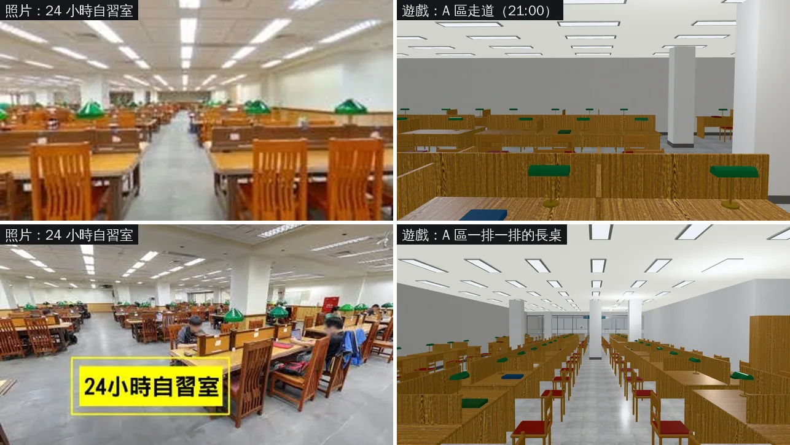
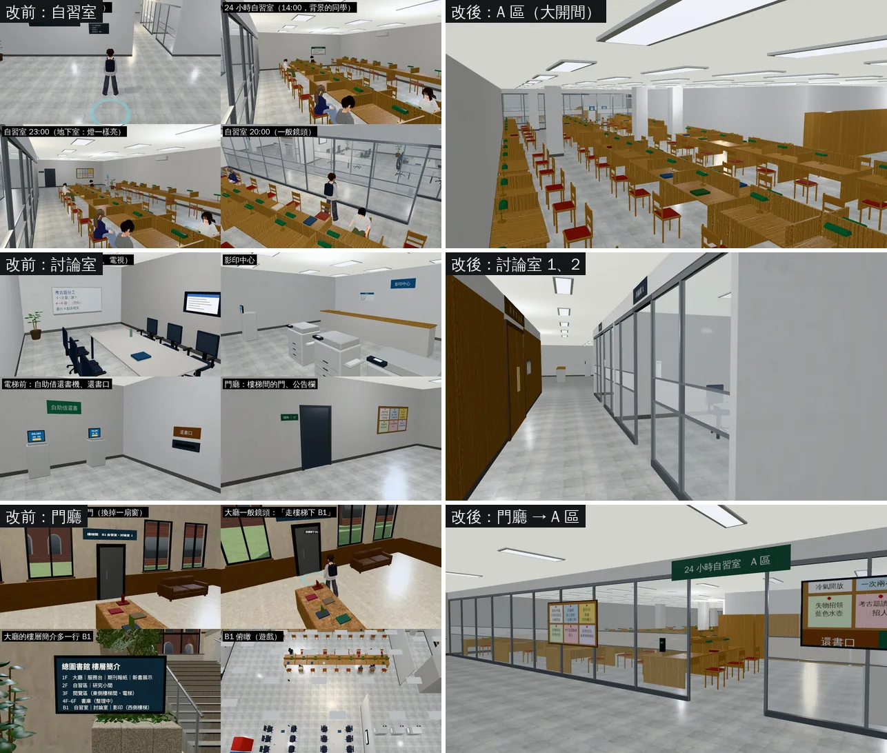
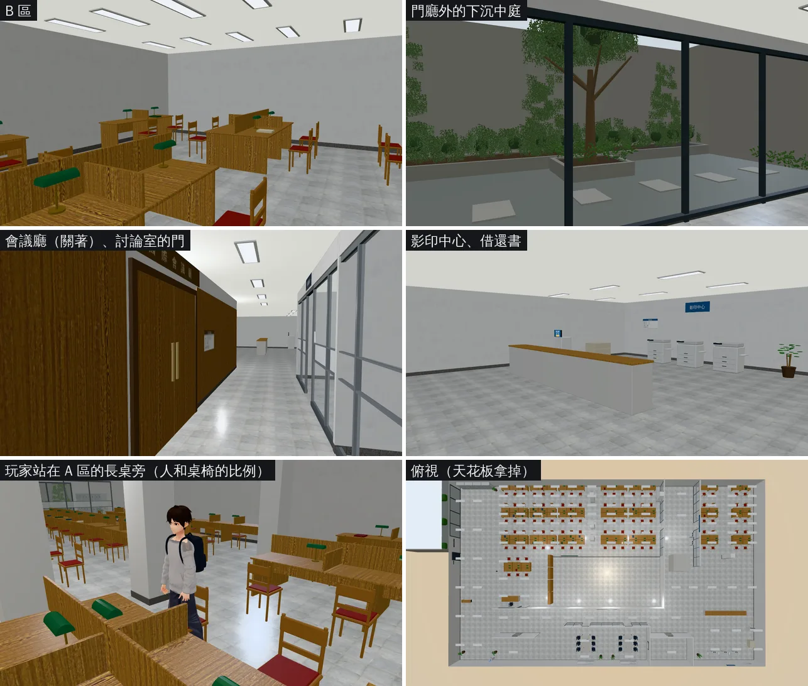

# 總圖 B1 第二版：24 小時自習室 A／B、下沉中庭、討論室、會議廳（LIB-INTERIOR-1102 的 B1；LAWWW2〔帳號 A〕2026-11-02）

- **起因（使用者直接對 LAWWW2 說）**：
  - 08:58「舊有的空間配置 能用的就沿用 按造實際配置安排 尤其B1自習室」（B1／1F／2F 平面圖＋鳥瞰圖）。
  - 10:0x「B1自習室我記得給我你照片 ?」：有。10-17 給過兩張 24 小時自習室的照片，B1 平面圖在企劃線 `docs/story_planning/art_reference/photo_ref/`（`ntu_lib_b1_room_a.jpg`、`ntu_lib_b1_room_b.jpg`、`ntu_lib_b1_floorplan.png`）。
  - 紀錄：`docs/handoff/user_asks_LAWWW2.json` UA-LAWWW2-1102-04、-07。
- **狀態**：`READY_FOR_ART_REVIEW`。
  - 場景美術由 BB 驗收（D120）。
  - 截圖是 Playwright＋SwiftShader（電腦 1280×720），不是實機。讀檔放位置、藏玩家和路人是 [捷徑]。
- **光照烘焙**：B1 第一版本來就還沒烘（INTERIOR-AAA，排在後面）。這一版也沒烘，和現在遊戲裡的 B1 一樣用即時光。

## 一、怎麼套（給 LAWWW）

1. **換二進位**（從我的分支 `claude/second-ai-env-art` 的 `assets/models/env/second_ai/` 拿）：
   - `library_b1.glb`、`library_b1.json`、`library_b1.layout.json`；
   - manifest 的 key 不變（遊戲照舊用 `Z3.attachRoomGLB` 接）。
2. **patch**：`docs/art-rebuild/second_ai/patches/library_b1_1102.patch`（`b1b249873`、`ba125d6f3` 都 `git apply --check` 乾淨）。動到的檔：
   - `src/data/library_b1_layout.js`：重新產生（`tools/blender/env_second/library_b1.py --js <repo>`，不要手改）；
   - `src/b1story3d.js`：國考讀書會的座位 `BAR_SEATS`、柏翰小組讀書的站位 `STAGES`（討論室搬了位置，見第五節）；
   - `src/r2y4b3d.js`：國考讀書會的集合點 `act_bar_study.spot`；
   - `tests/library_b1_unit.js`：自習室座位數 28 → 101。
3. B1 的區域大小、入口（大廳一樓西側樓梯間的門）、電梯、出口位置都沒變；`library_b1_3d.js` 不用改。

## 二、照片對照（左＝使用者的照片，右＝遊戲裡）

- **一樣的地方**：
  - 大開間，低的白色方格天花板，一條一條的日光燈；
  - 白色方柱，淺灰石材地板；
  - 一排一排蜂蜜色的木頭長桌，桌子中間有矮隔板；
  - 木椅配暗紅椅墊，綠燈罩的檯燈。
- **不一樣的地方（老實說）**：
  - 照片的自習室比遊戲大很多（遊戲的 B1 是 24 × 18 m，A 區只放得下 101 個座位）；
  - 照片裡桌上有很多人的東西，遊戲的桌上是空的。

## 三、改前改後（左＝第一版 10-23，右＝第二版；角度不完全一樣，第一版的房間配置不同）

## 四、新角度

## 五、做了什麼

- **工具**：Blender bpy，`tools/blender/env_second/library_b1.py`（第二版）。
- **配置**（照平面圖）：
  - 24 小時自習室 A 區：大開間，101 個座位；
  - B 區；
  - 大廳（服務台、自助借還書機、置物櫃），大廳西邊的大片玻璃外面是下沉中庭；
  - 國際會議廳：關著，門上有牌子；
  - 討論室 1、2：玻璃隔間，各 6 個座位，在 x −6～6、z 7.5～13；
  - 影印中心。
  - 總共 115 個座位，navcheck 沒有走不到的座位。
- **下沉中庭**（從門廳的玻璃看出去）：
  - 庭園樹：樹冠在 2.8～3.9 m，從門廳玻璃看得到；
  - 花台上的灌木：葉片卡圍著深色芯；
  - 也有牆腳的蕨類、擋土牆上的藤蔓、步石。
  - 11-02 12:0x 修過一次：第一次截圖時，灌木的深色芯露出來像多面體。改成芯縮小（0.6 → 0.45）、分段加多，葉片卡多一倍。
- **效能**：
  - 椅子 101 張、檯燈 101 盞用 GPU instancing（EXT_mesh_gpu_instancing）；
  - 三角形 29k（畫出來 65k）；
  - GLB 2.7 MB（每張椅子各畫一份是 5.3 MB）。
- **材質**：Poly Haven CC0（地板石材、木紋、灰泥、天花板）；葉子貼圖是本作程式畫的（`tools/blender/textures/gen/`）。

### 劇情站位（第一版 → 第二版）

| 用途 | 第一版 | 第二版 |
|---|---|---|
| 國考讀書會：阿哲（討論室 2） | (−0.58, 3.55) | (2.02, 9.6) |
| 國考讀書會：柏翰 | (−0.58, 4.4) | (2.02, 10.45) |
| 國考讀書會：小語 | (1.58, 3.55) | (4.18, 9.6) |
| 國考讀書會集合點 `act_bar_study.spot` | (2.0, 2.7) | (3.0, 8.3) |
| 柏翰小組讀書：玩家（討論室 1） | (−3.42, 4.4) | (−2.02, 10.45) |
| 柏翰小組讀書：芯慈 | (−5.58, 4.4) | (−4.18, 10.45) |

- 柏翰本人照舊用 `disc1_head` 這個 spot，spot 的座標在 layout 裡已經跟著討論室 1 搬了。
- 座位、spot 都是 `library_b1_layout.js` 的 seats／spots，和 Blender 模型同一份。

## 六、測試

- **環境**：乾淨的 worktree，`b1b249873`＋這個 patch＋GLB（`library_b1.glb` 11-02 12:0x 版，灌木修過）。Playwright＋SwiftShader，不是實機。
- **Node**：
  - 跑了碰到 `library_b1`、`b1story`、`r2y4b`、`LIBRARY_B1`、國考讀書會、柏翰小組讀書的單元測試，再加 `nav_buildings_unit`、`reachability_unit`，共 61 支。
  - 60 支 ALL PASS；1 支 FAIL：`pool_aafix_unit` 第 4 項（`classes3d.js` 的 `CLS.S.enrolled` 讀到 undefined 的 `y4s2_mar`）。
  - 這一支在乾淨的 `b1b249873`（沒有這個 patch）也一樣 FAIL，和 B1 無關。
- **瀏覽器**：`guide_flow`（`?turbo`）：10 PASS、3 FAIL。
  - 「閉館訊息寫開放時間與幾點開」（總圖閉館、B1 側門那一段）PASS。
  - FAIL 的是校園導航那三項：「校園裡指向『走出校門』」「有路線」「導航條顯示」。
  - 在乾淨的 `b1b249873`（沒有這個 patch）照樣是這三項 FAIL（14:4x 跑過），和 B1 無關。

## 七、還沒做的、限制

- 光照烘焙（INTERIOR-AAA，B1 排在後面）。
- 總圖北側的行政入口：鳥瞰圖上 B1 中庭旁邊的那個入口，這一版沒有做。
- 沒跑手機實機。
