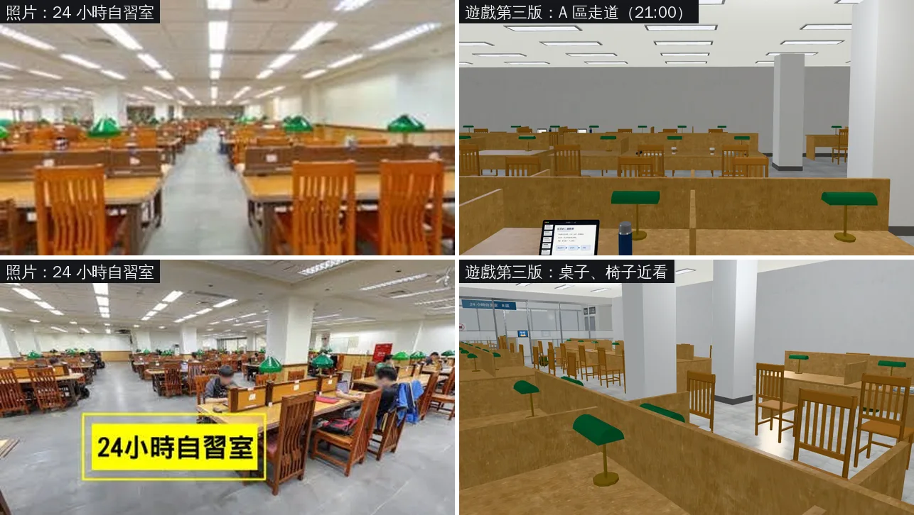
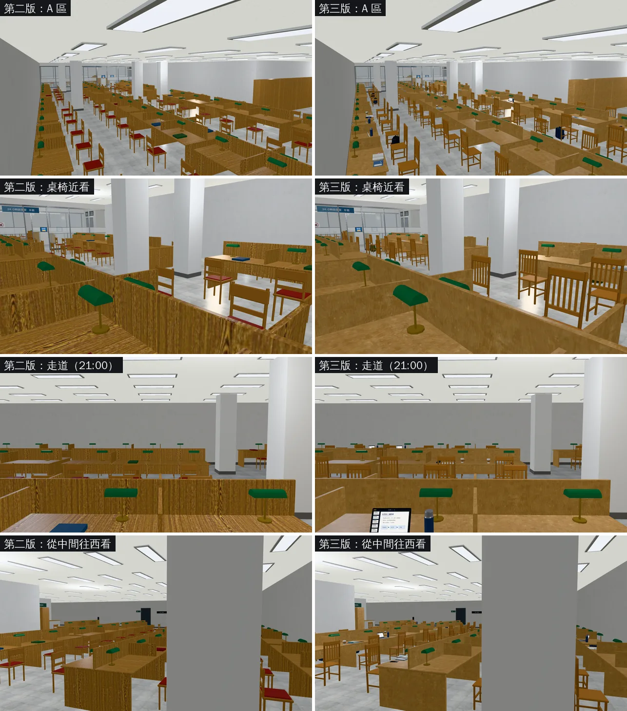

# 總圖 B1 第三版：細紋淺橡木、高背直條實木椅、桌上的東西和背包（BB_236 ①②③；LAWWW2〔帳號 A〕2026-11-02）

- **起因**：BB 11-02 14:43 驗收 B1 第二版（BB_236）：可以整合，還不標 ART_APPROVED。要做的五項，照優先順序：
  1. 木紋太誇張（條紋粗、對比強）：照片是細紋的淺橡木；
  2. 椅子：照片是高背、直條鏤空的實木椅，沒有坐墊；第二版是矮背加紅坐墊；
  3. 生活感：桌上的書、筆電、水壺、背包（instancing）；確認背景同學會坐到新座位上（第二版的截圖藏了路人，看不到）；
  4. 牆面：公告、標示、出風口、置物櫃；
  5. 烘焙光照。
- **這一版做 ①②③**。④牆面、⑤烘焙之後再做。
- **排序**：BB 15:46 的順序：一樓二樓第二版 → **B1 第三版** → LIB-FRONT v3.1 → 3F → 效能 → v3.2。
- **狀態**：`READY_FOR_ART_REVIEW`。
  - 場景美術由 BB 驗收（D120）。
  - 截圖是 Playwright＋SwiftShader（電腦 1280×720），不是實機。讀檔放位置、藏玩家和路人是 [捷徑]。

## 一、怎麼套（給 LAWWW）

- **只換二進位，不用 patch**：從我的分支 `claude/second-ai-env-art` 拿
  - `assets/models/env/second_ai/library_b1.glb`；
  - `assets/models/env/second_ai/library_b1.json`（建置紀錄）。
- `library_b1.layout.json`、`src/data/library_b1_layout.js` **和第二版一模一樣**（`cmp` 檢查過）：
  - 座位、互動點、劇情站位、導航都沒變；
  - 第二版的 patch（int/next1102 `3e6855649` 已經接了）不用再動。
- 要退回第二版：把這兩個檔換回 `3e6855649` 的版本。

## 二、照片對照（左＝使用者的照片，右＝遊戲裡）

- **對得上的**：
  - 高背、直條的實木椅，沒有坐墊；
  - 細紋的淺色木頭桌面，桌上有隔板；
  - 綠色檯燈、一排一排的日光燈。
- **還不像的**：
  - 照片的隔板、椅子是比較深的柚木色，隔板有一格一格的框；遊戲裡隔板和桌面同一個淺色。
  - 照片窗台以下有一圈木頭牆裙；遊戲裡是灰牆（④ 牆面還沒做）。
  - 中距離看，細紋木頭有點像軟木塞板（細紋在 1280×720 下糊成斑點）。

## 三、改前改後（同一個鏡頭；左＝第二版，右＝第三版）

- 木紋：第二版的粗條紋、強對比不見了，換成細紋的淺橡木。
- 椅子：矮背紅坐墊 → 高背直條、沒有坐墊。
- 桌上：第二版只有零星幾本書；第三版約一半的座位有書、筆記、筆電、水壺，椅腳邊有背包。

## 四、背景同學坐在新座位上（不藏路人）

（截圖跑完補。）

## 五、做了什麼

- **工具**：Blender bpy，`tools/blender/env_second/library_b1.py`（第三版）。
- **① 木紋**：
  - 桌面、木作換成 Poly Haven 的 `fine_grained_wood`（CC0，細紋）：顏色 #c49862、對比 0.45；
  - 牆裙、木作用同一張貼圖：#93683f、對比 0.5；
  - 第二版是 `wood_table_001`，對比 0.8，條紋粗。
- **② 椅子**（`study_chair_parts`）：
  - 高背：椅背到 1.02 m；
  - 上下兩條橫木，中間 5 根直條；
  - 木頭椅面，沒有坐墊；
  - 前腳直的，後腳往後斜、一路到椅背頂；四腳之間有橫撐；
  - 顏色是蜂蜜色。
- **③ 桌上的東西、背包**（`desk_items`）：
  - 約 55% 的座位，桌上放一組 `desk_props.glb`（10-13 交的桌上小物模組）的 `tset_*`：
    - 書 30%：攤開的書、螢光筆、筆記本、筆；
    - 筆記 30%：攤開的筆記本、筆、筆袋、杯子；
    - 筆電 25%：筆電、手機、保溫瓶；
    - 人暫時離開 15%：筆電、闔上的書、杯子、手機留在桌上。
    - 原點在坐的人正前方的桌緣，朝向坐的人。
  - 其中約四成的座位，椅腳邊再放一個背包：深藍、黑、橄欖綠三種顏色，各一個樣板。
  - 全部用 GPU instancing（EXT_mesh_gpu_instancing），跟椅子、檯燈一樣。
- **數字**（第二版 → 第三版）：

| | 第二版 | 第三版 |
|---|---|---|
| GLB 大小 | 2.73 MB | 2.88 MB |
| 三角形（不重複） | 30,144 | 32,036 |
| 三角形（畫出來，含 instancing） | 65,144 | 86,092 |
| 物件數 | 397 | 458 |
| 材質數 | 27 | 28 |
| 座位 | 115 | 115（同一份 layout） |

## 六、測試

- **環境**：`3e6855649`（int/next1102）＋LIB-FRONT v3.1 的 incr patch＋這一版的 `library_b1.glb`。Playwright＋SwiftShader，不是實機。
- **Node**：`library_b1_unit`、`b1story_unit`、`d118_b1_unit` ALL PASS。
  - 配置和第二版一模一樣，這三支只是確認沒有壞掉。
- **截圖**：改前改後各 5 張（`fast_shots`）都拍到了，沒有 JS 例外。
- **背景同學**：見第四節。

## 七、還沒做的、限制

- ④ 牆面（公告、標示、出風口、置物櫃）、⑤ 光照烘焙（INTERIOR-AAA）：之後做。
- 沒跑手機實機。
