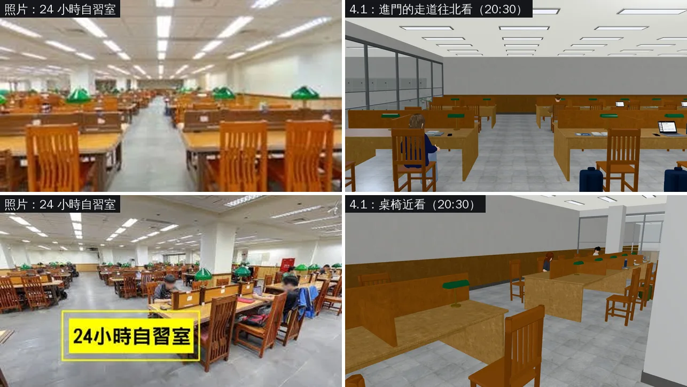
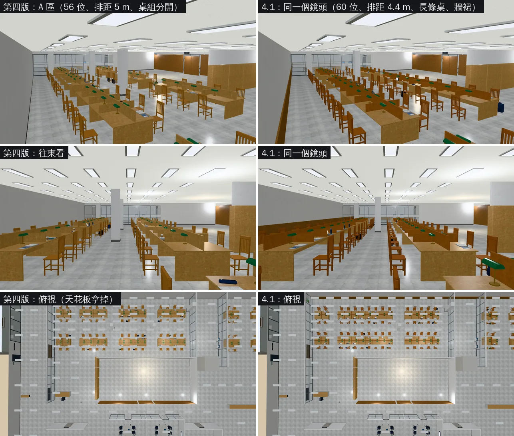
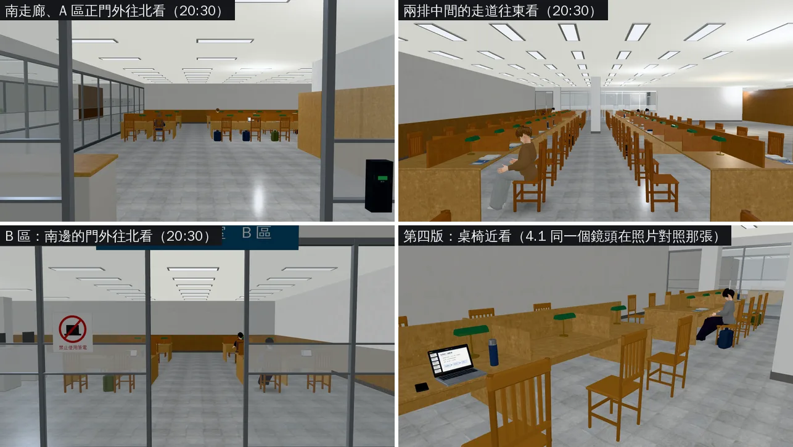

# 總圖 B1 第 4.1 版：長條桌、牆裙、椅子和隔板加深、排距 4.4 m（LAWWW2〔帳號 A〕2026-11-02）

- **起因**：
  - 使用者 18:1x 直接對 LAWWW2 說「自習室的桌椅太擠了」「桌子和進門的門應該是平行的」→ 第四版（`54d6e41c1`，已交件，LAWWW 已整合進 int/next1102）。
  - BB 驗收第四版（`BB_242`，企劃分支 `claude/story-planning`）：配置方向 ACCEPT，美術要做 4.1：
    - ① 排距；
    - ② 同一排的桌子連起來；
    - ③ 木頭牆裙；
    - ④ 椅子和隔板加深、椅子厚一點；
    - ⑤ 白色方柱保留；
    - ⑥ 烘焙之後再做。
  - **排距**：使用者 18:4x 直接對 LAWWW 說「B1 排距維持 4.4 m 就好」。
    - LAWWW 記在 UA-LAWWW-1102-26；BB 原本建議的 3.2～3.5 m 已經撤回（BB_242 更正那一節）。
    - LAWWW2 的紀錄：`docs/handoff/user_asks_LAWWW2.json` UA-LAWWW2-1102-10。
- **狀態**：`READY_FOR_ART_REVIEW`。
  - BB 用照片對照給使用者看，使用者點頭才標 ART_APPROVED（BB_242「給使用者看的時候」）。
  - 截圖是 Playwright＋SwiftShader（電腦 1280×720），不是實機。讀檔放位置、藏玩家、藏路人（15:00 那三張）是 [捷徑]。

## 一、怎麼套（給 LAWWW）

- **patch**：二選一，改的都是同樣 4 個檔：
  - `src/data/library_b1_layout.js`
  - `src/data/characters.js`（兩個 seatAt）
  - `tests/library_b1_unit.js`
  - `tests/aa497_supporting_unit.js`
- **已經整合第四版**：用 `docs/art-rebuild/second_ai/patches/library_b1_v41_incr_1102.patch`（第四版 → 4.1）。
  - `48918ca20`＋第四版 patch 上 `git apply --check` 乾淨。
- **還沒整合第四版**：用 `docs/art-rebuild/second_ai/patches/library_b1_v41_1102.patch`（`3e6855649` → 4.1）。
  - `3e6855649`、`48918ca20` 上都 `git apply --check` 乾淨。
- **二進位**（從我的分支 `claude/second-ai-env-art` 拿，蓋掉第四版的）：
  - `assets/models/env/second_ai/library_b1.glb`
  - `assets/models/env/second_ai/library_b1.json`
  - `assets/models/env/second_ai/library_b1.layout.json`
- `src/library_b1_3d.js`、`src/b1story3d.js` 不用改：劇情讀 `spots` 的名字；國考讀書會（討論室 2）沒動。

## 二、照片對照（左＝使用者的照片，右＝遊戲裡，晚上 20:30 有同學）

## 三、第四版 vs 4.1（同一個鏡頭）

## 四、新的鏡頭（20:30，背景同學坐在新座位上）

## 五、改了什麼（`tools/blender/env_second/library_b1.py` 的 build2）

- **排距（BB_242 ①，使用者 18:4x 決定）**：5 m → 4.4 m。
  - 背靠背的兩排椅子：2.64 m → 2.04 m。第三版是 1.64 m，使用者嫌擠的就是第三版。
  - 北邊那一排的椅子到北牆約 1.9 m。
  - A 區兩排在 z −9.9、−5.5；B 區兩排在 z −9.8、−5.4。
- **長條桌（BB_242 ②）**：同一排的桌子連起來，位子之間只有矮隔板。
  - 只在兩個地方斷開，都是走道：
    - 進門那條南北向走道：x −13.0～−11.4，正對 A 區正門；
    - 中間一條南北向走道：x −1.8～0.2，方柱在這裡。
  - 第四版每排是 4 組桌子，組和組之間空 2 m。
- **座位**：自習室 72 → 76。
  - A 區 56 → 60（每一排每一邊 2＋8＋5 位）；B 區照舊 16。
  - 討論室照舊各 6 個；全部 86 → 90（另有 2 個長椅）。
- **方柱（BB_242 ⑤ 保留）**：
  - A 區中間：第四版 2 根（x −5.6、1.2）→ 1 根（x −0.8，在中間走道和兩排中間走道交會的地方，四邊各留 0.75 m 以上）。
  - 桌子連起來以後，原本那兩根的位置會落在桌面上。
  - 東邊靠電梯走道的那根照舊。
- **牆裙（BB_242 ③）**：
  - 北牆、B 區東牆、A 區南邊兩道隔間牆加一圈木頭牆裙：0.12～1.0 m，上緣一條壓條。
  - 木頭用和桌子同一種細紋木頭，深一點；花崗石踢腳照舊。
  - 牆裙以上的牆白一點（#ecebe6 → #f3f2ee）。
- **椅子、隔板（BB_242 ④）**：
  - 椅子：蜂蜜橘再深一點（#b0763a → #a55f2a，腳 #98632f → #8a4d21），料加厚：
    - 前腳 1.7 → 2.3 cm，後腳 1.8 → 2.5 cm；
    - 椅背直條 2.2 → 3.0 cm；
    - 橫撐、椅背橫木也加厚。
  - 桌上的隔板換成獨立的蜂蜜橘木頭材質（#a8652e）；第四版和桌面同一個淺色。
- **模型大小**：
  - 三角形（畫出來的）69,840 → 72,520；
  - 材質 28 → 29（多了隔板）；
  - GLB 2.77 MB（差不到 4 KB）。

## 六、座標有改的（第四版 → 4.1）

| 用途 | 第四版 | 4.1 |
|---|---|---|
| spots.study_night（期末前的夜，柏翰；AA_399 第 2 節） | (−0.4, −6.38) | (−2.4, −6.68)：南邊那一排長條桌北側、靠中間南北向走道 |
| 芯慈 seatAt（characters.js，AA_497 2-3「在 B1 自習室收書」） | (−2.8, −9.02) | (−3.6, −8.72)：北邊那一排南側 |
| 明軒 seatAt（characters.js，AA_497 4-1「B1 自習室最角落」） | (6.4, −11.38) | (5.6, −11.08)：北邊那一排北側最東邊 |

- 門（A 區正門 (−12, 5.0)、B 區的門 (17.5, −1.0)）、study_door、「看」的點都沒動。
- 舊存檔：這一版沒有另外測（B1 沒有舊存檔的測試）。存檔的位置如果落在新的桌子上，讀檔時走引擎原本的 unstick（找最近的空地）。

## 七、測試

- **環境**：`scratchpad/devwt_p`＝`3e6855649`＋4.1 patch＋4.1 GLB（layout md5 `407ac5ff09ce`、GLB md5 `f9146f54f5ee`）。
- **Node**：9 支 ALL PASS（11-02 18:4x）。
  - library_b1_unit、b1story_unit、d118_b1_unit、aa497_supporting_unit、aa499_501_pool_unit、aa527_528_unit、library_upper_unit、phone_unify_unit、windowless_night_unit。
- **`library_b1_unit` 的改動**：
  - 座位數 72 → 76。
  - 第 8 項「背靠背的兩排椅子」門檻：2.3 m → 2.0 m。
    - 原因：使用者 18:4x 決定排距 4.4 m（UA-LAWWW-1102-26），4.4 m 的背靠背是 2.04 m。
    - 不是為了讓測試過才放寬：使用者嫌擠的第三版是 1.64 m，照樣 FAIL。
    - 「桌子和正門平行」那一項沒改：第三版的配置照樣 FAIL，4.1 PASS。
- **`reachability_all`（只跑 library_b1，引擎真的走一遍）**：ALL PASS（18:53）。
  - 109 個互動點都站得到、按鈕會出現、走得到。
  - 「坐下」走到椅子旁邊的點都走得到。
  - 4 個位子這個時段有路人坐著，設計上不能坐（INFO，不算失敗）。
  - 沒有 JS 例外。
- **配置檢查**（library_b1.py 的 navcheck）：每個座位的走近點、互動點、spot 都從樓梯間走得到，沒有問題。
- **截圖**：8 張，沒有 JS 例外。
- **沒跑**：B1 沒有專用的瀏覽器流程測試（tests/*.py 沒有寫到 library_b1）；手機實機。

## 八、還沒做的、限制

- **牆的顏色**：照片牆面很白、很亮；遊戲裡（尤其晚上）牆裙以上看起來偏灰。
  - 原因是光：B1 還沒烘光照，只有即時光，燈之間的牆面暗。
  - BB_242 ⑥：之後排到使用者的電腦用顯示卡烘（等 CC 加好 blender 工作）。
- **長度**：照片的長條桌一路延伸到很遠；遊戲的 A 區東西長約 24 m，桌子在中間走道斷開一次。
- 沒跑手機實機。
