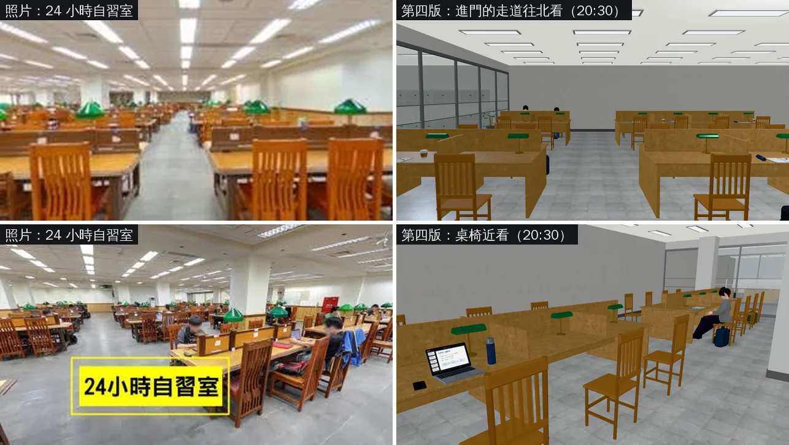
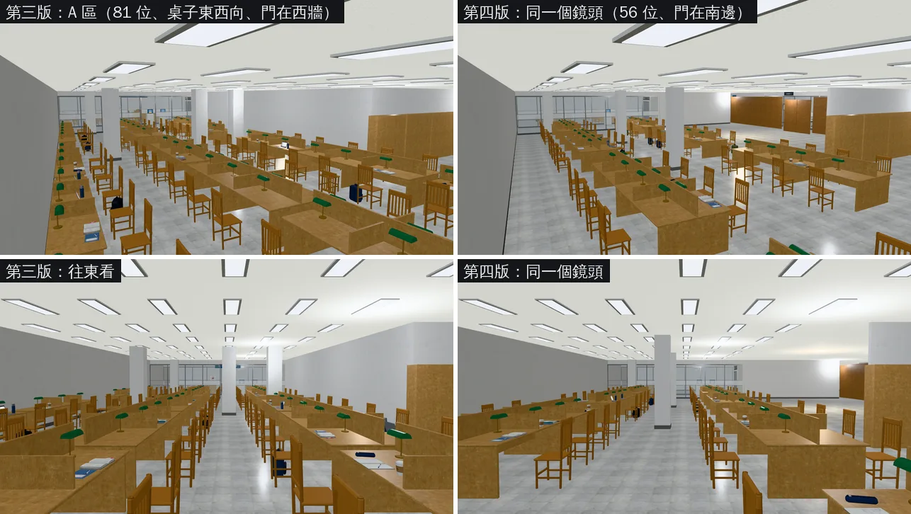
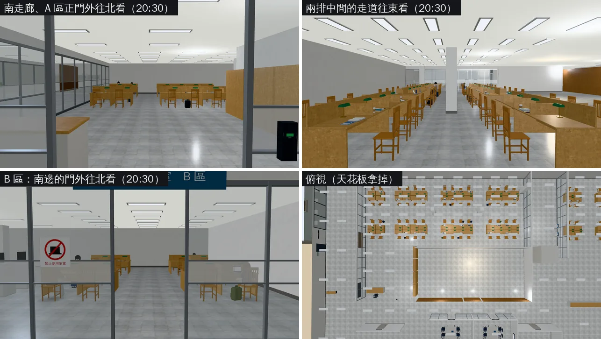

# 總圖 B1 第四版：自習室寬敞、桌子和進門的門平行（LAWWW2〔帳號 A〕2026-11-02）

- **起因**：使用者 11-02 18:1x 看了第三版截圖，直接對 LAWWW2 說：
  - 「自習室的桌椅太擠了吧我們的自習室我覺得很寬敞耶」
  - 「自習室桌椅的方向跟進門應該是就是跟進門的門應該是平行的，不是垂直」
  - 紀錄：`docs/handoff/user_asks_LAWWW2.json` UA-LAWWW2-1102-10。
- **第三版**（BB_236 ①②③：細紋淺橡木、高背直條實木椅、桌上小物＋背包）的材質、椅子、小物都沿用。第三版沒有交件，直接換成這一版。
- **狀態**：`READY_FOR_ART_REVIEW`。
  - 場景美術由 BB 驗收（D120）。
  - 截圖是 Playwright＋SwiftShader（電腦 1280×720），不是實機。讀檔放位置、藏玩家、藏路人（15:00 那兩張）是 [捷徑]。

## 一、怎麼套（給 LAWWW）

- **patch**：`docs/art-rebuild/second_ai/patches/library_b1_v4_1102.patch`。
  - 改 4 個檔：`src/data/library_b1_layout.js`、`src/data/characters.js`（兩個 seatAt）、`tests/library_b1_unit.js`、`tests/aa497_supporting_unit.js`。
  - 基準：int/next1102 `3e6855649`、`48918ca20`（LAWWW 18:14 說的最新 head）都 `git apply --check` 乾淨。
- **二進位**（從我的分支 `claude/second-ai-env-art` 拿）：
  - `assets/models/env/second_ai/library_b1.glb`
  - `assets/models/env/second_ai/library_b1.json`
  - `assets/models/env/second_ai/library_b1.layout.json`
- `src/library_b1_3d.js`、`src/b1story3d.js` 不用改：劇情讀 `spots` 的名字，國考讀書會（討論室 2）沒動。

## 二、照片對照（左＝使用者的照片，右＝遊戲裡）

## 三、第三版 vs 第四版（同一個鏡頭）

## 四、新的鏡頭（20:30，背景同學坐在新座位上）

## 五、改了什麼（`tools/blender/env_second/library_b1.py` 的 build2）

- **A 區正門**：
  - 從西牆（門在南北向的牆上，進門面向東）搬到**西段南牆**（x −12、z 5）；從南走廊刷卡進門、面向北。
  - 照使用者的 B1 平面圖：A 區入口在西翼南端（服務台旁邊）。
  - 西牆、A 區東門（往電梯走道）都關起來，A 區只從南邊正門進出。
  - 門牌「24 小時自習室 A 區」、刷卡機跟著搬到正門。
- **B 區的門**：從西牆（電梯走道）搬到南牆（x 17.5、z −1）；從影印中心那一邊進來、面向北。門牌、「禁止使用筆電」跟著搬。
- **桌子**：東西向，和正門平行。
  - A 區兩排雙面長桌，排距 5 m：
    - 背靠背的兩排椅子 2.64 m（第三版 1.64 m）；
    - 靠北牆、靠南牆的走道各約 1.3 m。
  - 一張桌子每邊四個位子（1.2 m 一位），桌子之間 2 m 的走道。
  - 進門那條南北向走道（x −13.0～−11.4）正對正門，兩邊都是桌子（照片 room_a 的樣子）。
  - 西段只留服務台、參考書架，進門的地方空出來。
  - 第三版：靠北牆單面一排＋兩排雙面，桌子之間只隔 0.3 m（幾乎連成一整排）。
- **座位**：自習室 101 → 72（A 區 81 → 56、B 區 20 → 16）；討論室照舊各 6 個。
- **方柱**：搬到桌子之間的走道和兩排中間的走道交會的地方（柱子四邊各留 0.7 m 以上）。

## 六、座標有改的

| 用途 | 第二、三版 | 第四版 |
|---|---|---|
| A 區正門（rooms[0].door） | (−16, 1.2) 西牆，axis z | (−12, 5.0) 西段南牆，axis x |
| B 區的門（rooms[2].door） | (13, −6.9) 西牆，axis z | (17.5, −1.0) 南牆，axis x |
| spots.study_door（刷卡進門） | (−15.1, 1.2) 面向東 | (−12, 4.1) 面向北 |
| spots.study_night（期末前的夜，柏翰；AA_399 第 2 節） | (−0.25, −6.08) | (−0.4, −6.38)：南邊那一排北側、靠走道 |
| 芯慈 seatAt（characters.js，AA_497 2-3「在 B1 自習室收書」） | (−3.2, −7.77) | (−2.8, −9.02) |
| 明軒 seatAt（characters.js，AA_497 4-1「B1 自習室最角落」） | (6.6, −7.77) | (6.4, −11.38)：北邊那一排最東邊 |
| 「看」study_door／studyb_door | A 西牆外、B 西牆外 | 兩個新門的外面 |

## 七、測試

- **環境**：`scratchpad/devwt_p`＝`3e6855649`＋這個 patch＋第四版 GLB。
- **Node**：9 支 ALL PASS。
  - library_b1_unit、b1story_unit、d118_b1_unit、aa497_supporting_unit、aa499_501_pool_unit、aa527_528_unit、library_upper_unit、phone_unify_unit、windowless_night_unit。
- **`library_b1_unit` 新的第 8 項**（照使用者這次的要求）：
  - 「自習室 A、B 區的桌子都和正門平行」；
  - 「背靠背的兩排椅子至少 2.3 m」。
  - 第三版的配置兩項都 FAIL（門 axis z；1.64 m），第四版 PASS。
  - 座位數那一項 101 → 72（使用者要的「寬敞」，不是放寬標準）。
- **配置檢查**（library_b1.py 的 navcheck）：每個座位的走近點、互動點、spot 都從樓梯間走得到，沒有問題。
- **截圖**：8 張，沒有 JS 例外（見上面）。
- **還沒跑**：
  - `reachability_all`（只跑 library_b1，引擎真的走一遍）：排在雲端佇列，跑完補；
  - B1 沒有專用的瀏覽器流程測試（tests/*.py 沒有寫到 library_b1）。
  - 這兩項也可以交給 BB／CC 用使用者的電腦跑（使用者決定中，UA-LAWWW2-1102-11）。

## 八、還沒做的、限制

- BB_236 ④ 牆面（公告、標示、出風口、置物櫃）、⑤ 光照烘焙：還沒做。
  - 照片窗台以下有一圈木頭牆裙，遊戲裡是灰牆。
- 照片的隔板、椅子是比較深的柚木色，遊戲裡和桌面同一個淺色。
- 兩排中間走道正中的白色方柱（結構柱）：看起來有點擋路，BB 覺得不好可以拿掉或搬到牆邊。
- 沒跑手機實機。
