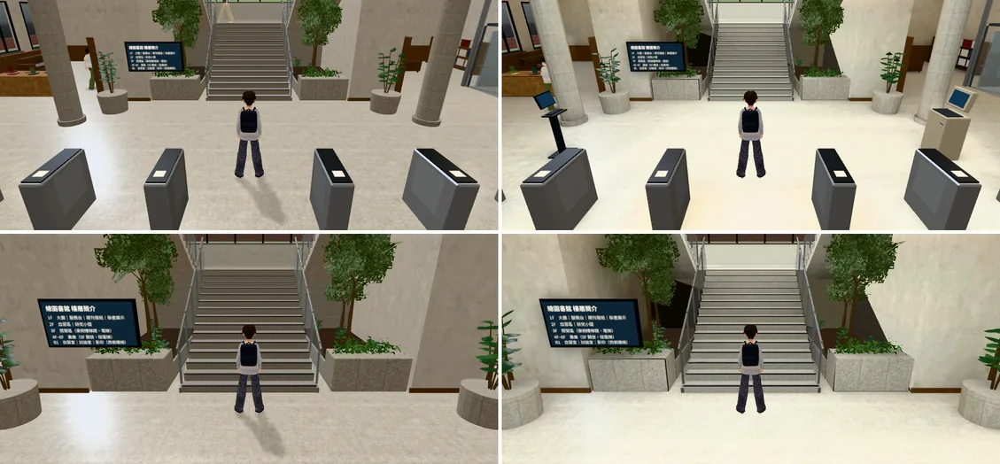
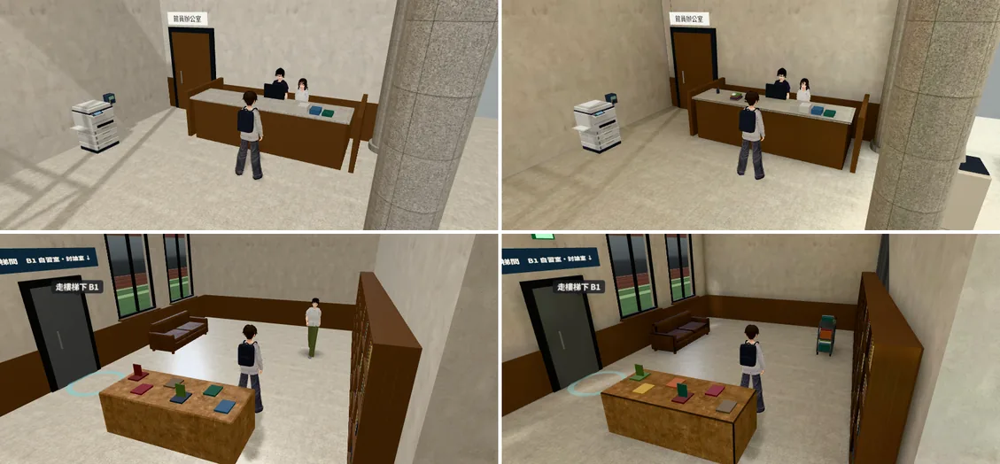
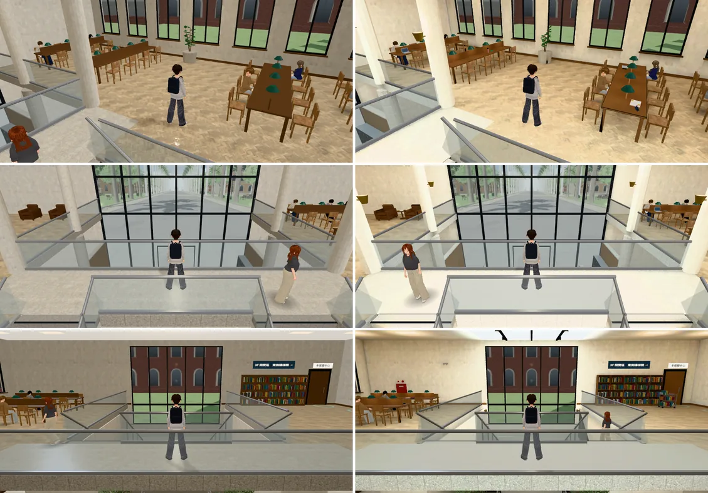
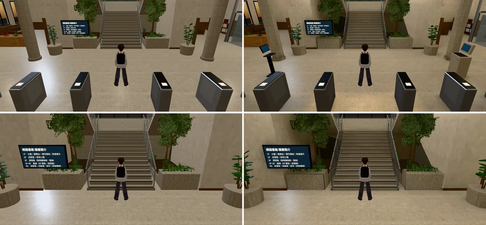
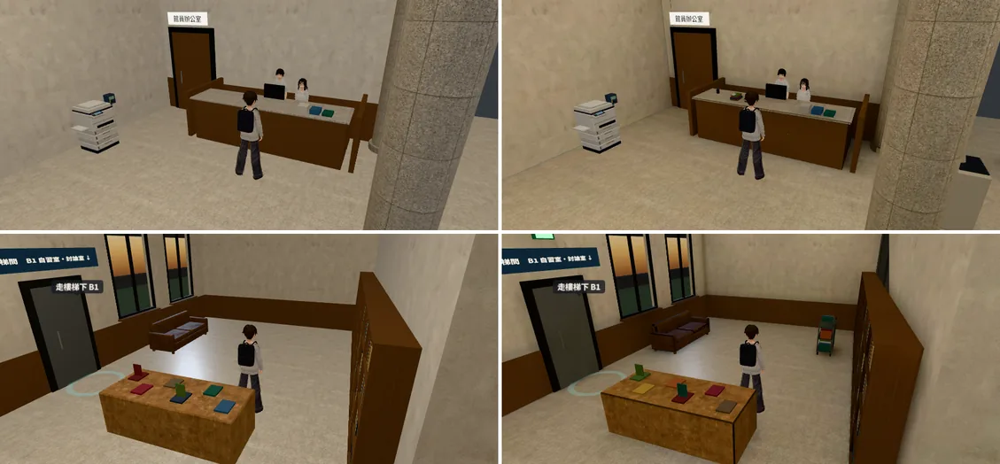
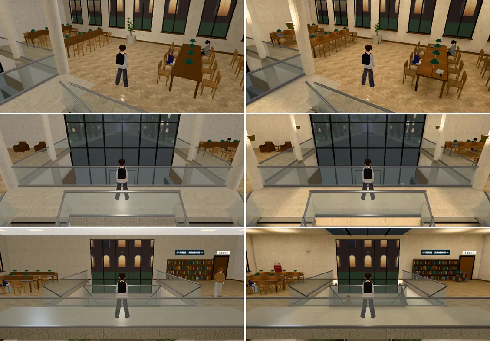
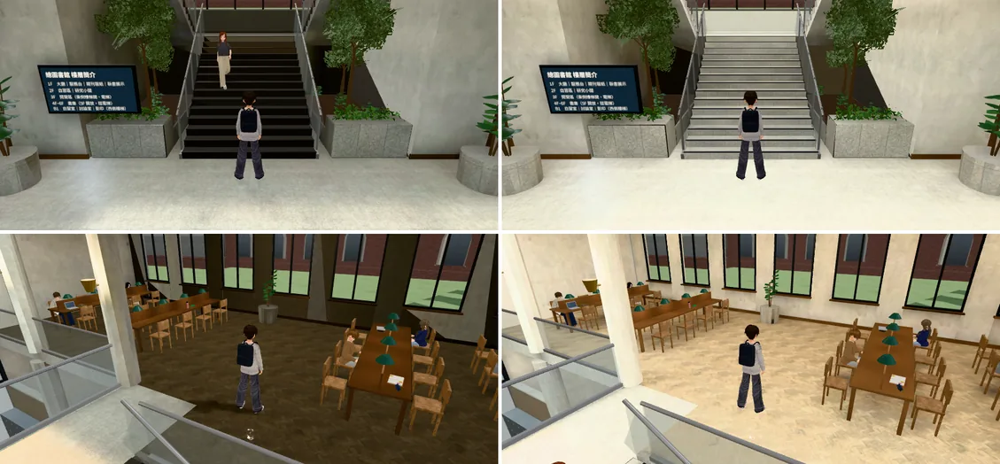

# 總圖大廳（一樓大廳、中庭、帝國式大樓梯、二樓自習區與東翼）：擺設＋光照烘焙（LIB-HALL-LM-1028；LAWWW2-C 2026-10-28）

- **起因**：使用者 10-28 P0（UA-LAWWW2-1028-01）「校內建築 空間內配置……廉價手遊感」。
  - 檢討報告 `INTERIOR_AAA_REVIEW_1028.md` 第 5 節：201 → 霖澤館大廳 → 其他。這是第七包。
  - 總圖是讀書、借書，和小安「總圖的下午」的地方。
- **改前的問題**（截圖左邊）：
  - 白天、晚上一樣亮，整片平均，看不出光從哪裡來（天窗、窗、燈）。
  - 大廳、二樓自習區空空的：沒有查詢電腦、借書機、傘架、飲水機，桌上沒有人用過的痕跡。
- **做法**：和霖澤館大廳、萬才館、男一舍門廳同一套（Blender 建模 → Cycles 烘焙白天、晚上兩張光照貼圖 → 遊戲照時段換）。
  - 程式只多一行（`library3d.js` 的 `prop`）；光照的接法不用改（`library3d.js` 也走 `B3.attachFormal`）。
  - 晚上天窗變暗要 `rt_night_1028.patch`（RT-NIGHT-1028，另一包）。沒套也能用，只是晚上天窗照樣亮。
- **狀態**：`READY_FOR_ART_REVIEW`。建築、場景只有使用者能標 `ART_APPROVED`。
- **怎麼套**（開發分支 `68e50d33f` 上 `git apply --check` 通過；LAWWW2-B 10-30 在最新開發 `c76d0cb69`（v9.10.13 發布樹）上再試一次也通過）：
  1. 程式：`git apply docs/art-rebuild/second_ai/patches/library_hall_lm_1028.patch`：
     - `src/data/library_layout.js`：十筆地上的擺設（`prop`）。
     - `src/library3d.js`：家具多一種 `prop`（備用方塊＋導航阻擋），和 `dorm3d.js`、`building3d.js` 一樣。
     - `tools/blender/library_interior.py`：模型（見下面「改了什麼」）。
     - `tests/library_hall_lightmap_unit.js`：新的測試。
     - `tests/singleside_interiors_unit.js`：拿掉「總圖樓梯踏面有反面」那一項（大樓梯改實心石材，見「測試」；LAWWW2-B 10-30 加進 patch）。
     - `LICENSES.md`：總圖書館大廳那一列。
  2. 二進位檔和工具（`git checkout <這包的 commit> -- `＋下面的檔）：
     - `assets/models/env/library_interior.glb`、`library_interior_lm_day.webp`、`library_interior_lm_night.webp`
     - `tools/blender/env_second/lightbake/`：`bake_room.py`、`bake_library_hall.sh`、`lm_probe.py`、`library_interior_lm.json`
- **截圖**：遊戲內、玩家鏡頭，手機橫向 844×390，Playwright＋SwiftShader 模擬，**不是 iPhone 實機**。讀檔進總圖、人放到指定位置是 [捷徑]。
  - 左：開發分支 `68e50d33f`。右：同一個 commit＋這包＋`rt_night_1028.patch`。

## 同角度對照

白天 14:00：

晚上 20:30：

- 看得到的差別：
  - 白天：天光從兩塊天窗下來，大廳、大樓梯、二樓連廊比兩翼亮；一樓兩翼靠窗那邊亮、往裡面暗一點；家具底下、牆角有影子。
  - 晚上：天窗是暗的（開發分支整晚發白光）；整體偏暖、比白天暗；燈下面亮、燈和燈中間暗一點；二樓自習區的長桌、檯燈一圈一圈的光。
  - 二樓自習區的人字拼木地板白天、晚上都是淺色（不是深色木地板，使用者 10-23 規則）。
  - 擺設：查詢電腦、自助借書機、傘架、雨傘套袋機、還書車、飲水機、消防栓箱、滅火器、出口燈、二樓桌上的筆電和課本（下面「擺設」）。

## 第一次校正烘焙抓到的三個錯（都已經修掉）

第一次校正烘焙（左）：大樓梯的踏面全黑，二樓自習區的淺色木地板烘出來像深色木地板。右：這包。

1. **疊在一起、方向相反的面讓整面烘成全黑**（`bake_room.py` 修）。
   - 總圖大廳的模型匯出時有一步「補反面」（`lib2.single_side`，PERF-SINGLESIDE-GLB-1025：材質改單面以後，開口的零件複製一份反過來的面）。
   - 樓板、木地板、天花板、幾面牆、舊的樓梯踏面都被補了反面，反面和正面在同一個位置；烘焙時光線一出發就打到反面，整面拿到 0。
   - 改法：烘焙以前拿掉這種反面（這次 2,342 個三角形）。有光照貼圖的物件用不到反面，而且 `lm_fix_hidden.py` 本來就會把它們併掉，所以輸出的 GLB 三角形數不變，只是烘對了。
   - 之前交的六間（201、202、霖澤館大廳、萬才館、多功能教室、男一舍門廳）的模型都沒有用 `single_side`，不受影響。
2. **天窗的發光強度沒有套上去**（`bake_room.py` 修）。
   - `--emit`、`--dayemit` 原本只套在「要烘的物件」的材質上；天窗是發光面，在 `--nolm`（不烘、照樣發光）裡，所以白天沒有照設定加強、晚上也沒有關掉。
   - 結果晚上的光照貼圖裡天窗照樣發光：二樓連廊晚上比大廳還亮。改成所有網格的材質都套。
3. **燈和發光面在同一個平面，光被自己的燈罩擋住**（`bake_library_hall.sh` 修）。二樓兩翼屋頂的燈板放在 9.6 m＝屋頂、燈罩的高度。改成比發光面低 1～2 cm。
- 怎麼防止再發生：`lm_probe.py`（新的）在光照貼圖上量九個重點位置（大廳、樓梯踏面、平台、兩翼、二樓自習區、連廊、一樓天花板）的亮度，低於下限就 FAIL。
  - `bake_library_hall.sh` 烘完自己跑：這包 ALL PASS；拿第一次校正的全黑版本跑是 7 項 FAIL。
  - 光看 log 的平均亮度看不出來（第一次校正的平均亮度 0.05，看起來只是偏暗），是拍了遊戲截圖才發現。

## 改了什麼（`tools/blender/library_interior.py`）

- **大樓梯上方的中庭天窗**：原本只有門廳上方有天窗，大樓梯上方是整片屋頂，烘焙以後踏面很暗。
  - 天窗兩側的樑上各三盞筒燈，門廳天窗最外側兩根樑上也各三盞：晚上天窗暗了，靠這十二盞往下照閘門、大樓梯、平台。
  - 燈裝在屋頂，不用吊燈：吊燈會擋住二樓連廊上的跟隨鏡頭。
- **大樓梯中間那一跑**：每一階只做一塊 17 cm＋2 cm 厚的石材，底下一塊實心的斜頂量體。
  - 原本每一階從地板疊到踏面，正面一大半夾在下一階後面，光照貼圖的像素一半分給看不到的地方，踏面每階不到兩個像素。
  - 走起來一樣：導航、樓梯高度是 `library3d.js` 照 `library_layout.js` 算的，沒有動。
- **燈**（`bake_library_hall.sh`，校正六次）：二樓兩翼燈板 20 W×16、一樓兩翼與連廊下的崁燈 14 W×24、天窗樑上的筒燈 22 W×12、二樓長桌檯燈 3 W×16、中庭柱子的黃銅壁燈 28 W×4（往上打）、平台北牆的壁燈 15 W×2；天窗白天發光 1.0；晚上那一張偏暖（白平衡 1.0／0.92／0.80）。
- 晚上天窗變暗：GLB 的 `extras.lightmap.dayEmit` 寫了 `lb_skylight`，遊戲照時段調暗要 `rt_night_1028.patch`（`Z3.roomLightmap`）。

## 擺設（照「誰在用、剛發生什麼」）

- 門廳：下雨天的傘架、雨傘套袋機（大門兩邊）。
- 一樓大廳：館藏查詢電腦（閘門裡面西側）、自助借書機（東側，借好書往南出閘門）、服務台上剛還回來的書。
- 一樓西側：館員推著還書車，整理到一半要上架的書。
- 東側電梯旁：飲水機。
- 消防：一樓、二樓北牆的消防栓箱、滅火器、出口燈、緊急照明。
- 二樓自習區：有人去上廁所，東西留在桌上（筆電、課本、水壺、筆袋、便利貼）。只放在玩家不能坐的那一半座位前面；小安「總圖的下午」那兩個位子不放東西。
- 二樓東側：還書車，兩張單人沙發中間的小茶几（雜誌、報紙）。
- 地上的十件在 `library_layout.js` 有一筆 `prop`：導航擋住、有備用方塊。模型裡沒有字（D77），螢幕是暗的。

## 效能（LAWWW2-B 10-30 收尾補量）

遊戲內、白天 15:00，拿掉路人（`renderer.info`＋每格 4×5 秒 fps；`perf_variants.py`，SwiftShader 模擬，不是手機實機）。改前＝開發 `c76d0cb69`；改後＝同一個 commit＋這包＋`rt_night_1028.patch`；最後再量一次改前看機器有沒有變慢：

| 鏡頭 | fps 改前／**改後**／再量改前 | draw call 改前 → 改後 | 三角形 改前 → 改後 |
|---|---|---|---|
| 一樓 入口往裡面 | 2.85／**2.7**／2.8 | 189 → 182 | 13.6 萬 → 14.0 萬 |
| 一樓 回頭（往大門） | 5.25／**4.75**／4.8 | 107 → 108 | 12.0 萬 → 12.9 萬 |
| 二樓自習區 方向 1 | 2.7／**3.1**／2.85 | 119 → 121 | 12.8 萬 → 13.8 萬 |
| 二樓自習區 方向 2 | 2.0／**2.5**／2.35 | 156 → 161 | 13.1 萬 → 14.1 萬 |

- fps 落在兩次改前之間的起伏裡，看不出變慢；draw call −4～+3%；三角形多 3～8%（新擺設）。
- 模型：5,717,612 → 6,921,936 bytes（第二套 UV、後處理以後有些頂點分開）；網格 88 → 87；材質 35 → 31；三角形 60,098 → 63,556。
- 光照貼圖兩張 WebP（1024 × 1024）：白天 125 KB、晚上 116 KB。

## 光照貼圖的排版（`uv_fill.py`）

- 填滿率 **28.7%**，接光照貼圖的三角形 8,622 個（39 個網格有第二套 UV）。
- 主要的面每公尺的像素：一樓地板 9、二樓木地板 9、樓板（從一樓往上看）6、大樓梯 9、牆 5～7、天花板 3。
- 沒有 uv1 的網格是故意的：發光面、玻璃、樹葉、黃銅、窗框、頂點色的小東西（晚上靠 `rt_night_1028.patch` 跟著暗）。

## 測試

- 新 `tests/library_hall_lightmap_unit.js`（這包）、`tests/room_rtnight_unit.js`（RT-NIGHT）：開發 `c76d0cb69`＋兩份 patch＋三個二進位檔 ALL PASS。
- **`tests/singleside_interiors_unit.js` 第 2 項要跟著改**（這個 patch 裡已經改了）：原本檢查「總圖樓梯踏面有反面」，這包大樓梯改成每階一塊實心石材、烘焙前也拿掉了有光照貼圖物件的反面，踏面現在是封閉的零件（每條邊兩個面），不需要反面。只拿掉那一個檢查，其他（葉片卡、社科圖天井、便利商店牆面）照舊。
- 開發 `c76d0cb69`＋兩份 patch＋三個二進位檔：`tests/` **725 支 Node 測試 0 失敗**。
- 「進兩次」（`shots/lm_reentry.py`）：見下。
- 沒跑：`flow_library_floors.py`、`flow_library_scene.py`（瀏覽器流程）、整套回歸、iPhone 實機。

## 缺點、還沒做到的

- **光照貼圖解析度偏低**：填滿率 28.7%、地板每公尺 9 個像素（男一舍門廳 52.3%、18 px/m；檢討報告第 7 節的目標是 50%）。總圖大廳面積大（一樓地板 885 m²），一張 1024 分不夠：家具底下、牆角的影子比較糊，近看地板的光有一點塊狀。之後可以分兩張（一樓、二樓各一張）或改 2048——貼圖大 4 倍，要先量手機的記憶體。
- 晚上天窗變暗要和 `rt_night_1028.patch` 一起套；只套這包，晚上天窗照樣亮（和開發分支原本一樣）。
- 三樓閱覽室（`library` 區域）沒有動，這包只有一樓大廳、中庭、二樓自習區與東翼。
- 西南角樓梯 `hdownS` 有 28 條邊不是封閉的（貼牆的那一側），單面看不到，烘焙也正常；記在這裡。

