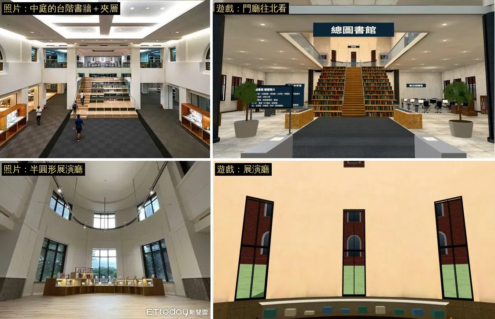
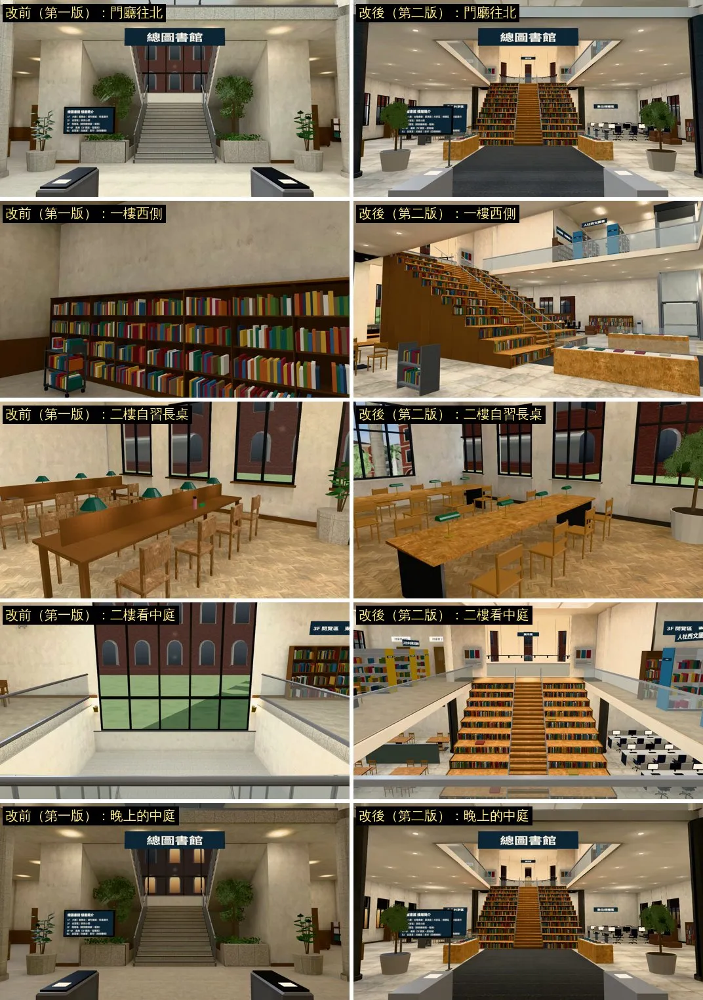
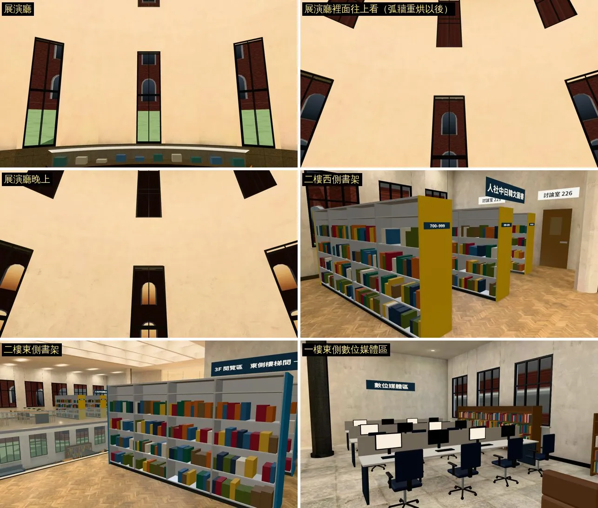
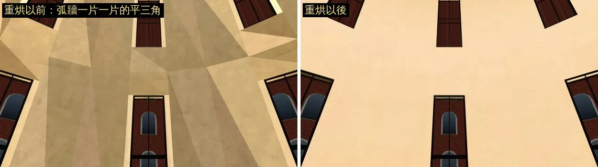

# 總圖大廳第二版：一樓中庭台階書牆、展演廳、多元共享區、數位媒體區；二樓書架、討論室、展示區（LIB-INTERIOR-1102 的 1F／2F；LAWWW2〔帳號 A〕2026-11-02）

- **起因（使用者直接對 LAWWW2 說）**：
  - 08:58「舊有的空間配置 能用的就沿用 按造實際配置安排」，附鳥瞰圖和 1F／2F／B1／3F 平面圖（原圖：`docs/art-rebuild/second_ai/ref/lib1102_user/`）；
  - 09:01 一樓兩張照片：中庭的木頭台階書牆＋夾層、半圓形展演廳；
  - 紀錄：`docs/handoff/user_asks_LAWWW2.json` UA-LAWWW2-1102-04、-05。
- **LAWWW 11:14 ACK 做法**：
  - version 1 留著當備用；
  - 舊存檔站在舊位置的要能 unstick；
  - 出生點、劇情站位要對，reachability_all 一起跑。
- **3F**：這一包沒有動 3F 閱覽區（`library` 區域）。
  - **更正**：使用者 08:58 其實有給 3F 平面圖（5 張裡的第 5 張），之前寫「沒有」是我漏看了。
  - 原圖現在存在 `docs/art-rebuild/second_ai/ref/lib1102_user/`。
  - 3F 照平面圖重排另開一項 LIB-3F-1102。
- **狀態**：`READY_FOR_ART_REVIEW`。
  - 場景美術由 BB 驗收（D120）。
  - 截圖是 Playwright＋SwiftShader（電腦 1280×720），不是實機。

## 一、怎麼套（給 LAWWW）

1. **二進位**（從我的分支 `claude/second-ai-env-art` 拿，路徑照抄）：
   - `assets/models/env/second_ai/library_hall_v2.glb`（有光照貼圖用的第二套 UV、`extras.lightmap`）；
   - `assets/models/env/second_ai/library_hall_v2_lm_day.webp`、`library_hall_v2_lm_night.webp`；
   - `tools/blender/env_second/lightbake/library_hall_v2_lm.json`（烘焙的紀錄，遊戲不讀）。
   - manifest 的 key `bldg.library_hall_v2` 由 `src/library_hall_v2.js` 自己登記，`src/assets3d.js` 不用改。
2. **patch**：`docs/art-rebuild/second_ai/patches/library_hall_v2_1102.patch`。
   - `b1b249873`、`int/next1102` 的 `3e6855649` 都 `git apply --check` 乾淨。
   - 動到的檔：
     - `src/library_hall_v2.js`（新）：第二版的區域。
     - `src/data/library_layout.js`：version 2。由 `tools/blender/env_second/library_hall_v2_layout.py` 從第一版產生，不要手改。
     - `src/library3d.js`：layout 是 version 2、而且 `LBV2` 有載入，才改走第二版；另外把 `buildFurniture`、`viewOf`、`outsideTex` 給第二版共用。
     - `index.html`：多載 `src/library_hall_v2.js`。
     - `src/story3d.js`：上下樓的路人，東翼那一點 (8,−5) → (8,−3.4)。原本那點在第二版的西文書架上。
     - tests（62 支）：
       - 載入檔案清單有列 `src/library3d.js` 的 60 支，加上 `src/library_hall_v2.js`；
       - `library_hall_cam_core_unit`、`library_hall_lightmap_unit`、`nav_buildings_unit`、`flow_library_floors`、`flow_library_scene` 改成認得第二版；
       - 新增 `library_hall_v2_oldsave_unit`。
3. **要退回第一版**：把 `src/data/library_layout.js` 換回 base 的版本（version 1）就好。
   - `library_hall_v2.js` 可以留著；layout 是 version 1 時不會用到它，`src/library3d.js` 照舊建第一版。
   - 二進位 `library_hall.glb`（第一版）沒有動。

## 二、照片、平面圖對照

- **中庭（照片 1）**：
  - 一樣的：
    - 中間是走的樓梯，兩側是坐的大階梯，每一階的立面是書架；
    - 二樓夾層有玻璃欄杆；
    - 深灰色的走道，兩旁有亮燈的木頭展示櫃。
  - 不一樣的：
    - 照片的展示櫃嵌在兩側牆邊（夾層下面），遊戲放在台階前、地毯兩旁；
    - 照片的走道是深灰方格地磚，遊戲是深灰地毯；
    - 照片的天花板是一整塊內凹的燈槽，遊戲是方格天花板、每格一片燈。
- **展演廳（照片 2）**：
  - 一樣的：半圓、挑高、一圈高窗、深色石材牆裙、淺色木地板、弧形展示櫃。
  - **還沒做到照片那樣**：
    - 牆的顏色：遊戲偏米色（光照貼圖用了偏暖的白平衡，第四節），照片是白色、有石材分割線。
    - 牆面的層次：照片上面有第二層的弧形環廊、一圈軌道燈、一排拱窗；遊戲只有一排高窗。
    - 窗外：遊戲是大廳共用的紅磚樓窗景，照片是樹。
    - 展示櫃：遊戲裡的展品是色塊（簡化），照片是書和展板。
    - 大小：遊戲的展演廳半徑 5.4 m（受大廳寬 24 m 限制），照片看起來比較大。
  - 這張遊戲截圖的鏡頭在展演廳開口前面，比照片近，而且有點往上看；從大廳拍的廣角那張排在背景重拍（跑完補）。
- **平面圖**：俯視圖重拍中（跑完補 `plans_vs_game.webp`）。
  - 第一次拍到的是天花板（`L0_ceil`、`L1_ceil` 從上面看也畫得出來），看不到樓層配置。
  - 重拍時把天花板、燈框藏起來；一樓那張再把二樓整層藏起來。

## 三、改前改後（同一個鏡頭；左＝第一版，右＝第二版）

- 門廳往北：
  - 第一版：實心核心＋帝國式大樓梯。
  - 第二版：台階書牆＋夾層；兩旁看得到多元共享區、數位媒體區的指標。
- 一樓西側：
  - 第一版：一整面靠牆書架。
  - 第二版：從側面看得到台階書牆，還有二樓的人社西文圖書。
- 二樓自習長桌：
  - 位置、座位和第一版一樣（小安「總圖的下午」的座位）。
  - 長桌換成淺色木頭，綠色銀行燈和 B1 是同一款。
- 二樓看中庭：
  - 第一版：一整面北窗。
  - 第二版：看下去是台階書牆，兩旁是展示區和數位媒體區。
- 晚上的中庭：窗外變暗，室內燈照舊。

### 新的鏡頭（第一版沒有的地方）

- 第一列：展演廳（白天）、展演廳裡面往上看（弧牆重烘以後）。
- 第二列：展演廳（晚上）、二樓西側的人社中日韓文圖書（書架、討論室 225／226 的門）。
- 第三列：二樓東側的人社西文圖書（看得到往三樓的指標）、一樓東側的數位媒體區。

### 展演廳弧牆重烘前後（第四節的更正）

- 左：重烘以前，弧牆是一片一片的平三角（頂點順序反了，見第四節）。
- 右：改了頂點順序、重烘以後，整面平順。

## 四、做了什麼

- **配置**：
  - 寫在 `src/data/library_layout.js` 的 version 2，由 `tools/blender/env_second/library_hall_v2_layout.py` 從第一版產生，不要手改。
  - 遊戲 `src/library_hall_v2.js`、Blender `tools/blender/env_second/library_hall_v2.py` 讀同一份。
  - layout 是 version 1 或 `library_hall_v2.js` 沒載入時，`src/library3d.js` 照舊建第一版（備用）。
- **一樓**：
  - 中庭：第一版的實心核心＋帝國式大樓梯 → 蜂蜜色木頭的「台階書牆」（照片 1）。
    - 中間是走的樓梯：28 階，一階 17.9 cm，兩層共用；
    - 兩側是坐的大階梯：一階 42 cm，走不上去，每一階的立面是書架；
    - 上面是方格天花板，每格一片燈。
    - 從閘門到台階是深灰地毯走道，兩旁是亮燈的木頭展示櫃。
  - 展演廳（照片 2）：
    - 北牆中間開口，進去是半圓、挑高兩層的大廳；
    - 一圈高窗、深灰石材牆裙、淺色木地板；
    - 弧形展示櫃、弧形軌道燈、兩張矮長椅。
    - 11-02 改後截圖抓到三個錯，都已經修好、重烘：
      - 地板、天花板的扇形面繞行方向寫反（法線朝下／朝上）：光照貼圖烘的是背面，地板 0.001，整片黑。
      - 兩側弧牆東西寫反（`dir` 朝外）：遊戲照 `dir` 淡出牆，鏡頭在展演廳裡反而把兩側的牆淡出，看到外面的窗景。
      - **更正（17:4x）**：上一版這裡寫「弧牆一片一片的平三角也修好了」，**是錯的**。重拍的 `e2`、`e3` 照樣是平三角：
        - 真正的原因是 `facet_quad` 兩面的頂點順序反了。室內那一面（半徑 5.4）法線朝外，外面那一面（5.6）法線朝內。
        - 烘焙照 `dir` 把室內那一面當成背面，縮成一點、不分像素；遊戲裡是雙面材質，看到的就是那一點的光。
        - `dir` 對調只修好了淡出，沒有修到這個。
        - 18:xx 改了頂點順序、重烘、重拍（第三節、`rotunda_fix.jpg`）。
      - `library_hall_lightmap_unit` 加了兩項：
        - 「牆的 `dir` 朝房間裡面」；
        - 「牆朝室內的那一面在室內那一側（頂點順序沒有反）」：17:4x 的 GLB FAIL（展演廳六面弧牆），重烘的 PASS。
      - lm_probe 加了展演廳地板、天花板兩個探針。
    - 和照片還不一樣的地方：
      - 牆的顏色偏米色：灰泥本身 #ece8e0，白天的光照貼圖乘了偏暖的白平衡（0.85, 0.80, 0.72），第一版也是這樣，這次沒有改；
      - 窗外的景是校園的紅磚樓（大廳共用的窗景），照片是樹。
  - 多元共享區（西北）：四張四人桌、矮隔屏、閱報架。
  - 數位媒體區（東北）：三排電腦桌、辦公椅、視聽資料架。
  - 樓層簡介：立牌在入口閘門後面，面朝門口；第一版是掛在核心書架上。
  - 指標：展演廳、多元共享區、數位媒體區。
  - 盆栽：大葉盆栽，葉片卡。
- **二樓**（11-02 二樓平面圖）：
  - 西半邊：「人社中日韓文圖書」三排雙面書架（平面圖黃色）；靠西牆照舊是閱覽長桌。
    - 小安「總圖的下午」的那一張在 z 3.0，座位 (−10.175, 2.2)、(−10.175, 3.8)，和第一版一樣。
  - 東半邊：「人社西文圖書」兩排雙面書架（藍色）。多媒體中心照舊在東北，門的位置不變。
  - 北牆：討論室 225、226 的門（關著，要預約）；台階上來兩邊的牆上是展示區的展板。
  - 地板：人字拼木地板（第一版、2D 背景 `ntu_library_2f` 都是）。
  - 長桌：綠色銀行燈，和 B1 自習室同一款，instancing。
  - 柱子：一直到屋頂，二樓也擋導航。東北那一根在多媒體中心的牆線上，只擋它自己那一格，不然東側走道會被擠到 0.7 m。

## 五、導航、舊存檔

- **導航**（`tests/nav_buildings_unit.js` 改成認得第二版，ALL PASS）：
  - 台階書牆中間的走道樓梯兩層共用：一階 17.9 cm，28 階；
  - 兩側坐的大階梯走不上去（一階 42 cm），一樓的導航把那兩塊整片擋住；台階背面也擋住，那裡是 5 m 的落差；
  - 一樓、二樓、展演廳、電梯都走得到；
  - 柱子一直到屋頂，二樓也擋。東北那一根在多媒體中心的牆線上，只擋它自己那一格，不然東側走道會被擠到 0.7 m。
- **舊存檔**（`tests/library_hall_v2_oldsave_unit.js`，新增，ALL PASS）：
  - 取樣：第一版每 0.8 m 取一個站得住的位置（兩層），加上座位、互動點，共 715 個。
  - 照引擎換區域的做法放上去：16 格內找空地 → 90 格內 → 區域出生點。
  - 在 int/next1102 `3e6855649`＋這一版的結果：
    - 619 個原地不動；
    - 96 個挪開：最遠 2.69 m、中位數 0.62 m。分兩種：
      - **配置改了的地方：58 個取樣點**
        - 一樓、二樓中庭 22 個：第一版的實心核心、帝國式大樓梯，第二版變成台階書牆；
        - 二樓挑空邊緣 16 個：第一版那裡有樓板，第二版是挑空，挪到連廊上，最遠 2.69 m；
        - 一樓地毯走道兩旁 10 個：第二版的展示櫃放在那裡；
        - 二樓兩翼 10 個：新的書架。
      - **家具沒動的座位：24 個座位、14 個互動點**
        - 二樓四張長桌、一樓兩張沙發，第一版、第二版的位置一模一樣；
        - 座位那一點本來就在椅子擋住的格子裡（坐下時才會到那裡），直接放上去會被推到旁邊，第一版也一樣。
    - 0 個退回出生點；
    - 最後都站得住，而且從一樓入口或二樓連廊走得到。
- **劇情站位**：
  - 小安「總圖的下午」的那一張長桌（二樓 z 3.0，座位 (−10.175, 2.2)、(−10.175, 3.8)）和第一版一樣（`library_hall_lightmap_unit` 有一項專門檢查）；
  - 上下樓的路人路線，東翼那一點 (8,−5) → (8,−3.4)：原本那點在第二版的西文書架上。

## 六、測試

- **環境**：
  - int/next1102 `3e6855649`＋這個 patch＋最後的 GLB（`2b86395e8`）；
  - Playwright＋SwiftShader（電腦），不是實機；
  - 瀏覽器測試一次只跑一支。
- **Node**：92 支 ALL PASS（11-02 16:46，最後的 GLB）。
  - 範圍：載入檔案清單有 `src/library3d.js` 的測試，加上 `nav_buildings_unit`、`library_hall_lightmap_unit`、`library_hall_v2_oldsave_unit`、`aa379_sis_lib_unit` 等。
- **瀏覽器**：

| 測試 | 結果 | 說明 |
|---|---|---|
| `reachability_all`（全部 29 區） | ALL PASS | 1142 個互動點、13 個劇情走路目的地、76 個出入口；總圖大廳 71 個互動點，3F 26 個 |
| `zone_transitions` | ALL PASS（37 項） | |
| `flow_library_floors` | ALL PASS | |
| `flow_library_scene` | ALL PASS（13 項；改測試以後重跑） | 見下面 1。樓梯中段：推搖桿 8 次，停在 (0.10, −9.35)、高 2.14 m、第 0 層，劇情還沒開始；走上二樓劇情才開始，兩個人走到座位坐下，走路保險 0 次，沒有 JS 例外 |
| `stairs_cam_browser`（`?turbo`） | 鏡頭檢查全過；「沒有 JS 例外」看下面 2。套了測試的修正以後：第二版（18:32）、第一版（18:34）都 **ALL PASS** | 大廳：樓梯上被樓板擋住 0／256（關掉修正 16／256）；電梯 0／11（關掉修正 3／11） |
| `seats_on_furniture`（總圖大廳、3F） | 總圖大廳 66 個座位，有問題 0。3F：見右欄 | 這台沙盒沒有這支測試直接 `launch()` 要的 headless shell，改用預裝的 Chromium 跑（`executablePath`；測試本身不改）。3F（`library`）那一區丟了例外，被測試吞掉了，沒印原因，所以沒量到，補跑中。這一包沒有動 3F |
| `flow_lib_tour` | A 段 FAIL；**第一版（base）一樣 FAIL** | 見下面 3 |

1. **`flow_library_scene`**：第一次 FAIL 是我寫的測試錯了。
   - 第一版是走到大樓梯中間的平台（2.5 m）。第二版沒有平台，我原本寫成「點地面點樓梯中段」。
   - 但遊戲的規則是點在一跑樓梯上就走完整跑（engine3d.js，任務 #42），所以點地面永遠停不在半路，人一路走上二樓，劇情就開始了。
   - 改成和玩家一樣：先點地面走到樓梯口，鏡頭轉向樓梯，再推搖桿上到 2 m 以上就放開。
   - 判斷標準不變：高度 1.5～3.5 m、劇情還沒開始。
   - 改在這個 patch 裡；重跑 ALL PASS。
2. **`stairs_cam_browser` 的「沒有 JS 例外」**：是測試本身原本就有的錯，和第二版無關。
   - `SHOT_JS` 寫成 `((e,clip)=>…)`，但呼叫時傳的是 `[e, False]`（page.evaluate 只傳一個參數）。所以 `e` 拿到整個陣列，`E.placeAt(P, undefined, undefined)` 把人物的座標變成 undefined。
   - 之後每次自動存檔，`snapshot()` 的 `P.x.toFixed` 都會丟例外。
   - 會不會報錯要看 45 秒一次的自動存檔有沒有落在那一段。這次第一版剛好沒落到，第二版有。
   - 修正另外交：`docs/art-rebuild/second_ai/patches/stairs_cam_browser_shotjs_1102.patch`（只改這支測試；`b1b249873`、`a5935aa30`、`3e6855649` 都 `git apply --check` 乾淨）。
   - 修好以後的結果：第二版（18:32）、第一版（18:34）都 ALL PASS（上面表格那一列）。
3. **`flow_lib_tour`**：在第一版、第二版都一樣失敗。
   - 跟著館員走到一半（遊戲時間 15:35 左右），跳出一個三選項、沒有台詞的選單（場景已經開始）。
   - 測試照慣例點第一個，人物就到了校園 (−104, −17)，導覽記成「沒走完」。
   - 第一版是在 (4.7, 2.4)、第二版在 (2.0, −2.0)，時間相同。
   - **是哪個選單**：圓窗館前的合照。
     - 這是 AA_555 L3，`src/campus_l123_3d.js`，11-01 才加進遊戲，在 flow_lib_tour 寫好之後。
     - 大一上第 3 週星期五 16:00，正好是這支測試讀檔的 9/19。
     - 中午的手機邀請會排進行程（`OUT.plan`）。15:35 左右跳出 `outings3d.js` 的 `S.prompt`：「出發：圓窗館前 16:00：系學會合照（走過去）」「晚一點（20 分鐘後再提醒）」「不去了」。
     - 用 `D.busyWho` 查過，開這個場景的就是 `S.prompt`。
     - 測試點第一個「出發」，人就被帶到圓窗館前 `S.L3_GOTO` (−104, −17)。
   - **修正**（只改這支測試，另交）：`docs/art-rebuild/second_ai/patches/flow_lib_tour_l3_1102.patch`。
     - 跳出「出發：…」的選單時選「不去了」：人正在導覽裡，`outings3d.js` 寫明不扣分。其他選單照舊點第一個。
     - `go_to` 遇到選單就停下來交給測試處理（`stop`）。
     - `b1b249873`、`a5935aa30`、`3e6855649` 都 `git apply --check` 乾淨。
     - 修好以後（18:00、18:29 跑完）：
       - **第二版**：跟著館員走完七站、從樓梯間上三樓（換區域）、記成 full，都 PASS；
         只剩「七站的話依序都出現」是 `[]`。
       - **第一版（base）**：前六站照樣走，第六站（二樓東側、往三樓）以後停住：沒有換到三樓、記成 partial。
         - 三項 FAIL：七站的話、換區域、走完。
         - 原因沒有往下查。這是 base 本來的行為，和第二版的 patch 無關。
     - **「七站的話」是測試的問題**：館員的話用 `GM.caption` 顯示約 5 秒，測試只在兩次 `go_to` 之間看一眼畫面；跟著館員走（最多 60 秒）的時候都看不到。
       - 之前的第一版也出現過只看到 `[0]`、`[2]`。
       - 改成在頁面裡把每一句 caption 記下來（包一層 `GAME.caption`），檢查的標準不變（七站依序都出現）。
       - 併進同一個 tests patch（`flow_lib_tour_l3_1102.patch` 重產），第二版、第一版重跑排在佇列最後：（跑完補）。
   - 遊戲該不該在導覽裡跳行程提醒（導覽 15:30～16:20 和合照 16:00 撞時間）是設計問題，我沒有動，給 LAWWW／AA 決定。

## 七、還沒做的、限制

- 3F 這一包沒有動：照 08:58 的 3F 平面圖重排是下一項 LIB-3F-1102。
- 沒跑手機實機。
