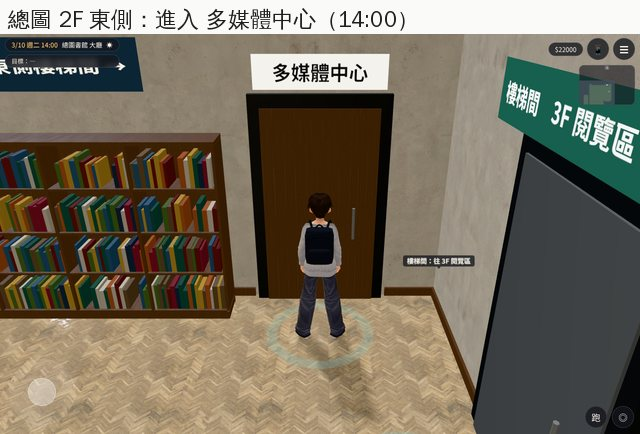
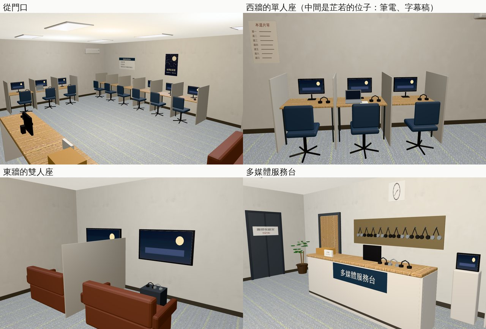
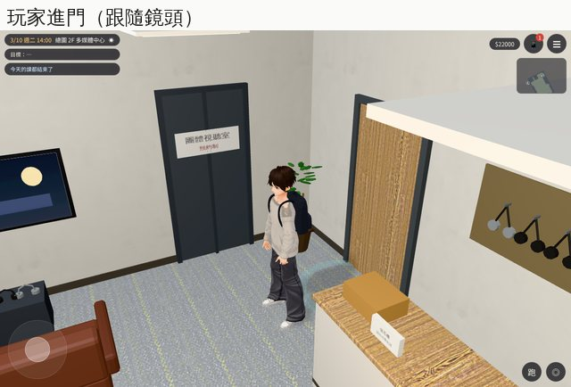

# 總圖 2F 多媒體中心（AA_399 第 12 節；任務 #82 第六間）

- **企劃**：AA_399 第 12 節（AA-B，企劃線 `5d09bb725`）。
  - **芷若**：看電影、做字幕作業（`ZR3_SUBTITLE`）。
    - LAWWW 先查她的作息（Café 班表、外文系的課），有空的下午才放。
    - 2027-09～2028-02 她在英國，不放。
  - **玩家**：可以一個人看一部片（60 分）。旁白「（你借了一副耳機。片子很長，你看到一半睡著了。）」
- **派工**：LAWWW-B 10-24 03:53（P2），任務 #82 第六間。做法 LAWWW-B 07:04 同意：
  - 「看一部片」搬到裡面的服務台；
  - `library3d.js` 的門認 `d.to`。
- **做的人**：LAWWW2-B。
- **狀態**：`READY_FOR_ART_REVIEW`。場景美術的 `ART_APPROVED` 只有使用者能標。
- **Patch**：`docs/art-rebuild/second_ai/patches/library_media_1024.patch`，對開發 `758d8af30` 做的（洗衣間、205 已經整合在裡面）。模型在我的分支。

## 做了什麼

- **模型**（Blender bpy，`tools/blender/env_second/library_media.py` → `assets/models/env/second_ai/library_media.{glb,json,layout.json}`）：
  - 23,054 個三角形；房間 10 × 7 m。
  - 門在 +z 那一面靠東，沒有窗（視聽室）。地毯和研究小間同一種。
  - **進門左手邊**：
    - 多媒體服務台：深藍色牌子「多媒體服務台」、「借耳機　請出示學生證」小立牌、館員的螢幕、三副耳機、還片箱；
    - 服務台後面：牆上一片洞洞板，掛著一排耳機。
  - **服務台西邊**：影片架（兩座，光碟盒的書背、沒有片名）、查詢機。
  - **後牆**：六個單人視聽座（隔板、螢幕、耳機、布面辦公椅）；牆上「視聽區使用須知」（請戴耳機、請勿飲食、耳機還到服務台）、秋季影展週的海報（虛構）。
  - **西牆**：三個單人視聽座。中間那個是芷若的位子：桌上多一台筆電和一疊字幕稿。牆上「本週片單」。
  - **東牆**：
    - 兩個雙人座：紅棕色小沙發對著牆上的大螢幕，小茶几上兩副耳機；
    - 一扇玻璃門「團體視聽室（預約制）」，門後是暗的、關著。
  - **其他**：時鐘、冷氣、盆栽。
  - 字都是虛構的一般用語（沒有真實片名、品牌）。
- **配置**（`room_glb_layouts.js` 的 `library_media`）：
  - 沒有 `open`：總圖開館的時候都開（關館以後本來就進不了總圖）。
  - `seats`：13 個（單人 9、雙人 4）。
  - `spots`：
    - `staff`：館員在服務台後面；
    - `zhiruo`：芷若坐西牆中間那個單人座；
    - `player`：玩家在服務台前面。
  - `interact`：
    - 多媒體服務台（「看一部片」）；
    - 影片架；
    - 團體視聽室（門上一句「（門上貼著：預約制。）」，AA 要改再改）。

## 程式

- **`rooms_glb3d.js`**：`HOST` 多 `library_hall`（`LIBRARY_LAYOUT`）。總圖的 doors 也能接正式房間（`d.to`、`d.spawn`）。
- **`library3d.js`**：門有 `d.to` 而且在 `ROOM_GLB_LAYOUTS` 裡，就是出入口，標籤用 `host_door.label`（「進入 多媒體中心」）。研究小間那一行一字不動（`library_upper_unit` 會檢查那一行的原文）。
  - 研究小間的門照舊（落點＝研究小間的門廳）；
  - 館員辦公室照舊是門上的字。
- **`closed2_3d.js`**：「看一部片」原本做在門上（`it.label==='多媒體中心'`）。
  - 門變成「進入 多媒體中心」以後，那個按鈕就按不到了（和洗衣間的「洗衣服」同一個問題）。
  - 改成在裡面的「多媒體服務台」也能看：選項、60 分鐘、旁白、21:00 以後不給，都一樣。
  - 門口那一條留著（沒有房間的版本用）。

## 給劇情接線（LAWWW-B）

- 芷若：有空的下午放在 `spots.zhiruo`（坐姿，桌上已經有筆電和字幕稿）。2027-09～2028-02 不放。
- 館員：`spots.staff`（站在服務台後面）。

## 截圖（遊戲內，Playwright＋SwiftShader；不是 iPhone 實機）

開發 `cc366dbe5`＋洗衣間／205＋這份 patch（測試樹），2026-03-10（二）14:00。每張的 `post` 都確認：區域、正式模型載入、最近的互動點。

### 總圖 2F：「進入 多媒體中心」

- 玩家站在回大廳的落點（10.4, −8.05），最近的互動點是「進入 多媒體中心」（`post` 確認）。畫面上那行小字「樓梯間：往 3F 閱覽區」是旁邊樓梯間門上的字，不是這扇門的。
- 繪製呼叫 118、三角形 10.6 萬（總圖大廳那一層）；房間裡 22 次、2.4 萬。

### 房間（從門口、西牆的單人座、雙人座、服務台）

### 玩家進門的畫面（跟隨鏡頭）

### 第一輪截圖找到、已經改的

- 芷若位子上的筆電只看得到灰色的背面：加上朝坐的人那一面的螢幕。

## 測試

- **`tests/library_media_unit.js`**（新，13 項；改之前第 1 項就失敗）：
  - 區域、正式模型；
  - 總圖 2F 的門：只有「進入 多媒體中心」，落點＝spawn；
  - 研究小間、館員辦公室的門照舊；
  - 回大廳的落點站得住，「離開多媒體中心」用的就是它；
  - 引擎的 `simWalk`：13 個座位、服務台、影片架、團體視聽室的門、出口都從門口走得到；
  - 芷若坐的是一個座位；
  - 玩家站在服務台前面、服務台的互動點就在那裡；
  - 館員在服務台後面，玩家走不到；
  - 單人座的人面向螢幕。
- **`tests/aa399_closed2_unit.js`** 多第 3b 項：裡面的服務台一樣能看一部片，21:30 不給。
- **相關單元測試**（開發 `758d8af30`＋這份 patch）：用到 `teach3d`／`rooms_glb3d`／`room_glb_layouts`／`dorm3d`／`library3d`／`closed2_3d`／`closed3d` 的 93 個單元測試——跑的時候發現 `library_upper_unit` 第 2 項檢查 `library3d.js` 研究小間那一行的原文：改成研究小間那一行一字不動、多媒體中心另外一行，就過了。結果：**93 個全部 ALL PASS**（含 `library_media_unit`、`aa399_closed2_unit`、`library_upper_unit`、`library_b1_unit`、`rooms_glb_unit`、`dorm_laundry_unit`、`dorm_205_unit`、`nav_buildings_unit`）。

## 還沒做／已知

- 人（館員、芷若）沒有放：位置在 `spots`（LAWWW-B）。
- 「看」的字等 AA 寫。
- 走廊上的門畫的是關著的門，走近按「進入」就進去。
- 手機效能沒實測（23,054 個三角形、繪製呼叫見截圖的 perf）。
