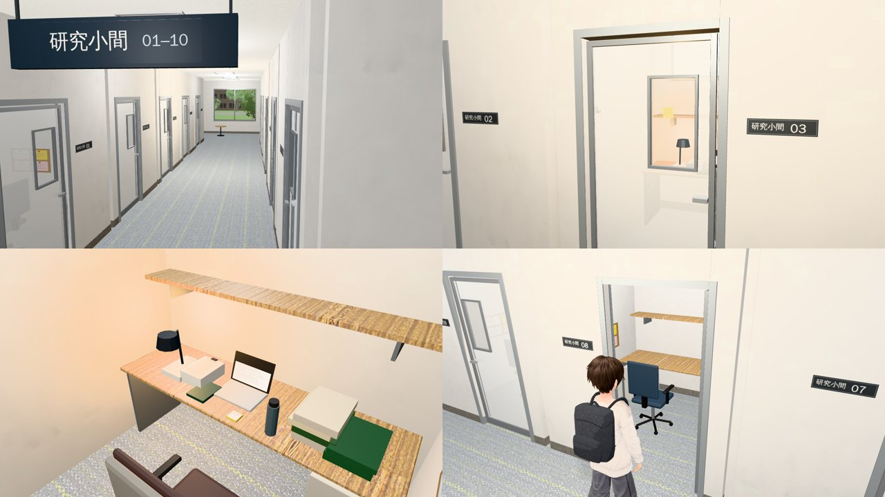
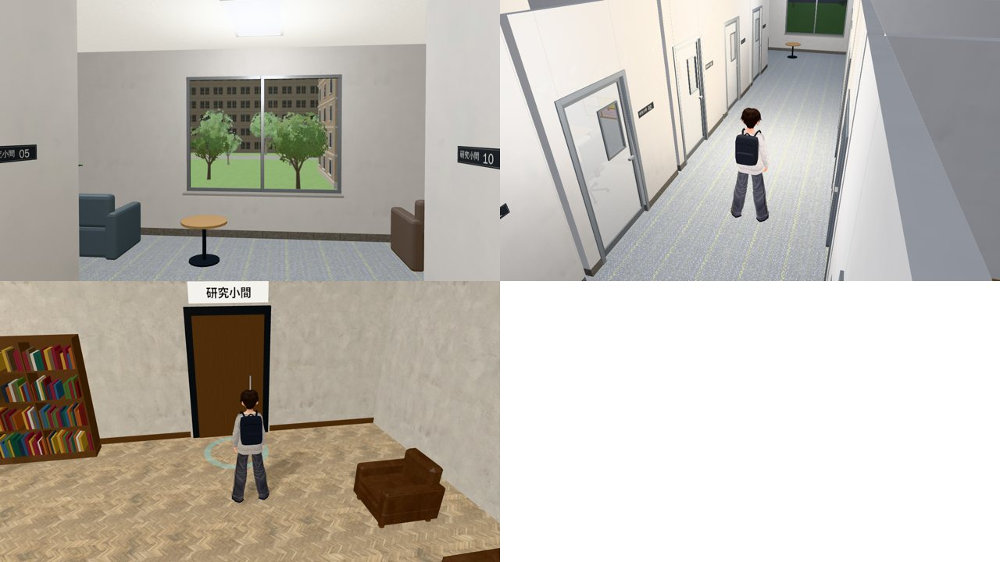
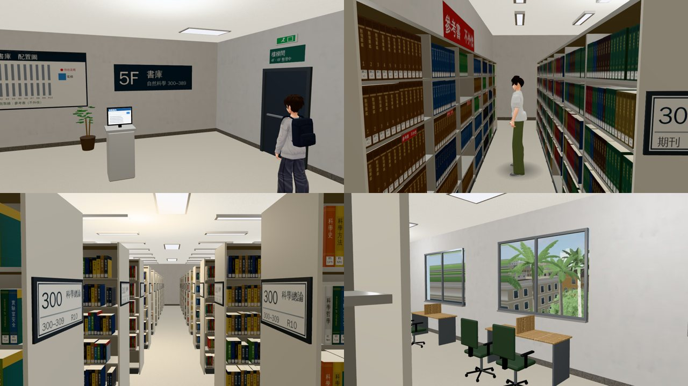
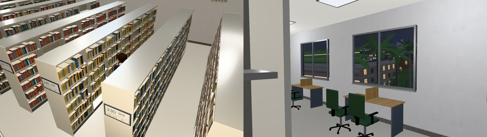
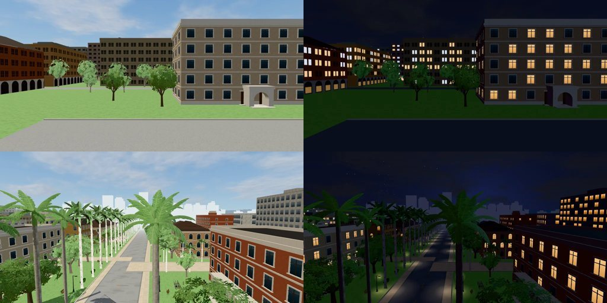
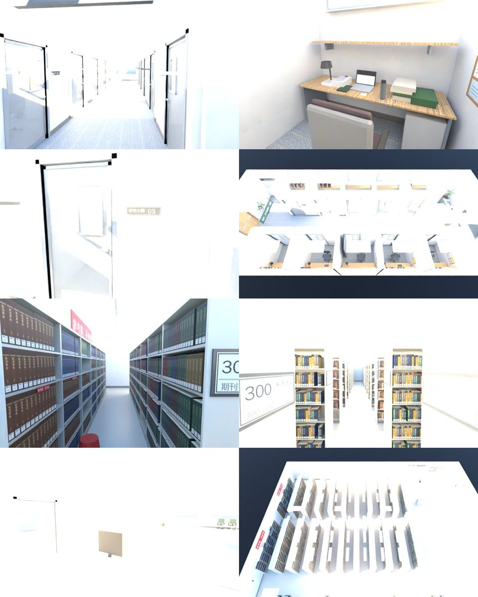

# CLOSED-SPACES-1023 第 3 項：總圖研究小間（2F）＋5F 書庫

- **企劃**：AA_399 第 3 節（AA-B，企劃線 `claude/cool-heisenberg-o8kuqx`）。
  - 3-1 研究小間：學姊 2028-02～2029-05 平日 14～17 在研究小間寫論文；玻璃門上有小窗，玩家「敲玻璃」，她在便利貼上寫一句貼在玻璃上。大四起玩家可以預約。
  - 3-3 5F 書庫：只開 5F（4F、6F 照舊整理中）；方奕廷大二上第 12～14 週、週二 15～17 在最裡面找植物圖鑑（「總圖五樓最裡面。」）。
- **派工**：LAWWW-B 10-23 18:4x 佇列第 ③ 項：研究小間給門外的位置和她的座位；書庫給方奕廷最裡面一排的位置、「看那一排」；入口我決定、寫進配置。
- **做的人**：LAWWW2-B。
- **狀態**：`READY_FOR_ART_REVIEW`。場景美術的 `ART_APPROVED` 只有使用者能標。

## 入口（我決定的）

| 地方 | 怎麼去 | 為什麼 |
|---|---|---|
| 研究小間 | 總圖大廳**二樓東牆**原本關著的「研究小間」門打開 → 新區域 `library_carrels` | 門本來就在那裡（`library_layout.js` doors 的 carrels），大廳的模型不用改 |
| 5F 書庫 | **搭電梯**：大廳、3F 閱覽區的電梯多一個「5F 書庫（自然科學）」，4F、6F 照舊「整理中」 → 新區域 `library_stacks` | 電梯已經會跨區域（大廳 ⇄ 3F）；書庫的樓梯間門鎖著（「4F、6F 書庫整理中，往下請搭電梯」） |

- 電梯三部（大廳、3F 閱覽室、5F 書庫）的樓層都是 1F～6F：1F、2F 大廳，3F 閱覽區，4F 關，5F 書庫，6F 關。
- 總圖外觀是四層樓；5F 書庫照劇情放在 5F（方奕廷的訊息「總圖五樓」），外觀不改。

## 研究小間（`library_carrels`）

- **工具**：Blender bpy，`tools/blender/env_second/library_upper.py --part carrels`。
- **材質**：地板淺灰藍地毯（Poly Haven `dirty_carpet` 調色）；牆 `painted_plaster_wall`；桌面 `wood_table_001`（淺色）。**沒有深色木地板**。
- **配置**：x −8.6…8.6、z −3.6…3.6、高 3.0。
  - 西端門廳：回大廳的雙開門、使用須知、本週預約表（03 那一格平日下午都塗著綠色）、長椅、飲水機、掛衣架。
  - 中間走廊，兩側各五間（北 01～05、南 06～10），每間 2.4 m 寬：
    - 靠外牆一張長桌、書架板、檯燈、辦公椅、掛勾、軟木小板；外牆高處一條霧面窗（白天亮、晚上暗）。
    - **門**：鋁框霧面玻璃門，門上一塊**透明的小窗**（眼睛的高度、靠門把那一側），從走廊看得到裡面亮著的檯燈。
  - 東端閱讀角：大窗（窗外是遊戲裡拍的校園：總圖南側二樓看出去的草地、系館）、兩張單人沙發、還書車。
- **學姊的 03**（北排中間）和**玩家的 08**（南排中間）隔著走廊正對面。

### 給劇情接線（`LIBRARY_UPPER_LAYOUTS.carrels`、`LUP`）

| | 內容 |
|---|---|
| `spots.sis_knock` | 03 門外、面向小窗（敲玻璃站的位置） |
| `spots.sis_seat` | 03 裡面她坐的位置（面向北邊的桌子）。03 的門關著，NPC 直接放 |
| `spots.sis_note` | 便利貼的位置：小窗裡面、字朝走廊 |
| `spots.my_door`／`my_seat` | 08 門外／08 的椅子 |
| 節點 `SIS_CARREL_*` | 她的東西：開著的筆電、兩疊論文影印稿、書、**深綠封面的計畫本**（和 5F 研究室同一本）、保溫瓶、便利貼一疊、椅背上的灰色針織外套 |
| 節點 `SIS_CARREL_LAMP` | 她的檯燈（她在的時候亮，加一盞暖色點光） |
| 節點 `STICKY_SIS` | 黃色便利貼（紙上只有筆跡；字由對話框顯示，四種照 AA_399 3-1） |
| 節點 `CARREL08_DOOR_SHUT`／`OPEN` | 08 的門：沒有預約關著、有預約開著 |

- 區域的函式（`src/library_upper3d.js`，預設值，LAWWW-B 可以換掉）：
  - `LUP.booked(G)`：今天有沒有預約 08。預設看 `G.flags.carrelDay===G.day`（服務台預約時寫）。有預約：08 的門開、可以坐下讀書；沒有：門擋著、只能「看」。
  - `LUP.sisPeriod(G)`：她用 03 的時期，預設 2028-02-01～2029-05-31（**美國期間除外要 LAWWW-B 判斷**）。不在這段時期，她的東西藏起來。
  - `LUP.sisHere(G)`：她在，預設平日 14～17（假日除外）：檯燈亮。
  - 便利貼：`G.flags.carrelNoteDay===G.day` 或 `LUP.note(true)` 時顯示（敲玻璃以後）。`LUP.refresh()` 重新套用。
- interact id：`door01`～`door10`（「研究小間 03」等，暫定的「看」）、`booking`、`rules`、`hall`（回 2F 自習區＝出口）。
  - `door03` 的 label 在她在的時候換成「敲玻璃」由 LAWWW-B 做。

## 5F 書庫（`library_stacks`）

- **工具**：Blender bpy，`library_upper.py --part stacks`；書背圖集 `lib5f_atlas.py`（程式畫的，照中國圖書分類法的類分組：一般的書名，沒有真實作者、出版社）。
- **材質**：地板淺色塑膠地磚（`linoleum_brown` 調淺）；書架奶油色鋼板。**沒有深色木地板**。
- **配置**：x −12…12、z −9…9、高 3.2（和總圖大廳同一套座標；電梯井同一個位置）。
  - 十排雙面鋼製書架，中間一條橫向走道分成北、南兩段；每段兩端的端板貼類號牌：
    - R1 期刊合訂本、R2 380 動物、R3 370 植物、R4 360 生物、R5 350 地球科學、R6 340 化學、R7 330 物理、R8 320 天文、R9 310 數學、R10 300 科學總論（R10 靠電梯）。
  - **最裡面靠西牆一排單面的參考書**：大開本的圖鑑、手冊、辭典、年曆，一套一格加書擋；每格貼「參考書　不外借」，牆上一塊大的。
    - **植物圖鑑**一套八冊（綠色書背）在北段中間、第四層＝方奕廷面前那一格。
    - 書架旁一張紅色踏腳凳（不擋路）。
  - 南牆六扇窗（窗外是遊戲裡拍的：5F 高度看出去的椰林大道），窗下五張兩人閱覽桌（可以坐下讀書）。
  - 電梯前：5F 樓層牌、配置圖、館藏查詢電腦（螢幕是上一個人查的「植物圖鑑：5F 參考書，不外借」）、還書車、使用須知；東牆樓梯間的門（鎖著）、東南角放大開本的矮書架。
- 書：一層一個開間做成一個「書模組」（一段一段同一類的書），整層用 GPU instancing。

### 給劇情接線（`LIBRARY_UPPER_LAYOUTS.stacks`）

| | 內容 |
|---|---|
| `spots.fang` | 方奕廷：最裡面那一排（西牆參考書和 R1 中間的走道）、面向西牆、站著翻植物圖鑑 |
| `spots.fang_look` | 玩家走進最裡面那一排、看到他的位置（面向北，他在前面 1.4 m） |
| `spots.ref_plant` | 植物圖鑑那一格 |
| `spots.elevator_out`、`reading` | 出電梯、窗下閱覽桌前 |
| interact `row_300`～`row_380`、`row_j` | 「看那一排」：中間橫向走道、每一排的端板前（借書：書在 5F＝來這裡「看」那一排拿書，AA_399 3-2，LAWWW-B 接） |
| interact `row_ref` | 最裡面那一排（參考書，不外借） |
| 其他 interact | `directory`、`rules`、`opac`、`cart`、`stairs`（「看」的字都是暫定，AA 可以改） |

- 背景的讀者（路人）：`LUP.populate`：窗下閱覽桌，開館時段一到三位（考試週多一位）。`story3d.js` 進來、待著的時候叫（兩行，同 B1；要不要由 LAWWW-B 決定）。

## 檔案

- 我的分支：
  - `assets/models/env/second_ai/library_carrels.{glb,json,layout.json}`、`library_stacks.{glb,json,layout.json}`
  - `assets/models/env/views/library_carrels_{day,night}.webp`、`library_stacks_{day,night}.webp`（窗外的景，遊戲裡拍的；6 m／10 m 內沒有東西，所以只有一層）
  - `tools/blender/env_second/library_upper.py`、`lib5f_atlas.py`、`textures/gen/lib5f_books.{png,json}`、`library_carrels_print.png`、`library_stacks_print.png`
- patch：`docs/art-rebuild/second_ai/patches/library_upper_1023.patch`（對開發 `984ee75f3` `git apply --check` 過）：
  - 新檔：`src/library_upper3d.js`（兩個區域、`LUP`）、`src/data/library_upper_layouts.js`（`library_upper.py --js` 產生，不要手改）、`tests/library_upper_unit.js`。
  - `index.html`：載入兩個新檔（在 `library_b1_3d.js` 後面）。
  - `src/data/library_layout.js`：
    - doors 的 carrels 加 `to`、`back`（`closed` 留著：研究小間的區域沒載入時照舊是「看」）。
    - 大廳、閱覽室電梯的「4F–6F 書庫」換成 4F（關）、5F 書庫（開，`library_stacks`）、6F（關）。
    - 新的 `stacks.elevator`（書庫那一部電梯：位置和大廳同一個井、base 5、樓層 1F～6F）。
  - `src/library3d.js`：
    - 有研究小間的區域時，「研究小間」的門是出口。
    - 電梯樓層的出生點照樓層的區域找那一部電梯（`zoneElev`；原本「別的區域」一律當成閱覽室）。
    - 樓層簡介（畫的字、看的字）改成 5F 開放。
    - 回傳 `hallFloors`、`readingFloors`（單元測試用）。
  - `src/guide3d.js`（大廳 ⇄ 研究小間、電梯 ⇄ 書庫；圖書館裡換區域不顯示「沒開」）、`src/placemap3d.js`（地圖釘＝總圖）、`src/data/places.js`（名字、開館時間 08:00–22:00）。
  - `src/story3d.js` 兩行：書庫進來、待著叫 `LUP.populate`（背景讀者；拿掉這兩行就沒有）。
  - `tools/shots/shop_views_layers.py`、`.json`：兩個窗景 `library_carrels`、`library_stacks`。
  - **LAWWW-B 的測試檔（請看一下）**：
    - `tests/nav_buildings_unit.js` 兩項：原本檢查「電梯 4 個樓層、4F 以上關著」，改成 6 個樓層（4F 關、5F 書庫開、6F 關）。
    - `tests/library_b1_unit.js` 一項：guide 的比對允許 `library_b1` 後面再接研究小間（我的檔）。

## 截圖（遊戲內，Playwright＋SwiftShader；不是 iPhone 實機）

2028-03-08（週三）：學姊用 03 的時期。截圖時設了今天有預約 08、她已經貼了便利貼（`carrelDay`、`carrelNoteDay`）。

### 研究小間

- 左上：門廳往東看走廊（15:00），盡頭是閱讀角的窗。
- 右上：03 門外，小窗裡看得到她的檯燈和貼在玻璃上的黃色便利貼。
- 左下：03 裡面（鏡頭在研究小間裡）：她的筆電、影印稿、計畫本、保溫瓶、便利貼。
- 右下：08 今天有預約，門開著。

- 左上：閱讀角的窗（11:00）。
- 右上：一般鏡頭、21:00（鏡頭比天花板高時，天花板和燈具淡出）。
- 左下：大廳二樓東牆的「研究小間」門（大廳的模型沒有改）。

### 5F 書庫

- 左上：出電梯的地方：5F 樓層牌、配置圖、館藏查詢、樓梯間的門（鎖著）。
- 右上：最裡面那一排：左邊西牆的參考書，右邊 R1 期刊合訂本。站著的是**路人代替**，只是標出方奕廷的位置，不是他的模型。
- 左下：中間的橫向走道，端板的類號牌（300 科學總論、R10…）。
- 右下：南邊窗下的閱覽桌，窗外是椰林大道（11:00）。

- 左：一般鏡頭（玩家在 R6、R7 中間的走道）。右：21:00 的閱覽桌（夜景）。

### 窗外的景（遊戲裡的校園拍的）

- 上：研究小間的窗（總圖南側二樓的高度，往南）。下：書庫的窗（5F 的高度 19.5 m，往西看椰林大道）。

### Blender（Cycles；天花板藏起來，曝光過亮，不是遊戲畫面）

## 效能（遊戲內同一張截圖的 draw call／三角形）

| 鏡頭 | calls | 三角形 |
|---|---|---|
| 研究小間：走廊 | 82 | 2.5 萬 |
| 研究小間：03 門外 | 62 | 2.5 萬 |
| 研究小間：08（有玩家） | 100 | 9.9 萬 |
| 研究小間：一般鏡頭 21:00 | 93 | 6.3 萬 |
| 書庫：電梯前（有玩家） | 91 | 11.1 萬 |
| 書庫：最裡面那一排（有一個路人） | 71 | 10.2 萬 |
| 書庫：橫向走道 | 97 | 8.1 萬 |
| 書庫：一般鏡頭（有玩家，看得到大半層） | 121 | 15.2 萬 |

- 模型：研究小間 2.1 萬三角形、17 種材質、1.96 MB；書庫 7.7 萬三角形（書用 GPU instancing：1,507 個物件、79 個網格）、16 種材質、2.01 MB。
- 人物多的時候三角形主要是人物（一個 VRM 約 7 萬）。

## 測試

| 測試 | 測試樹 | 結果 |
|---|---|---|
| `node tests/library_upper_unit.js`（新） | 開發 `984ee75f3`＋patch；`03b327ded`＋patch | ALL PASS（20 項） |
| `library_b1_unit`、`nav_buildings_unit`、`guide_unit`、`guide_declutter_unit`、`placemap_unit`、`quick_travel_unit`、`zone_dispose_unit`、`zone_prewarm_unit` | 同上 | ALL PASS |
| `tests/reachability_all.py --zones library_hall,library,library_carrels,library_stacks` | `03b327ded`＋patch | ALL PASS（96 個互動點、6 個出入口到達點） |
| `tests/flow_library_floors.py`（真實走路，不用 turbo；含電梯） | `03b327ded`＋patch | ALL PASS（27 項） |
| 遊戲內截圖 13 張 | 同上 | 沒有 JS 例外 |
| Blender `navcheck` | — | 0 個問題（研究小間 5 個座位、書庫 10 個） |

- `library_upper_unit` 用修改前的開發分支跑：第 1 項 FAIL（沒有這兩個區域），後面不跑。
- 第一版 `library_upper_unit` 抓到一個真的問題：08 的門擋路的範圍沒寫進配置，沒有預約也走得進去。已修。
- 截圖修過的：掛勾穿到走廊、茶几是方塊、從上面看天花板燈具是一塊塊灰板、書庫東牆「樓梯間」牌子左右相反。

## 還沒做到的、要 LAWWW-B 決定的

1. **學姊的時期**：`LUP.sisPeriod` 只照日期（2028-02～2029-05），**美國期間除外**要 LAWWW-B 判斷（換掉這個函式或加條件）。
2. **預約**：服務台預約、一次三小時、一天一次（AA_399 3-1）是 LAWWW-B 的程式；我只做「今天有預約 08 就開門、可以坐」，看 `G.flags.carrelDay`。
3. **敲玻璃**：她在的時段把 `door03` 的 label 換成「敲玻璃」、照關係顯示便利貼的字、`LUP.note(true)`（或寫 `G.flags.carrelNoteDay`）——劇情接線。
4. **她和方奕廷的 NPC**：站位在 spots，NPC 由 LAWWW-B 放（03 的門關著，她直接放在 `sis_seat`）。
5. **借書**（AA_399 3-2）：「看那一排」的 interact 已經有 id，借書的流程由 LAWWW-B 接。
6. 研究小間其他九間門都關著、裡面沒有人。之後要背景的人坐在別間（從小窗看得到），再說。
7. 門是靜止的：08 的門只有開、關兩種擺法，沒有開門的動畫。
8. iPhone 沒看過。
