# CLOSED-SPACES-1023 第一項：霖澤館 5F 研究室樓層

- **使用者原話**（2026-10-23，對 LAWWW2-B）：「遊戲裡任何現在關起來的空間都可以開始開發，例如進不去的討論室之類的。相關功能如何與劇情連接，請跟 AA 討論。」
- **劇情用途**：AA_399 第 1 節（AA-B）。學姊的八場研究室戲，現在全部是 2D 走廊；有 3D 以後換成 3D。
- **分工**（LAWWW-B 10-23 14:41）：
  - LAWWW2-B：模型、配置、區域接線。
  - LAWWW-B：進出的劇情條件（4F 刷卡門「傳訊息給學姊」、八場事件換 3D）。
- **做的人**：LAWWW2-B。
- **狀態**：`READY_FOR_ART_REVIEW`。場景美術的 `ART_APPROVED` 只有使用者能標。

## 做了什麼

- **工具**：Blender bpy，`tools/blender/env_second/linze_upper.py`（和 3F、4F 同一支，加 `--floor 5f`）。
- **材質**：和 3F、4F 一樣是 Poly Haven（CC0）：
  - 地板：淺色石英磚（`large_floor_tiles_02`）。沒有深色木地板。
  - 牆：`painted_plaster_wall`。
  - 踢腳板：`granite_tile_03`。
  - 桌面：淺色木紋 `wood_table_001`。
  - 天花板：`ceiling_interior`。
- **座標**：和樓下相同（x −8…8、z −7…7）。電梯井、樓梯間的門和 1F～4F 同一個位置。

| 地方 | 位置 | 內容 |
|---|---|---|
| 走廊（北邊） | z −7…−3.2 | 北牆四間教授研究室 501～504。門牌只寫房號，下面一塊在室狀態牌（磁鐵放在「上課中／外出／在研究室／開會中」），**不能進**。另有時鐘、一張長椅。 |
| 碩士班研究室（西端，「走廊最後一間」） | x −8…−3.4、z 0…7 | 四張桌子： ・靠窗兩張並排：學姊的位子，和她旁邊的空位。 ・西牆兩張：背景碩士生。 學姊桌上：計畫本（深綠封面）、保溫瓶、一疊論文影印稿（長尾夾）、螢幕（論文的文書檔，一行紅字修訂）、螢幕旁的便利貼（字看不清楚）、檯燈、筆筒。 另有：兩座書架、白板（論文進度）、研究室公約、小冰箱＋熱水壺、冷氣。門開著（門片貼牆）。 |
| 交誼區（中間） | x −3.4…2.9 | 三人沙發＋兩張單人沙發＋小邊桌、四人方桌、期刊架、兩盆植物。 |
| 會議室（東端） | x 2.9…8、z −0.65…7 | 長桌、九張辦公椅、投影幕、空白白板、冷氣。**門關著、進不去**。門上的「口試中」平常藏起來。 |
| 電梯井東邊的角落 | — | 影印機、飲水機、三個回收桶。 |

- **隔間牆**：`WALL_P1`～`P4`，`partition=1`。鏡頭和玩家在牆的兩邊才淡出（`zones3d.js` 的 `fadeWalls`，B1 用的同一套）。
- **窗景**（`assets/models/env/views/linze_5f_{day,night}.webp`）：
  - 在遊戲校園裡拍，鏡頭放在研究室那扇窗的位置：室內 x −5.6＝校園 x 24.4，高 17.7 m，往下看一點。
  - 拍照設定在 `tools/shots/window_views.py`。

## 給 LAWWW-B 接劇情

| 項目 | 內容 |
|---|---|
| 區域 id | `linze_5f`（`zoneFor` 自動登記；正式模型 `bldg.linze_5f`） |
| 樓梯 | 5F「走樓梯下樓（4F）」→ 4F 樓梯間門口。 往上「往 6F 以上」關著。 **4F 往上照舊關著（刷卡門）**：「傳訊息給學姊」由你加。 |
| 電梯 | 從 5F 可以到 1F～4F；6F–8F 按不亮。 **3F、4F 的電梯照舊不停 5F**（5F–8F 按不亮）。 |
| 出生點 | 電梯：(4.6, −4.9)。 樓梯間：(7.0, −5.5)，配置的 `stairs.spawn`。 |
| 學姊的位子 | `spots.sis_desk` (−5.65, 5.45)，面向窗（yaw 0），走近點 (−5.65, 4.75)。 **不在 `seats`**，玩家不能坐。 |
| 她旁邊的空位 | `seats` 裡「坐在旁邊的空位」(−4.2, 5.45)，study。 大四「兩張桌子並排」也是這張。 |
| 背景碩士生 | `spots.desk_c` (−6.75, 2.3)、`spots.desk_d` (−6.75, 3.9)，面向西牆。這層沒有自動放路人，誰坐由你排。 |
| 研究室門口 | `spots.lab_door` (−4.2, −0.8)，走廊這一側、面向門。 |
| 會議室門口 | `spots.meeting_door` (2.25, 0.4)，面向門。 「看」的互動點 `meeting_door` (2.3, 0.4)。 M9 口試等在門外就站這裡。 |
| 走廊中間 | `spots.corridor` (−1.0, −5.4)。 |
| 房間範圍 | 配置的 `rooms`：`lab`、`lounge`、`meeting`。 |
| 「口試中」 | 節點 `WALL_P3_EXAM_SIGN`。 `LZUP.examSign(true)` 顯示，`examSign(false)` 藏起來（預設）。 |
| 只開她那一盞燈 | `LZUP.labLights('sis')`：研究室的日光燈（`LAB_tubes`）關掉，整層的環境光、天花板燈調暗，她的檯燈（`LAB_SIS_LAMP`）亮、桌上有一圈暖光。 `'off'`：全暗。 `'all'`：全開，預設。 |

- `examSign`、`labLights` 進 5F 前後叫都可以：正式模型載好時照當時的狀態套用。**事件結束要叫回來**：`examSign(false)`、`labLights('all')`。
- 「看」的字是暫定的（教授研究室的門、白板、書架、冰箱、期刊架、影印機、公告欄），配置的 `dev` 欄寫了「暫定的字，AA 可以改」。遊戲裡顯示的是 `note`。

## 檔案

| 檔案 | 說明 |
|---|---|
| `assets/models/env/second_ai/linze_5f.glb` | 2.6 MB、30,904 個三角形 |
| `assets/models/env/second_ai/linze_5f.layout.json`、`linze_5f.json` | 配置、模型資訊 |
| `assets/models/env/views/linze_5f_day.webp`、`linze_5f_night.webp` | 窗景 |
| `tools/blender/env_second/linze_upper.py` | 加 5F。改共用的地方只多了參數，3F、4F 的配置檔重新產生後一個位元組都沒變 |
| `tools/blender/env_second/textures/gen/linze_5f_print.png` | 5F 的印刷品貼圖：門牌、在室狀態牌、白板、口試中、螢幕畫面、便利貼。都是虛構的，沒有人名、課號 |
| `tools/blender/env_second/linze_upper_layouts_js.py` | 產生 `src/data/linze_upper_layouts.js`。原本標了「不要手改」但沒有產生程式，這次補上；跑出來和 patch 裡的一樣 |
| `docs/art-rebuild/second_ai/patches/linze_5f_1023.patch` | 對開發 `fb75d67ea`，`git apply --check` 通過 |

patch 改了這些（`src/guide3d.js` 是你的檔案，只加兩個鍵）：

- `src/data/linze_upper_layouts.js`：加 5F。
- `src/linze_upper3d.js`：
  - 教授研究室的門「看」用配置的 `note`。
  - `examSign`、`labLights`。
  - 5F 的燈光（檯燈點光、`applyTime` 裡調暗環境光）。
- `src/guide3d.js`：
  - `linze_5f:['linze_4f']`。
  - 電梯 `linze_5f:['linze','linze_3f','linze_4f']`。
  - **別的樓層不指路上 5F**（要學姊開門）。
- `tools/shots/window_views.py`：加 `linze_5f`。
- 新的 `tests/linze_5f_unit.js`。

## Blender 渲染（Cycles；不是遊戲畫面）

俯瞰（拿掉天花板和南牆）：

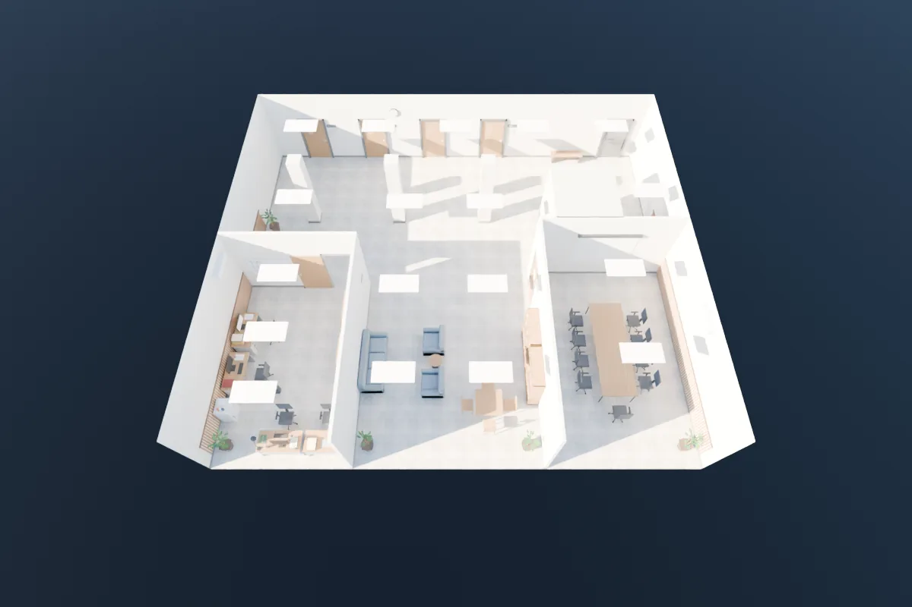

研究室、學姊的桌子、交誼區、走廊：

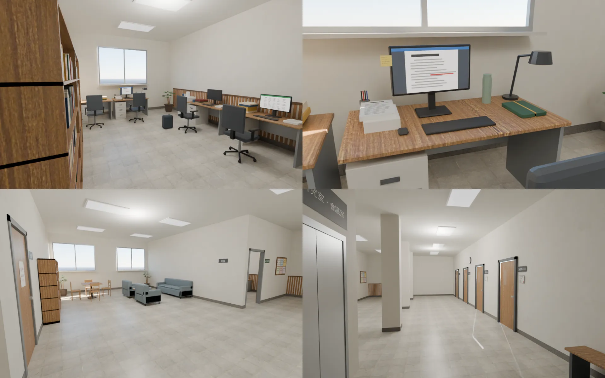

- 會議室門口（Blender 裡每個節點都顯示，所以看得到「口試中」）：

  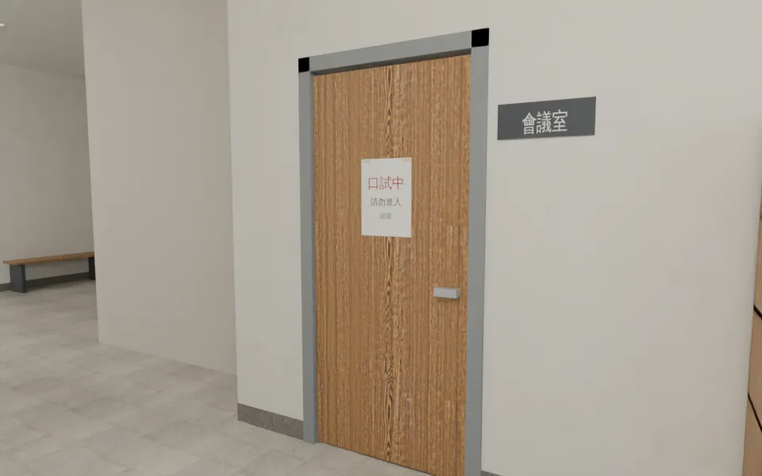

- 走廊的渲染圖地上有兩條細亮線：Cycles 的陽光從某條接縫漏進來。
  - 我先以為是會議室門片的圓角留縫，把門片伸進門框裡以後重新渲染，**線還在**。原因還沒查到。
  - **遊戲畫面沒有這兩條線**（下面「走廊」那張）：遊戲不算光線穿縫。
  - 門片伸進門框的改動留著，沒有壞處。

## 遊戲內畫面

- 測試環境：Playwright＋SwiftShader，**不是 iPhone**。
- 【捷徑】讀檔直接進 `linze_5f`、自訂鏡頭。
- 14:00，藏起玩家。
- 正式模型載好才拍。

研究室（從門口看）：

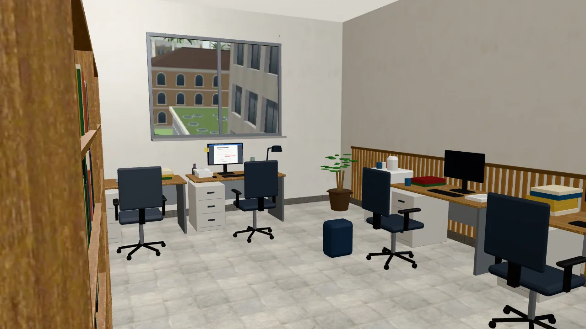

學姊的桌子：

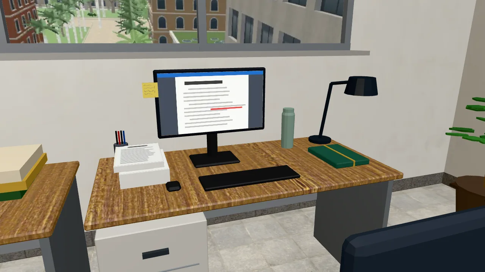

從她的位子看出去：

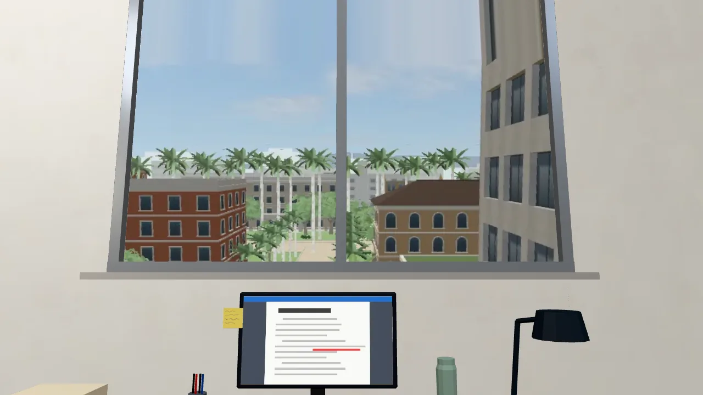

走廊：

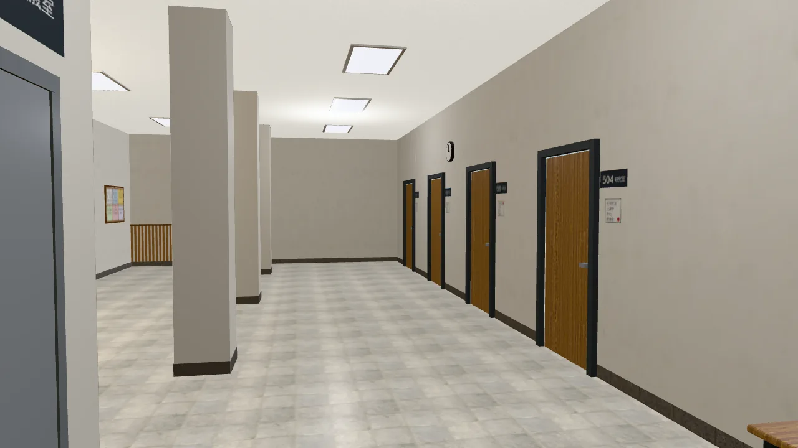

交誼區：

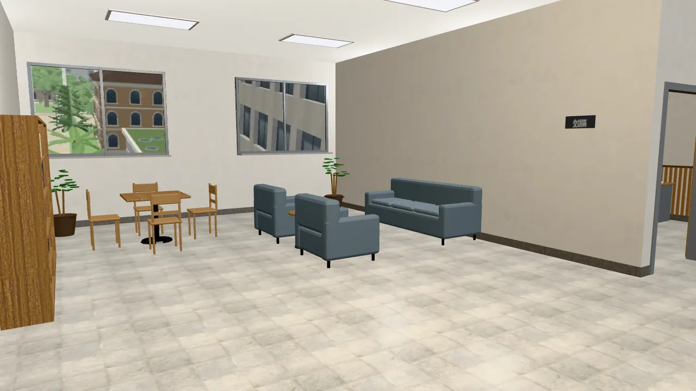

會議室門口（左：`examSign(true)`；右：預設，藏起來）：

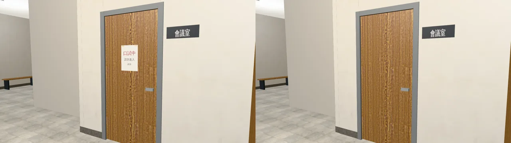

21:00 研究室（左：燈全開；右：`labLights('sis')` 只開她那一盞檯燈）：

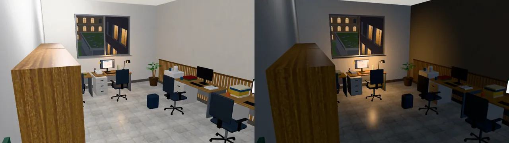

手機橫向（844×390、跟隨鏡頭、看得到玩家）：

研究室：

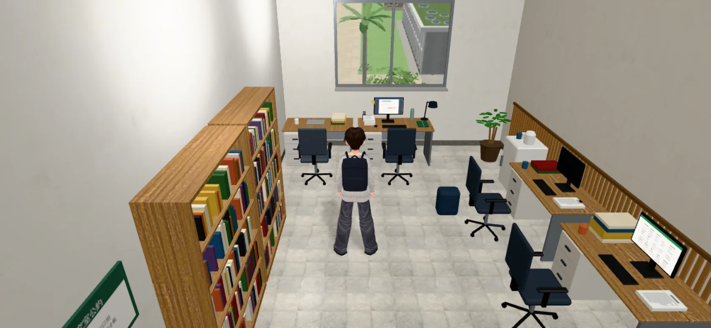

走廊：

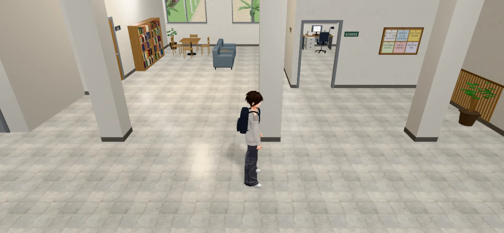

手機直向（交誼區）：

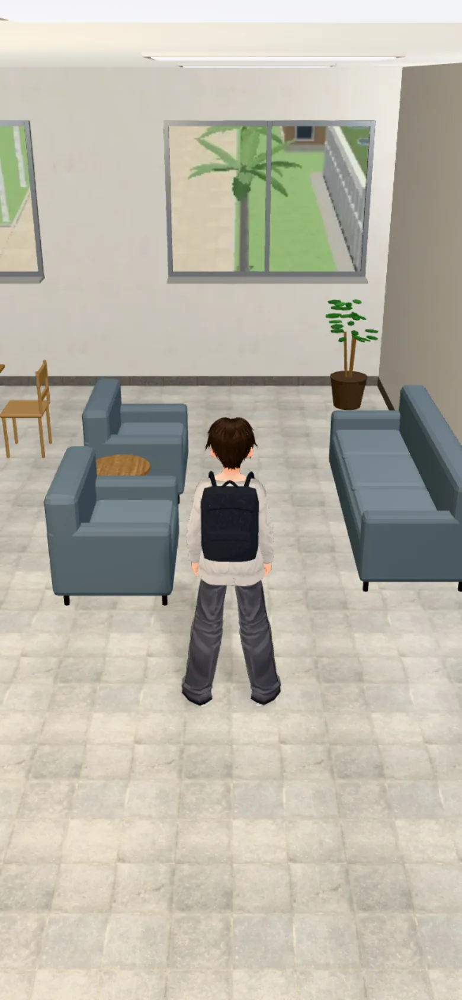

窗景照片（上白天 11:00、下晚上 20:30）：

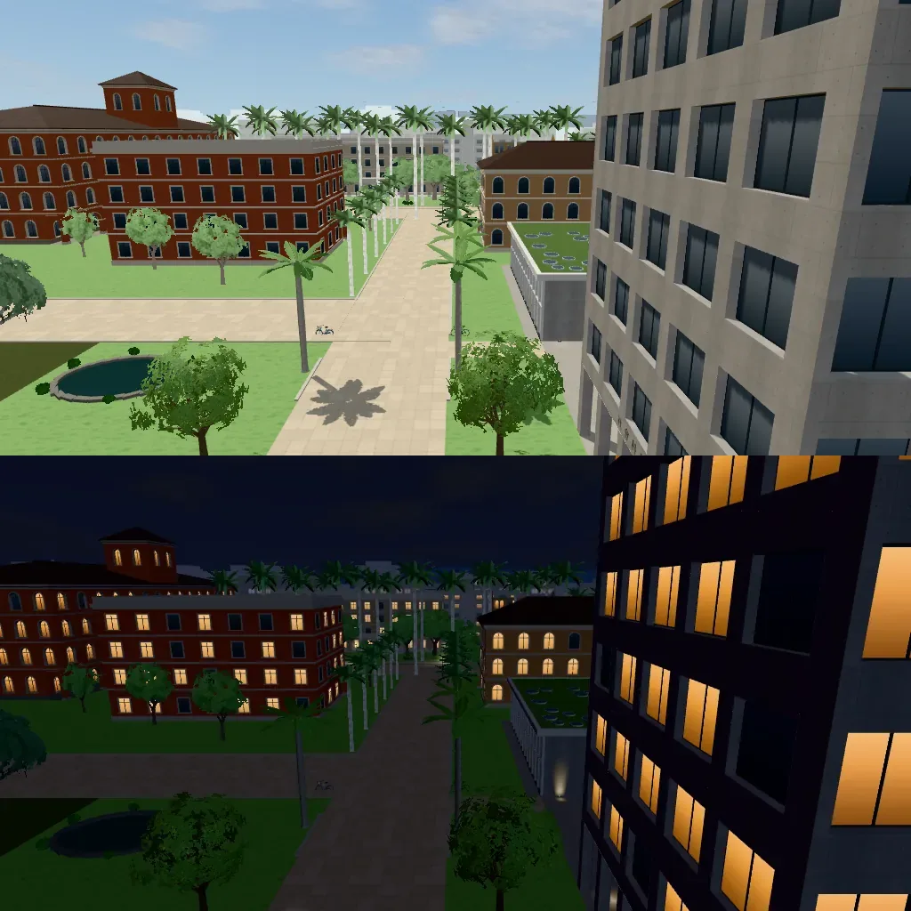

## 效能（同一個鏡頭的 draw call／三角形）

| 鏡頭 | draw call | 三角形 |
|---|---|---|
| 研究室 | 45 | 31,322 |
| 走廊 | 63 | 32,286 |
| 交誼區 | 76 | 32,868 |
| 手機跟隨鏡頭（含玩家） | 81～118 | 10.4 萬～11.0 萬 |

模型 30,904 個三角形。3F、4F 約 1.1 萬：多出來的是辦公椅、書架上的書、桌上的東西。

## 測試（開發 `fb75d67ea`＋這個 patch，開發分支的測試腳本）

| 測試 | 結果 |
|---|---|
| `node tests/linze_5f_unit.js`（新） | ALL PASS |
| `node tests/linze_upper_unit.js` | ALL PASS |
| `node tests/nav_buildings_unit.js` | ALL PASS |
| `tests/reachability_all.py --zones linze_5f,linze_4f,linze_3f` | ALL PASS |

`tests/linze_5f_unit.js`：

- 樓梯、電梯照上面的表：
  - 5F 往下到 4F。
  - 3F、4F 不停 5F。
  - 4F 往上照舊關著。
- 學姊的位子不在 `seats`。
- 會議室門擋住。
- `examSign`、`labLights` 的狀態。
- 「只開她那一盞燈」時環境光調暗：叫的是區域的 `applyTime`，和引擎室內分支走同一條路。
- 照遊戲的導航格：從電梯、樓梯間走得到每個座位的走近點、每個互動點、研究室和會議室門口、學姊和背景碩士生的位子。
- 會議室裡面走不到。

`reachability_all.py`：

- 5F：26 個互動點都站得到、按鈕會出現、走得到。
- 「坐下」的走近點都走得到。
- 這是引擎真的走路模擬。

**修正過的兩個錯**（都是遊戲內截圖才看出來）：

1. **「只開她那一盞燈」一開始畫面沒變**：
   - 我把調暗寫在區域的 `applyTimeOutdoor`。
   - 引擎在室內的分支只叫 `zone.applyTime` 就 return，根本不叫 `applyTimeOutdoor`。
   - 已經改到 `applyTime`。單元測試也改成走同一條路。
2. **`examSign(false)` 了「口試中」還在**：
   - 牌子是 `WALL_` 牆面的一部分，引擎每一格照淡出設 `o.visible`（`engine3d.js` 的 `hideFaded`）。
   - 已經改用材質的 `visible`。截圖確認兩種狀態不同。

**沒跑**：

- `zone_transitions.py`。
- 真實玩家流程：要等你接上 4F 刷卡門。
- iPhone 實機。

## 還沒做到、要注意的

1. **「窗戶對著一棵樹」（AA_399 1-1、第 13 節）只做到一半**：
   - 從她的位子看出去是法學院前的校園、椰林、右邊隔壁社科院的大樓。
   - 正前方沒有一棵樹：五樓 17 m 高，前面的樹最高約 10 m，只在窗的下緣看得到樹冠。
   - 三個做法要你決定（我建議 A）：
     - **A（建議）**：在校園霖澤館正面西段（研究室那扇窗前，約校園 (24, −97)）種一棵真的大樹，約 17～19 m，樹冠到五樓窗。
       - 從廣場看也在，世界一致。
       - 要改 `zones3d.js` 的校園（法學院廣場），加樹穴、導航阻擋。
       - 要重拍 linze_south、201、3F、4F、5F 的窗景，跑校園的導航測試。
     - **B**：只在 5F 的窗景加一層近景的樹（`W3.VIEW_LAYERS` 近景）。
       - 快，但從外面看沒有這棵樹，前後不一致。
     - **C**：照現在，AA 把那句改成「窗外看得到樹」。
2. **會議室進不去**（AA_399：門口就好）。
   - 裡面有家具，是給鏡頭看的：鏡頭有時會跑到隔間牆另一邊。
3. **背景碩士生、學姊的作息、4F 刷卡門的「傳訊息給學姊」、八場事件換 3D**：都是 LAWWW-B 的。
4. 「看」的字（門、白板、書架…）是我寫的暫定句，AA 可以改。
5. 晚上的窗景照片是 20:30 拍的，21:00 用同一張。
6. iPhone 實機沒看過。
