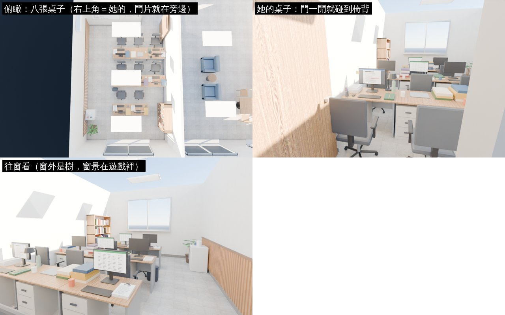
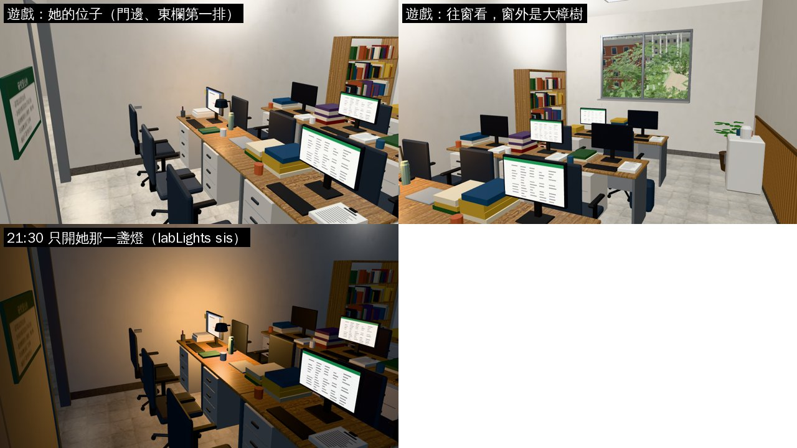
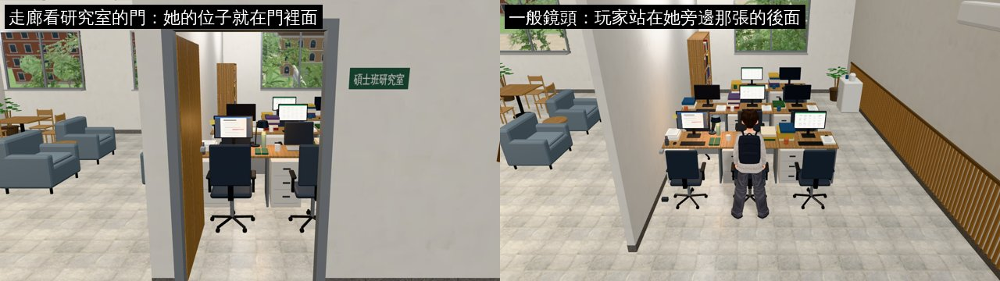

# 霖澤館 5F 碩士班研究室：更正成八張桌子、學姊的位子在門邊

- **誰要的**：AA 更正 AA_399 1-1（企劃線 `8a21184d`）；LAWWW-B 10-23 20:5x 轉給 LAWWW2-B（排在總圖 B1 之後）。
  - 劇情原文（`ev_sis_lab_desk`）：「研究室有八張桌子。她的在門邊，門一開就撞到椅背。」
  - 劇情裡她的台詞：「靠門的位子。每個人進來都會撞到我。」
  - 研究室在走廊最後一間，窗戶對著一棵樹（照舊）。
- **之前的版本**（`ce472581`）：四張桌子，她的位子靠窗。這一版取代它。
- **做的人**：LAWWW2-B。
- **狀態**：`READY_FOR_ART_REVIEW`。場景美術的 `ART_APPROVED` 只有使用者能標。

## 改了什麼

- **工具**：Blender bpy，`tools/blender/env_second/linze_upper.py --floor 5f`（同一支，只改研究室那一段）。
- **研究室**（x −8…−3.4、z 0…7；位置、門、窗都沒動）：
  - **八張桌子**：三排、三欄，都面向南邊的窗（窗外是法學院廣場的大樟樹）。第九個位置（東欄第三排）放書架。
  - **她的位子**：東欄第一排，就在門裡面。
    - 門的鉸鍊改在東邊的門框，門片往裡開 90°、靠東牆那一側。
    - 門片的末端就在她的椅背旁邊。
  - **她旁邊那張**（中欄第一排）：玩家坐的空位（大四「兩張桌子並排」）。
  - 她桌上的東西照舊：計畫本（深綠封面）、保溫瓶、論文影印稿、螢幕＋便利貼、檯燈 `LAB_SIS_LAMP`、筆筒。
  - 其他六張：背景碩士生的桌子。螢幕有開有關，書、影印稿、杯子各不一樣。
  - 小冰箱、白板、研究室公約、冷氣、盆栽、地上的後背包照舊，位置配合新的桌子調整。
- **欄、排照遊戲 0.4 m 的導航格對齊**：
  - 每張桌子只擋一排格子，兩排桌子中間留三排格子，走得過去。
  - 西邊 1.3 m 的走道接到每一排椅子那一條。
  - 第一次排的時候，桌子中間只剩兩排格子（clear 0.33 過不去），`navcheck` 報「走不到書架」。改成對齊以後 0 個問題。

## 配置（`spots`）

| 名字 | 現在 | 之前 |
|---|---|---|
| `sis_desk` | (−3.98, 1.2) 面向窗；ap (−4.53, 0.75) | (−5.65, 5.45) 靠窗 |
| `beside` | (−4.97, 1.2)（seats「坐在旁邊的空位」） | (−4.2, 5.45) |
| `me_desk`（新） | (−4.53, 0.7)，面向她 | `lab5f3d.js` 寫死 [−4.75, 4.55, −0.55] |
| `sis_lamp`（新） | (−4.38, 2.02)，y 1.15 | `linze_upper3d.js` 寫死 (−5.85, 6.15) |
| `desk_c`／`desk_d` | 西欄、東欄第二排 | 西牆兩張 |
| `lab_door`、`meeting_door`、`corridor` | 不變 | — |

## 檔案

- `assets/models/env/second_ai/linze_5f.{glb,json,layout.json}`（我的分支）。
- `docs/art-rebuild/second_ai/patches/linze_5f_lab8_1023.patch`（對開發 `65213fe2d` `git apply --check` 過）：
  - `src/data/linze_upper_layouts.js`：用 `linze_upper_layouts_js.py` 重新產生（3F、4F 不變）。
  - `src/linze_upper3d.js`（1 行）：檯燈的暖色點光改讀 `spots.sis_lamp`。
  - `tests/linze_5f_unit.js`：第 5 項改成新的設定。
    - 八張桌子；她的位子在門邊（離門 1.6 m 內）、面向窗。
    - 檯燈的點光、主角站的位置跟著她的桌子。
    - 第 7 項的走得到加 `me_desk`。
  - **LAWWW-B 的檔**（兩處，請看一下）：
    - `src/lab5f3d.js`：`DESK_ME` 原本寫死在靠窗那張旁邊，改成 `'me_desk'`（讀配置；`cfg.me` 本來就支援 spot 名字）。註解「靠窗的位子」改成「門邊的位子」。
    - `tests/lab5f_unit.js` 第 4 項：她坐的位子原本比對寫死的 (−5.65, 5.45)，改成讀 `spots.sis_desk`。

## 截圖

### Blender（Cycles；天花板藏起來，不是遊戲畫面）

### 遊戲內（Playwright＋SwiftShader；不是 iPhone 實機）

- 21:30 只開她那一盞燈：暖色的點光照在她的桌上（`spots.sis_lamp`）。

## 測試（開發 `f023a83f1`＋總圖 B1 patch＋這個 patch）

| 測試 | 結果 |
|---|---|
| `node tests/linze_5f_unit.js` | ALL PASS；用舊的配置跑，新加的三項 FAIL（4 張桌子、她不在門邊、沒有 sis_lamp／me_desk） |
| `node tests/lab5f_unit.js` | ALL PASS |
| `node tests/linze_upper_unit.js`、`node tests/nav_buildings_unit.js` | ALL PASS |
| `tests/reachability_all.py --zones library_hall,library_b1,linze_5f` | ALL PASS（119 個互動點、5 個出入口到達點） |
| 遊戲內截圖 | 沒有 JS 例外；研究室 84 calls／3.9 萬三角形 |
| Blender `navcheck` | 0 個問題 |

## 還沒做到的

- iPhone 沒看過。
- 門是靜止的：門片畫成開著靠牆，不會真的撞到椅背。
