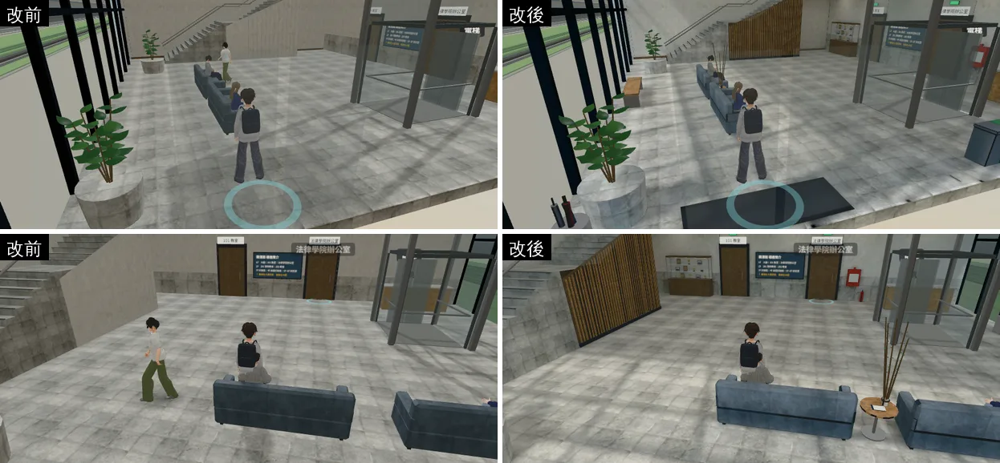
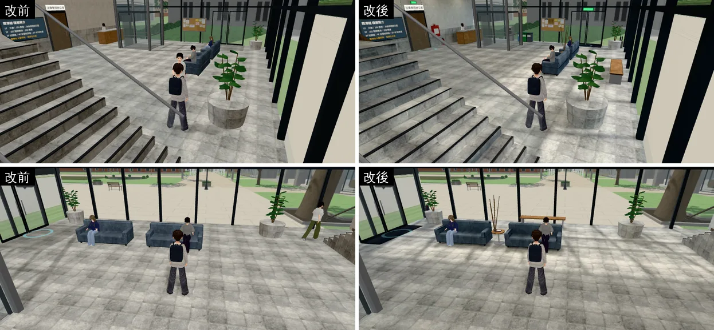
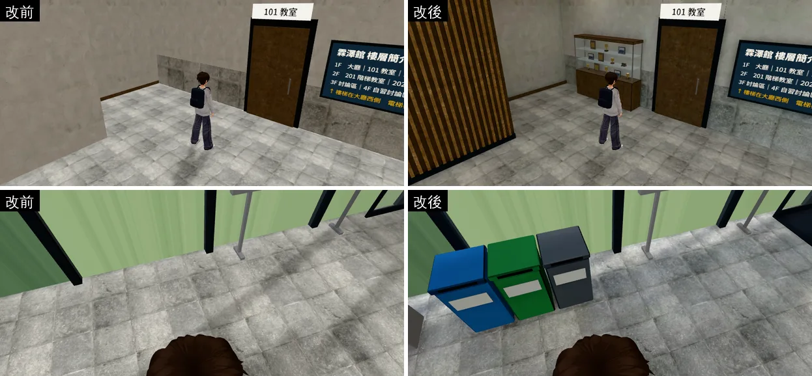
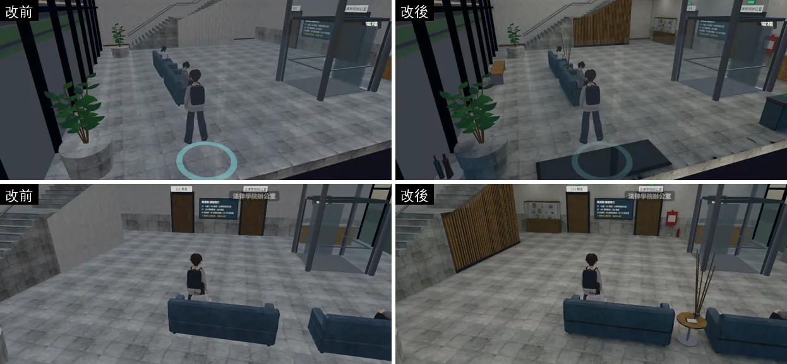
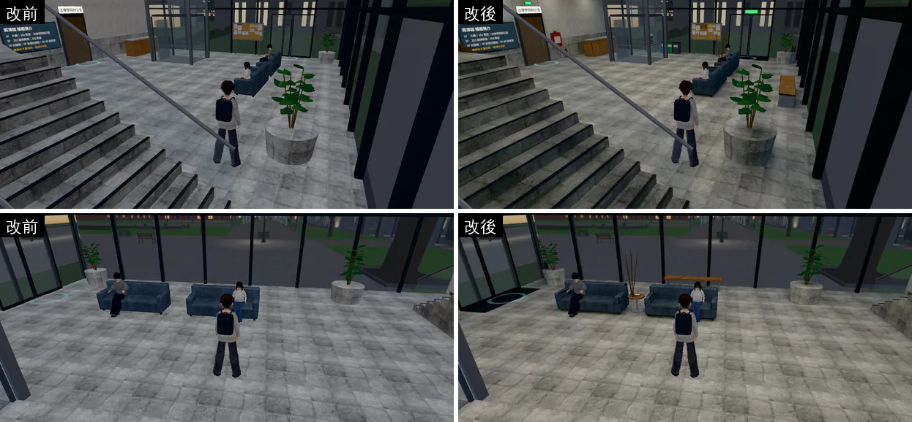
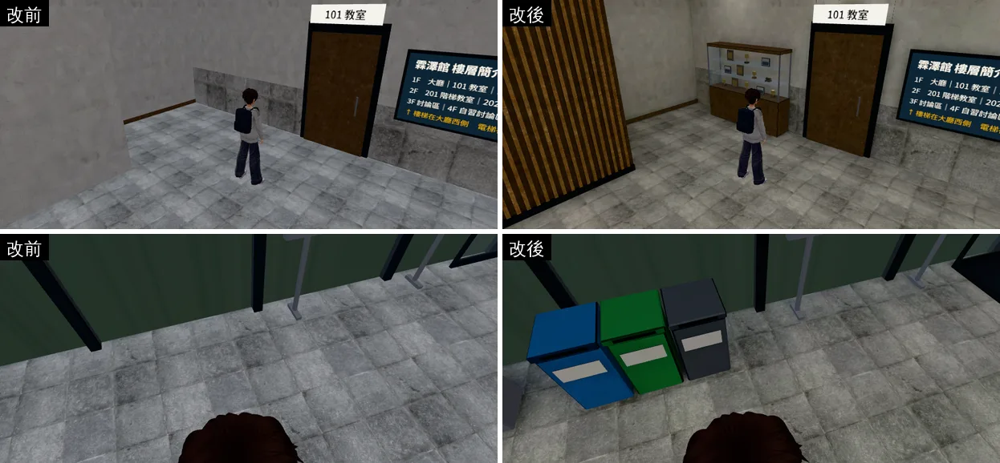
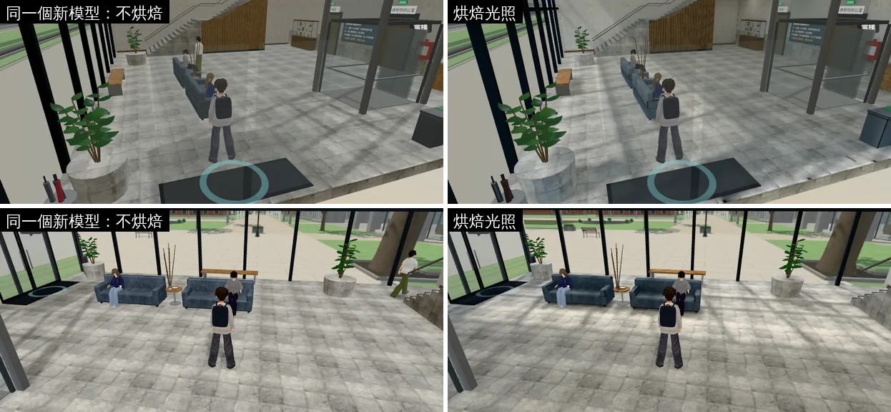

# 霖澤館一樓大廳第二版：擺設＋光照烘焙（LINZE-LOBBY-V2-1028；LAWWW2-C 2026-10-28）

- **起因**：使用者 10-28 P0（UA-LAWWW2-1028-01）：「我仍然覺得 校內建築 空間內配置 有很大的美術提升空間 現在是一個廉價手遊感 請你去參閱3A大作好好檢討」。
  - 檢討報告 `docs/art-rebuild/second_ai/INTERIOR_AAA_REVIEW_1028.md` 第 5 節的順序是 201 → 大廳 → 其他。
  - 大廳是法律系每天進出的那一棟一進門看到的地方。
- **狀態**：`READY_FOR_ART_REVIEW`。建築、場景只有使用者能標 `ART_APPROVED`。
- **怎麼套**：
  1. 程式：`git apply docs/art-rebuild/second_ai/patches/linze_lobby_v2_1028.patch`（開發分支最新的 `e324ccc5e` 上 `apply --check` 通過）。
  2. 二進位檔（交件 commit `98b90c9c5`）：`assets/models/env/linze_interior.glb`、`linze_interior_lm_day.webp`、`linze_interior_lm_night.webp`。
- **截圖**：遊戲內、玩家鏡頭，手機橫向 844×390，Playwright＋SwiftShader 模擬，**不是 iPhone 實機**。讀檔進大廳、人放到指定位置是 [捷徑]。

## 同角度對照

- 左：改前（現在開發分支的大廳；在 `55fcd3003` 拍的，大廳的模型、配置和開發分支一樣）。右：這一包。
- 六個鏡頭：入口、大廳中間往北、樓梯、往南面玻璃、二樓迴廊下的展示櫃角落、東牆的回收桶。

**白天 14:00**

**晚上 20:30**

**只看光**：同一個新模型，左邊不烘焙（原本的即時光）、右邊烘焙，白天 14:00：

## 玩家會看到什麼不同

| 檢討報告的問題 | 改前 | 改後 |
|---|---|---|
| 大廳空蕩：只有沙發、花台、服務台，看不出這棟樓的人怎麼用它 | 一片地板加幾張沙發 | 照用途分區：入口（腳踏墊、傘架、出口燈）、等候（兩張沙發中間的小圓桌、南面玻璃前的長椅）、公共設施（飲水機、三個回收桶、消防栓箱、滅火器）、法學院的展示櫃（模擬法庭、辯論的獎盃、獎牌、合照、法槌） |
| 從入口一進來看到的樓梯側面是一整面素牆 | 深色平板 | 木條牆：深色底板，前面是每 12 cm 一條淺色直木條，頂端照樓梯的斜度；下面有踢腳板 |
| 八公尺高的中庭上面是空的 | 天花板十二片燈板 | 兩排線型吊燈（6.4 m 高、三段一排，吊線到天花板） |
| 光是平的：一盞方向光＋半球光，整間一樣亮，東西像貼在地上 | 即時光 | 烘焙光照（白天、晚上兩張）：白天南面兩層樓高的玻璃照進一塊陽光（地上有窗框的影子），往北、二樓迴廊下面暗下來；沙發、長椅、花台、樓梯下面有接觸陰影；晚上是吊燈、崁燈、天花板燈板的光，偏暖 |
| 緊急出口燈、消防設備不見了（每棟公共建築都有） | 沒有 | 入口上方、北牆兩扇門上方的出口燈（綠色發光）；北牆消防栓箱＋滅火器 |

## 光照烘焙

- **工具**：`tools/blender/env_second/lightbake/bake_linze_lobby.sh`。先跑 `linze_interior.py` 建模，再跑 `bake_room.py`（Blender Cycles）烘白天、晚上兩張 1024×1024，最後轉 WebP。
- **燈**：每盞一個面光源。發光的燈面本身不烘，照舊發亮。
  - 天花板十二片燈板（8.4 m）。
  - 二樓迴廊樓板下十盞崁燈（3.9 m）。
  - 中庭兩排線型吊燈（6.4 m）。
- **白天**：天空（Nishita）＋太陽（方位 165°、仰角 52°：秋天中午前後，從南面玻璃照進來）。**晚上**：只有燈，加一點夜空。
- **外殼**：南面、東面一樓是玻璃，天光從這兩面進來；北、西、上、下包黑殼，門縫不會漏天光（`--shell S,E`）。
- **不烘的**（照舊即時光）：發光面、盆栽（葉子、樹皮、土，幾千個小島）、扶手和欄杆的鋼管、獎盃獎牌、樓梯止滑條（只有 1.5 cm 高，分不到一個像素）。
- **亮度校正**：調了五輪。每輪拍遊戲截圖，量地板的顏色，和同一個模型不烘焙的樣子比。
  1. 第一輪（天空 1.0、太陽 2.0、燈 60／15／40 W）：白天地板整片發白，地磚的紋路都看不到。
     - 地板的中位數是 202 教室的 3.5 倍：南面整片兩層樓高的玻璃，天光比教室多很多。
  2. 白天的燈只開一半時：二樓迴廊照不到天光，白天反而比晚上暗一倍，不合理。所以白天燈照樣全開，改把天光降到 0.15。
  3. 現在：
     - 燈 19／4.5／13 W：晚上地板和原本的即時光一樣亮，偏暖。
     - 白天天空 0.15、太陽 2.2：陽光那一塊約是陰影處的 2.5 倍。
     - 白天再乘白平衡 0.85／0.8／0.72：天光偏藍，調成暖灰（`engine3d.js` 室內白天的半球光是 `0xf4f1ea`）。
     - 平滑只用 1 像素：用 2 會把 12 cm 寬的窗框影子抹掉。
- **烘焙工具加的東西**（`bake_room.py`，其他房間照舊相容）：
  - `--daylights`：白天那張的燈乘多少。
  - `--daywb`／`--nightwb`：白平衡。
  - 物件的自訂屬性 `lmhide`：朝某個方向的面看不到，不分像素（二樓樓板上面被地板蓋住）。
- **模型為了光照貼圖改的**（`linze_interior.py`，外觀一樣）：
  - 樓梯原本是 25 個「從地面長上來的方塊」互相重疊：光照貼圖量到 294 m²，看得到的不到 70 m²，地板、牆分到的像素被擠掉。
  - 改成只有看得到的面：踏面、踢面、兩側的鋸齒形側面、第二跑的背面。
  - 地板、天花板、高牆分到的比例不同（`lm`：一樓地板 1.6、二樓地板 1.3、8.4 m 高的天花板 0.3、二樓以上的牆 0.7～0.8）。
  - 同材質合併時照 `lm` 分組，比例才不會在合併時丟掉。
- **光照貼圖的解析度**（`tools/blender/env_second/lightbake/uv_fill.py` 量；每公尺像素只算看得到的那一面）：

| 面 | 每公尺像素 |
|---|---|
| 一樓地板 | 27 |
| 二樓迴廊地板 | 22 |
| 一樓的牆、迴廊樓板底下、樓梯、沙發、木條牆 | 17～19 |
| 二樓以上的牆（5.4～8.4 m 高） | 14 |
| 8.4 m 高的天花板 | 5（故意少分） |

  - 填滿率 44.7%，**沒有達到驗收標準的 50%**（檢討報告第 7 節第 4 點）。
    - 原因：大廳的小東西多（獎盃、回收桶、飲水機、沙發的倒角），每一小塊都要 4 個像素的間隔。
    - 主要的面都有每公尺 12 個像素以上，這一項有達到。
  - 樓梯改模型以前，地板只有每公尺 23 個像素。
  - 一樓地板方塊的四邊側面不分像素（`lmhide 'side'`）：東邊、南邊在玻璃外面，第一次烘的時候烘成天空的顏色，晚上鏡頭在門外時，地上玻璃那一線是一條深藍色。改了以後取地板中間的值，填滿率也從 42.8% 升到 44.7%。
- **光照值**（烘好以後在模型上取樣，地板朝上的面；1.0＝貼圖顏色原本的亮度）：

| | 白天 中位數／陽光那一塊 | 晚上 中位數 |
|---|---|---|
| 一樓地板 | 0.34／0.78 | 0.28 |
| 二樓迴廊地板 | 0.28 | 0.30 |

## 沒有動的（玩法、存檔）

- 導航、互動點、出生點、電梯、樓梯的走法：配置（`linze_layout.js`）只多了第一階段的六筆擺設，導航擋的範圍都在牆邊、劇情站位與路人路線以外。
- 點地面用的地板照舊是程序化的（不畫）；樓梯模型改了，但走樓梯照舊用導航格的高度。
- 存檔格式沒有改。
- 正式模型載不到時：照舊用程序化備用模型，新的六筆擺設是方塊，導航一樣。

## 程式（`patches/linze_lobby_v2_1028.patch`）

- `src/building3d.js`：
  - 擺設的 `prop` 類型：備用模型是一個方塊、導航擋 `nav`（或 w×d）。正式模型照 `kind` 做。
  - `attachFormal` 看到 GLB 的 `extras.lightmap` 就接光照貼圖（`Z3.roomLightmap`，和 201、202 同一套）。
    - 在外牆材質複製**以後**才接：`clone()` 不會帶 `onBeforeCompile`。
    - 兩層樓已經搬出 root，所以兩層一起走。
    - 有光照貼圖時，天花板不再加 `TK.bounce`：亮度已經烘焙進去。
  - 萬才館室內也走 `attachFormal`。它的 GLB 沒有 `extras.lightmap`，照舊。
- `src/zones3d.js`：`Z3` 多匯出 `roomLightmap`（一個字）。
- `src/data/linze_layout.js`：六筆擺設（第一階段）。
- `tools/blender/linze_interior.py`：第一階段的擺設、樓梯、`lm`／`lmhide`。
- `LICENSES.md`：霖澤館室內那一列補上第二版的內容和光照貼圖。
- `tests/linze_lightmap_unit.js`（新的，Node）：見下面。

## 測試

- **開發分支最新的 `e324ccc5e`＋這個 patch＋二進位檔**（Node）：
  - `linze_lightmap_unit`（新的）、`nav_buildings_unit`、`linze_5f_unit`、`linze_office_unit`、`linze_upper_unit`、`wancai_semb_unit`：ALL PASS。
  - `linze_lightmap_unit` 檢查的：
    1. 正式模型：場景的 `extras.lightmap` 指到的兩張貼圖在 repo 裡；地板、牆、天花板、樓梯有第二套 UV；燈面、葉子沒有。
    2. 假的 GLB 走遊戲真正的建區域流程：
       - 有第二套 UV 的材質接上 lightMap（強度 2π）；外牆是複製以後才接的。
       - 天花板不加 `TK.bounce`；燈面不接。
       - `zone.update` 照時段換：12:00 白天那張、20:00 晚上那張、17:48 各一半。電梯照舊會更新。
    3. 沒有 `extras.lightmap` 的 GLB（萬才館）：照舊。
  - **拿掉 `building3d.js`、`zones3d.js` 的改動，同一支測試 FAIL 6 項**；改回來 ALL PASS。
- **深色木地板**（使用者 10-23 的永久規則 UA-LAWWW2-1023-03）：`scan_floors.py` 唯一標出的是花台裡的盆栽土（`lz_soil_pot`，0.63 m 高，原本的大廳也一樣）。兩層地板都是淺灰石材（亮度 188）。
- **瀏覽器**：
  - 白天 14:00、晚上 20:30，六個鏡頭，改前（`55fcd3003`，大廳和開發分支一樣）、改後各拍一輪。
  - 沒有 JS 錯誤；遊戲裡接上光照貼圖的材質 60 個。
- **iPhone 實機沒有測。**

## 效能

- **模型**（`linze_interior.glb`）：

| | 改前 | 改後 |
|---|---|---|
| 檔案 | 2,058,500 bytes | 2,323,732 bytes（+13%） |
| 網格 | 56 | 78 |
| 三角形 | 5,742 | 8,750（第一階段 9,686；樓梯改成只有看得到的面少了九百多） |
| 材質 | 17 | 32 |

- **光照貼圖**：白天 90 KB、晚上 76 KB（WebP，1024×1024）。顯示卡記憶體兩張約 8 MB（含 mipmap 約 10.7 MB），和 201、202 一樣大。
- **draw call**：大廳本身，人物先移出場景再量（`perf_views.py`），白天 14:00，同六個鏡頭：

| 鏡頭 | 入口 | 中間往北 | 樓梯 | 往南面玻璃 | 展示櫃角落 | 東牆回收桶 |
|---|---|---|---|---|---|---|
| 改前 | 93 | 94 | 90 | 58 | 59 | 38 |
| 改後 | 117 | 115 | 114 | 72 | 76 | 51 |

  - 多 22～34%。多出來的主要是新擺設的 15 個純色材質（回收桶三色、黑、白、紅、深藍、腳踏墊、傘、獎盃金色……），每個材質畫一次。
  - **下一步可以減**：不發光、不是金屬的純色材質合成一個頂點色材質，約少 12 個 draw call。只換二進位檔（GLB＋兩張光照貼圖），程式不用改。
  - 截圖那一輪是有人物的：入口 142 → 166；晚上中間那一格多 2～3 個路人，數字不能直接比。
- **fps**：雲端沙盒是 SwiftShader（1～4 fps），量不出意義。**手機實機沒有量。**

## 缺點、還沒做

- **陽光的位置是固定的**：烘焙的太陽是秋天中午前後從南面照進來。早上、傍晚地上那塊陽光也在同一個地方；17:00～18:36 慢慢換成晚上那張。
  - 遊戲在室內的即時太陽方向是另外一套（`engine3d.js`「室內沒有方位」）。人物的影子方向和地上窗框的影子不一定一致；即時光只剩三成，影子很淡。
- **填滿率 44.7%**，沒有到 50%（見上面）。要再提高，就要把回收桶、飲水機這些小東西改成不烘，它們會變得比旁邊亮一點。
- **盆栽、獎盃、扶手照舊即時光**：不烘的東西照樣吃原本的光，在陰影處會比旁邊亮一點。201 也一樣。
- **吊燈**：燈管是一直亮的發光材質，沒有加光暈（`TK.glowSprite`）。吊燈在 6.4 m 高，這六個玩家鏡頭都是往下看，畫面裡沒有拍到吊燈本身。
- **展示櫃的玻璃**：玻璃是半透明的一片，沒有反射（遊戲沒有環境貼圖）。
- **木條牆**：直條每 12 cm 一條。截圖看起來正常；手機上走動時會不會閃（鋸齒），要看實機。
- **還沒做的室內**：萬才館、總圖大廳、男一舍交誼廳的光照烘焙。萬才館也走 `attachFormal`，它的 GLB 烘好、加 `extras.lightmap` 就會接上，程式不用再改。
