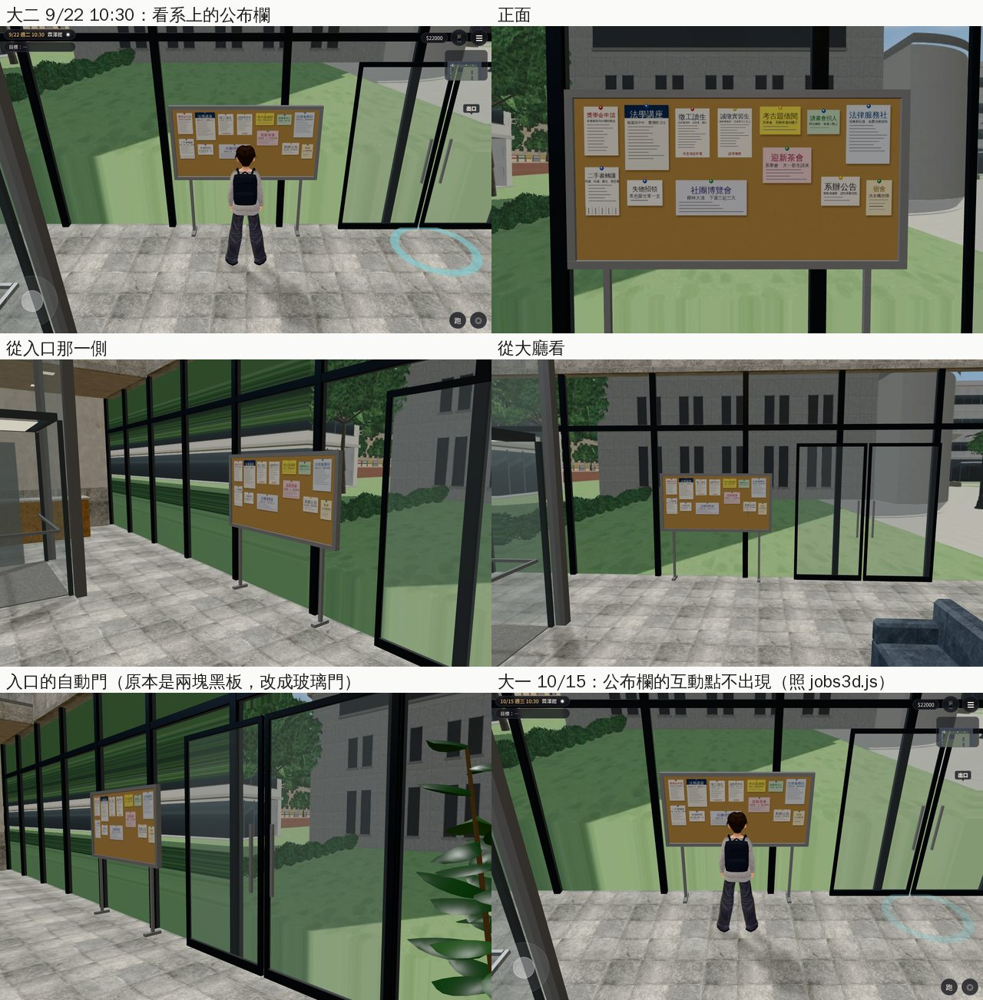

# 霖澤館 1F 入口東牆的公布欄（＋入口自動門改成玻璃門）

- **派工**：LAWWW-B 10-24 03:53（不急）。
  - 霖澤館 1F 公布欄的互動點搬到入口東牆 (7.2, 1.2)，原本和樓層簡介疊在一起。
  - 那裡沒有公布欄模型，補一塊。
- **做的人**：LAWWW2-B。
- **狀態**：`READY_FOR_ART_REVIEW`。場景美術的 `ART_APPROVED` 只有使用者能標。
- **沒有程式 patch**：只換 `assets/models/env/linze_interior.glb`。導航、互動點都不用改。

## 做了什麼

`tools/blender/linze_interior.py`（重新匯出 `linze_interior.glb`）＋`tools/blender/linze_notice_tex.py`（貼圖）：

- **公布欄**：
  - 一樓東面是玻璃帷幕，所以做成立在玻璃前面的獨立公布欄：白鐵框、兩根腳、淺色軟木板（2.0 × 1.0 m），面向大廳。
  - 位置：z 0.2～2.2，入口自動門的北邊。
  - 腳在 x 7.63～7.88：導航格的牆邊是 7.6，直櫺從 7.9 起。
  - 跟著東面一起淡出（`fadegrp: Efacade`）：鏡頭在建築外面時不會擋住人。
- **單子**（虛構的一般用語，沒有真實的補習班、事務所名稱；內文用看不清楚的灰線）：
  - 獎學金申請、法學講座、考古題借閱（系學會）、讀書會招人、法律服務社、二手書轉讓（下面撕得掉的電話條）、失物招領、迎新茶會、社團博覽會、系辦公告、宿舍。
- **兩張徵才單是另外的節點**：
  - 節點：`L0_WALL_notice_job_cram`（「徵工讀生」法科補習班，有意者請來電）、`L0_WALL_notice_job_office`（「誠徵實習生」律師事務所，請寄履歷）；
  - 和 AA_433 的「打電話問。」「寄履歷。」一致。
  - 現在一直看得到。要照 `jobs3d.js` 的時程開關（補習班大二上、事務所大三上才貼），遊戲可以照這兩個節點名稱開關；開關要不要做，LAWWW-B 決定。
- **入口自動門改成玻璃門**：
  - 原本兩扇門整扇是框的深色材質（`L0_autodoor_k`，4 cm 厚的方塊），畫面上是兩塊黑板。
  - 改成細鋁框（跟著東面淡出）＋玻璃＋直的把手。
  - 玻璃不放進淡出的群組：半透明的材質放進去會被設回不透明。

## 模型的差別（照網格名稱比對，`glbcmp_name.py`）

- 先用沒改的腳本重新匯出：和開發分支的 `linze_interior.glb` 一模一樣（52 個網格、0 個差別、檔案大小相同）。用的是開發分支的 `linze_layout.js`。
- 改了以後：
  - 新的 4 個：`L0_WALL_Efacade_lz_notice`（軟木板）、`L0_WALL_Efacade_steel`（框、腳、門把）、兩張徵才單；
  - 變了的 2 個：`L0_WALL_Efacade_frame`（門框）、`L0_glass`（多兩片門玻璃）；
  - 其他 50 個不變。
- 5,528 → 5,742 個三角形；檔案 2.00 → 2.06 MB（貼圖 1024 × 768）。

## 截圖（遊戲內，Playwright＋SwiftShader；不是 iPhone 實機）

開發 `bcc821fe0`＋這個 GLB（測試樹）。`post` 都確認：正式模型載入、最近的互動點。

- 大二 9/22 10:30：最近的互動點是「看系上的公布欄」。
- 大一 10/15：互動點不出現（`jobs3d.js` 的 `S.board2` 是空的），模型照樣在。

## 測試

- `tests/room_ceiling_unit.js`（會讀 `linze_interior.glb`）：ALL PASS。
- 導航、互動點沒有改，`nav_buildings_unit` 等不受影響。
- **沒有跑**：`tests/indoor_camera_occlusion.py`（瀏覽器、慢）。

## 還沒做／已知

- 徵才單照時程開關（遊戲端，LAWWW-B 決定要不要做）。
- 公布欄的字是貼圖，不會換；「看」的字照 `jobs3d.js`。
- 手機效能沒實測。
