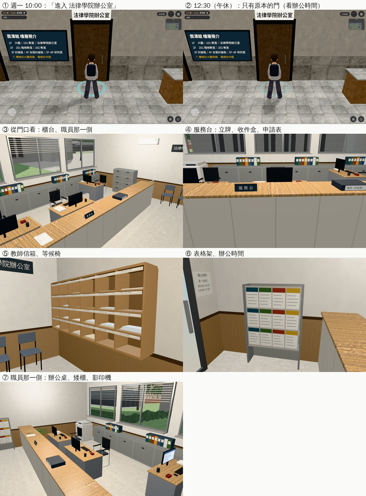

# 霖澤館 1F 法律學院辦公室（系辦；AA_399 第 7 節；任務 #82 第二間）

- **企劃**：AA_399 第 7 節（AA-B，企劃線 `5d09bb725`）。
  - 開：平日 09:00～12:00、13:30～17:00。櫃台＋系辦助理（背景人物，說話框寫「系辦助理」）。
  - 事件換到這裡：交換志願表繳交（2027-11-18 截止）、學分採計 C10（現在是 2D）、延畢的證書（2030-01-21）。
  - 其他時間：門上的辦公時間照舊。
- **派工**：LAWWW-B 10-24 03:53（P2），任務 #82 第二間。
- **做的人**：LAWWW2-B。
- **狀態**：`READY_FOR_ART_REVIEW`。場景美術的 `ART_APPROVED` 只有使用者能標。
- **Patch**：`docs/art-rebuild/second_ai/patches/rooms_ab3_1024.patch`（研討室 B、系辦、共同教學館 3F 考場同一份；對開發 `907cdc2f9`、`738cc7ffc` 都 `git apply --check` 過）。模型在我的分支。

## 做了什麼

- **模型**（Blender bpy，`tools/blender/env_second/linze_office.py` → `assets/models/env/second_ai/linze_office.{glb,json,layout.json}`）：
  - 0.86 MB、8,188 個三角形（教師信箱第一輪用木紋貼圖，板子細、紋路太粗，改成淺色木頭的單色）；房間 8.0 × 6.0 m，門（玻璃門）在大廳那一側靠東，南面一排窗（百葉拉起一半；窗景借 `linze_east`）。地板淺色磨石子。
  - **客人那一側**（門口到櫃台）：服務櫃台（1.0 m 高、客人那一側多出 4 cm）、櫃台上「服務台」立牌、「收件（申請表）」盒、一疊申請表、綁線的筆；東牆表格架；北牆西段教師信箱（6 × 4 木格子，名條只有號碼，幾格有信）；公告欄（交換甄選、學分抵免、獎學金、畢業審查、推甄簡章、教室借用，都是泛稱）；牆上「法律學院辦公室」字牌、辦公時間、時鐘；西牆兩張等候椅。
  - **職員那一側**（櫃台後面，玩家走不進去）：兩張辦公桌面向櫃台＋一張靠西；螢幕（畫面朝人）、鍵盤、一疊公文、筆筒、印章盒；窗下一排矮櫃（檔案夾）、影印機、西南角的檔案櫃；櫃台西端一道關著的小門（職員出入）。
  - 字都是一般用語（沒有真實姓名、課號、商標）。
- **配置**（`room_glb_layouts.js` 的 `linze_office`）：
  - `open`：`{wd:[1,2,3,4,5], ranges:[[9,12],[13.5,17]], holiday:false}`（和 `closed2_3d.js` 的 `CLOSED2.officeOpen` 同一套）。
  - `spots`：`assistant`（系辦助理坐在辦公桌）、`staff2`、`staff3`（背景）、`counter`（助理到櫃台收件、給證書的位置）、`player`（玩家在櫃台前）。
  - `interact`：服務台、教師信箱、表格架、公告欄（顯示的字等 AA 寫）。
- **程式**（和研討室 B 同一套）：
  - `building3d.js`：霖澤館的門也認 `d.gate`：辦公時間是「進入 法律學院辦公室」，其他時間照舊是原本的門（看辦公時間）。
  - `rooms_glb3d.js`：`open` 多認星期陣列、一天兩段時間（`ranges`）、國定假日不開（`holiday:false`）。
  - `closed2_3d.js`：**交換志願表改在裡面的「服務台」交**。原因：辦公時間門變成出入口以後，門口那一個「法律學院辦公室」按鈕在辦公時間是藏起來的，原本在門口交的流程就按不到了。門口那一條照舊留著（沒有 3D 房間時用）。

## 給劇情接線（LAWWW-B）

- 系辦助理放 `spots.assistant`（坐姿）；收件、給證書時站到 `spots.counter`，玩家在 `spots.player`。
- 學分採計 C10、延畢證書：2D 換 3D 時進 `linze_office`，在「服務台」演。
- 交換志願表：`CLOSED2.officeForm` 已經接在「服務台」（formDue 的條件不變）。

## 截圖（遊戲內，Playwright＋SwiftShader；不是 iPhone 實機）

開發 `738cc7ffc`＋ART-WZ6 patch＋這次的 patch，2026-09-07（一）。

## 測試

- `tests/linze_office_unit.js`（新，14 項；改之前第 1 項就失敗）：
  - 區域、正式模型、門的 `to`／`gate`、門上的辦公時間留著；
  - 開放時段：平日 10:00、14:00、16:50 開；08:30、12:30、13:20、17:00、20:00 關；週六、週日關；平日的國定假日（2026-09-25 中秋節）關；
  - 霖澤館 1F 的門：辦公時間只有「進入 法律學院辦公室」、中午和週六只有原本的門；
  - 引擎的 `simWalk`：客人那一側的服務台、教師信箱、表格架、公告欄、兩張等候椅、出口都走得到；櫃台後面走不到；spots 站得住；
  - `closed2_3d.js` 的「服務台」交志願表。
- 用到 `teach3d`／`building3d`／`closed2_3d`／`rooms_glb3d`／`room_glb_layouts` 的 59 個單元測試都 ALL PASS（三間一起）。

## 還沒做／已知

- 系辦助理、職員沒有放（LAWWW-B）。
- 「看」的字等 AA 寫（現在顯示名稱）。
- 門畫的是關著的玻璃門（開放時段也一樣），走近按「進入」就進去；要不要開著的門再說。
- 手機效能沒實測。
