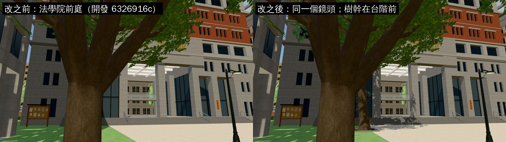
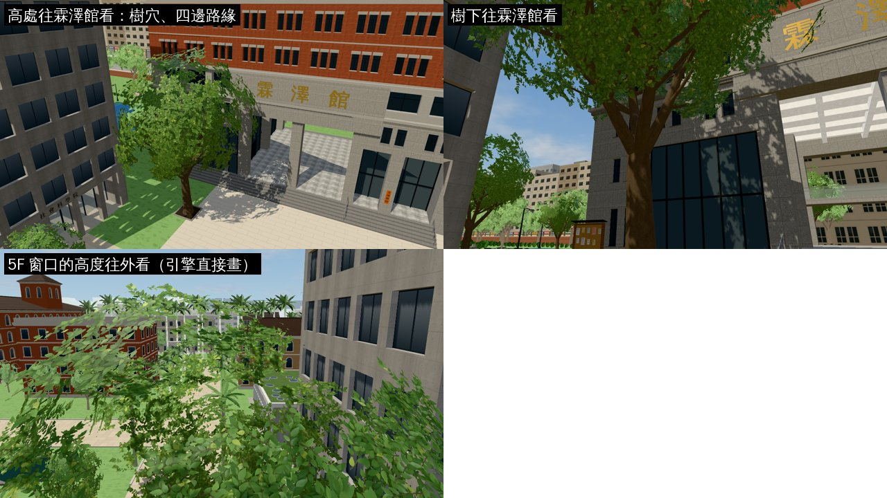
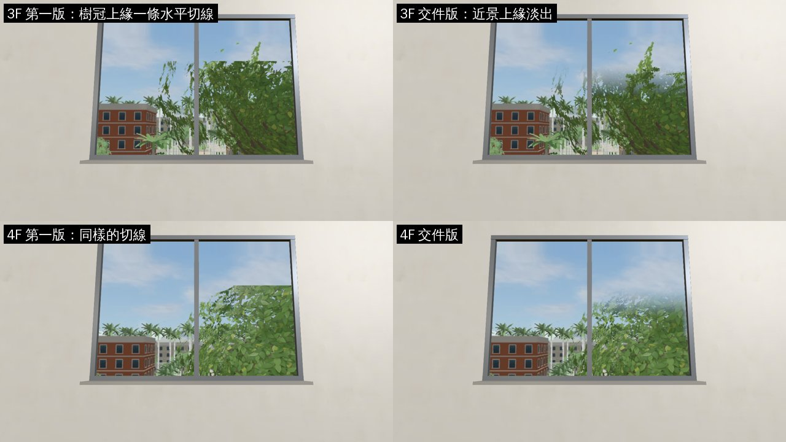
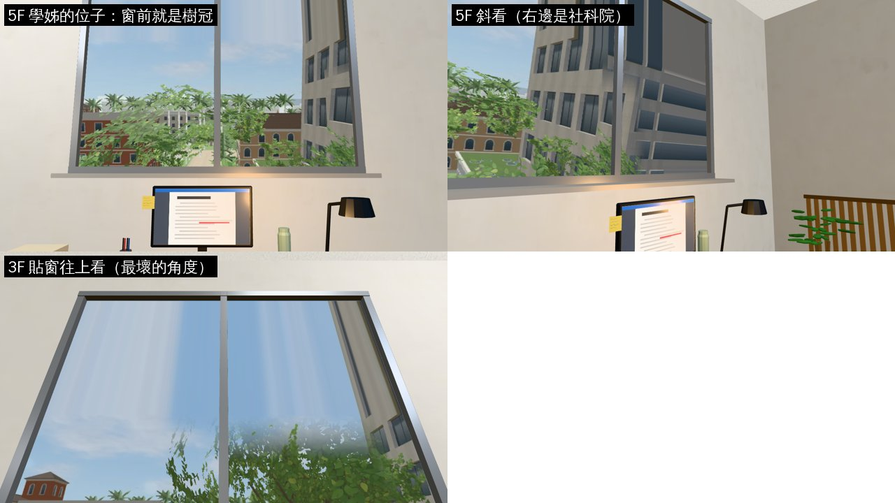

# 法學院廣場的大樟樹（CLOSED-SPACES-1023 第一項的「窗戶對著一棵樹」）

- **誰要的**：AA_399 1-1「她的位子在走廊最後一間、靠窗，窗戶對著一棵樹」（霖澤館 5F 碩士班研究室，學姊的位子）。
  - LAWWW-B 10-23 16:02 選 **A**：在法學院廣場種一棵真的大樹（17～19 m），從廣場看得到，霖澤館各層的窗景重拍。
- **做的人**：LAWWW2-B。
- **狀態**：`READY_FOR_ART_REVIEW`。場景美術的 `ART_APPROVED` 只有使用者能標。

## 做了什麼

- **樹**：`TK.tree(19, 4242, {sp:'camphor'})`。
  - 是已經在遊戲裡的正式樟樹模型（`street_trees.py` 的那一組；`prop.trees` 載好時換成正式模型，沒載好用程序化的備用）。不是新做的模型。
  - 位置 (24.5, −94.5)：霖澤館西段正面前 8.5 m，5F 碩士班研究室那扇窗（校園 x 24.4）的正前方。
  - 樹冠在 0.24H～0.96H（4.6～18.2 m）、半徑約 0.38H（7.2 m），不碰霖澤館的牆。
  - 離霖澤館入口（x 34）、公告欄（16.6, −100.6）都遠。
- **樹穴**：2.2 m 見方的土＋四邊 12 cm 高的路緣石。
- **導航**：只擋樹幹（半徑 1.0 m 的圓）。樹冠下面可以走。
- **窗景**：霖澤館 3F、4F、5F 的窗前都是這棵樹，改成兩層（遠景＋近景的樹冠，和店面窗景同一套 `W3.VIEW_LAYERS`）。
  - 一樓（`linze_south`）、201 還是一層，重拍（照片裡多了這棵樹）。
  - 近景照片的上緣、左右淡出（`tools/shots/shop_views_layers.py` 的 `FADE`）：
    - 第一版 3F、4F 的樹冠上緣有一條水平切線（下面的對照圖）。樹冠高過近景照片的上緣（3F 往上 40°，照片只到 22°），從窗下往上看就看到照片的邊。
    - 不用重拍：`VIEWS_REMATTE=<原始照片資料夾>` 只重新去背。
  - 景深（`tools/shots/shop_views_layers.json`）：

    | 窗 | 遠景 | 近景 |
    |---|---|---|
    | 3F | 26.91 m | 2.67 m |
    | 4F | 38.67 m | 2.14 m |
    | 5F | 18.97 m | 3.69 m |

  - 近景很近（2～4 m），因為樹冠一直長到霖澤館的牆前面；這是量出來的中位數，不是手調的。

## 檔案

- `docs/art-rebuild/second_ai/patches/linze_tree_1023.patch`（對開發 `700cb0b7f`，`git apply --check` 過）：
  - `src/zones3d.js`：法學院前庭種樹＋樹穴（7 行）。
  - `src/linze_upper3d.js`：`W3.VIEW_LAYERS` 加 `linze_3f`、`linze_4f`、`linze_5f`（3 行）。
  - `tools/shots/window_views.py`：拿掉 3F～5F（改在 `shop_views_layers.py` 拍，不然重跑會蓋掉遠景）。
  - `tools/shots/shop_views_layers.py`、`.json`：3F～5F 兩層、`FADE`、`VIEWS_REMATTE`、景深。
- 照片（我的分支直接放）：`assets/models/env/views/`
  - `linze_south_{day,night}.webp`、`linze_201_{day,night}.webp`：重拍。
  - `linze_{3f,4f,5f}_{day,night}.webp`：遠景。
  - `linze_{3f,4f,5f}_near_{day,night}.webp`：近景（新檔）。
- **沒有改**：`linze_east`（霖澤館東側的窗景）、`engine3d.js`、`world3d.js`。

## 截圖（遊戲內，Playwright＋SwiftShader；不是 iPhone 實機）

### 廣場：改之前／改之後（同一個鏡頭）

- 前景那棵是原本就有的樹。新的樟樹在後面、霖澤館台階前。

### 廣場：其他角度（只有改之後）

### 3F、4F 窗景：第一版的切線／交件版

### 5F 窗景

- 5F 學姊的位子：窗正前方往下是樹冠。
- 「3F 貼窗往上看」是最壞的角度：
  - 樹冠往上淡掉（實際的樹應該一直長上去，這是近景照片只拍到 22° 的限制）。
  - 天空有直條紋：遠景照片的上緣被拉長（`windowMat` 的 clamp）。改樹以前就有，一般走動的鏡頭看不到。

## 測試（測試樹＝開發 `6326916cc`＋這個 patch；`6326916cc`→`700cb0b7f` 沒有改到這幾個檔案）

| 測試 | 結果 |
|---|---|
| `tests/campus_layout_nav.py` | ALL PASS |
| `tests/reachability_all.py --zones campus` | ALL PASS（42 個互動點、9 個出入口） |
| `node tests/nav_buildings_unit.js` | ALL PASS |
| `node tests/linze_5f_unit.js` | ALL PASS |
| 3F、4F、5F 窗景截圖（上面） | 沒有 JS 例外；3F 18 calls／9066 三角形、5F 33 calls／3.1 萬三角形 |

## 還沒做到的

- 樹冠上緣是淡出，不是真的長上去（見上面）。要真的看到樹冠頂，得把近景照片拍得更高（`windowMat` 加近景自己的垂直比例），會改到 `world3d.js`，這一版沒做。
- 晚上的窗景沒有另外截圖檢查（照片有拍，和白天同一個鏡頭）。
- iPhone 沒看過。
