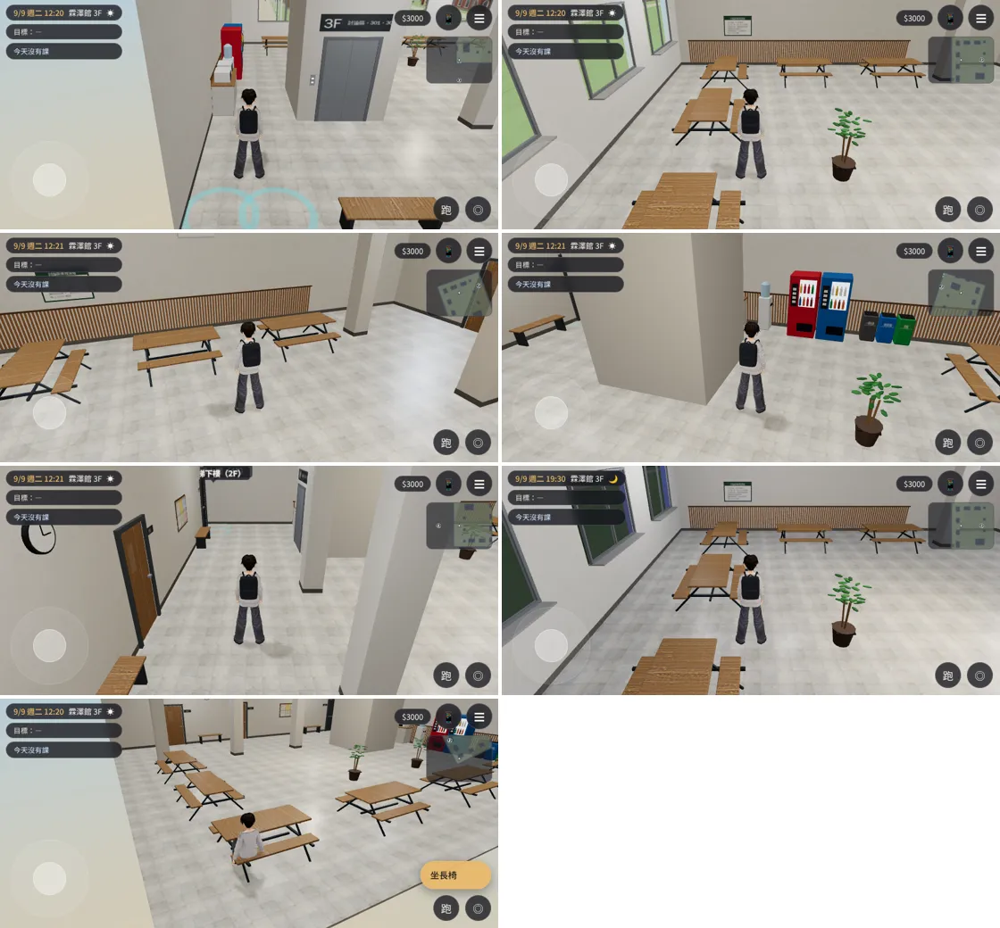
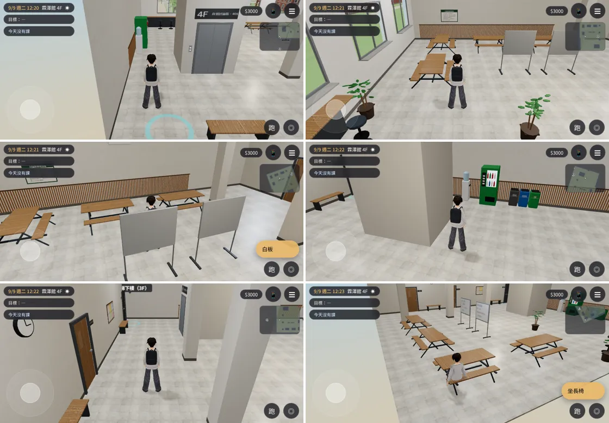
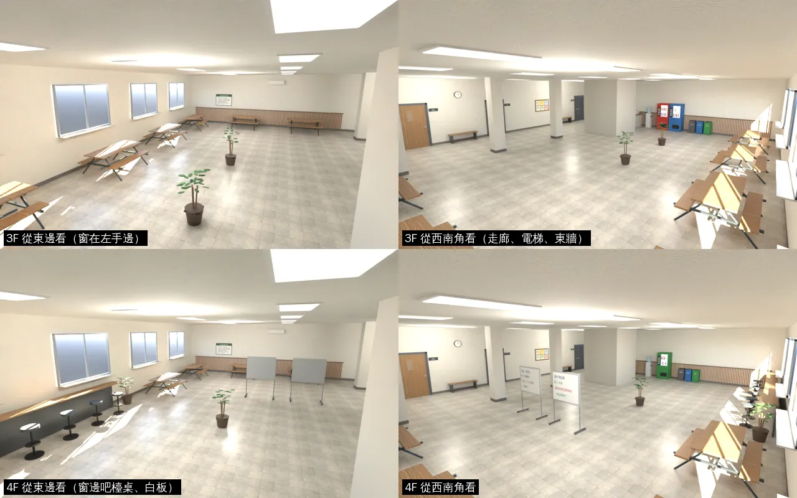
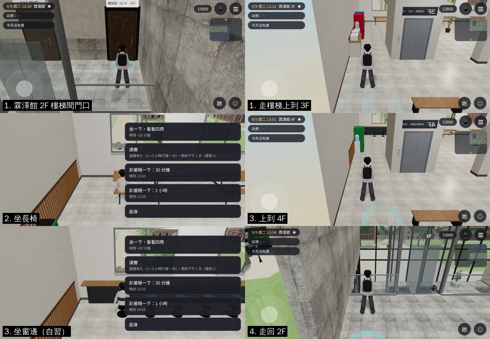

# 霖澤館 3F 學生討論區、4F 自習討論區（LINZE-34F-TABLES-1020）

LAWWW2-C，2026-10-20。
- 使用者的要求：
  - 10-20 試玩 v9.10.2：「霖澤3.4樓要有長條桌子附椅子像野餐椅子讓大家可以在那邊討論事情功課或者吃飯啊」「霖澤館3-8樓為什麼永遠都在蓋 萬才也是阿」；
  - 更正：「霖澤館長椅都是靠窗的靠牆的」；
  - 10-20 第一項：可進入的室內公共空間、長條桌、附椅或長椅、走廊、窗景、碰撞；桌椅要能討論、讀書、吃東西，不是純裝飾；留足夠的 NPC 活動與行走空間；交給 LAWWW 接線；室內不同視角的驗收截圖。
- 樓層規劃（202、研討室 A、5F 以上）見 [`../../LINZE_WANCAI_FLOORS_PLAN.md`](../../LINZE_WANCAI_FLOORS_PLAN.md)。

## 狀態（分開標）
| 項目 | 狀態 | 說明 |
|---|---|---|
| Blender 模型＋配置（`linze_3f`、`linze_4f`） | **MODEL_READY** | 導航模擬 0 個問題（第 3 節） |
| 接進遊戲 | **INTEGRATED（只在我的測試工作樹）** | 臨時接線套在開發分支 `207d6c43` 上（第 7 節的 patch）；正式接線由 LAWWW-C 做 |
| 真實玩家流程 | **FUNCTIONAL_VERIFIED（只在測試工作樹、Playwright 手機模擬）** | `tests/flow_linze_upper.py` **ALL PASS**（11 項，第 6 節）；**不是 iPhone 實機** |
| 美術 | **READY_FOR_ART_REVIEW** | 場景美術只有使用者能標 ART_APPROVED |
| 電梯 | 沒接 | 臨時接線的電梯只說「請走樓梯」；車廂、樓層按鈕由 LAWWW-C 用 B3 的電梯接（樓層清單在 layout 的 `elevator.floors`） |

## 1. 配置
座標和霖澤館室內（`src/data/linze_layout.js`）完全一樣：x −8…8、z −7…7、每層自己的地板 y＝0、天花板 3.4 m；電梯井、樓梯間的門和一、二樓同一個位置。

| | 3F 學生討論區 | 4F 自習討論區 |
|---|---|---|
| 靠南面窗 | 4 張野餐桌（長桌＋兩側長椅，每張 6 位） | 2 張野餐桌＋窗邊吧檯桌（6 張高腳椅，自習） |
| 靠西牆 | 2 張野餐桌（沿牆） | 2 張野餐桌（沿牆）、2 面可推的白板（討論） |
| 東牆 | 微波爐、飲水機、販賣機 ×2、回收桶 | 飲水機、販賣機、回收桶 |
| 北側走廊 | 301、302 教室的門（關著）、走廊長椅 ×2、電梯、樓梯間 | 401 教室、402 研討室的門（關著）、走廊長椅 ×2、電梯、樓梯間 |
| 牆上 | 樓層牌、使用規則、公告欄、時鐘、冷氣 | 同左 |
| 中間 | **空出來**：走道、NPC 走動 | 同左 |
| 座位 | 40（長椅 36＋走廊 4） | 34（長椅 24＋高腳椅 6＋走廊 4） |

- 長椅的座位標 `kind: 'study'`、`uses: ['討論', '讀書', '吃東西']`：坐下的選單有「讀書」；吃東西、和同學討論由 LAWWW 接。
- 野餐桌是一體的（桌子＋兩側長椅＋鐵框），碰撞是一整塊。
  - 座位在碰撞框裡面，所以每個座位都有遊戲用的走近點（`ap`）。
  - 玩家按「坐長椅」先走到走近點再坐下，和 118 巷的店一樣。
- 窗：南牆 4 個窗洞（2.2 × 1.6 m、中心 2.1 m，和遊戲 `room()` 的窗一樣）。
  - 窗外的景是遊戲裡校園的畫面：`assets/models/env/views/linze_{3f,4f}_{day,night}.webp`，由 `tools/shots/window_views.py` 從霖澤館南邊、3F／4F 的高度拍。
- 5F 以上：電梯按鈕「5F–8F 研究室（教職員）」，按下去說「研究室樓層。電梯要刷教職員證才會停。」；樓梯間往上「5 樓以上是研究室，樓梯間的門要刷教職員證。」。**不寫整修中**。

## 2. 截圖（遊戲內，Playwright 844×390 橫向，9/9 週二 12:20；[捷徑] 人物放到位置、設鏡頭，只為了截圖）
- 3F（①～⑦）：

- 4F：

- Blender 算圖（Cycles，不是遊戲畫面）：

## 3. 模型規格
| | 3F | 4F |
|---|---|---|
| GLB | `assets/models/env/second_ai/linze_3f.glb` | `linze_4f.glb` |
| 大小 | 1.00 MB | 1.01 MB |
| 三角形 | 11,248 | 11,458 |
| 網格（primitive） | 29 | 29 |
| 材質 | 13 | 13 |
| 貼圖 | 11 張，0.20 MB，最大 1024 px | 同左 |
| 碰撞框 | 18 | 17 |
| 座位／有走近點 | 40／18 | 34／12 |
| 導航模擬（0.4 m 格、內縮 0.25） | 0 個問題 | 0 個問題 |

- 材質：
  - 地板、牆、踢腳板、天花板：Poly Haven CC0（`tools/blender/textures/`）；
  - 桌面：木紋 PBR；
  - 鐵框、販賣機、飲水機：頂點色；
  - 日光燈：`GLOW_`，整天亮。
- 印刷品（樓層牌、使用規則、公告、門牌、白板、回收標籤）都是自己畫的：`tools/blender/env_second/textures/gen/linze_upper_print.png`。
  - 內容是虛構的校園日常，沒有真實姓名、課號、品牌。

- 遊戲內（`tests/perf_rooms.py`＝`tests/perf_scenes.py` 的 MEASURE；從樓梯間進來的鏡頭，白天，含玩家人物和太陽陰影那一輪；SwiftShader，只拿來互相比，不是手機的 fps）：

| 區域 | draw call | 三角形 | 看得到的網格 | 材質 |
|---|---|---|---|---|
| 3F | 80（不含陰影 64） | 90,012（53,316） | 48 | 50 |
| 4F | 78（62） | 90,062（53,366） | 47 | 49 |
| 對照：霖澤館 1F、2F（`linze`） | 173（152） | 234,138（197,214） | 148 | 146 |

  樓上的一層樓大約是一、二樓大廳的一半。

## 4. 已知缺點
- 電梯沒接（最上面的狀態表）。
- 窗外的景是一張照片：
  - 斜著看沒有視差；
  - 晚上換夜景圖。
- 教室門是門片＋門牌，不能開。臨時接線說「這個時段有課，門關著」；正式的字要不要照課表換，由 LAWWW-C 決定。
- 野餐桌只有一種木色；3F、4F 的家具大部分相同（4F 多了白板、吧檯桌）。
- 長椅坐下的姿勢是一般坐姿：腿會在長椅前面，不會跨進桌子底下。
- 還沒在 iPhone 實機上看過。

## 5. 這次修掉的問題（看截圖、跑流程才發現的）
1. 電梯門上的樓層牌字是反的（「3F」左右鏡像）：貼圖四邊形的頂點順序錯了，牆朝走廊那一面要從 +x 開始。東牆回收桶的標籤同樣的錯，一起修。
2. 4F 窗邊吧檯桌的高腳椅：
   - 原本的走近點離座位 0.6 m，「坐窗邊」按鈕只在 0.7 m 以內出現；
   - 人站偏 0.2 m 就看不到按鈕（第一次流程測試 FAIL：停在 (6.43, 5.39)、沒有按鈕）；
   - 走近點改成高腳椅後面 0.45 m 以後 PASS。
3. 長椅座位原本標 `eat`，改成 `study`＋`uses`。
   - 原因：坐下的選單要有「讀書」；吃東西、討論由 LAWWW 接。

## 6. 真實玩家流程（`tests/flow_linze_upper.py`，套 patch 的開發分支 `207d6c43`，手機模擬橫向，不用 turbo）
- [前置／捷徑] 讀檔到 9/9（二）12:20 霖澤館 2F 迴廊、樓梯間的門前面；之後全部用點地面、按按鈕走。
- ALL PASS（11 項）：

| # | 項目 | 結果 |
|---|---|---|
| 1 | 2F「進入 樓梯間（往 3F、4F）」→ 3F（正式模型）、站得住、不在「走樓梯」上 | PASS |
| 2 | 走到野餐桌「坐長椅」→ 坐下；站起來、站得住 | PASS |
| 3 | 「走樓梯上樓（4F）」→ 4F；走到窗邊桌「坐窗邊（自習）」→ 坐下；站起來 | PASS |
| 4 | 「走樓梯下樓（3F）」→ 3F；「走樓梯下樓（2F）」→ 霖澤館 2F（第 1 層）、站得住 | PASS |
| 5 | 沒有 JS 例外；劇情自動走路沒有用到卡住保險（walkFallbacks＝0） | PASS |

## 7. 交付
- 模型＋配置：`assets/models/env/second_ai/linze_3f.glb`／`.json`／`.layout.json`、`linze_4f.*`。
- 窗景：`assets/models/env/views/linze_3f_day.webp`、`linze_3f_night.webp`、`linze_4f_day.webp`、`linze_4f_night.webp`。
- 腳本：`tools/blender/env_second/linze_upper.py`（`/opt/blenv/bin/python tools/blender/env_second/linze_upper.py -- --floor 3f,4f`）。
- 臨時接線 patch：[`../../patches/linze_upper_wire_test.diff`](../../patches/linze_upper_wire_test.diff)，套在開發分支 `207d6c43`。
  - `src/linze_upper3d.js`：兩個區域 `linze_3f`、`linze_4f`。做法照 118 巷的店：`Z3.room`＋`attachRoomGLB`、導航格、座位、互動點、樓梯上下。
  - `src/data/linze_upper_layouts.js`：從 layout.json 產生。
  - `index.html`：加兩行 script。
  - `src/building3d.js`：門可以自己帶出生點 `d.spawn`（2F 樓梯間的門 → 3F）。
  - `tools/shots/window_views.py`：加 `linze_3f`、`linze_4f`。
  - `tests/flow_linze_upper.py`：真實玩家流程。
  - `tests/shots_linze_upper.py`：本頁的截圖。
- LAWWW-C 正式接線要做的：
  1. `linze_layout.js` 的 `stairs3f` 門打開，往 3F；
  2. 電梯樓層照 layout 的 `elevator.floors`；
  3. 樓層簡介改字（`building3d.js:169`）；
  4. 路人、作息（AA-C 排）。
