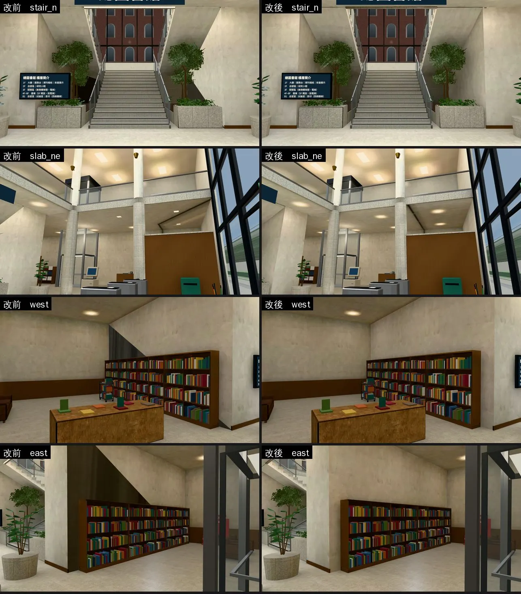
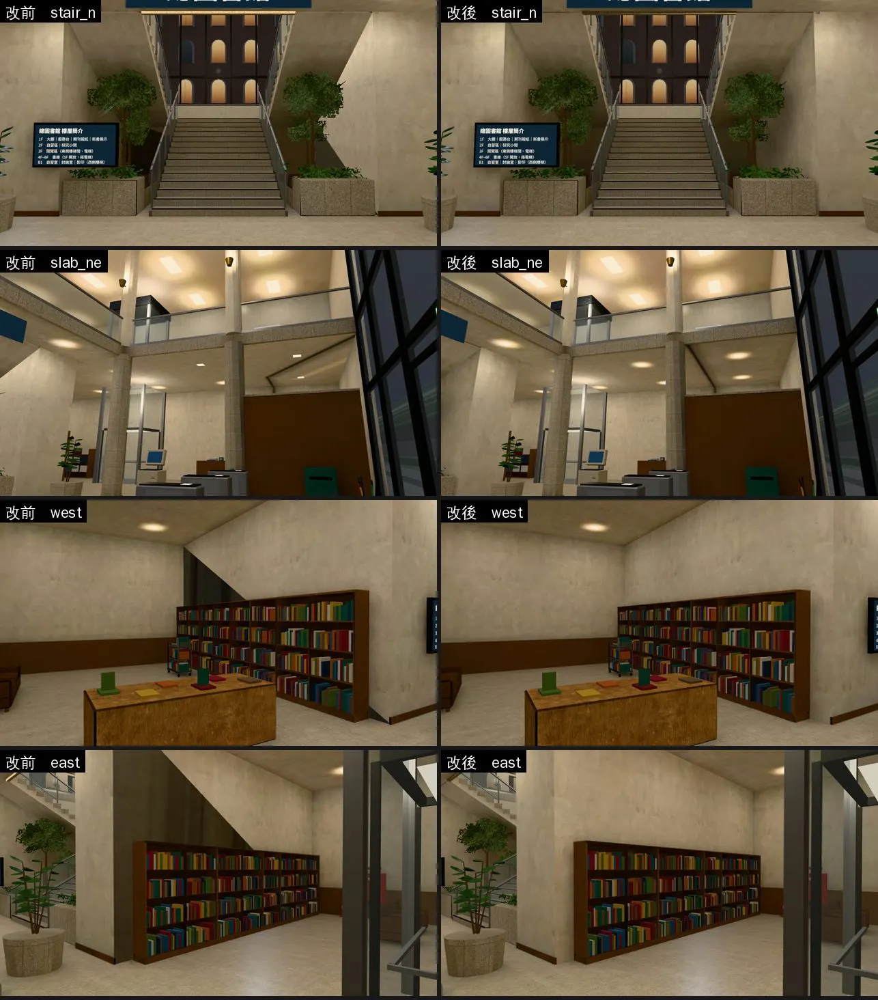
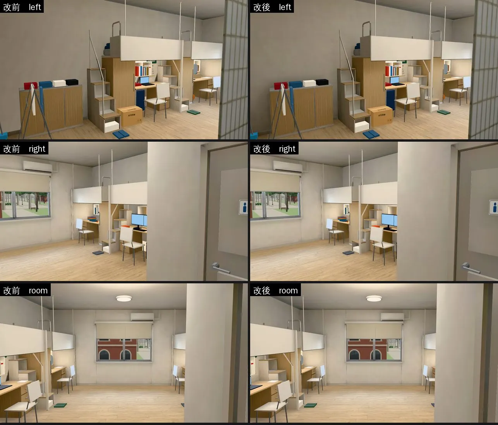
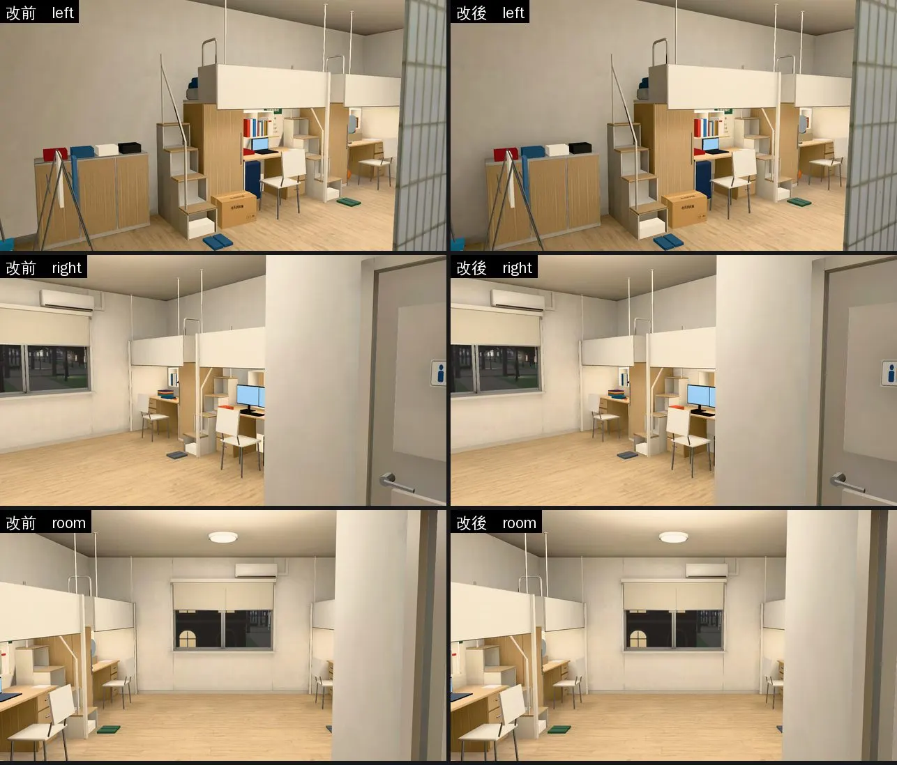
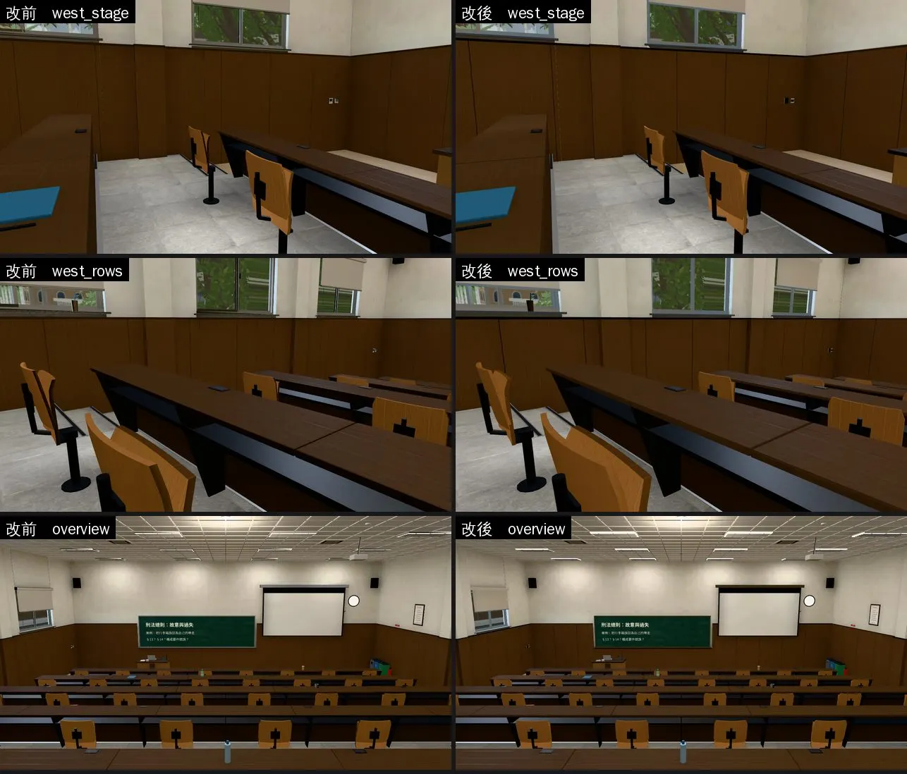
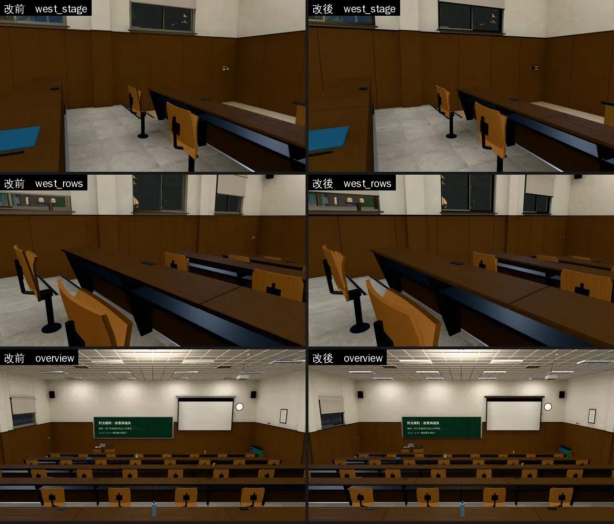

# 舊房間重烘：光照被壓扁的面（LM-COLLAPSE-1030；LAWWW2-B 2026-10-30）

- **起因**：SOCLIB-LM-1030／BOYA n19 查到烘焙工具的 bug（`bake_room.py` 的 `collapse_black` 只看面的中心，大的面中心剛好被東西擋住就整面收掉，`lm_fix_hidden.py` 再接到對角線上拉開）；工具已修（`soclib_lm_1030/README.md` 第二節第 3 點）。
- **LAWWW-B 10-30 18:19 派工**（P2，NOODLE-LM-1030 之後）：法律學院圖書館 → 總圖大廳 → 宿舍四人房 → 201，每間做完就交。
  - 驗收：`tools/blender/env_second/lightbake/lm_squash_scan.py` 朝室內、看得到的面壓扁要 0 m²，再附同鏡頭的改前改後。
- **做法**：模型、燈、參數都不動，只用修好的 `bake_room.py` 照原本的烘焙腳本重烘（`bake_lawlib.sh` 等）。模型大小、三角形數不變。
- **狀態**：`READY_FOR_ART_REVIEW`。截圖是 Playwright＋SwiftShader，**不是 iPhone 實機**；讀檔放位置是 [捷徑]。改前＝開發 `ade6ef271` 原樣，改後＝加這一包。

## `lm_squash_scan.py` 這次改了一點

- 射線碰到的是**背面**，就不算看得到：起點在別的實心零件裡面（例如伸進牆裡 7 cm 的樓梯）。
- 原本會把樓梯底下封住的面算成看得到。

## 1. 法律學院圖書館（`assets/models/env/lawlib_interior.glb`＋兩張光照貼圖）

- **掃描**（朝室內、被壓扁）：開發分支原樣 91.4 m² → 重烘 12.0 m²。剩下兩面我逐一查過，都看不到：
  - 樓梯間的牆（x −3.47，朝西，10.7 m²）：這面牆是一個四邊形、兩個三角形。被壓扁的是下面那一個，整個在樓梯 B 的踏面和平台底下（樓梯底下封住的空間）。上面那一個三角形是好的。
  - 入口上方那面牆的外側（朝東，1.4 m²）：朝室外，烘焙本來就當作看不到。
- **看得到的差別很小**：
  - 原本壓扁最大的兩面（一樓、二樓東牆，各 28 m²），大部分在現期期刊櫃、書架後面。
  - 五個鏡頭每張改到的像素都不到 1.1%：期刊櫃邊緣、樓梯口幾塊。
- **樓梯間右邊牆上那幾塊模糊的深色**：是欄杆柱子的影子，改前改後一樣。看起來糊糊的，是那面牆分到的光照貼圖解析度低（約 9 cm 一格）。這不是這個 bug；要改的話是另外的工作（提高那面牆的光照貼圖比例）。

改到的地方（白天；右邊白色＝有變的像素）：

- **測試**：全部 Node 775／0（測試樹＝開發 `ade6ef271`＋這一包＋NOODLE-LM-1030）。只換二進位（GLB＋兩張光照貼圖），不用改程式；模型、三角形數不變，效能沒有重量。

## 2. 總圖大廳（`assets/models/env/library_interior.glb`＋兩張光照貼圖）

- **掃描**（朝室內、被壓扁）：開發分支原樣 83.2 m² → **重烘 0 m²**。
  - 原本：二樓樓板底面 31 m²、一樓東西兩面灰泥牆各 20 m²、北牆 12 m²…
- **看得到的差別很明顯**（和博思 101 講台那面牆同一個 bug）：
  - 西側、東側書架後面那兩面牆：原本一大塊斜的深色三角形（灰泥牆下半個三角形被收掉、對角線那一條光拉開），重烘以後沒有了。
  - 從一樓往上看二樓樓板底面：光照照實際的燈。
  - 四個鏡頭改到的像素 2～10%。
- 鏡頭（`tools/blender/env_second/shots/libhall_lm_shots.py`）：①從入口往北看中央大樓梯 ②往東北上看二樓樓板底面 ③西側灰泥牆 ④東側灰泥牆。

- **測試**：和總圖大廳有關的 Node 三支都過（`library_hall_lightmap_unit.js`、`library_b1_unit.js`、`singleside_interiors_unit.js`）；測試樹＝開發 `ade6ef271`＋前一包＋這一包。只換二進位（GLB＋兩張光照貼圖），模型、三角形數不變，不用改程式。

## 3. 宿舍四人房（`assets/models/env/second_ai/dorm_room4.glb`＋三張光照貼圖：白天、晚上、熄燈）

- **掃描**（朝室內、被壓扁）：開發分支原樣 21.0 m²（左牆靠門那一半、右牆靠窗那一半，各 10.5 m²）→ **重烘 0 m²**。
- **重烘以後的模型和開發分支一樣**：158 個節點、127 個網格、19,144 個三角形、42 個材質。
- **看得到的差別小**：
  - 左牆上半原本一塊偏灰的漸層，重烘以後和旁邊一樣亮：左牆鏡頭改到約 4% 像素。
  - 右牆、整間的鏡頭不到 1%：那兩面牆下半大多在床、書桌、衣櫃後面。
- **重烘要注意**：
  - 這間用到 `tools/blender/env_second/textures/floor_tiles_06`（洗手間地板）。開發分支沒有這份烘焙用的原始貼圖，第一次在開發分支的測試樹烘不起來。
  - 要從 `claude/funny-albattani-iawshm` 複製進去（LAWWW-B 10-30 21:37：留在這個分支就好，遊戲不讀）。
- 鏡頭（`tools/blender/env_second/shots/dorm4_lm_shots.py`）：①左牆靠門那一半 ②右牆靠窗那一半 ③從門口看整間。

- **測試**：用到 `dorm_room4` 的 Node 八支全過。
  - `dorm_lightmap_unit`、`room_ceiling_unit`、`dorm_seethru_unit`、`v0_dorm_props_unit`、`dorm_205_unit`、`dorm_y3_items_unit`、`room_y4_unit`、`jacket_econ_unit`。
  - 只換二進位（GLB＋三張光照貼圖），不用改程式。

## 4. 法律系館A 201 階梯教室（`assets/models/env/classroom_201.glb`＋兩張光照貼圖）

- **掃描**（朝室內、被壓扁）：開發分支原樣 5.8 m²（西牆下緣兩小塊）→ **重烘 0 m²**。
- **重烘以後的模型和開發分支一樣**：63 個節點、62 個網格、62,232 個三角形、32 個材質。
- **看得到的差別小**：西牆木護牆板的明暗稍微不一樣，三個鏡頭改到 3～8% 像素。
- 201 的烘焙腳本（`bake_classroom_201.sh`）沒有跑 `lm_fix_hidden.py`（比 `lm_fix_hidden.py` 早），這次照原本的流程，沒有加。
- 鏡頭（`tools/blender/env_second/shots/c201_lm_shots.py`）：①講台西側 ②第二排西側 ③從後門口看整間。

- **測試**：用到 `classroom_201` 的 Node 三支全過（`room_ceiling_unit`、`room_rtnight_unit`、`seat_fold_unit`）。只換二進位（GLB＋兩張光照貼圖），不用改程式。

## 總結（四間）

| 房間 | 朝室內被壓扁（開發 → 重烘） | 看得到的差別 |
|---|---|---|
| 法律學院圖書館 | 91.4 → 0 m² | 小（東牆大多在櫃子、書架後面；<1.1%） |
| 總圖大廳 | 83.2 → 0 m² | **明顯**（東西兩面灰泥牆的斜黑三角不見了；2～10%） |
| 宿舍四人房 | 21.0 → 0 m² | 小（左牆上半偏灰漸層；4%） |
| 201 | 5.8 → 0 m² | 小（西牆護牆板明暗；3～8%） |
