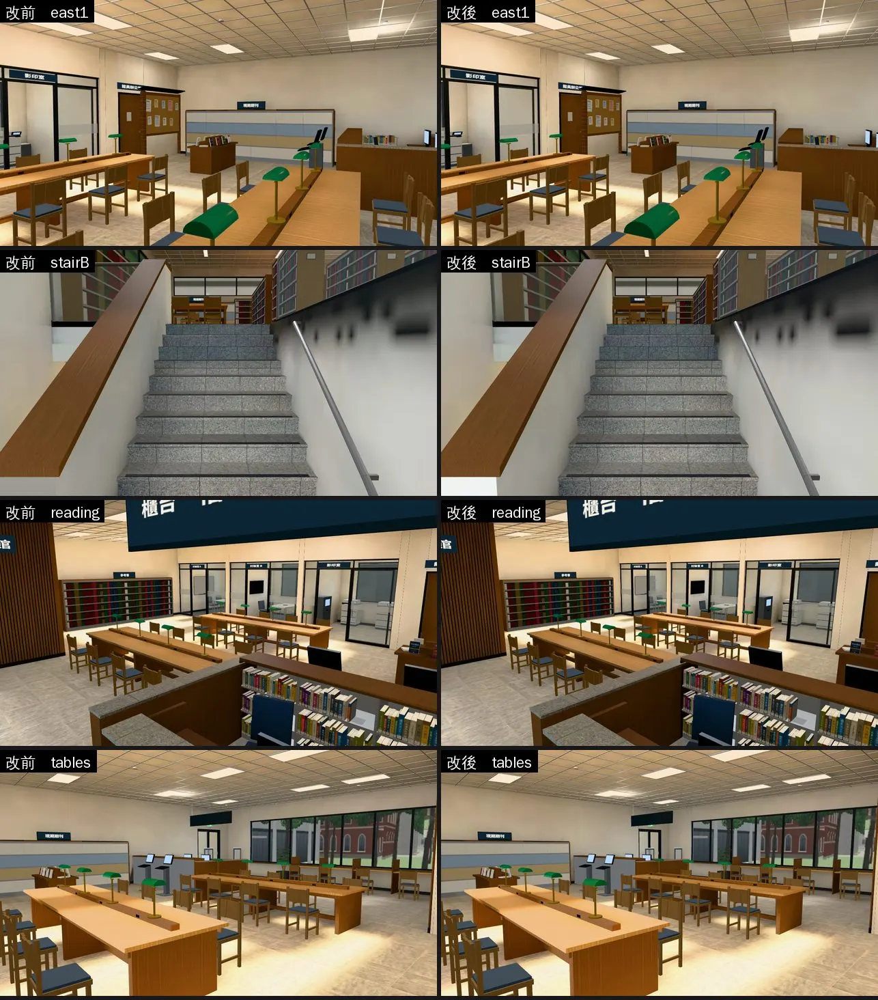
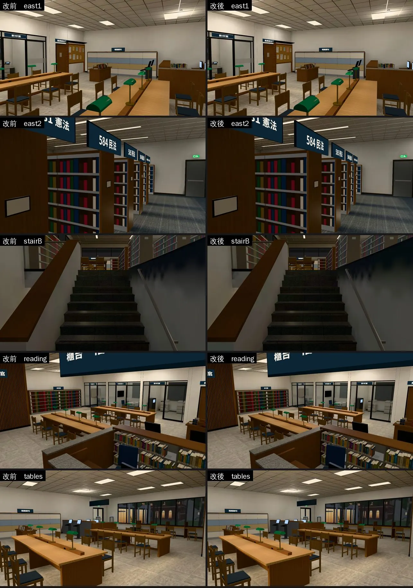
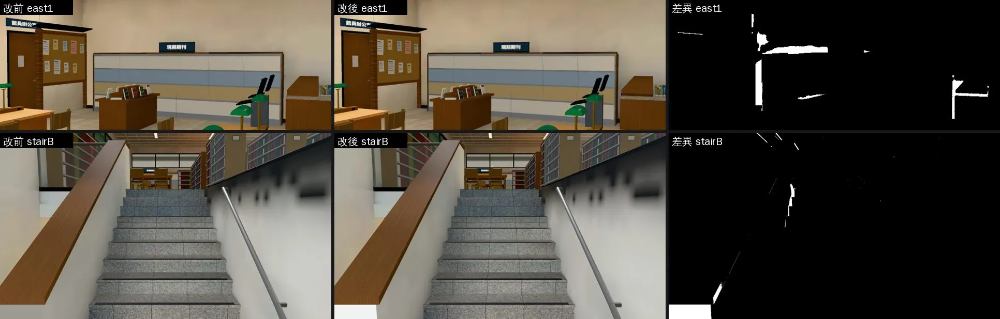

# 舊房間重烘：光照被壓扁的面（LM-COLLAPSE-1030；LAWWW2-B 2026-10-30）

- **起因**：SOCLIB-LM-1030／BOYA n19 查到烘焙工具的 bug（`bake_room.py` 的 `collapse_black` 只看面的中心，大的面中心剛好被東西擋住就整面收掉，`lm_fix_hidden.py` 再接到對角線上拉開）；工具已修（`soclib_lm_1030/README.md` 第二節第 3 點）。
- **LAWWW-B 10-30 18:19 派工**（P2，NOODLE-LM-1030 之後）：法律學院圖書館 → 總圖大廳 → 宿舍四人房 → 201，每間做完就交。
  - 驗收：`tools/blender/env_second/lightbake/lm_squash_scan.py` 朝室內、看得到的面壓扁要 0 m²，再附同鏡頭的改前改後。
- **做法**：模型、燈、參數都不動，只用修好的 `bake_room.py` 照原本的烘焙腳本重烘（`bake_lawlib.sh` 等）。模型大小、三角形數不變。
- **狀態**：`READY_FOR_ART_REVIEW`。截圖是 Playwright＋SwiftShader，**不是 iPhone 實機**；讀檔放位置是 [捷徑]。改前＝開發 `ade6ef271` 原樣，改後＝加這一包。

## `lm_squash_scan.py` 這次改了一點

- 射線碰到的是**背面**，就不算看得到：起點在別的實心零件裡面（例如伸進牆裡 7 cm 的樓梯）。
- 原本會把樓梯底下封住的面算成看得到。

## 1. 法律學院圖書館（`assets/models/env/lawlib_interior.glb`＋兩張光照貼圖）

- **掃描**（朝室內、被壓扁）：開發分支原樣 91.4 m² → 重烘 12.0 m²。剩下兩面我逐一查過，都看不到：
  - 樓梯間的牆（x −3.47，朝西，10.7 m²）：這面牆是一個四邊形、兩個三角形。被壓扁的是下面那一個，整個在樓梯 B 的踏面和平台底下（樓梯底下封住的空間）。上面那一個三角形是好的。
  - 入口上方那面牆的外側（朝東，1.4 m²）：朝室外，烘焙本來就當作看不到。
- **看得到的差別很小**：
  - 原本壓扁最大的兩面（一樓、二樓東牆，各 28 m²），大部分在現期期刊櫃、書架後面。
  - 五個鏡頭每張改到的像素都不到 1.1%：期刊櫃邊緣、樓梯口幾塊。
- **樓梯間右邊牆上那幾塊模糊的深色**：是欄杆柱子的影子，改前改後一樣。看起來糊糊的，是那面牆分到的光照貼圖解析度低（約 9 cm 一格）。這不是這個 bug；要改的話是另外的工作（提高那面牆的光照貼圖比例）。

改到的地方（白天；右邊白色＝有變的像素）：

