# 光照貼圖的接縫和全黑的面（LM-SEAM-1028；LAWWW2-C 2026-10-28）：之前交的五間＋男一舍門廳，只換 GLB

- **起因**：男一舍門廳（DORM-HALL-LM-1028）第一次正式烘焙，門框上方一條條點狀黑線。
  - 方塊拼的牆段，接縫是 T 形接頭（一邊有頂點、一邊沒有）。畫的時候露出一點一點的縫，看到的是夾在中間、烘成全黑的面。
  - 量之前交的 201、202、霖澤館大廳、萬才館（大廳＋二樓、多功能教室），也有 50～470 m² 全黑的面。大部分看不到，看得到的在窗框、門框、捲簾盒、兩扇門中間的壓條、出口燈的側面。
- **做法**：`tools/blender/env_second/lightbake/lm_fix_hidden.py`（第六版）。**不用重烘**，貼圖不動，只改 GLB 裡第二套 UV（TEXCOORD_1）。
  - 先從面的中心沿法線射一條線，分三種：
    - **夾在零件中間**（5 mm 內碰到東西，或碰到別的方塊的背面）：接共用一條邊、看得到的那一面。
    - **露在外面**：接附近 60 cm 內、朝同一個方向、看得到的面。
    - **朝建築外面**（什麼都沒碰到：外牆外側、地板朝外的切邊、從門口看出去的牆面）：
      - 沒分像素的：接附近朝同一個方向、而且有亮的面；沒有就接共用一條邊的面（例如地板的上面）。
      - 烘成全黑的：不動。
  - 不拉亮：露在外面、本來就很暗的縫（附近沒有同方向的面）。
  - 「全黑」要整面每一處都黑（中心、角、邊的中點，大的面再加一張格子），不是只看中心。
- **狀態**：`READY_FOR_ART_REVIEW`（建築、場景只有使用者能標 `ART_APPROVED`）。程式不用改。
- **怎麼套**：`git checkout d5e28e291 -- `＋下面六個檔：
  - `assets/models/env/classroom_201.glb`
  - `assets/models/env/second_ai/linze_202.glb`
  - `assets/models/env/linze_interior.glb`
  - `assets/models/env/wancai_interior.glb`
  - `assets/models/env/second_ai/wancai_multi.glb`
  - `assets/models/env/dorm_hall.glb`：開發分支 `217e655bd` 已整合的是第三版，這包換成第六版，差別見下面「男一舍門廳」。
- **截圖**：遊戲內、玩家鏡頭，手機橫向 844×390，Playwright＋SwiftShader 模擬，**不是 iPhone 實機**。讀檔進房間、人放到指定位置是 [捷徑]。白天 14:00。左：開發分支；右：這包。

## 201（階梯教室）

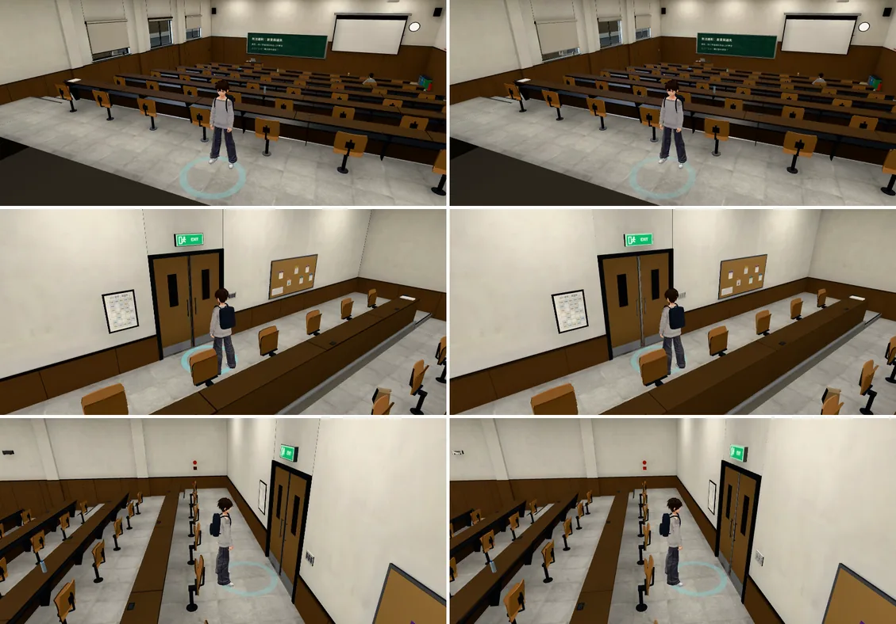

放大三倍（左改前、右改後）：

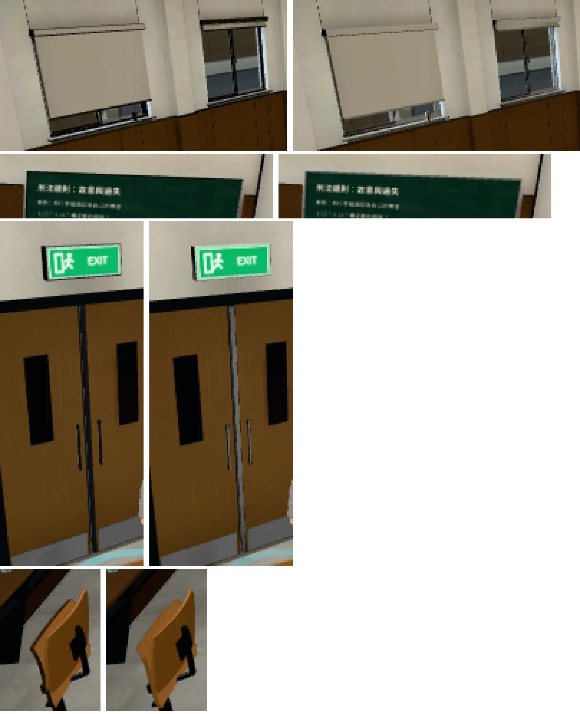

- 窗框頂、捲簾盒下緣、壁柱邊上的黑線變成窗框、牆的亮度。
- 兩扇門中間的鋁壓條：本來全黑，現在是鋁色。出口燈盒子的側面也一樣。
- 開關面板、公告欄外框沒有動（它們有一部分本來就亮，不算全黑）。

## 202（平面教室）

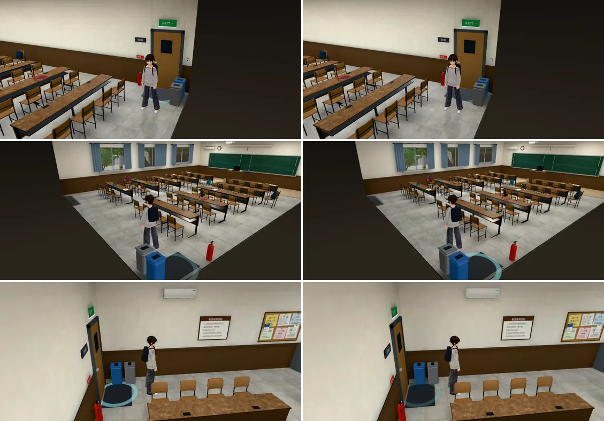

- 202 本來全黑、看得到的面很少，看起來幾乎一樣。唯一的差別是地上互動圈的動畫（每張截圖閃的時間不一樣）。
- 交件前抓到、已經修掉的退步（左：改前；中：第三版；右：這包。其他退步見最後「交件前自己抓到的退步」）：

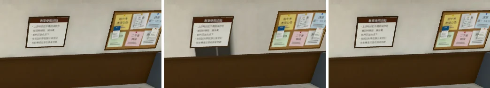

  - 第三版只看每一面的中心判斷全黑。東牆一整面（11.5 m² 的三角形）的中心剛好在「教室使用須知」那塊板子後面的影子裡，整面被當成全黑、光照座標改掉，牆上抹出一塊暗影。
  - 改成整面每一處都黑才算，暗影不見了。

## 萬才館多功能教室

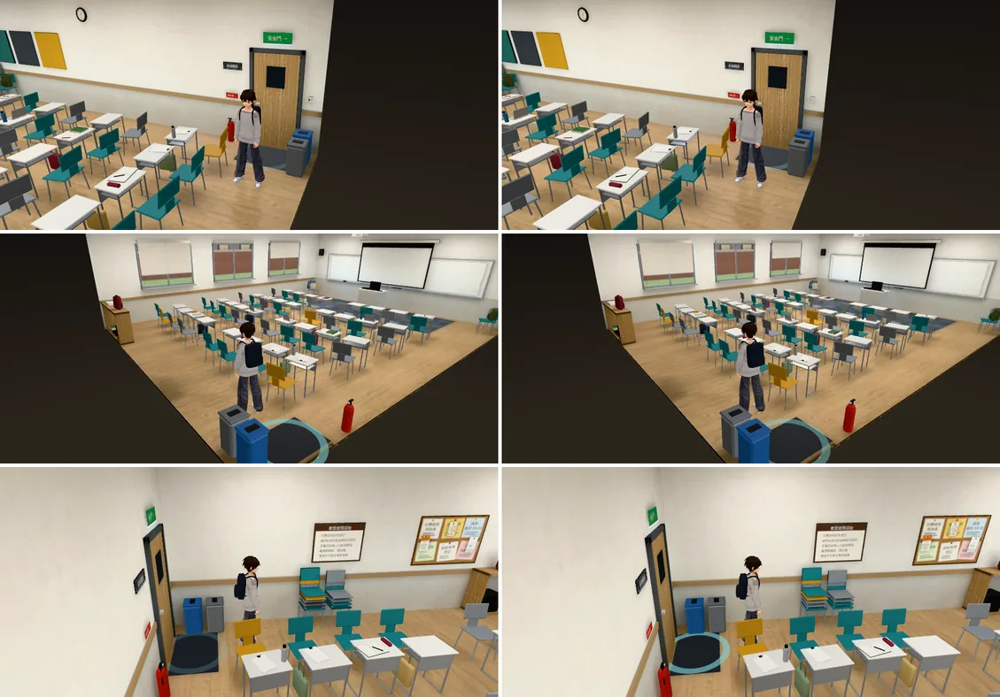

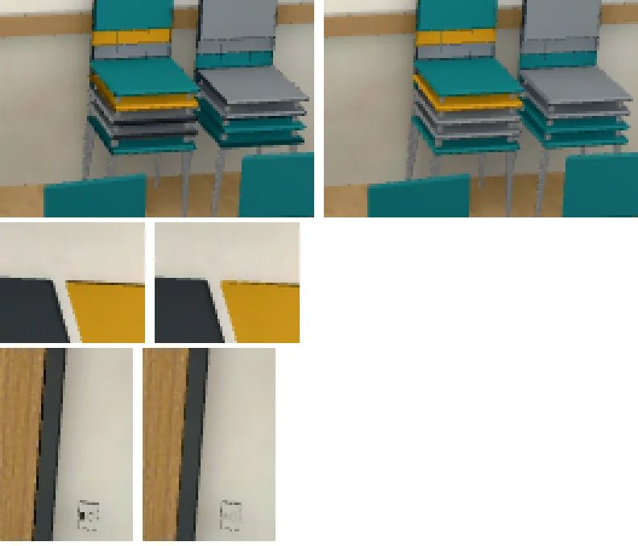

- 疊起來的椅子中間、開關面板裡面：本來全黑的縫變成灰的。

## 霖澤館大廳

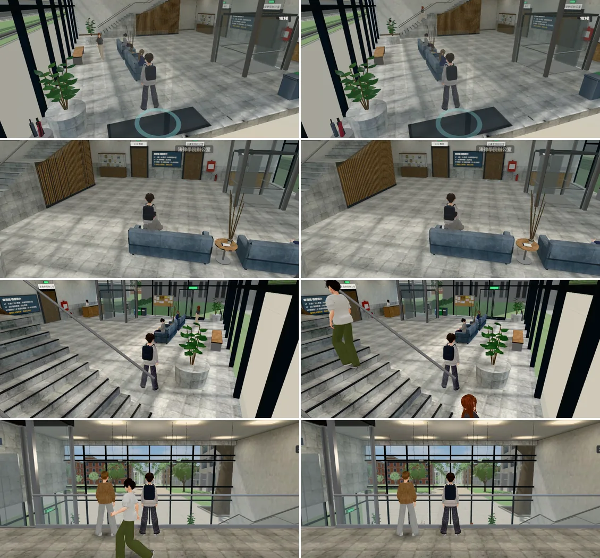

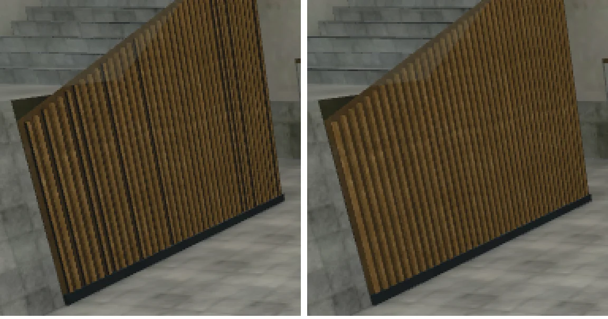

- 木條牆：本來有幾根木條側面全黑，一條一條不規則的黑線；現在每根木條一樣。
- 樓梯、玻璃帷幕、二樓看起來一樣。其他差別是走動的路人。
- 鏡頭在牆外、牆淡出時看得到的地板切邊（左：改前；中：第三版變黑；右：這包）：

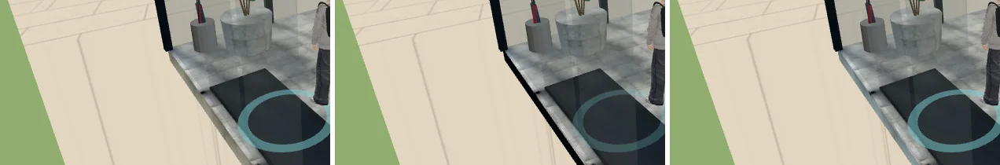

## 萬才館（大廳＋二樓）

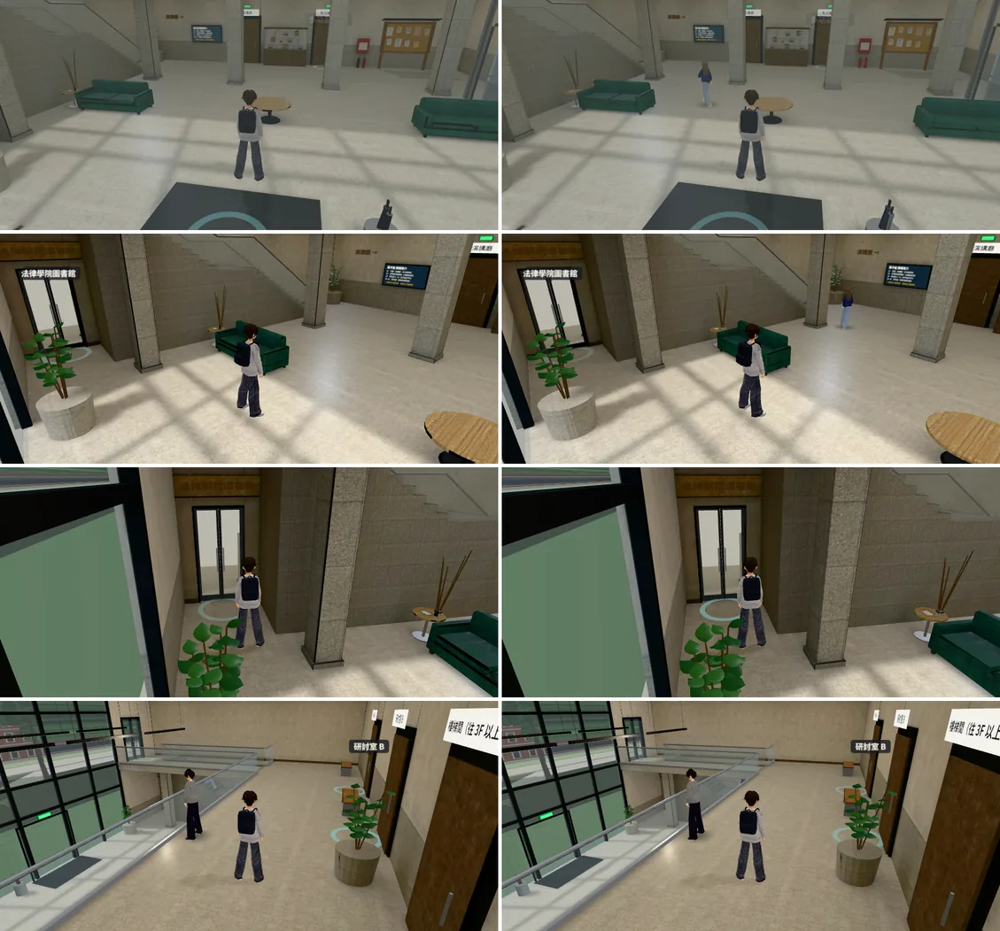

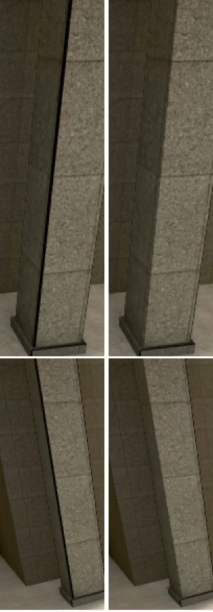

- 大廳的花崗石柱子：本來每根柱子的轉角從上到下一條黑線，現在轉角和柱面一樣。
- 二樓走廊看起來一樣。其他差別是走動的路人。

## 男一舍門廳

左：開發分支 `217e655bd` 已整合的第三版；右：這包（第六版）。

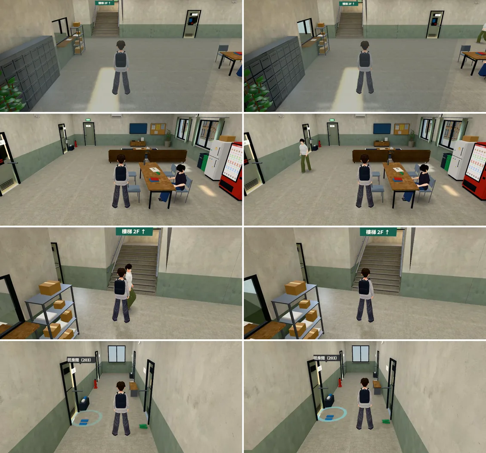

- 兩版看起來幾乎一樣：門框上方的點狀黑線、樓梯間開口旁的暗直條，第三版就修掉了，這包照舊。差別是走動的路人。
- 門口往裡看的門洞（放大三倍，左第三版、右這包）：第五版這裡一塊暗的（見最後「交件前自己抓到的退步」第 3 點），這包是亮的。

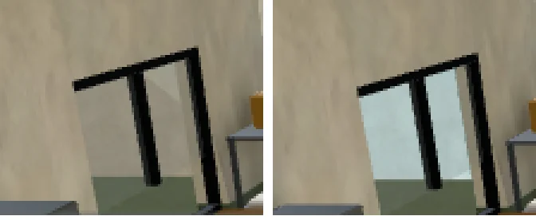

- 還沒修的：走廊北牆和樓梯間那道牆的接頭（放大四倍；左：開發分支烘焙以前、中：第三版、右：這包）。一點一點的縫三版都有，烘焙以前縫裡是亮的，烘焙以後是暗的。見最後「還沒做、缺點」。

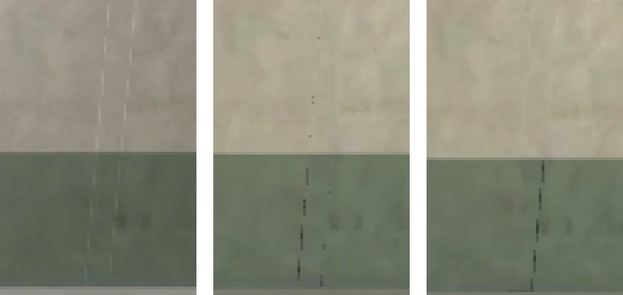

## 數字

| 房間 | 改了的面 | 不動的面（朝外全黑、很暗的縫） | 三角形 | 頂點 | GLB |
|---|---|---|---|---|---|
| 201 | 9,224（528 m²） | 3,500 | 62,232（不變） | 81,318 → 85,615 | 3.92 → 4.10 MB |
| 202 | 2,780（182 m²） | 276 | 41,791（不變） | 57,373 → 58,173 | 2.70 → 2.74 MB |
| 霖澤館大廳 | 1,534（551 m²） | 515 | 8,738（不變） | 14,651 → 15,762 | 2.33 → 2.39 MB |
| 萬才館 | 2,056（891 m²） | 704 | 13,009（不變） | 20,189 → 21,564 | 2.89 → 2.96 MB |
| 多功能教室 | 1,292（140 m²） | 174 | 19,176（不變） | 38,246 → 38,605 | 1.94 → 1.96 MB |
| 男一舍門廳 | 2,758（1,158 m²） | 386 | 22,326（不變） | 44,503 → 44,098（第三版 → 這包） | 3.94 → 3.92 MB |

- 改了的面大部分看不到：夾在牆段、樓板、家具中間的面，和外牆外側、樓板底面。面積大的是樓板、地板的底面和夾層。
- 節點、網格、材質、光照貼圖（`extras.lightmap`）都和原本一樣；頂點多一點：改了光照座標的面，匯出時和旁邊的面分開。
- 要知道每一面怎麼接的：`lm_fix_hidden.py -- … --report 檔名.json`（每個物件幾個面）、`--debug 檔名.json`（每一面的位置、接到哪裡）。

## 測試

開發分支 `ce70927ed`＋這包六個 GLB（Node，不需要瀏覽器）：

- ALL PASS（16 支）：`rooms_glb_unit`、`x78_rooms_unit`、`linze_lightmap_unit`、`wancai_lightmap_unit`、`dorm_hall_lightmap_unit`、`room_ceiling_unit`、`nav_buildings_unit`、`door_open_unit`、`seat_fold_unit`、`aa509_s0_unit`、`dorm_lounge_unit`、`dorm_laundry_unit`、`dorm_205_unit`、`aa517_dorm_y24_unit`、`move_out_y4_unit`、`dorm_moved_out_unit`。
- `company_priv_unit` 4 項 FAIL：**和這包無關**。拿掉六個 GLB、用開發分支原本的檔，一樣是這 4 項。
  - 原因：這個測試用 `git show` 讀企劃分支的 `f6069e42d`，我這邊的 checkout 沒有那個 commit。
- 截圖的每一輪（六間、三十幾個鏡頭）都沒有 JS 錯誤。
- 程式沒改，所以沒有再跑「進兩次」。

## 交件前自己抓到的退步（都已經修掉）

工具改了六版。每一版都拍改前改後同角度、放大看，才抓到這些：

1. **第三版：只看每一面中心判斷全黑**。202 東牆一整面（11.5 m² 的三角形）的中心剛好在「教室使用須知」那塊板子的影子裡，整面被當成全黑、光照座標改掉，牆上抹出一塊暗影。201 的四面牆也一樣（195 m²）。
   - 改成整面每一處都黑才算。
2. **第三版：朝建築外面的面接附近同方向的面**。霖澤館大廳地板朝外的切邊（鏡頭在牆外、牆淡出時看得到）接到外面本來就暗的面，變成一條黑邊。
   - 改成只接有亮的面。
3. **第五版：朝建築外面的面一律不動**。男一舍門口往裡看，門洞裡那面牆建模時當成看不到、沒分像素，結果一塊暗的。
   - 改成沒分像素的照樣接光（附近同方向有亮的面 → 共用邊的面 → 4 m 內同方向有亮的面）。
4. 三版都碰到的：**一樣是「全黑」，不一定該拉亮**。露在外面、本來就很暗的縫（附近沒有同方向的面）照舊不動。

## 還沒做、缺點

- iPhone 實機沒測。
- **牆段接頭的縫本身沒修**：男一舍門廳走廊北牆和樓梯間那道牆的接頭，放大看還有一點一點的暗線（開發分支第三版也有，三種版本的位置不一樣，是每次鏡頭停的位置差一點點）。
  - 縫裡看到的是：
    - 走廊牆段貼著樓梯間牆的端面（一半全黑）；
    - 樓梯間牆朝樓梯井那一面最靠近走廊的地方（本來就暗）。
  - 第二種只改光照座標修不了，要從建模改：牆段接頭不要露縫，例如樓梯間的牆往走廊多伸 1 cm，蓋住接頭。之後另開一項。
- **很細的面**：萬才館大廳正中間那根花崗石柱子的倒角，放大看還有一條暗線（改前就有）。
  - 倒角只有 1～2 cm 寬，光照貼圖上不到一個像素，一半吃到旁邊的亮、一半是黑的，不算「整面全黑」，工具不動它。
  - 柱子其他的倒角、法圖門口、西邊沙發那兩根的轉角，整面全黑的已經修掉。
  - 要修可以讓烘焙時倒角多分一點像素，或者這類很細的面也當成沒分像素的處理。之後另開一項。
- 朝建築外面、烘成全黑的面照舊：鏡頭在牆外、牆淡出的時候，牆外側照樣是暗的（改前也是）。
- 細小零件照舊是即時光（晚上比旁邊亮，RT-NIGHT-1028 另提）。
