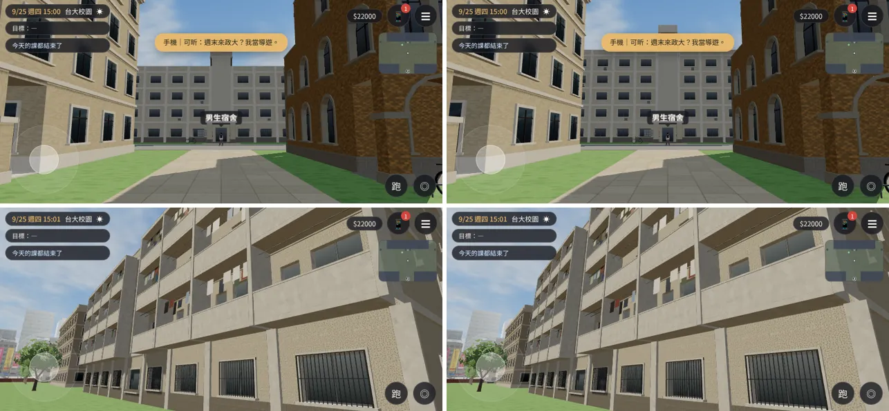

# MALE1-5F-1021：男一舍外觀 4 層 → 5 層

LAWWW2-C，2026-10-21。
- 起因：AA-C 10-21 裁定 J1（企劃線 `d0d7407e` AA_345 第 7 節），LAWWW-C 08:22Z 轉。
  - 祐廷的房間是 507；房號不改（存檔鍵 `Y507_*` 等五十幾處）。
  - 外觀從 4 層加到 5 層。
  - 宿舍窗景（美術子代理 `82f45a8b` 的 `dorm_back_view.py`）本來就照五樓的高度算。
  - 室內樓梯那句轉場旁白由 LAWWW-C 的程式加。
- 10-18 我照住宿組資料（地上 4 層）做成 4 層，套件也一起改成 4 層。
  - 這次改回 5 層：**遊戲化設計，和真實的男一舍不同**。

## 狀態
| 項目 | 狀態 |
|---|---|
| 模型 `campus_male1.glb` | **MODEL_READY**：三角形 10,902 → 12,856；1.03 → 1.18 MB |
| 接進遊戲 | **INTEGRATED（只在我的測試工作樹）**：開發分支 `0b5fb318`＋換 GLB＋patch |
| 測試（Playwright 手機模擬，不是 iPhone 實機） | `nav_buildings_unit.js` ALL PASS；`kit_nav_check.js` ALL PASS；`campus_layout_nav.py` ALL PASS；截圖沒有 JS 例外 |
| 美術 | **READY_FOR_ART_REVIEW**（等使用者看） |

## 改了什麼
- `tools/blender/env_second/campus_male1.py`：
  - 樓層 `YF` 多一層（一到五樓地板 0、3.6、6.7、9.8、12.9，屋頂 16.0）；
  - 和套件 `CK.hall`（gfh 3.6、fh 3.1）一樣高；
  - 其他都照 `NF` 算：窗、陽台、樓梯間的鏤空花磚、柱子、樓板帶、屋頂的東西、樓梯間凸出屋頂的出口。
- patch [`../../patches/male1_5f.diff`](../../patches/male1_5f.diff)（套在開發分支 `0b5fb318`）：
  - `zones3d.js` 男一舍的套件 `floors:4` → `floors:5`（和正式模型一樣高，鏡頭碰撞跟著）；
  - 改一行註解。

## 導航、碰撞（同一個開發分支：修改前＝4 層的 GLB＋套件 4 層，修改後＝這次）
| | 修改前 | 修改後 |
|---|---|---|
| 校園導航格（225,680 格） | 擋住 84,943 格、雜湊 1216682475 | **完全相同** |
| 男一舍附近的互動點 | 回宿舍 (20, 59.6) r 2.6；騎腳踏車 (25, 57.9) r 1.3 | **完全相同** |
| 男一舍的鏡頭碰撞方塊 | 中心 (20, 6.45, 68)、36 × **12.9** × 14 | 中心 (20, 8, 68)、36 × **16** × 14（只變高） |
| 正式模型最高點（含樓梯間出口、水塔） | 19.2 m | 22.3 m |

## 截圖（左：修改前；右：這次；9/25 週四 15:00；[捷徑] 讀檔、電影鏡頭指定位置）
1. 從舟山路往南看正面（四排窗 → 五排窗）；
2. 背面斜看（陽台三層 → 四層）。

## 已知、還沒做
- 正面中間的名牌照舊（`男生宿舍`）。
- 宿舍窗景的高度：子代理的 `dorm_back_view.py` 照五樓算，這次沒重拍。
- iPhone 實機沒有測過。
