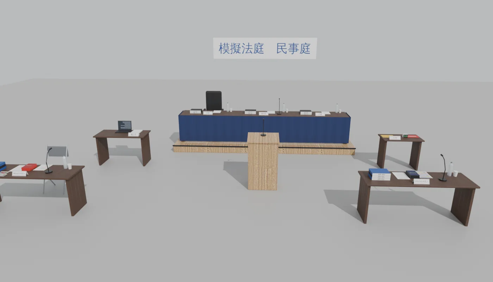
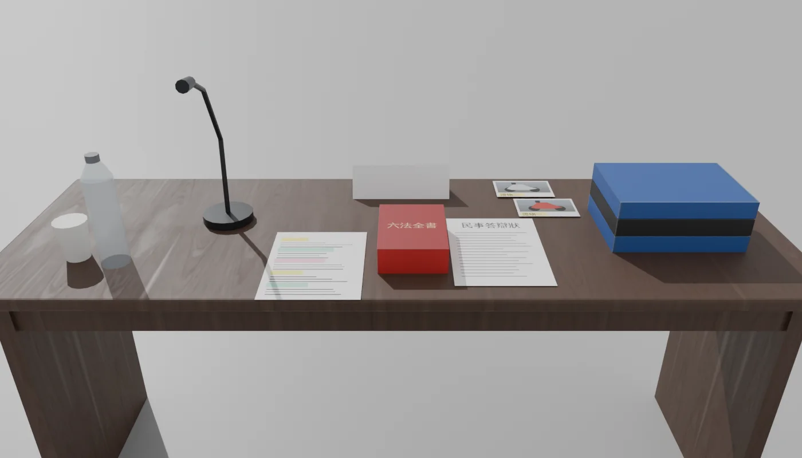

# SCN-V3-03 模擬法庭的道具組（LAWWW2-C，2026-10-17；MODEL_READY）
- **規格**：AA-C `AA_246_模擬法庭道具清單.md`（magical-albattani 3e5d8e04），19 項道具、擺法。
- **檔案**：`assets/models/env/second_ai/moot_court_props.glb`（573 KB、5,272 個三角形、11 個材質）＋同名 `.json`。
  - `.json` 的 `layout` 是 AA_246 §1 的建議擺法（201 室內座標），LAWWW 決定實際擺法。
- **腳本**：`tools/blender/env_second/moot_court_props.py`。
  - 字用文泉驛正黑畫進一張貼圖，貼圖在 `textures/gen/moot_court_atlas.png`。
  - 木紋、仿皮用 Poly Haven CC0。
- **頂層節點**：原點都在底部中央地面。

| 節點 | 內容 |
|---|---|
| `MC_JUDGE_BENCH` | 法官席 4.5 m＋深藍桌裙（細褶）＋桌牌「審判長」「評審」×2＋麥克風＋卷宗、水瓶 |
| `MC_DAIS` | （可選）20 cm 平台 4.8 × 1.2 m |
| `MC_CHAIR_HIGH` | 黑色仿皮高背椅 |
| `MC_CHAIR_FOLD` | 灰色折疊椅 |
| `MC_TABLE_DEF` | 被告（賣方，祐廷組）席：「被告訴訟代理人」、卷宗「被告」、「民事答辯狀」、六法全書（紅）、以安組的分工表、證物照片兩張 |
| `MC_TABLE_PLA` | 原告（買方，芯慈組）席：「原告訴訟代理人」、卷宗「原告」、「民事起訴狀」、六法全書（深藍）、芯慈組的分工表（顏色多、格子整齊） |
| `MC_CLERK` | 書記官桌：桌牌、筆電、紙 |
| `MC_TIMER` | 計時桌：桌牌「計時」、電子計時器、計時牌（黃「剩餘兩分鐘」、紅「時間到」） |
| `MC_PODIUM` | 發言台：「發言台」朝法官席、麥克風 |
| `MC_BANNER` | （可選）布條「模擬法庭　民事庭」 |

- **方向**：
  - 桌牌正面朝 +z（給對面的人看）。
  - 桌上的紙、書、計時牌給坐在 −z 那一側的人讀。
- **不放的東西**：法槌（台灣的法庭不用法槌，AA_246）；校名、系名、年份、出版社、品牌（D77）。
- **沒做**：法袍（AA_246 建議穿正式服裝）；遊戲裡的擺放和截圖（等 LAWWW 接）。

