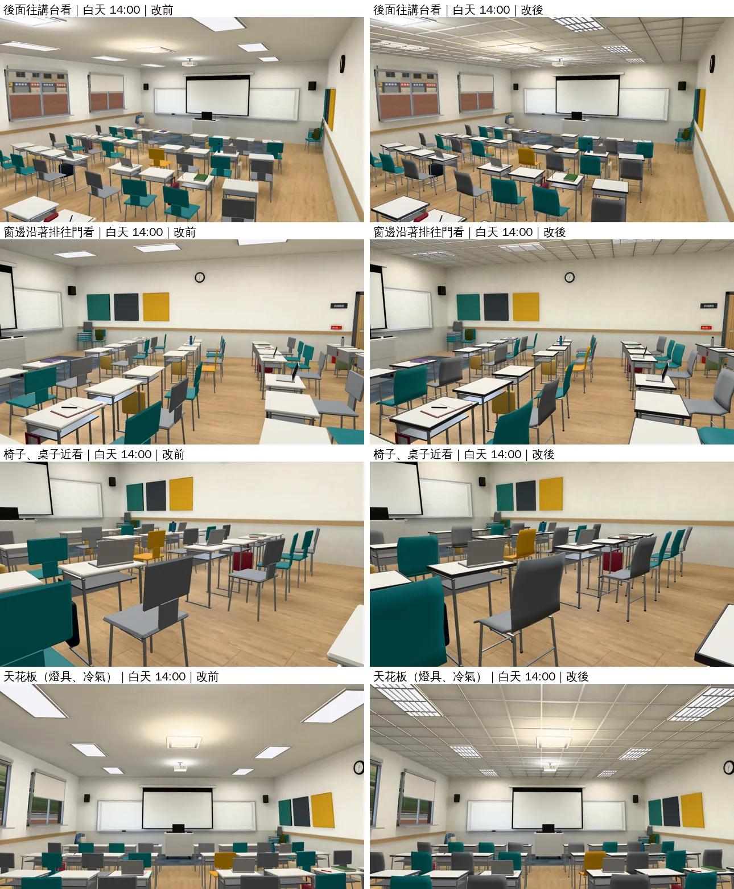
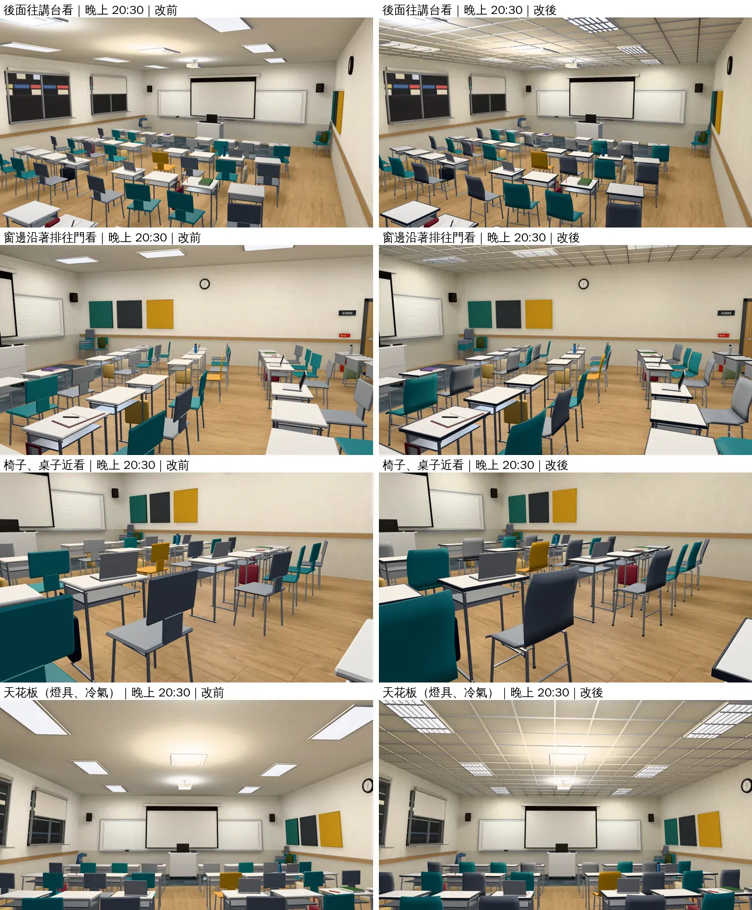

# 法律系館B（萬才館）多功能教室 v2：換家具＋天花板（MULTI-ROOM-V2-1030；LAWWW2-B 2026-10-30）

- **起因**：
  - `VISUAL_REVIEW.md` 26.3：「家具沒有換。和 202 第一版一樣，只有光不夠。白牆偏亮。這間最簡單，下一輪要照 202 換家具。」
  - LAWWW-B 10-30 的佇列（D111 三間室內之後）。
  - 企劃 AA_330 的旁白：「椅子是可以移動的那種，大家坐得比在 201 鬆。」
- **狀態**：`READY_FOR_ART_REVIEW`。建築、場景的 `ART_APPROVED` 只有使用者能標。
- **截圖條件**：遊戲內固定鏡頭（藏玩家、NPC），1280×720，Playwright＋SwiftShader 模擬，**不是 iPhone 實機**。讀檔放位置是 [捷徑]。
  - 改前＝開發分支原樣；改後＝開發 `f75d60a4c`＋這一包。

## 一、交付

| 檔案 | 內容 |
|---|---|
| `assets/models/env/second_ai/wancai_multi.glb` | 新家具、天花板；光照貼圖重烘 |
| `assets/models/env/second_ai/wancai_multi_lm_day.webp`、`_night.webp` | 光照貼圖（新的燈位置） |
| `assets/models/env/second_ai/wancai_multi.json`、`.layout.json` | 統計、配置（layout 和開發分支**一模一樣**：座位、碰撞框、走近點都沒動） |
| `tools/blender/env_second/flat_classroom.py` | 多功能教室 v2；改名同步（法律系館A／B） |
| `tools/blender/env_second/lightbake/bake_flat_rooms.sh` | 多功能教室的燈換成新位置；可以只烘一間（第二個參數），另一間的 GLB 不動 |

- **不用改程式**：`attachRoomGLB` 照舊接。

## 二、改了什麼（照 202 v2 的做法，保留這間自己的風格）

- **塑膠椅**（47 張，含疊起來的）：
  - 原本：座面、椅背、中間那段是三塊倒角方塊。
  - 現在：一體成形的殼。
    - 座面中間微凹，兩側、後緣往上翹，前緣往下彎（瀑布邊）。
    - 椅背從座面後緣一路彎上去，左右往前包。
    - 鐵腳多了座面下的側框、前後的橫桿、黑色腳套。
  - 座面高度、腳的位置照舊（坐姿、碰撞框不變）。
- **單人桌**：
  - 桌面一圈深灰的 PVC 封邊。原本白色方板看起來像紙板。
  - 四支腳加了黑色腳墊。
- **天花板**：
  - 和 202 同一套的 0.6 m 輕鋼架格子＋T5 格柵燈具。燈具 x ±1.5、±4.5、z ±2.4，燈具的邊剛好在格子線上。
  - 原本是兩排貼在天花板上的平板燈、整片平的天花板。嵌入式冷氣照舊。
- **白牆調暗一點**：#f0eee9 → #e7e3da（VISUAL_REVIEW 26.3「白牆偏亮」）。
- **光照貼圖重烘**：燈的位置換成新的燈具，512 取樣。

## 三、改前改後（同鏡頭；左＝改前、右＝改後）

四個鏡頭：後面往講台看、窗邊沿著排往門看、椅子和桌子近看、天花板。

- **椅子**：近看那一張最明顯。
  - 原本是三塊方板（座面、椅背、中間一塊），像積木。
  - 現在是一體成形的塑膠殼：座面前緣往下彎、椅背彎上來往前包，看得出是一張可以疊的塑膠椅。
- **天花板**：
  - 原本整片平的、貼著幾塊平板燈。
  - 現在 0.6 m 輕鋼架格子＋格柵燈具，和 202 同一棟風格。
- **桌子**：桌面一圈深灰封邊，不再像一張白紙板。
- **牆**：白牆暗一點，和地板、家具比較不刺眼。

## 四、測試、效能

（量完補）
