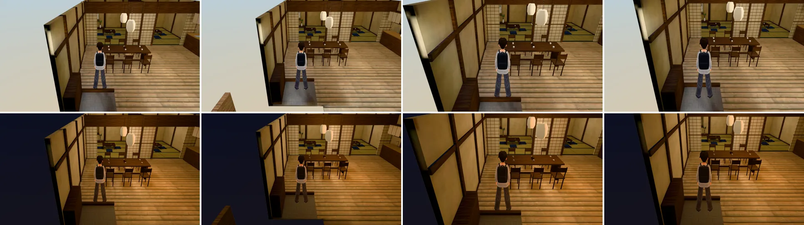

# 一盞門口的木柱擋鏡頭（BB n33 第 2 項；LAWWW2-B 2026-10-31）

- **起因**：LAWWW-B 15:37（BB n33_shoplm 09、10）。
  - BB 的探針（出口往裡 1 m、鏡頭在後 3 m）：白天晚上都有一根木柱擋在鏡頭和玩家中間，晚上幾乎全黑。
  - LAWWW-B：「請先看進門的預設鏡頭是不是也這樣，是的話柱子標 seethru_」。
- **結論：預設的跟隨鏡頭不會被柱子擋，這一版不改模型。**
  - 遊戲的跟隨鏡頭在屋簷上方往下看（鏡頭高 2.8～3.1 m，屋簷 2.6 m），緣側的柱子都在畫面外面。
  - 玩家拉近鏡頭（兩指縮放）也一樣：要求 3 m，實際停在 3.9 m（鏡頭距離有下限），高度 2.76 m。
  - BB 那張應該是固定鏡頭（直接給鏡頭位置），放在屋簷高度以下、柱子後面；跟隨鏡頭到不了那裡。

## 量的方法

- `tools/blender/env_second/shots/cam_pillar_probe.py`：
  - 環境變數 `ZONE=wz_teahouse`、`SWING=1`（鏡頭照平常一樣）；
  - 這次加了 `DIST`：模擬玩家拉近鏡頭。
- 兩個位置：
  - BB 的位置：出口往裡 1 m，(−3, 3.6)；
  - 進門的出生點：(−3, 4.2)。
  - 都面向屋裡，鏡頭在背後。
- 14:00、20:30 各一次。
- 「看得到」＝玩家外框裡、藏起玩家再拍一張相減的像素（`cam_pillar_visible.py`）。

| 位置 | 鏡頭距離 | 14:00 | 20:30 |
|---|---|---|---|
| BB 的位置 (−3, 3.6) | 預設（4.9 m） | 50% | 45% |
| 進門出生點 (−3, 4.2) | 預設（4.9 m） | 43% | 36% |
| BB 的位置 | 拉近（要求 3 m，實際 3.9 m） | 49% | 46% |
| 進門出生點 | 拉近 | 45% | 36% |

- 人本身大約只佔外框的一半，所以 40% 以上就是整個人看得到。
- 截圖是 Playwright＋SwiftShader（電腦橫向），不是實機。讀檔放位置、藏路人是 [捷徑]。
- 如果 BB 那個角度是玩家真的拍得到的（例如某個劇情固定鏡頭），請告訴我是哪一段，我再把緣側的柱子（`wzs_post`）標成網點透空。
