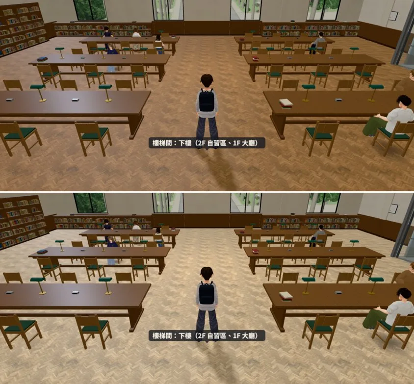
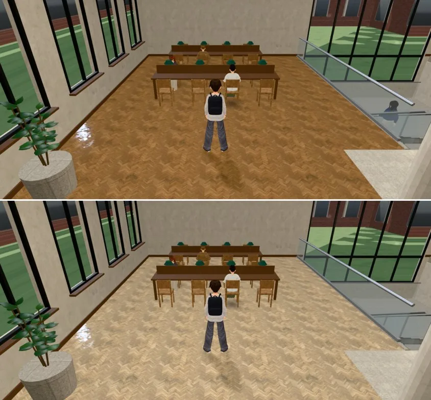
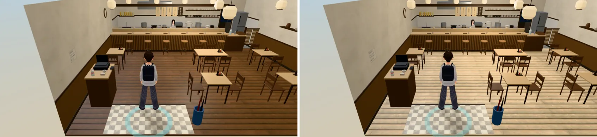
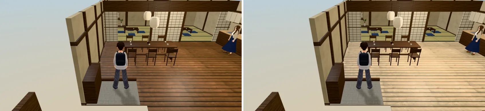
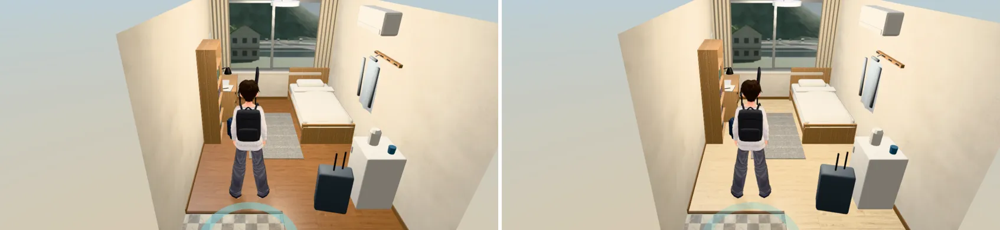
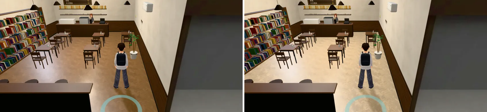
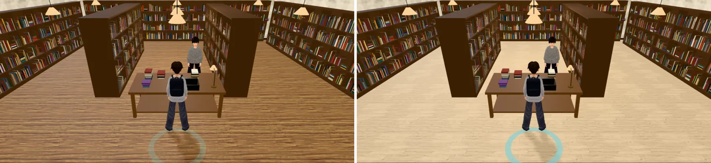
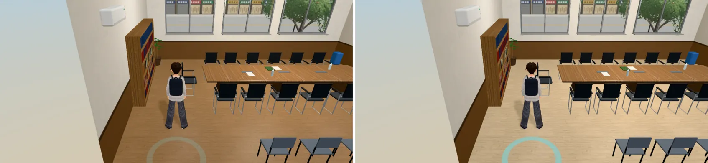
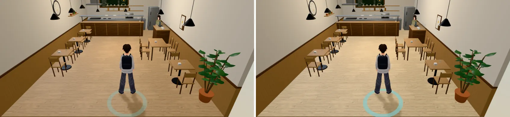

# ART-NO-DARK-WOOD-1023：整個遊戲不要深色木地板（D112）

- **使用者原話**（2026-10-23 07:3x，對 LAWWW2-B）：「圖書館三樓那種深色木地板 很醜 不要出現這種深色木底板 整個遊戲都不要 只能接受淺色木地板或其他材質」
- **做的人**：LAWWW2-B。
- **狀態**：
  - 第一批：交件，LAWWW-B 已合進開發分支 `b32ee2c4`。
  - 第二批：交件（美國公寓兩戶的室內截圖補拍中）。
  - 場景美術的 `ART_APPROVED` 由使用者決定。

## 標準
- 木地板要和宿舍四人房一樣淺：Blender 目標色 `#cdb594`。使用者看過宿舍說「宿舍ok」。
  - GLB 裡地板材質的平均顏色約 (205, 181, 148)，sRGB 亮度約 185。
  - 原本圖書館是 (161, 123, 86)，亮度 130。
- 人字拼、木條的紋路照舊，只換顏色。
- 家具、桌面、牆裙不是地板，不動（使用者說的是地板）。
- 檢查工具：`tools/blender/env_second/floors/scan_floors.py`。
  - 它量每個 GLB 裡大片、水平網格的材質平均顏色，標出「木頭色而且深」的。
  - 用法：`python3 tools/blender/env_second/floors/scan_floors.py assets/models/env --json 輸出.json`。

## 第一批（`15551b2f`）：圖書館 3F 閱覽區、總圖大廳二樓自習區
| 檔 | 改了什麼 |
|---|---|
| `tools/blender/env_second/library_3f.py` | 地板 `l3_parquet` 目標色 `#a07a55` → `#cdb594` |
| `assets/models/env/second_ai/library_3f.glb`（＋`.json`） | 重匯：物件 147、三角形 15,528、材質 32，都和原本一樣 |
| `tools/blender/library_interior.py` | 二樓兩翼 `lb_parquet` 目標色 `#a07a55` → `#cdb594` |
| `assets/models/env/library_interior.glb` | 重匯：其他材質、節點都沒動 |

- 遊戲程式不用改。
- 遊戲內修改前後：
  - 上＝開發分支 `719cca3b` 原本的 GLB，下＝這次的 GLB。
  - Playwright 手機橫向 844×390、像素比 2，**不是 iPhone**。
  - 【捷徑】用讀檔把玩家放進區域。
  - 截圖時，開發分支的測試樹另外套了這次的 `patches/no_dark_wood_src.patch`。這兩個區域的地板不是那幾支檔畫的，所以畫面不受影響。

圖書館 3F 閱覽區（14:00）：

總圖大廳二樓自習區（14:00）：

## 第二批（`6fbe2830`）：九個室內＋程式備用地板
| 地方 | GLB | 地板原本 → 這次（平均顏色） |
|---|---|---|
| 巷子裡定食 | `wz_teishoku_interior.glb` | (108, 77, 53) → (204, 179, 143) |
| 美國公寓（祐廷單人戶） | `us_apartment.glb` | (122, 75, 50) → (207, 183, 150) |
| 美國合租戶（學姊） | `us_shared.glb` | 同上 |
| 溫州街茶行一盞 | `wz_teahouse_interior.glb` | (115, 81, 55) → (205, 180, 144) |
| 日本宿舍房間 | `jp_room.glb` | (143, 100, 66) → (211, 191, 157) |
| 118 巷慢讀咖啡 | `l118_cafe2.glb` | (141, 108, 76) → (205, 181, 148) |
| 舊路書房 | `bookstore_interior.glb` | (144, 109, 73) → (203, 179, 144) |
| 萬才館研討室 A | `wancai_sema.glb` | (156, 122, 88) → (205, 182, 149) |
| 溫州街早午餐 | `wz_brunch_interior.glb` | (184, 151, 112) → (208, 184, 146) |

- 九個 GLB 的節點、網格、材質、三角形數都和開發分支相同，只換地板貼圖。
- 腳本：
  - `bookstore_interior.py`（`dark_wood` 換成 `laminate_floor_02`）
  - `jp_dorm.py`
  - `wancai_seminar.py`
  - `wz_shops_interior.py`（早午餐、茶行）
  - `us_apartment.py`（兩戶共用）
  - `lane118_shops.py`（咖啡）
  - `wz_aa364_shops.py`（定食）
- **程式產生的備用地板**（模型載入前、或載入失敗時看到的）：`patches/no_dark_wood_src.patch`，對開發分支 `719cca3b`，五支檔 7 行。
  - `rooms_glb3d.js` `#9c7a58` → `#cdb594`
  - `us3d.js` `#b48a64` → `#cfb796`
  - `jp_dorm3d.js` `#8f6442` → `#d3bf9c`
  - `zones3d.js`：書店 canvas 木地板改淺；`WZ_FLOOR.wood_dark` 改淺
  - `wz_shops_layout.js`：茶行、定食的 `floor` 改 `wood_light`
  - 沒有改到 engine3d、game3d、story3d。

### 遊戲內修改前後（左＝開發分支 `719cca3b` 原本的 GLB＋原本的程式，右＝這次的 GLB＋`no_dark_wood_src.patch`；14:00，手機橫向，不是 iPhone）

巷子裡定食：

溫州街茶行一盞：

日本宿舍房間：

118 巷慢讀咖啡：

舊路書房：

萬才館研討室 A：

溫州街早午餐：

- **美國公寓兩戶**：預設鏡頭停在門外的走廊平台，拍不到室內，正在從室內門口重拍（補進這裡）。地板顏色已用掃描確認：(122, 75, 50) → (207, 183, 150)。
- 另外看到：美國公寓門外走廊右邊那面是**深色木板牆**（不是地板，不在這次規則內）。使用者可能一樣覺得醜，記下來，之後再處理。

## 還沒做
1. 美國公寓兩戶的室內前後截圖（補拍中）。
2. 溫州街店面玻璃後面的淺店內：`wz_shopkit.shallow_interior` 定食用 `wood_dk`、書店／早午餐用 `wood_lt`（`#b48a5e`，偏中）。會和 118 巷、公館店面翻修一起改。
3. 體育館 3F 主球場 `arena_floor`：楓木本身是 (210, 162, 104)，平均偏深是外圈的深色漆；之後再看要不要調亮。
4. 2D 背景：永康街咖哩店（`bg_curry.py` `dark_planks #5a3e2c`）、視訊（`bg_video_far.py`）。2D 歸 BB（D100），BB-B 說會逐張列給使用者。
5. 只在我的分支、還沒進開發分支的 GLB，還沒掃。
6. iPhone 實機沒看過。
