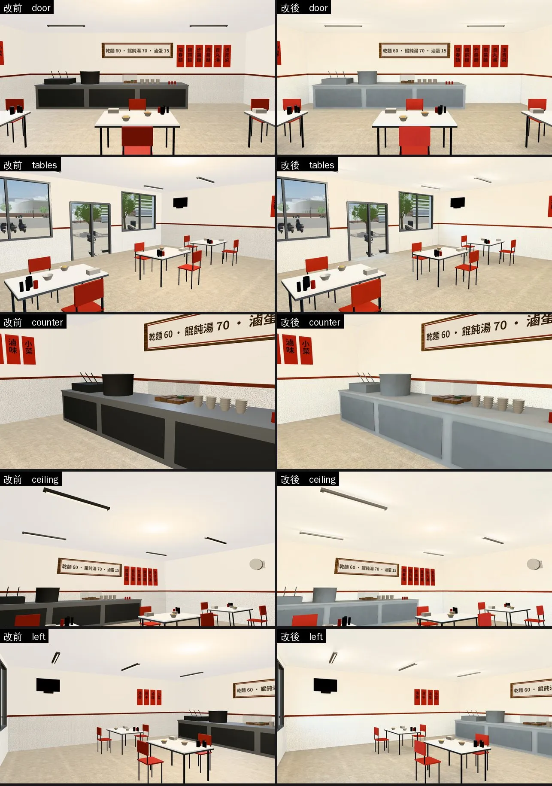
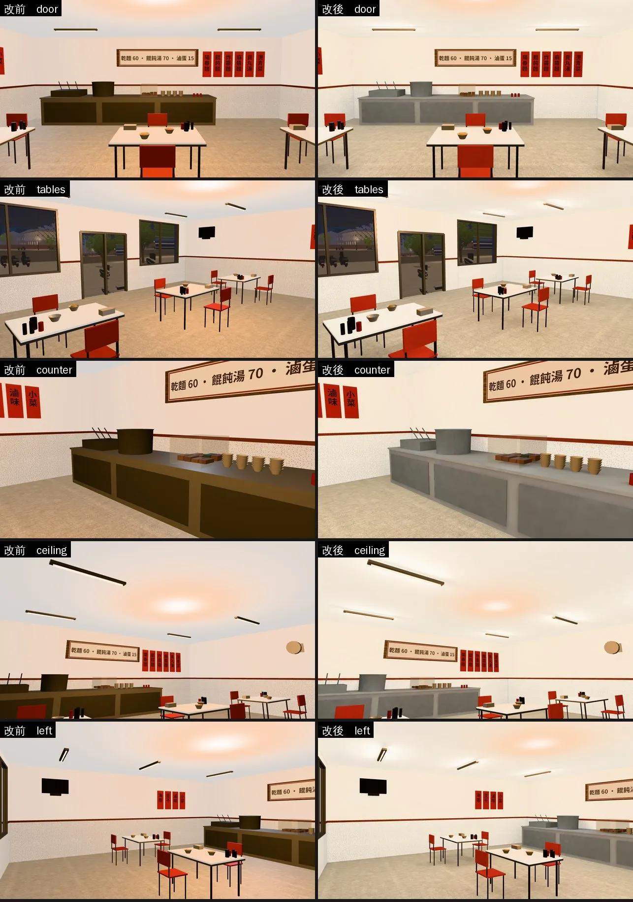

# 阿鳳麵店室內：光照烘焙＋不鏽鋼、燈座（NOODLE-LM-1030；LAWWW2-B 2026-10-30）

- **起因**：LAWWW-B 10-30 派工（INTERIOR-AAA：`INTERIOR_AAA_REVIEW_1028.md` 第 5 節 P1 光照）。麵店是大一上麵店團、考完的晚餐常去的地方。
- **狀態**：`READY_FOR_ART_REVIEW`。建築、場景的 `ART_APPROVED` 只有使用者能標。
- **截圖條件**：
  - 遊戲內固定鏡頭（藏玩家、NPC），1280×720。
  - Playwright＋SwiftShader 模擬，**不是 iPhone 實機**。讀檔放位置是 [捷徑]。
  - 改前＝開發 `ade6ef271` 原樣；改後＝開發 `ade6ef271`＋這一包。

## 一、交付

| 檔案 | 內容 |
|---|---|
| `assets/models/env/second_ai/noodle_interior.glb` | 多一套 UV（TEXCOORD_1）、`extras.lightmap`；不鏽鋼、燈座換材質（下面）。0.44 → 0.47 MB |
| `assets/models/env/second_ai/noodle_interior_lm_day.webp`、`_night.webp` | 光照貼圖 1024，55 KB＋54 KB |
| `assets/models/env/second_ai/noodle_interior.json` | 統計（三角形 6,008 → 6,056：燈管 6 → 8 邊） |
| `tools/blender/env_second/noodle_interior.py` | 產生器：不鏽鋼金屬度、燈座材質 |
| `tools/blender/env_second/lightbake/bake_noodle.sh`、`noodle_interior_lm.json` | 建模＋烘焙＋WebP（512 取樣約 30 分鐘）、這次的參數紀錄 |
| `tools/blender/env_second/shots/noodle_lm_shots.py` | 截圖鏡頭 |

- **不用改程式、不用套 patch**：`zones3d.js` 的 noodle 用 `attachRoomGLB` 接正式模型，看到 `extras.lightmap` 就接（和 Café 同一套）。配置、座位、導航都不動。

## 二、改了什麼

### 1. 光照烘焙（512 取樣）

- **燈**：
  - 六支日光燈管，每支三顆點光源（燈管中間和兩邊 0.4 m，17 W，偏白 1.0／0.97／0.9）。
  - 燈管上面的燈座照樣擋光：燈管正上方的天花板暗一點。
- **白天**：店面朝東，下午的太陽在屋子後面。只有店面玻璃門、兩扇窗進來的天光（0.8），燈照樣開（0.9）。
- **晚上**：只有燈。
- **照舊即時光**：碗、麵、湯、滷味、調味罐、筷筒、椅腳桌腳、桌邊、面紙盒、菜單價目板（字由遊戲畫）、窗框、燈管、燈座、電扇、電視。
- **一起烘**：地板、牆、天花板、桌面、紅色椅子、煮麵台（櫃身、櫃門、湯鍋、煮麵爐）。
  - 第一次正式烘焙沒烘櫃門、湯鍋：晚上照遊戲的暖色即時燈，變成咖啡色，和烘過的灰色櫃身不搭。第二次一起烘。
- **試烘焙（64 取樣）**：
  - 燈 20 W：白天和改前差不多亮，晚上牆整片偏白。
  - 正式版 17 W：白天平均 0.36、晚上 0.31。日光燈小店本來就是整間平均地亮，晚上和白天差不多。

### 2. 不鏽鋼、燈座（原本是黑的）

- **煮麵台、湯鍋、煮麵爐**：
  - 原本不鏽鋼的金屬度 0.6／0.5（lib2 夾到 0.45）。遊戲沒有環境貼圖，金屬度高只剩高光，改前整片接近黑的。
  - 改成金屬度 0.2、顏色亮一點，看起來是小麵店常見的霧面不鏽鋼。
- **日光燈座**：原本用窗框的金屬灰，遊戲裡是一條條黑棒子。改成白色烤漆；燈管 6 → 8 邊。
- **檢查**：`lm_squash_scan.py` 朝室內看得到的壓扁面 0 m²。

## 三、改前改後（同鏡頭；左＝改前、右＝改後）

五個鏡頭：門口往裡看、後面往店面看、煮麵台近看、往上看日光燈、左邊牆（菜單、電視）。

- **白天**：
  - 煮麵台從黑色變成不鏽鋼；燈座從黑棒子變成白色燈座。
  - 牆角、桌子底下、煮麵台底下稍微暗一點。整體亮度和改前差不多。
- **晚上**：
  - 改前整間被遊戲的暖色燈染成橘色，煮麵台、湯鍋變咖啡色。
  - 改後是日光燈的白光：牆、地板、煮麵台都是原本的顏色。
- **還看得到的**：
  - 天花板上那一團橘色光暈是遊戲本來的即時燈（房間預設的那一盞），改前就有，這一包沒有動。
  - 燈座晚上偏一點咖啡色（燈座照舊即時光）。

## 四、測試、效能

（待填）

## 五、還沒做到的

- 人物、碗、調味罐、桌腳照即時光：晚上這些小東西會比旁邊烘過的地板、桌面偏暖一點（遊戲的即時燈是暖色）。
- 店面朝東，下午的太陽在屋子後面：白天只有店面進來的天光，地上沒有陽光的窗框影子。
- 生活感擺設（檢討報告 P4：牆上的電扇轉、冰箱、時鐘）這一輪沒做；背景版（`--layout longtable`）有的冰箱、時鐘、月曆沒有搬進遊戲版。
