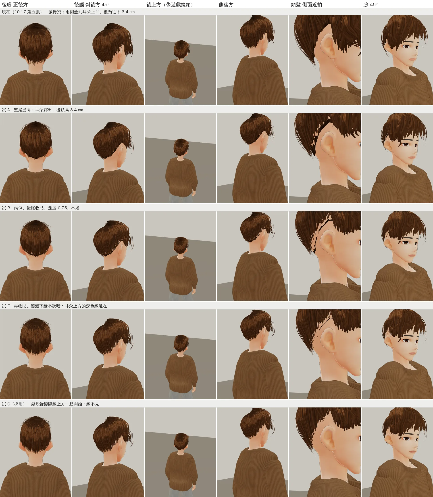
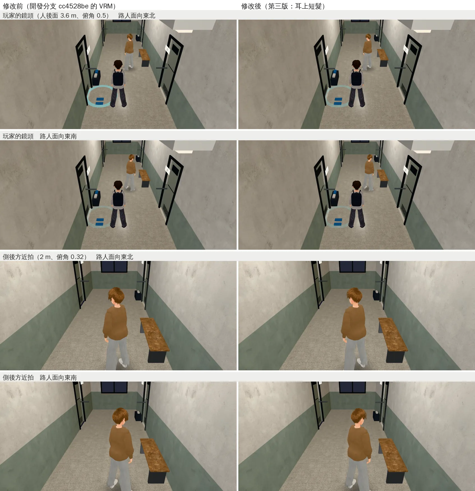
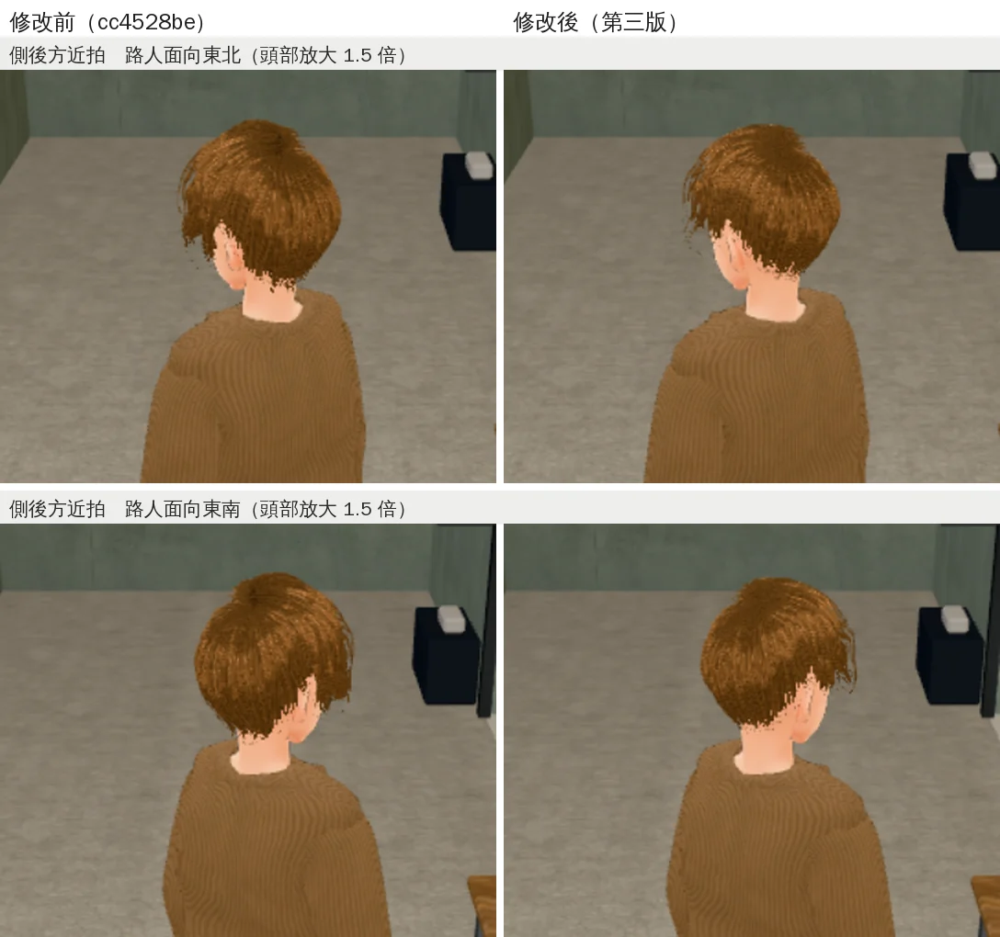

# 路人 npc_nm3：頭髮改成耳上短髮、後頸露出（ART-NPC-NM3-HAIR-1022）

帳號 A 的 LAWWW2，2026-10-22 10:1x～11:xx UTC。

- **狀態**：交件；角色美術由 LAWWW 驗收（D100 第 6 點）。
  - `assets/models/char/second_ai/bl_npc_nm3.vrm` 同檔名替換（第三版），遊戲程式、manifest 都不用改。
- **派工**：LAWWW 09:56（P3）。
  - BB 在候選 `364dabe0` 的男宿二樓走廊看到一位路人（`char.npc_nm3`）。
  - 說明寫的是「淺棕側分短髮、駝色針織衫、淺灰長褲」，遊戲裡頭髮看起來接近及肩，從側後方看像女生。
  - 要做的：照說明改成短髮（耳上、後頸露出），臉和衣服不動。
  - BB 的截圖在企劃線：`docs/story_planning/test_shots/rel9105_1022/男宿二樓走廊_長椅前面的路人_364dabe0.webp`。

## 為什麼看起來像及肩

- 模型裡的頭髮其實沒有到肩膀：最低點 1.504 m，頭骨 1.545 m。10-17 第五批（日劇髮型）給 nm3 的是「微捲燙」。
- 看起來長，是因為：
  - **後頸**：髮尾比髮際線低 3.4 cm（正中間 1.507 m），毛衣後領最高 1.480 m，中間只剩 2.7 cm 的脖子。
    - 從後上方（遊戲的鏡頭）看，頭髮下緣蓋過這一段，淺棕頭髮和駝色毛衣連成一塊。
  - **耳朵**：耳朵前面的鬢角垂到眼睛下面（1.586 m），耳朵上半被蓋住。
  - **後腦**：蓬、髮尾微捲往外翹，從後面看是一頂圓圓的蘑菇頭。

## 改了什麼

### 參數（`tools/blender/char_second/npc.py` 的 nm3）

| | 原本（10-17 第五批） | 這次 |
|---|---|---|
| 太陽穴到耳朵前面（`tip` 中間 4 個，相對眼睛，m） | 0.004、0、−0.006、−0.012 | 0.010、0.012、0.016、0.020 |
| 耳朵上面、後面（`tip` 後 3 個，相對耳朵上緣） | −0.020、−0.016、−0.012 | 0.006、0.006、0.004（會停在髮際線） |
| 後頸（`nape`／正中間多的 `nape_c`） | 0.022／0.012 | 0／0 |
| 頭頂蓬度 `vol` | 0.95 | 0.75 |
| 兩側、後腦越靠髮尾越貼頭（`side_taper`／`nape_taper`） | 0／0 | 0.75／0.85 |
| 微捲燙（`JP_STYLE` 的 `wave`） | 0.004 | 拿掉 |
| 髮殼下緣不調暗（`shell_root`）、髮殼從哪裡開始（`shell_v0`） | 0.75／0（髮際線） | 1.0／0.05 |
| 髮尾至少超出髮際線多少（`v_min`） | −0.02 | −0.04 |
| 瀏海（`tip` 前 3 個）、分線 20°、髮色、亂翹的角度 | — | 不變 |

髮尾高度（Blender 裡的 z，m；`HAIR_DEBUG=1` 印出來的；方位 0＝正前方、90＝耳朵、180＝正後方）：

| 方位 | 原本 髮尾／髮際線 | 這次 髮尾／髮際線 | 髮尾提高 |
|---|---|---|---|
| 0、20、36（瀏海） | 1.616、1.622、1.622 | 一樣 | 0 |
| 56（太陽穴） | 1.598／1.656 | 1.608／1.654 | +1.0 cm |
| 70（鬢角） | 1.589／1.624 | 1.614／1.626 | +2.5 cm |
| 84（耳朵前緣） | 1.602／1.648 | 1.631／1.647 | +2.9 cm |
| 92～108（耳朵上面） | 1.644～1.622 | 1.645～1.621 | 0（本來就在髮際線） |
| 130（耳朵後下方） | 1.554／1.576 | 1.575／1.581 | +2.1 cm |
| 165（後頸） | 1.516／1.549 | 1.550／1.557 | +3.4 cm |
| 180（正後方） | 1.507／1.541 | 1.538／1.549 | +3.1 cm |

- 毛衣後領最高 1.480 m：露出的脖子從 2.7 cm 變成 5.8 cm。
- 耳朵上面原本就停在髮際線；看起來蓋住耳朵的是鬢角和外層垂下來的髮片，這兩樣變短以後耳朵整個露出來。

### 產生器（`tools/blender/char_second/npc_hair_m.py`）

- 加五個選用參數：`nape_taper`、`nape_c`、`shell_root`、`v_min`、`shell_v0`（說明寫在檔案開頭）。
- **不給＝和原本一樣**：用新的產生器、nm3 原本的參數重做，匯出的 VRM 和改產生器以前位元組相同。其他路人不用重做。

### VRM（第三版）

- 和原本逐個網格、逐張貼圖比：
  - 臉（8 個 primitive，含表情）、身體、衣服（三種布料）：頂點、法線、UV、權重、索引全部相同。
  - 貼圖 20 張裡 19 張位元組相同；只有頭髮貼圖 `NM3_HairCard` 不同（髮殼那一格不調暗）。
  - 材質、節點、骨架、VRM 設定（表情、彈簧骨、視線、meta）相同。
  - 頭髮網格：8,456 → 8,449 個頂點，三角形一樣是 10,736 個。
- 2,486,108 → 2,485,764 bytes。
- 做法（和 10-17 第五批同一套）：
  ```
  NPC=nm3 /opt/blenv/bin/python tools/blender/char_second/npc.py -- <輸出>.vrm --stages stage0,face,clothes,hair
  VRM_BASE=HairSample_Male VRM_MALE=1 NPC_SMALL=1 python3 tools/blender/char_second/vrm_finish2.py <輸出>.vrm <遊戲用>.vrm 路人 '#3a2818'
  python3 tools/char_strip_hair_matcap.py <遊戲用>.vrm
  ```
  - 動手前先確認：同一套流程、原本的參數，做出來和 repo 裡的 VRM 位元組相同。
  - 第五批交件時最後多跑了 `char_strip_hair_matcap.py`（拿掉頭髮的 MatCap 白邊），這次照做。

## 試過的版本（遊戲渲染器）

- 用 `test_charlook.html` 的本機複本，多加後腦、斜後方、後上方、側後方幾個鏡頭。
  - 本機複本放在 `tools/vroid_wip/`，不在 repo 裡；燈光、材質和 `test_charlook.html` 一樣。
- 白天的燈，不是遊戲畫面；遊戲畫面看下一節。



- **試 A**：只把髮尾提高。耳朵露出來、後頸高了，但後腦還是蓬的一頂。
- **試 B**：兩側、後腦越靠髮尾越貼頭（0.7）、蓬度 0.75、不捲。頭形乾淨很多。
  - 另一版（試 C＝試 B＋微捲燙）耳後的髮尾往外翹，沒選。
- **試 B～E 的毛病：耳朵上方一條深色的線，太陽穴附近一點深色。**
  - 原因是髮殼的下緣。髮殼是最底下那一層不透明的殼，下緣停在髮際線，而且調暗了。
  - 原本的長髮片會蓋過它；髮尾短了以後，下緣露出來，斜斜地看就是一條深色的線。
  - 試 E 只把下緣改成不調暗，線還在。
- **試 G（採用）**：髮殼改從髮際線上面一點（5%）開始，髮尾至少超出髮際線 4%，讓髮片蓋住髮殼的邊。線不見了。

## 遊戲內前後（j50）

- Playwright＋SwiftShader，844×390（手機橫向）、像素比 2，**不是 iPhone**。
- 開發分支 `cc4528be`：修改前＝原本的 VRM；修改後＝只換第三版 VRM（同檔名）。
- 地點、時間：男宿二樓走廊、20:24（BB 看到的時間）。
  - 原本的路人藏起來，另外放一個 npc_nm3 在 207 前面的長椅旁 (7.5, 0.25)，面向東北、東南兩個方向。
  - 【捷徑】這個路人是截圖腳本放的（`CHAR.build`＋`E.addNPC`，遊戲生成路人也用這兩個），不是照作息走過來的。
- 上兩列：玩家的鏡頭（人在 207 門口西邊，鏡頭在人後面 3.6 m、俯角 0.5）。
- 下兩列：側後方近拍（2 m、俯角 0.32；玩家藏起來）。





- 修改前：
  - 頭髮蓋住耳朵，從後腦一直接到領口。
  - 晚上的燈下，淺棕頭髮和駝色毛衣連成一塊，像鮑伯頭。
- 修改後：耳朵露出來，後頸和領口之間有一段脖子，頭形是男生的短髮。
- 同一份（開發分支 `cc4528be`＋新 VRM）：
  - `node tests/npc_ambient_unit.js` ALL PASS。
  - 在 Node 用遊戲的 `CHAR.build` 建 npc_nm3：VRM 解析成功、54 根骨頭、頭髮 8,449 個頂點。
- 身高：遊戲用身體的高度縮放人物（`character3d.js` 的 `buildVRM` 不算頭髮），頭頂的頭髮矮了 0.8 cm，人的大小不變。

## 接法（LAWWW）

1. 換 `assets/models/char/second_ai/bl_npc_nm3.vrm`（同檔名）。程式、manifest 都不用改。
2. 骨架、身高、材質沒變，坐、走、上下樓梯和原本一樣。
3. 原始檔：`tools/blender/char_second/npc.py`（nm3 的參數）、`tools/blender/char_second/npc_hair_m.py`（五個選用參數）。

## 還不到的地方（誠實寫）

- 後腦還是有一點蓬（像短的蘑菇頭），斜後方看，頭髮下緣離脖子約 1 cm。
- 側瀏海最外面一撮停在眼尾旁邊（臉 45° 看得到一小撮深色）。原本被長鬢角擋著，現在露出來；已交件的 nm1 也有一樣的一撮。
- 只拍了男宿二樓走廊的晚上；白天、戶外沒拍。
- 真機沒看過。
