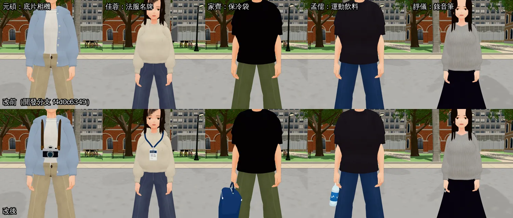
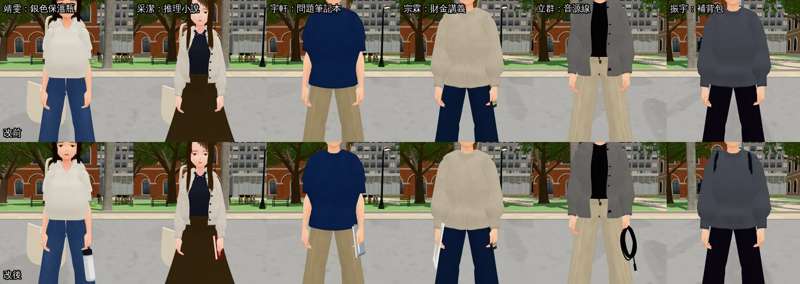
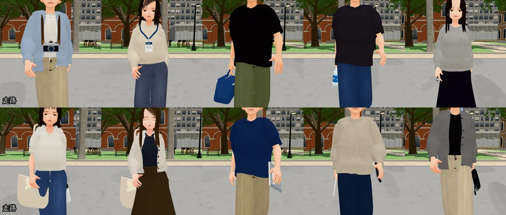
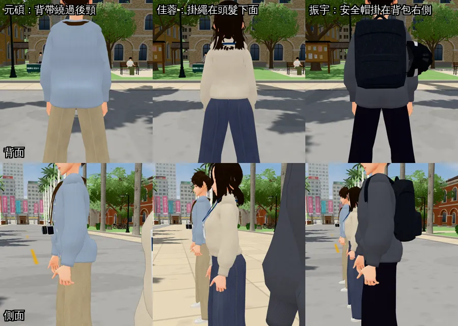
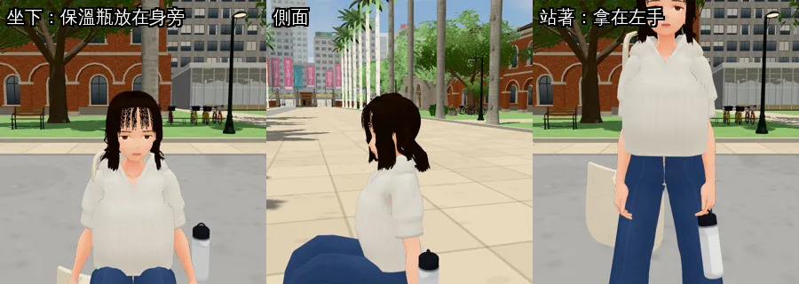
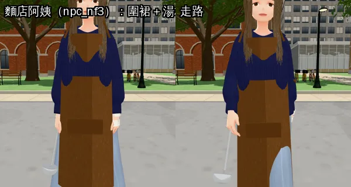
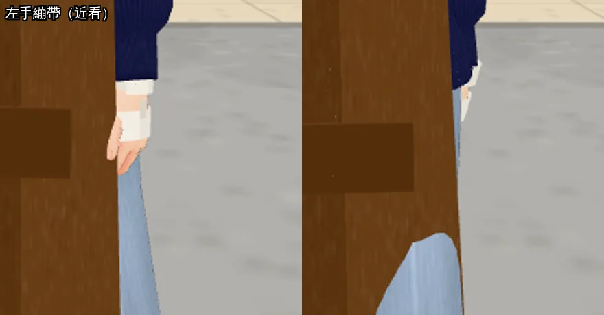
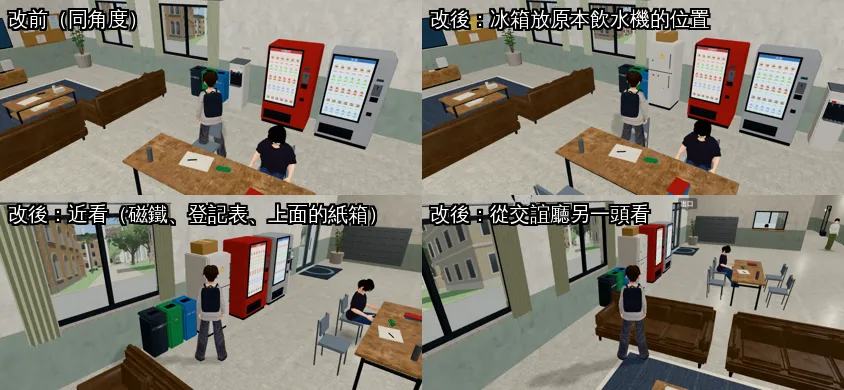
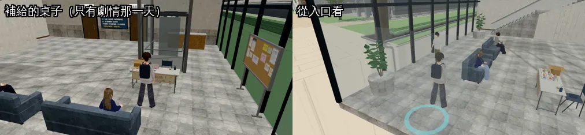

# 法律系同學的隨身道具、男一舍交誼廳冰箱、霖澤館一樓補給桌（NPC-POOL-ART-1028；LAWWW2-C 2026-10-28）

- **任務**：LAWWW-C 04:48Z（P2）。
  - AA_498 二十位法律系同學的道具與外觀。
  - 第 9 節第 4 點的實體物件：男一舍交誼廳的冰箱、霖澤館一樓「補給的桌子」。穿堂照片展是選做，**這一包沒有做**。
- **D99 人物美術凍結**：只做「配件」（使用者：「做好的就放進去」）。衣服、髮型、動作都不做，清單在最後一節。
- **麵店阿姨的繃帶**（HEROINE-LIFE-NPC3D-1028，LAWWW-C 說併進這一包）：一起做了，另外加湯杓。
- **狀態**：`READY_FOR_ART_REVIEW`。
  - 人物身上的配件由 BB 驗收（D59）。
  - 冰箱、補給桌是場景，只有使用者能標 `ART_APPROVED`。
- **怎麼套**：
  1. 程式：`git apply docs/art-rebuild/second_ai/patches/npc_pool_art_1028.patch`。開發分支最新的 `44e8ff8b7` 上 `apply --check` 通過；patch 是在 `f4d0c6349` 上做的。
  2. 二進位檔：從交件 commit 拿，清單在 outbox。
- 截圖都是遊戲內畫面，Playwright＋SwiftShader 模擬，**不是 iPhone 實機**。工具是 `tools/shots/pool_lineup.py`：同學排在椰林大道中間，屬於 [捷徑]，不是玩家流程。

## 1. 同學的隨身道具（同角度：上排改前、下排改後）

走路（道具跟著手擺，不會穿進腿）：

背面、側面：
- 元碩的相機背帶繞過後頸。
- 佳蓉的掛繩在頭髮下面。
- 振宇的安全帽掛在背包右側。改前他只有安全帽、沒有背包，所以安全帽浮在背後半空。

靖雯坐在傅鐘長椅時，保溫瓶放在身旁。AA_498 的旁白寫「長椅上一個女生……旁邊一個銀色的保溫瓶」。站著的時候拿在左手：

| 同學 | 加了什麼 | 怎麼掛 | 坐下時 |
|---|---|---|---|
| 元碩（pool_6，`npc_nm9`） | 底片相機（銀色頂蓋、黑色皮紋、稜鏡、鏡頭）＋深咖啡背帶 | upperChest。**背帶照這個底模的身體量過**：離身體最近 11 mm | 照樣掛著 |
| 佳蓉（pool_20，`npc_nf18`） | 法服值班名牌：深藍掛繩、卡套，卡面有自己畫的天秤和「值班」 | upperChest。**掛繩照這個底模量過**：最近 7.6 mm | 照樣掛著 |
| 家齊（pool_3） | 保冷袋（媽媽寄的虱目魚丸） | 右手提著 | 藏起來 |
| 孟儒（pool_12） | 運動飲料：寶特瓶，沒有牌子 | 右手指夾著瓶頸 | 藏起來 |
| 靜儀（pool_13） | 錄音筆：銀灰色機身、麥克風網、紅色錄音鍵 | 右手，像拿手機 | 照樣拿 |
| 靖雯（pool_7） | 銀色保溫瓶 | 左手（托特包在右肩）；坐在傅鐘長椅時改放在身旁 | 手上的藏起來，長椅那支出現 |
| 采潔（pool_1） | 推理小說：封面朝內，外面只看到封底 | 左手 | 照樣拿 |
| 宇軒（pool_10） | 寫滿問題的筆記本：螺旋線圈、一排便利貼 | 左手 | 照樣拿 |
| 宗霖（pool_2） | 一疊財金講義：長尾夾、螢光筆、小圖表 | 右手（計算機在左前臂） | 照樣拿 |
| 立群（pool_16） | 一捲音源線＋接頭 | 左手 | 藏起來 |
| 振宇（pool_14） | 補後背包（安全帽本來就要掛在背包上） | 現成的 backpack | 照現成的規則藏 |

## 2. 麵店阿姨（hc_ayi，`npc_nf3`）：圍裙＋湯杓＋左手繃帶

 

- 圍裙是現成的 `apron`（`{name:'apron',show:true}`，咖啡色）。
  - 這是程式產生的硬圍裙：走路時大腿會從圍裙側面露出來，芷若用的也一樣。
  - 想換顏色可以給 `color`。
- 繃帶照阿姨這個底模的左手量過：手腕 y −0.02～0.015、手掌含大拇指根部 z −0.06～0.03。
  - 包住手掌和手腕，手指露出來；手背貼一條膠帶。
- **要 LAWWW-C 接的**：`heroine_circle.js` 的 PEOPLE[] 現在沒有 props，要讓它傳到 spec 才看得到。建議 `hc_ayi` 的 props 是 `[{name:'apron',show:true},'ladle','bandage']`。

## 3. 男一舍交誼廳的冰箱

- 互動點照舊是 (7.3, 6.7)：「把箱子放進交誼廳的冰箱」「看交誼廳的冰箱」。
- 冰箱放在原本飲水機的位置 (6.52, 7.43)，是白色雙門冰箱，上面有：
  - 把手、磁鐵、使用登記表；
  - 上面一個紙箱。
- 飲水機移到販賣機西邊 x 3.0。南牆 7.4～9.4 是窗，第一次放在窗前擋到了。
- 模型在 `tools/blender/dorm_hall.py`（fridge）。導航擋 0.72×0.72，`src/dorm3d.js` 有備用模型。
- `dorm_layout.js` 的冰箱、飲水機位置都在 patch 裡。

## 4. 霖澤館一樓「補給的桌子」（只有劇情那一天）

- 什麼時候擺：`POOL.ytTableDue` 成立那一天才擺，也就是郁婷那一晚包好補給包的隔天。
- 位置：玻璃電梯南邊 (4.6, 1.05)，長邊沿 x。發的人站電梯那一側，拿的人從南邊來。
- 擋路的時機：GLB 載好才加進這一區、才擋導航。載不到就什麼都沒有，不會有看不見的牆。換區域時跟著這一區一起丟掉。
- **互動點從 (4.6, 0.6) 移到 (4.6, 2.05)**。原本的點會被桌子蓋住，現在在桌子前面。
- 檢查結果：
  - 從入口走到互動點，停在 0.21 m（低幀率 0.1 m）。
  - 桌子後面那條縫走得進去。
  - 加桌子前後，一樓都只有一個可站區塊，沒有小孤島。
  - 沒到那一天：沒有桌子、不擋路、沒有 JS 錯誤。
- 模型：`tools/blender/env_second/supply_table.py`，5,994 個三角形、505 KB。
  - 摺疊桌、手寫布條「期中考加油！」、三排補給包、拆開的紙箱、立牌「一人一包／不要搶 :)」、膠帶、筆筒、摺疊椅和外套。

## 5. 程式（patch：`patches/npc_pool_art_1028.patch`）

- `src/props3d.js`：
  - 十三個 DEF：`camera_film`、`lanyard_tag`、`thermos_silver`、`thermos_bench`、`sports_drink`、`recorder`、`cooler_bag`、`novel`、`notebook_q`、`handouts`、`audio_cable`、`ladle`、`bandage`。
  - DEF 可以寫 `sit`：
    - `'hide'`：坐下時藏，用在垂著拿的東西。
    - `'only'`：只有坐下、而且 `CHAR.setProp` 開了才看得到，給長椅上的保溫瓶用。
- `src/character3d.js`：
  - 坐下時藏東西，從寫死三樣（後背包、吉他、側背包）改成也看 DEF 的 `sit`。
  - `C.CARRY` 加這十樣手上的東西（羽球短片等演出時一起拿下來）。
- `src/pool3d.js`：
  - `S.prop`：劇情那一天才擺的實體物件。
  - 補給桌、互動點南移。
  - 靖雯在傅鐘長椅時打開 `thermos_bench`。
- `src/data/pool_story.js`：十一位的 props，註解寫明哪些沒做、為什麼。
- `src/assets3d.js`：十二個 `prop.*`＋`bldg.linze_supply_table`，都是 lazy，那個人出現才載。
- `src/dorm3d.js`、`src/data/dorm_layout.js`：冰箱、飲水機移位。
- `LICENSES.md`：新增兩列（補給桌、這些道具）；男生宿舍那一列加上冰箱。

## 6. 測試

- **開發分支 `44e8ff8b7`＋這個 patch＋二進位檔**（Node）：
  - `badclip_bag_unit`、`badclip_wire_unit`、`dorm_lounge_unit`、`anon_pool_unit`、`perf_npc_pool_unit`：ALL PASS。
  - `aa498_pool_unit` 2 項、`aa497_supporting_unit` 12 項、`aa502_dorm203_unit` 3 項 FAIL。都是「讀企劃稿」的檢查，這個 clone 拿不到那幾個 commit。
  - 在 `44e8ff8b7` 上拿掉 patch 再跑：aa498 一樣 2 項、aa497 一樣 12 項。aa502 是之前在 `f4d0c6349` 上用 stash 比過，一樣 3 項。和這一包無關。
- **瀏覽器（`f4d0c6349`＋patch）**：
  - 同學在四種姿勢（站、走、坐、讀書）下截圖，坐下時該藏的有藏。
  - 背面、側面、近照各拍一輪。
  - 補給桌的走路與導航檢查（第 4 節）。
  - 冰箱同角度改前改後。
  - 沒有 JS 錯誤。
- 冰箱（`be70f1386`）：宿舍的 Node 測試 ALL PASS。
- **iPhone 實機沒有測。**

## 7. 效能（GLB，都是 lazy）

| 檔案 | 三角形 | 大小 |
|---|---|---|
| camera_film | 2,178 | 160 KB |
| lanyard_tag | 1,214 | 101 KB |
| audio_cable | 2,184 | 94 KB（第一版 3,524／248 KB，改成一整條掃掠的管子） |
| thermos_silver／sports_drink／recorder／notebook_q | 850／1,020／584／654 | 35／33／45／51 KB |
| cooler_bag／novel／handouts／ladle／bandage | 508／148／146／300／92 | 21／16／17／14／6 KB |
| linze_supply_table（場景） | 5,994 | 505 KB |

- 一位同學多 1～2 個 draw call（道具和身上的東西各是自己的網格）。

## 8. 沒有做的、缺點（誠實列）

- **D99，不做**：
  - 衣服、鞋子：格子襯衫（元碩）、系服（孟儒）、系學會外套（郁婷）、藍白拖（家齊）。
  - 動作：外套蓋在頭上趴著睡（pool_18）。
  - 髮型配件：采潔的鯊魚夾。
- **還沒做**，小東西或要接作息：
  - 書豪掛在背包上的計時器。
  - 珮瑜一邊戴一邊不戴的耳機（耳機線要跨頭和胸口兩根骨頭）。
  - 晨希的撥片鑰匙圈、佳蓉的延長線。
  - 振宇的公路車：是世界物件，要跟他的作息一起擺。
  - 靖雯膝蓋上的飯糰包裝紙。
  - 穿堂照片展（選做）。
- **換底模要重量**：相機背帶、名牌掛繩、繃帶是照那一位的底模量的。換底模要重跑 `python3 tools/blender/char_second/prop_pool.py --fit`，再做 GLB。
- 晨希的吉他袋照預設掛法：排隊截圖裡看起來沒穿模，沒有仔細調。
- 道具是卡通明暗（MeshToon），和人物一樣；沒有金屬反光，相機的銀色是淺灰色。
