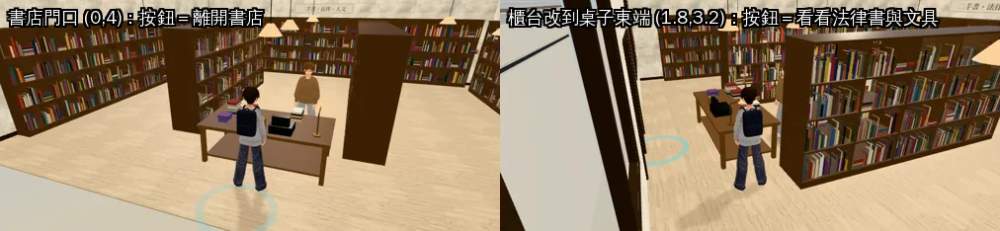
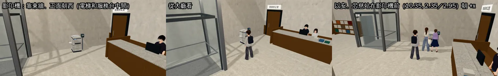
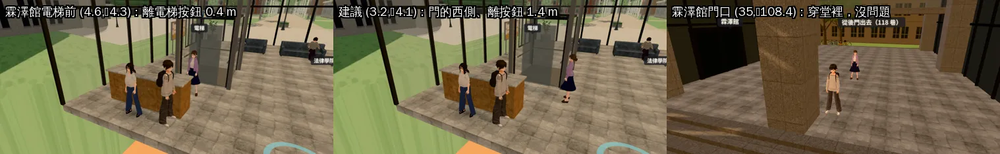

# 總圖一樓的影印機＋六個站位檢查（NPC-STORY-1028）、公館書店門口按錯（BOOKSTORE-EXIT-SHOP-1028）（LAWWW2-C 2026-10-28）

- **任務**：
  - LAWWW-C 06:41Z NPC-STORY-1028（AA_497 美術小需求）：①影印機 ②六個站位看畫面合不合理。
  - LAWWW-C 06:59Z／07:06Z BOOKSTORE-EXIT-SHOP-1028：BB 回報，v9.10.11 就有。
- **怎麼套**：
  - 程式：`git apply docs/art-rebuild/second_ai/patches/npc_story_bookstore_1028.patch`。開發分支最新的 `30e7921b7` 上 `apply --check` 通過。
  - 二進位檔：`assets/models/env/second_ai/library_copier.glb`。
- **狀態**：
  - 書店是功能修正（BB 在 v9.10.13 的 6a 驗）。
  - 影印機是場景物件 `READY_FOR_ART_REVIEW`，只有使用者能標 `ART_APPROVED`。
- 截圖：遊戲內，Playwright＋SwiftShader 模擬，不是 iPhone 實機。人物、鏡頭是 [捷徑] 放的。

## 1. 公館書店：門口按下去是買書選單

- **原因**：櫃台互動點 (0, 4.05) 半徑 1.1，就在門口。
  - 桌子前緣（z 3.6＋0.1）到門口站得到的最後一排（z 4.07）只有 0.37 m，「買書」和「離開」一定疊在一起。
  - 進門的落腳點 (0, 4) 也在櫃台範圍裡，按鈕是「看看法律書與文具」。
- **改法**：櫃台互動點移到桌子東端、收銀機那一頭 (1.8, 3.2)，半徑 0.9（`src/zones3d.js`，一行）。
  - **沒有照 BB 建議移到 (0, 2.2)**：店員站桌子北側 (0.55, 1.95)、面向門口（`story3d.js`），(0, 2.2) 是店員那一側，玩家會站到店員旁邊結帳。
  - 東端離門口 2 m，從店裡、門口都走得到。
  - 出口 (0, 4.6) 半徑 1.5 沒動；落腳點、桌子、店員、正式模型都沒動。
- **測試** `tests/bookstore_exit_unit.js`（新的，Node）：
  - 出口範圍裡站得住的 81 個點全是「離開書店」，落腳點 (0,4) 也是。
  - 從門口走到櫃台（30 fps＋低幀率）走得到。
  - 櫃台範圍裡站得住的 295 個點全是買書。
  - **改前同一支測試 FAIL 3 項**：門口 81 點裡有一部分是買書、落腳點是買書。
- 瀏覽器裡：門口 (0,4)、門口左右 (±1, 4.05) 都是「離開書店」，桌子東端是「看看法律書與文具」。

## 2. 總圖一樓的影印機

- **位置改了**：LAWWW-C 寫的是 (8.0, 2.6) 附近、人站 (7.6, 2.6) 朝 +x。我改放**東牆邊 (11.4, 2.6)、正面朝西**，人站 **(10.35, 2.35)、(10.35, 2.95) 朝 +x**。
  - **請 LAWWW-C 改芯慈 2-2 的站位。**
  - 原因：服務台的互動點在 (7.8, 3.25) 半徑 1.3，(8.0, 2.6) 會擠在服務台客人站的地方旁邊。
  - 影印機靠牆、在電梯（北邊）和服務台（西南邊）中間，像圖書館影印區。
- **模型**（`tools/blender/env_second/library_copier.py`，1,660 個三角形、131 KB）：
  - 米白的大台多功能影印機：上面自動送紙器（有一疊原稿）、正面右上的觸控面板、四個紙匣、出紙凹口（印好的紙）、右側出紙盤。
  - 旁邊柱子上一個投幣／刷卡盒。
  - 沒有牌子、型號（D77）。
- **遊戲**：
  - `library_layout.js` 加一筆 `copier`（位置、朝向、擋住的範圍）。
  - `library3d.js`：導航一直擋。畫面先放一個方塊，影印機的正式模型載好就換掉。
    - 方塊不放在備用模型群組裡：大廳的正式模型載好會把那一組藏起來。
- **測試** `tests/library_copier_unit.js`（新的，Node）：
  - 影印機擋住、兩個站位站得住。
  - 從入口走得到兩個站位；服務台、電梯的點照樣走得到。
  - 一樓沒有小孤島（只有一塊可站的區域）。
  - `nav_buildings_unit`、`library_b1_unit`、`library_media_unit`、`library_upper_unit`、`seat_reach_unit`、`postcard_reach_unit` 全部 ALL PASS（`55fcd3003`＋patch）。

## 3. 六個站位（AA_497；看了導航和畫面）

| 站位 | 結果 | 建議 |
|---|---|---|
| B1 座位 (−3.2, −7.77) | 正好是一個座位（朝 π） | 不用改 |
| B1 座位 (6.6, −7.77) | 正好是一個座位 | 不用改 |
| 法圖 (−4.8, −5.2)（`seatAt`） | **最近的座位在二樓**：(−4.4, −5.4)，lv 1，0.45 m。seatNear 不看樓層，人會被放到二樓 | 要一樓的話改 `seatAt:[-4.6,-6.0]`（一樓最近的座位，0.82 m）；本來就要二樓的話不用改 |
| 傅鐘長椅 (−30, 21)（`seatAt`） | 對到長椅座位 (−30, 20.94) | 不用改 |
| 霖澤館電梯前 (4.6, −4.3) | 站得住，但**離電梯按鈕 (4.6, −3.9) 只有 0.4 m**：人站在玩家按電梯的位置。玩家走過去，按鈕可能變成和她說話，人也擋在門口 | 改 **(3.2, −4.1)**：門的西側，離按鈕 1.4 m、離最近的牆 1.1 m，朝東（+x）看電梯門。另一邊 (6.0, −4.2) 也可以 |
| 霖澤館門口 (35, −108.4) | 在穿堂裡（地坪 0.9 m），四周 9 m 內沒有擋住的東西，2 m 內沒有別的互動點 | 不用改 |

## 檔案

- `docs/art-rebuild/second_ai/patches/npc_story_bookstore_1028.patch`：
  - `src/zones3d.js`（書店一行）
  - `src/data/library_layout.js`、`src/library3d.js`、`src/assets3d.js`（影印機）
  - `LICENSES.md`（一列）
  - `tests/bookstore_exit_unit.js`、`tests/library_copier_unit.js`（新的）
- `assets/models/env/second_ai/library_copier.glb`（＋`.json`）、`tools/blender/env_second/library_copier.py`。
