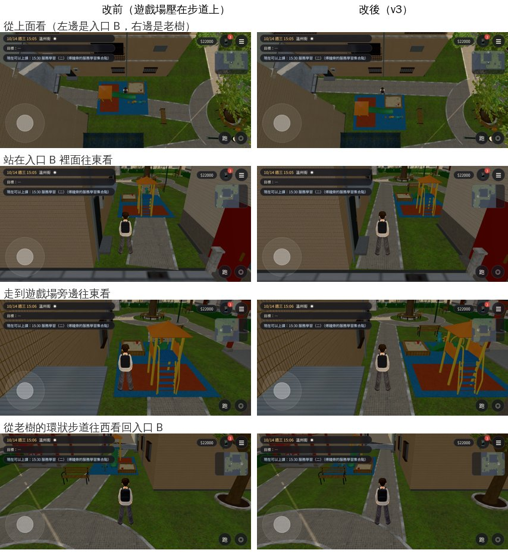

# B08（PARK-ENTRY-B-1027）：溫州街小公園——從入口 B 走不進主園區（LAWWW2-C 2026-10-27）

- **來源**：LAWWW-C 10-27 18:00 派的評估清單 B08（帳號 A 時代的 ART-WZPARK-ENTRY-B-1022，P3，一直沒開工）：小公園遊戲場的導航阻擋把入口 B 的步道整段擋住。
- **對**：最新開發 `fb8d27888`（`claude/adoring-meitner-mqzst8`）。
- **工具**：配置 `src/data/wz_park_layout.js`（遊戲和 Blender 共用）＋Blender bpy `tools/blender/env_second/wz_park.py` 重匯 `wz_park.glb`。材質照舊（Poly Haven CC0、原本的地磚）。

## 原本錯在哪

- 遊戲場（x 15.2、z 19.4，5.2×3.6 m）整塊壓在「入口 B → 老樹」那條步道上；導航阻擋照遊戲場的範圍擋，B 步道剩西北角那棟（F1）和遊戲場之間 0.8 m，人過不去。
- 結果：從北巷走入口 B 只走得到入口裡面那一小塊；要去老樹得繞出去，從北巷繞到主巷、從入口 A 進來（**42.5 m**）。畫面上步道穿過遊戲場的地墊（改前俯視圖）。
- `src/crowd3d.js` 的課輔班路線早就寫了「入口 B 走不進主園區的時候改從遊戲場東邊出發」，B 步道打通以後會自動改回從入口 B 進來（每次排人先試一次）——這次不用改程式。

## 改了什麼（配置 v3）

（方向照配置檔的約定：x 往東、**z 往北**，北巷在 z 大的那邊；主巷在 z 小的那邊）

- 遊戲場往北 1.5 m：z 19.4 → 20.9（導航阻擋一起改）。
- 入口 B 的步道改成 (24.16, 18.58) → (8.4, 18.0)、寬 1.4 m：從老樹環狀步道的西南側出發，走遊戲場南邊（A3 後牆 z 17.0 和遊戲場 z 19.1 之間）到入口 B。
- 其他東西（老樹、涼亭、鞦韆、健身器材、座椅、互動點、市集）都沒動。路人站位（`crowd3d.js`）照配置的遊戲場位置算，跟著移。
- 正式模型：`wz_park.glb` 重匯（三角形 49,724 不變；遊戲場 `park_play`、小物件 `wz_park_small_atlas` 往北 1.5 m；步道 `park_paver` 跟著配置）。

## 測試

- `tests/wz_park_unit.js` 加兩項：從北巷經入口 B 走得到老樹的環狀步道；入口 B 到老樹的路線 30 m 以內（不繞北巷、主巷）。**改前（配置 v2）FAIL（42.5 m）、改後 ALL PASS**；版本檢查改成 v3。
- 最新開發＋patch＋新 GLB：`wz_park_unit`、`wz_park_people_unit`、`wz_park_talk_unit`、`crowd_unit`、`crowd_far_indoor_unit`、`indoor_crowd_unit` ALL PASS；另外所有會載入小公園配置的 Node 測試 43 支 ALL PASS（`aa163_tutor_unit` 課輔班、`wz_cat_unit`、`seat_reach_unit`、`quick_travel_unit`、`lamppost_nav_unit`、`wz_market_unit`……）。
- 截圖（`tools/shots/b08_park_entry_shots.py`，SwiftShader 手機模擬橫向，15:00；[捷徑] 讀檔、直接放玩家位置、路人藏起來）：改前、改後同角度 5 張（`before_*`、`after_*`）。改前「走到遊戲場旁邊」那個點站不住（在遊戲場的導航阻擋裡）。
- 沒跑：瀏覽器流程測試（BB：從北巷用搖桿走入口 B 到老樹、課輔班那一場）、整套回歸、手機實機。

## 檔案（我的分支 `claude/focused-cray-c9uwvw`）

- `docs/art-rebuild/second_ai/patches/park_entry_b_1027.patch`（`src/data/wz_park_layout.js`、`tests/wz_park_unit.js`）。配置檔我的分支上也有同一份。
- `assets/models/env/second_ai/wz_park.glb`＋`.json`（從我的分支拿）。
- 截圖工具 `tools/shots/b08_park_entry_shots.py`。

## 還沒達到

- 遊戲場離 A3 後牆比較近了（南邊步道 1.4 m 寬），從主巷那一側看不出差別；遊戲場北邊和西北角那棟之間的草地變窄。
- 美術狀態照舊 `READY_FOR_ART_REVIEW`（場景要使用者看過才能標 ART_APPROVED）。
