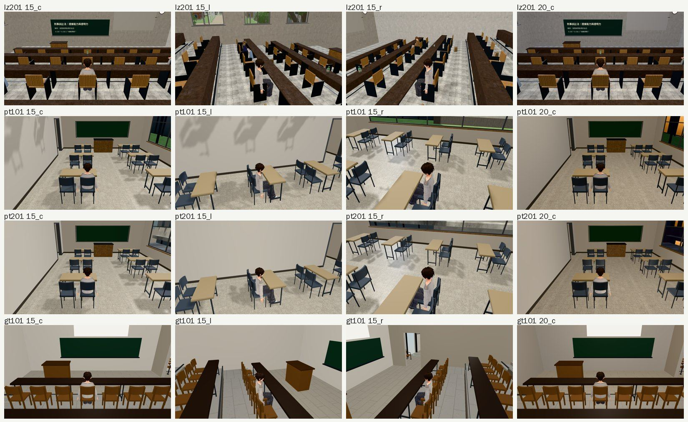
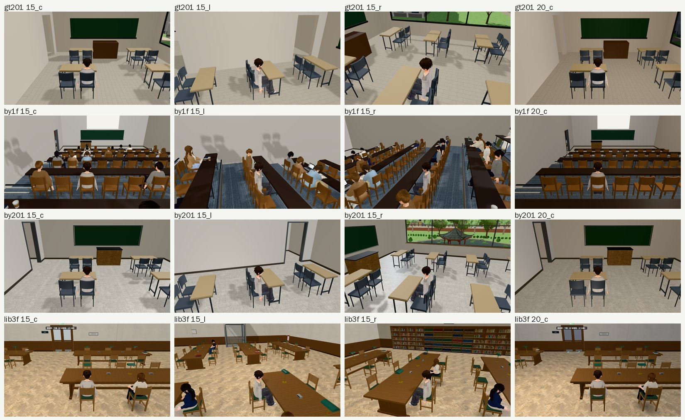
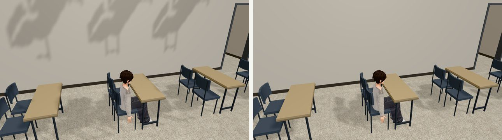

# 巡場景第 7 區：室內教室坐下看窗外（2026-10-24，LAWWW2-B）

開發分支 `af405f952` 加上博雅窗景 patch（測試樹；開發分支後來的 `0a5835573` 就是這個狀態），經濟系那一年 10/15（二）。

- **怎麼拍**：用遊戲本身的坐下（`GAME.sitAt`，找離目標最近的座位），坐下後跟隨鏡頭在人後面 3 m。
  - 每間拍 15:00 三個方向（後面 c、往左轉 l、往右轉 r）＋20:00（後面）。
  - Playwright＋SwiftShader，不是 iPhone 實機。
- **8 間**：霖澤 201（`classroom`）、普通 101／201、共同 101／201、博雅一樓階梯教室／201、總圖 3F 閱覽區。
- 32 張，errors 0。

## 結果

| 看到的 | 優先 | 處理 |
|---|---|---|
| 一樓教室的牆上一片片放大的桌椅影子（普通 101、博雅一樓，下午最明顯）——是正上方二樓的桌椅 | P2 | **已交件**：BUG-SHADOW-UPPER-1024（`test_shots/shadow_levels_1024/`；LAWWW-B 10:49 同意改 `engine3d.js`） |
| 博雅一樓階梯教室下午有一整班路人：365 calls、77 萬三角形（其他教室 107～143 calls、11～20 萬） | 記錄 | 照劇情排的人數；手機效能沒實測，只記錄 |
| 窗景：普通、共同、博雅都是新拍的（`aef97e506`、`0a5835573`），坐著看也對 | — | 沒問題 |
| 地板：總圖 3F 是淺色拼花（P0 已換）；教室是淺灰地磚、水磨石 | — | 沒問題 |
| 霖澤 201 的長桌是深色木頭 | — | 使用者不要的是「深色木地板」，桌子不算；照舊 |

## 一樓牆上的影子：原因與驗證

- 坐著時鏡頭比二樓地板低，`engine3d.js` 的 `updateLevelVis` 讓二樓整層顯示（從下面看得到天花板，是故意的）。
- 二樓的桌椅因此也進了陰影貼圖。室內的太陽沒有被樓板擋住，就把二樓桌椅的影子打在一樓的牆上。
- 驗證：同一個畫面把 `levelGroups[1]` 的 `castShadow` 全部關掉，牆上的影子就全部消失（calls 120 → 114、三角形 158k → 146k）：

- 提案：陰影那一輪把「玩家這一層以上」的 `levelGroups` 暫時藏起來，畫完再還原（包一層 `renderer.shadowMap.render`，大約 4 行）。
- LAWWW-B 10:49 同意；已交件，見 `test_shots/shadow_levels_1024/`。
