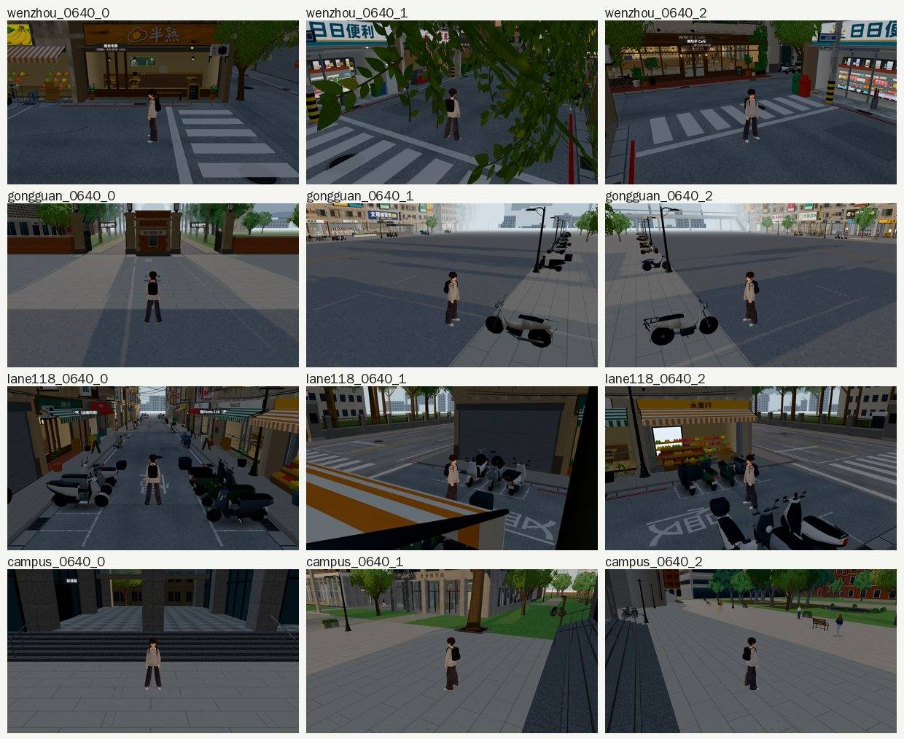
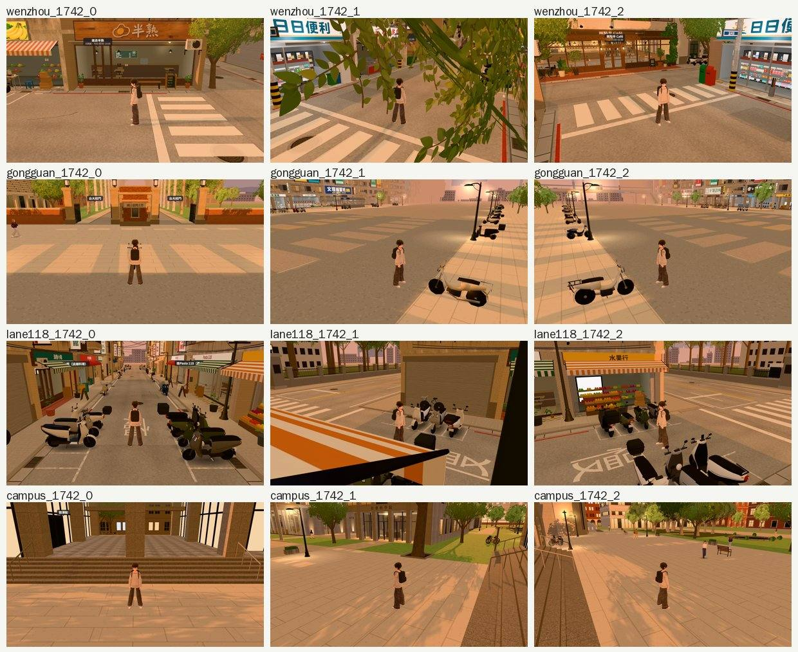

# 巡場景第 8 區：日夜變化——清晨、黃昏（2026-10-24，LAWWW2-B）

前面各區都拍了 15:00、20:00；這一輪補清晨 06:40 和黃昏 17:42。

- **條件**：開發 `99b6cf1b5`，法律系大一 10/15（三）；Playwright＋SwiftShader，不是 iPhone 實機。
- **拍法**：溫州街、公館、118 巷、校園，從各區的出生點，跟隨鏡頭（距離 6 m）轉三個方向，24 張，errors 0。

## 結果

**沒有找到要修的。**

- **06:40**：天色偏冷，路燈關著，店面是開店前的樣子。
- **17:42**：整個畫面偏暖橘色（黃昏的色調表）。校園最明顯，和 10-21 校園巡查的 17:42 一致。
- **118 巷第 2 張的前景橘白條紋**：看起來像停著的大車或路障。
  - 從鏡頭往人打射線，中間只打到人，沒有東西擋。
  - 那是鏡頭在轉角店家雨遮的正上方往下看，取景問題，不是模型。
- **溫州街第 2 張前景的樹葉**：鏡頭在行道樹的樹冠高度。樹幹會網點透空，樹冠不會，照舊。
