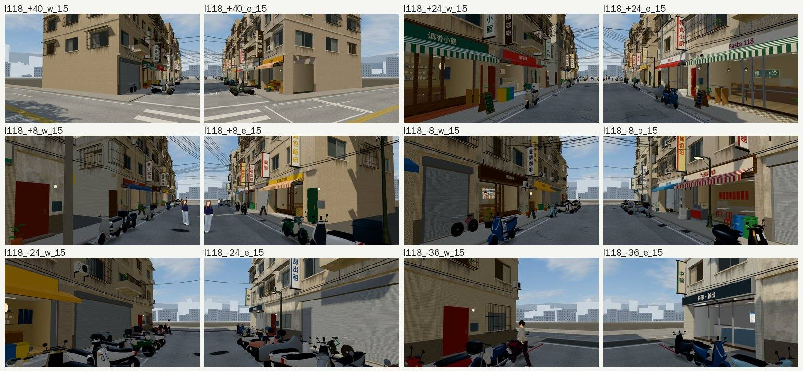
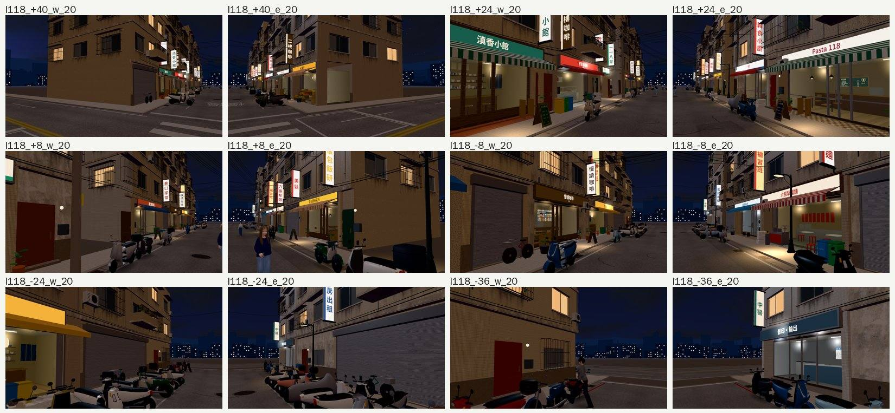

# 巡場景第 6 區：118 巷（2026-10-24，LAWWW2-B）

開發 `99b6cf1b5`，法律系大一 10/15（三），15:00、20:00；Playwright＋SwiftShader，不是 iPhone 實機。

- **怎麼拍**：導航格查過，主巷沿 z 方向（46 到 −38）、寬約 8 m。
- 取 z 40、24、8、−8、−24、−36 六個位置，往西、往東斜看兩側，24 張，errors 0。

## 結果

| 看到的 | 優先 | 處理 |
|---|---|---|
| 店面、招牌、雨遮、店內、機車、電線、晚上的亮燈 | — | 沒問題（82725bf8 的立體店面、79777475 的窗景都在） |
| 白天往巷子兩頭看出去，最遠的背景樓是一片淡藍灰的平板剪影，沒有細節（晚上有亮窗，還好） | P3 | 記錄：D27 走不到的背景（公館、118 巷共用）；要改的話是遠景剪影加一點窗格和明暗，等排 |
