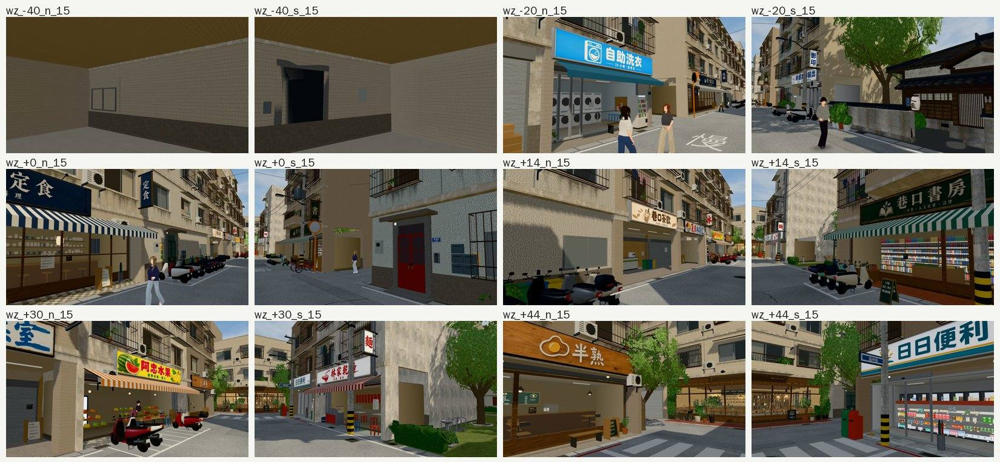
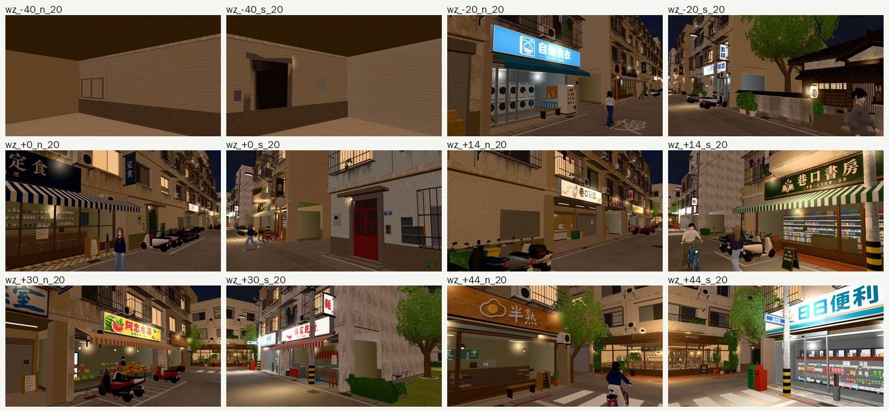
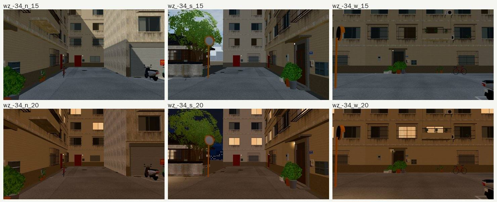

# 巡場景第 5 區：溫州街（2026-10-24，LAWWW2-B）

開發 `99b6cf1b5`，法律系大一 10/15（三），15:00、20:00。Playwright＋SwiftShader，不是 iPhone 實機。

- **怎麼拍**：主巷 x −20、0、14、30、44 五個位置，每個位置往北、往南斜看兩邊，24 張；西端路口 x −34 往北、往南、往西，6 張。
- 第一輪的 x −40 是在建築裡面：導航格查過，巷子在 x ≈ −36 就到底了，玩家走不到。那兩張作廢，改拍 x −34 的路口。

## 結果

**沒有找到要修的方盒、黑塊、穿模。** 30 張 errors 0。

- 店面（自助洗衣、定食、巷口茶飲、阿忠水果、林家乾麵、巷口書房、半熟、日日便利）的招牌、店內、騎樓、機車、路人都在，晚上有亮燈。
- 幾面沒有窗的側牆（x 30 往南、x −34 往北）：台北巷子本來就有，照舊。
- x −40 的舊截圖鏡頭在建築裡，看到的是套件的內牆。不是玩家看得到的地方，不用修。
