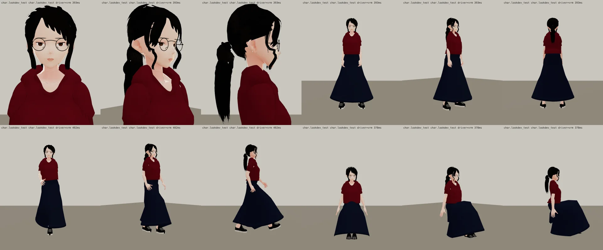

# 郭沛珊自己的 3D 模型 第一版（MODEL_READY；角色美術由 BB 驗收，D59）

> LAWWW2-B，2026-10-15。LAWWW-B 23:34Z 分派 A。
> 起因：使用者 2026-10-15 試玩線上 v9.7，第 26 項「郭沛珊為什麼跟 NPC 穿一樣醜的紅色衣服」。原話在 LAWWW-B 分支 `docs/USER_INSTRUCTION_LOG.md`，commit `10826bd`。

## 照什麼做

- **參考圖**：企劃分支的 `docs/story_planning/art_reference/classmate_peishan.webp`。BB 已經標 `ART_APPROVED`（`BB_116` 第 13 節）。縮圖放在 `reference_small.webp`。
- **規格**：`BB_109` 第 2 節。
  - 163 cm、法律系一年級。
  - 黑色、**低而鬆的馬尾＋側分瀏海**（使用者 2026-10-13 已定案）。
  - **深色細圓框眼鏡，一直戴著**。
  - 酒紅素 T＋深藍長裙＋帆布鞋。
  - 識別物：黑色硬殼筆記本。
- 外觀都照參考圖和規格，我沒有自己決定新的外觀。

## 做法（Blender bpy＋VRM；和吳芯慈同一條生產線）

| 部分 | 腳本 | 說明 |
|---|---|---|
| 主程式 | `tools/blender/char_second/peishan.py` | VRoid CC0 樣本 Darkness Shibu 的身體、臉（表情）、骨架，和芯慈同一個樣本。頭縮 0.91，約 7.3 頭身 |
| 臉 | `peishan_face.py` | h01_face 的參數。眼睛比芯慈圓、外眼角幾乎不上揚（安靜、收斂），**細眉**，淡唇色、幾乎沒有腮紅 |
| 頭髮 | `peishan_hair.py` | 從溫書瑀的低馬尾（LAWWW 的 p05_hair）複製改寫。近黑；側分在人物右邊，瀏海往左斜撥；比學姊蓬、鬆；臉旁長碎髮到下巴下面；後頸碎髮多幾束；馬尾粗一點。馬尾、臉旁碎髮有彈簧骨 |
| 衣服 | `peishan_clothes.py` | 酒紅圓領短袖 T，下擺蓋在裙頭上；深藍 A 字長裙，裙擺到小腿下段；黑色帆布鞋，白鞋底。**長裙的權重**：膝蓋以上照大腿，膝蓋以下照小腿，不用裙擺彈簧骨 |
| 眼鏡 | `glasses_peishan.py` → `assets/models/char/second_ai/glasses_peishan.glb` | 和芷若的眼鏡同一種做法與座標，換成深色細框、直徑 4.6 cm。1,348 三角形、32 KB |

- 遊戲用 VRM：`assets/models/char/second_ai/bl_classmate_peishan.vrm`，2.9 MB。
  - 用 `vrm_finish2.py` 處理（`VRM_BASE=Darkness_Shibu`，虹膜色 #3a2a22）。
- 三角形數：
  - 衣服 10,144：T 6,752、裙 2,208、鞋 1,184。
  - 頭髮 12,312。

重建步驟：

```bash
/opt/blenv/bin/python tools/blender/char_second/peishan.py -- - --stages stage0,face --blend <工作>/face.blend
/opt/blenv/bin/python tools/blender/char_second/peishan.py -- <工作>/v.vrm --from-blend <工作>/face.blend --stages clothes,hair
VRM_BASE=Darkness_Shibu python3 tools/blender/char_second/vrm_finish2.py <工作>/v.vrm assets/models/char/second_ai/bl_classmate_peishan.vrm 郭沛珊 '#3a2a22'
/opt/blenv/bin/python tools/blender/char_second/glasses_peishan.py
```

需要 VRM Add-on for Blender，以及 `tools/vroid_src/Darkness_Shibu.vrm`（見 `common.py`、`vroid_build.py` 開頭）。

## 檢視圖（遊戲渲染器：LAWWW 的 test_charlook.html，不是遊戲內截圖）

- `char_lookdev.py`：遊戲本身的 ASSETS＋CHAR.build＋props3d 眼鏡，白天的光，待機、走路、坐姿。
- 基準：開發分支 `6212adb`，SwiftShader。



- 上排：臉正面、45°、側面，全身正面、45°、背面。
- 下排：走路三個角度，坐姿三個角度。
- 第二版 `lookdev_v2_sheet_skirt_disc.webp`：坐下時整條長裙跟著大腿抬平，變成大圓盤。第三版改成膝蓋以下照小腿，坐著時順著膝蓋垂下。
- Blender 預覽：`blender_v2_sheet.webp`（T 字姿勢）。

## 和參考圖比，還不到的地方（誠實寫）

1. **T 恤的領子太厚**：用的是針織衫生產線（h01_clothes）的圓領，羅紋領口偏高、偏厚，近看有點像毛衣或連帽上衣的領子；身片也比參考圖鬆。參考圖是薄的素 T，領口貼著鎖骨。
2. **瀏海**：側分方向對，但瀏海是幾片比較大塊的髮片，沒有參考圖那種細碎、鬆的感覺。頭頂的剪影有一點鋸齒。
3. **長裙坐姿**：不會炸開了，但側面看，膝蓋前面的裙子是一大片斜面，沒有布料的皺褶；裙子後面在椅子底下可能穿進椅面（測試頁沒有椅子，沒有確認）。
4. **還沒做**：
   - 黑色硬殼筆記本（道具）。
   - 冬天的灰色開襟毛衣、讀書會的襯衫、哲學系旁聽的托特包。
   - 大三以後的及肩短髮。
5. 只在 test_charlook 看過，**沒有遊戲內截圖**（D59：接進遊戲後由 LAWWW 拍給 BB），也**沒有實機測試**。

## 接法建議（LAWWW-B 的檔案，我沒有改）

- `src/assets3d.js`，manifest 加兩筆：
  - `'char.classmate_peishan'`：寫法同 `char.classmate_xinci`；`url:'assets/models/char/second_ai/bl_classmate_peishan.vrm'`，`height:1.63`，Darkness Shibu 底模。BB 驗收前要不要加 `blOnly`，由你決定。
  - `'prop.glasses_peishan'`：寫法同 `prop.glasses_zhiruo`；`url:'assets/models/char/second_ai/glasses_peishan.glb'`，lazy。
- `src/character3d.js` 的 `C.MODEL_PROPS` 加 `'char.classmate_peishan':[{name:'glasses',glb:'prop.glasses_peishan'}]`。
- `CHARACTERS.classmate_peishan.char3d.model` 改成指到 `char.classmate_peishan`，取代現在的路人底模。
- `LICENSES.md`：底模 VRoid CC0 樣本「Darkness Shibu」（pixiv），頭髮、衣服、臉型是本作 Blender。

## 狀態

`MODEL_READY`：模型完成，還沒接進遊戲。接進遊戲並拍遊戲內截圖後，由 BB 驗收角色美術；LAWWW2 不標 `ART_APPROVED`。
