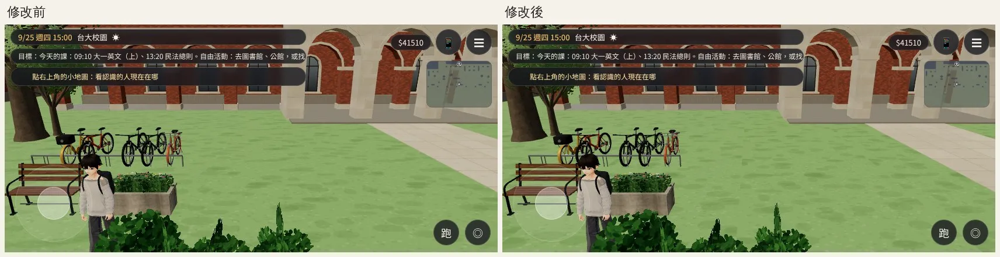
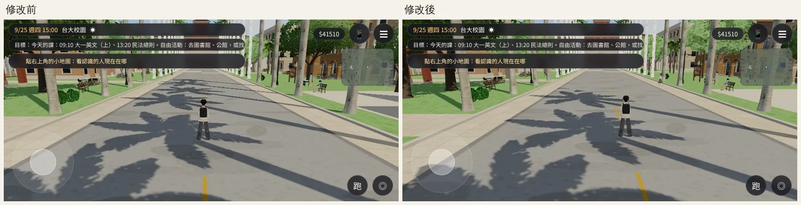
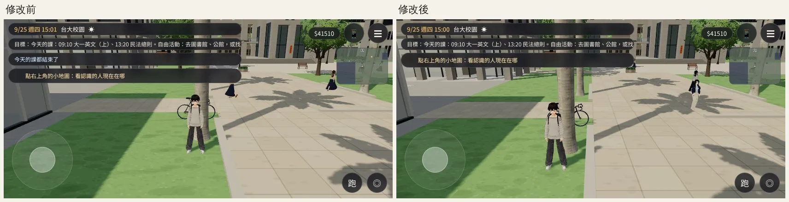
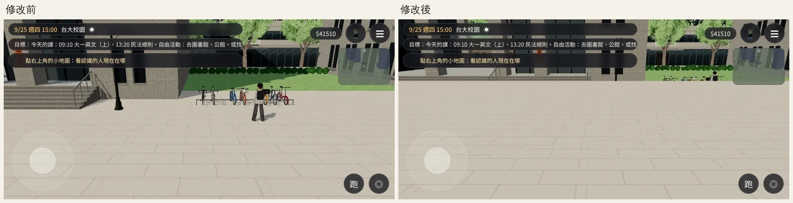

# 校園卡：每一幀畫了什麼、停著的腳踏車分區合併（PERF-CAMPUS-SHADOW-1020）——已交件

帳號 A 的 LAWWW2，2026-10-21 18:5x UTC。

狀態：**已交件**（腳踏車那一項），交 LAWWW 整合。路人那一項是 LAWWW 的範圍，數字寫在下面。

## 問題

- 使用者 10-20 試玩 v9.10.2：「地圖蠻卡的」。
- BB-C 當時量到：19:30 校園 516 個 draw call、857 個投影子物件。
- 影子閃那一半 LAWWW 已經修了（shadowSnap，等真機）。這裡處理「卡」那一半。

## 先量：每一幀畫了什麼（`shadow_audit.py`、`shadow_audit2.py`）

- 環境：開發分支 `b804db03`（和 `15f3c677` 只差測試檔），Playwright＋SwiftShader，手機橫向 844×390。**不是 iPhone**，只看 draw call、三角形，不看毫秒。
- [前置／捷徑]：讀使用者 9/25 存檔；`GAME.enter('campus')`；把玩家搬到三個位置：霖澤館前、椰林大道、社科院。

### 第一輪：投影子物件

BB-C 的 857 是舊版本。現在校園的投影子物件只有 172～184 個（大多數建築已經換成合併材質的正式模型）。

| 15:00 | 主畫面 draw call／三角形 | 陰影那一輪 draw call／三角形 |
|---|---|---|
| 霖澤館前 | 122／32.2 萬 | +90／+21.5 萬 |
| 椰林大道 | 321／74.6 萬 | +70／+22.3 萬 |
| 社科院 | 300／63.3 萬 | +81／+20.7 萬 |

19:30 的陰影那一輪是 61～105 個 draw call（強制重畫一次量的；LAWWW 已經讓晚上 2 秒才重畫一次）。

### 第二輪：照來源分組（`audit2_before_1500.json`）

椰林大道 15:00，一幀 382 個 draw call、104 萬個三角形：

| 來源 | 主畫面 | 陰影那一輪 |
|---|---|---|
| 路人（VRM，約 10～15 個人） | 151 個 draw call、**25.2 萬**個三角形 | 16 個、2.4 萬 |
| 合併過的程序化場景（沒有名字的網格） | 76 個、**24.2 萬** | 17 個、**9.7 萬** |
| 行道樹 | 9 個、4.5 萬 | 8 個、4.5 萬 |
| 共同教學館、萬才館、總圖等正式模型 | 各 7～12 個、1～3 萬 | 少 |

合併過的程序化場景裡最大的是**停著的腳踏車**：
- `bike_dark` 4.7 萬、`bike_metal` 4.6 萬、`bike_frame` 3.0 萬……合計約 14 萬個三角形；
- 一塊網格橫跨 **153×184 m**。

原因：
- 進區域時引擎會把整個校園的靜態網格照材質合併（`P3.mergeStatic`）。
- 全校園約 120 台車（每處停車架＋單台，正式模型一台約 1,300 個三角形）變成幾塊橫跨全校園的網格。
- 視錐剔除和距離都沒用，畫面外、幾百公尺外的車每一幀照畫；有投影的那幾塊，陰影那一輪也照畫。

## 改法：`docs/art-rebuild/second_ai/patches/campus_parked_bikes.diff`

- 對開發分支 `15f3c677` git apply 乾淨。只改 `src/zones3d.js`，加一支測試。
- 校園的六處擺車改用 `parkedRack`／`parkedBike`，先記下來。
- `parkedBikeChunks`：
  - 照 40 m 的格子分區合併，同一區、同材質一塊；
  - `userData.dyn`＝不參加全區合併；
  - 畫面外的整區由視錐剔除。
- `zone.update` 每 0.5 秒照鏡頭到那一區的距離開關：45 m 外整區不畫。
- 導航阻擋另外寫在 `blockRect`，沒動。

## 測試

### Node 單元測試 `tests/campus_bikes_unit.js`（修改前 FAIL、修改後 ALL PASS）

- 沒有橫跨全校園的車網格：14 區，最大的一區 26 m。
- 三角形守恆：合併前＝合併後。
- 大道、霖澤館前、校門只畫鏡頭 45 m 內的那幾區。Node 裡是程序化備用的車：大道 26,732／86,432。
- 站在每一區旁邊，那一區一定看得到。
- 停車架照舊擋路、旁邊照舊走得過。
- 導航：全校園每 0.5 m 一點站得住的格子，修改前後都是 **135,670** 個，簽章相同。
- 其他校園測試 ALL PASS：`campus_public_unit`、`socsci_place_unit`、`crowd_unit`、`follow_buddy_unit`、`nav_buildings_unit`。

### 遊戲內（同一個存檔、同一個時間 15:00、同三個位置，`audit2_after_1500.json`）

路人每次隨機，所以比「合併過的程序化場景＋停著的車」這兩項：

| 位置 | 主畫面三角形 | 主畫面 draw call | 陰影那一輪三角形 |
|---|---|---|---|
| 椰林大道 | 24.2 萬 → **12.0 萬** | 76 → 82 | 9.7 萬 → **2.1 萬** |
| 社科院 | 21.6 萬 → **7.3 萬** | 56 → 51 | 9.9 萬 → **0.6 萬** |
| 霖澤館前 | 20.3 萬 → **6.5 萬** | 42 → 36 | 9.7 萬 → **2.3 萬** |

- 一幀少約 **20～23 萬**個三角形（約總量的兩成），draw call 差不多。
- 原本陰影那一輪的「合併場景」約 10 萬個三角形幾乎全是腳踏車。

### 畫面（`bikes_shots.py`）

- 環境同上；JS 例外 0。
- 停車架就在旁邊（大道北側、社科院）：修改前後一樣，車都在。
- 沿大道往東看遠處：遠的停車架本來就小到看不出來，修改後看不出少了。
- 法學院前那一張：修改後的鏡頭還在從 100 m 外的上一個位置移過來（低優先度跑、幀數少）。畫面右上角看得到人和停車架上的車，那一區有畫；不是車不見。

## 交給 LAWWW 的（不在我的範圍）

**路人是現在最大的一項**：椰林大道 15:00 主畫面 151 個 draw call、25.2 萬個三角形（約 10～15 個人，一個 VRM 約 1.7～2.5 萬個三角形、10 個網格）。

可以考慮：
- 遠的路人換低面數版本或藏起來（`engine3d.js` 現在 60 m／中畫質才不畫）；
- 手機上減少同時出現的路人數。

這是人物和 NPC 系統（LAWWW）。要做低面數的路人模型（美術那一半）可以派給我。

## 還沒做的

- 長椅（`bench_iron` 9,240）、路燈（`lamp_paint` 1.6 萬）也是全校園合併成一塊。數量比腳踏車小很多，先不動。
- 真機（iPhone）卡不卡要使用者或 BB 看；這裡只有 SwiftShader 的 draw call、三角形。
