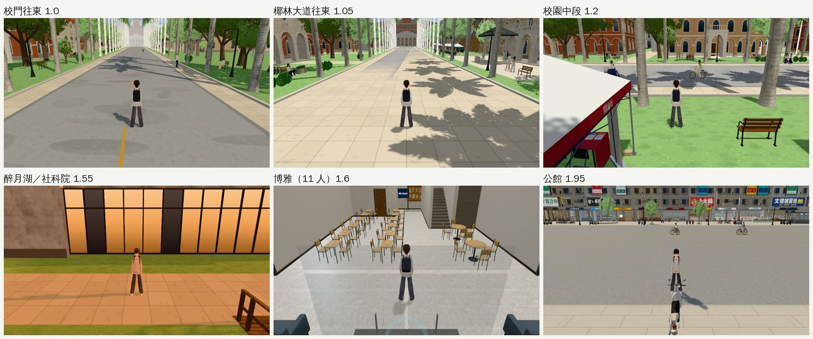

# PERF-PATROL-ECON-1025：經濟系路線效能巡查（2026-10-25，LAWWW2-B）

- **派工**：LAWWW-B 10-25 05:0x。新遊戲 → 宿營 → 在學（宿舍 412、共同、博雅、椰林大道、公館）→ 休學在家 → 重考 → 放榜，各主要地點用同一套工具量 fps／三角形；先列最慢三處＋原因，再照美國社區的做法逐項交（外觀不退、改前改後同角度）。
- **對**：開發 `cc9bd3c4e`。
- **環境**：Playwright＋SwiftShader 手機模擬（844×390），不是 iPhone 實機。SwiftShader 的絕對數字比手機低很多，只看相對變化。
- **狀態**：`WORK_IN_PROGRESS`（量測、找原因；還沒有 patch）。

## 量法

- 工具：`tools/blender/env_second/shots/perf_route.py`（地點清單，每個地點兩個方向，每格 4 次、每次 5 秒）。
- 路人、同學照時段出現，和實際玩的時候一樣；只把劇情事件關掉，免得量到一半演起來。
- 【捷徑】讀檔直接把玩家放到地點、設日期時刻（經濟系那一年：9/18～10/16）。
- 臺北的家、補習班、放榜是 2D 背景＋對話（`home3d.js`、`econff3d.js` 的 `cram_class`），沒有 3D 場景，不量。可昕常去的地方用 Café、總圖三樓。

## 12 個地點（fps 平均；兩個方向）

| 地點 | 方向 1 | 方向 2 | draw call／三角形（較慢那一邊） | 看得到的人 |
|---|---|---|---|---|
| 宿舍 412（19:00） | 4.4 | 3.9 | 101／5.3 萬 | 0 |
| 宿舍大廳 | **2.25** | 3.55 | 127／14.9 萬 | 2 |
| 共同教學館 | 2.85 | 4.95 | 150／15.1 萬 | 6 |
| 普通教學館 | **2.15** | 3.7 | 158／17.0 萬 | 3 |
| 博雅教學館（午休） | **1.6** | 4.1 | 196／26.6 萬 | 11 |
| 椰林大道 | **1.05** | **1.4** | 405／75.5 萬 | 9 |
| 校園中段（傅鐘附近） | **1.2** | 2.3 | 493／77.9 萬 | 4 |
| 校門往東 | **1.0** | 2.5 | 450／73.2 萬 | 3＋騎車 7 |
| 醉月湖／社科院門口 | 3.05 | **1.55** | 467／55.4 萬 | 1 |
| 兩點半 Café | 3.85 | 4.95 | 132／13.2 萬 | 3 |
| 總圖三樓（19:00） | 4.25 | 6.8 | 128／8.4 萬 | 3 |
| 公館 | 2.55 | **1.95** | 292／52.0 萬 | 5 |

## 找原因（同一頁、同一個鏡頭，一次藏一類東西）

（量測中，結果補在這裡。）
