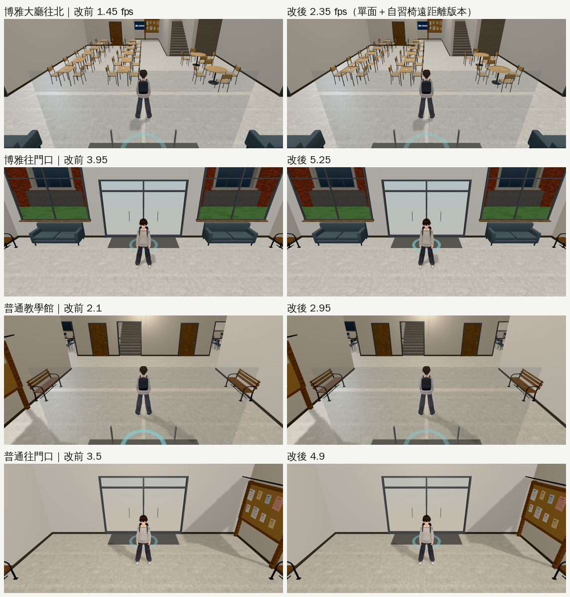
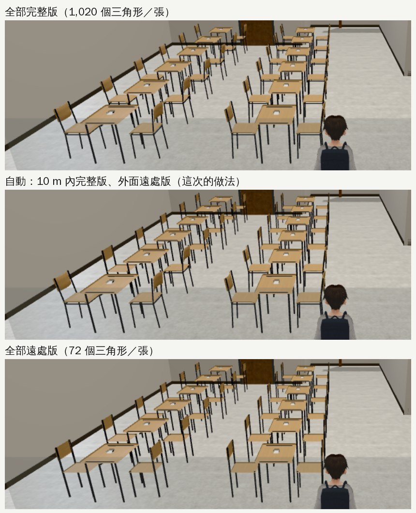
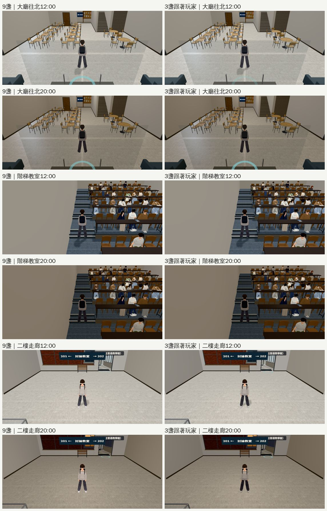
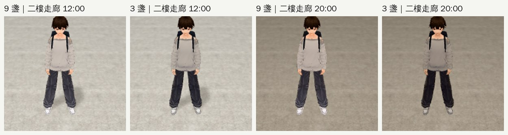

# PERF-PATROL-ECON-1025：經濟系路線效能巡查（2026-10-25，LAWWW2-B）

- **派工**：LAWWW-B 10-25 05:0x。新遊戲 → 宿營 → 在學（宿舍 412、共同、博雅、椰林大道、公館）→ 休學在家 → 重考 → 放榜，各主要地點用同一套工具量 fps／三角形；先列最慢三處＋原因，再照美國社區的做法逐項交（外觀不退、改前改後同角度）。
- **對**：開發 `cc9bd3c4e`。
- **環境**：Playwright＋SwiftShader 手機模擬（844×390），不是 iPhone 實機。SwiftShader 的絕對數字比手機低很多，只看相對變化。
- **狀態**：`WORK_IN_PROGRESS`（量測、找原因；還沒有 patch）。

## 量法

- 工具：`tools/blender/env_second/shots/perf_route.py`（地點清單，每個地點兩個方向，每格 4 次、每次 5 秒）。
- 路人、同學照時段出現，和實際玩的時候一樣；只把劇情事件關掉，免得量到一半演起來。
- 【捷徑】讀檔直接把玩家放到地點、設日期時刻（經濟系那一年：9/18～10/16）。
- 臺北的家、補習班、放榜是 2D 背景＋對話（`home3d.js`、`econff3d.js` 的 `cram_class`），沒有 3D 場景，不量。可昕常去的地方用 Café、總圖三樓。

## 12 個地點（fps 平均；兩個方向）

| 地點 | 方向 1 | 方向 2 | draw call／三角形（較慢那一邊） | 看得到的人 |
|---|---|---|---|---|
| 宿舍 412（19:00） | 4.4 | 3.9 | 101／5.3 萬 | 0 |
| 宿舍大廳 | **2.25** | 3.55 | 127／14.9 萬 | 2 |
| 共同教學館 | 2.85 | 4.95 | 150／15.1 萬 | 6 |
| 普通教學館 | **2.15** | 3.7 | 158／17.0 萬 | 3 |
| 博雅教學館（午休） | **1.6** | 4.1 | 196／26.6 萬 | 11 |
| 椰林大道 | **1.05** | **1.4** | 405／75.5 萬 | 9 |
| 校園中段（傅鐘附近） | **1.2** | 2.3 | 493／77.9 萬 | 4 |
| 校門往東 | **1.0** | 2.5 | 450／73.2 萬 | 3＋騎車 7 |
| 醉月湖／社科院門口 | 3.05 | **1.55** | 467／55.4 萬 | 1 |
| 兩點半 Café | 3.85 | 4.95 | 132／13.2 萬 | 3 |
| 總圖三樓（19:00） | 4.25 | 6.8 | 128／8.4 萬 | 3 |
| 公館 | 2.55 | **1.95** | 292／52.0 萬 | 5 |

## 找原因（同一頁、同一個鏡頭，一次藏一類東西）

- 工具：`$SCRATCH/econperf/toggles2.py`（同 perf_route 的讀檔；藏一類、量 4×5 秒、還原，再藏下一類）。
- 有人走來走去的地方（椰林大道、公館）數字會跳，同一類要看幾次。

| 地點（方向） | 原本 | 藏起來／關掉以後 |
|---|---|---|
| 校門往東 | 0.95 | 人 1.15、騎車的人 1.2、校外背景 1.3、樹 1.4、影子 1.25 |
| 椰林大道往東 | 0.95 | **人 1.4**；騎車的人、樹、影子在誤差內 |
| 博雅大廳往北 | 1.55 | **9 盞點光源全關 2.55**、只留最近 3 盞 2.3、只留同一層 1.85；**自習椅＋階梯教室桌椅 2.15**；**室內殼改單面 1.95**；人 1.65；玻璃、牆的 transparent 沒差 |
| 博雅大廳往北（20:00） | 1.8 | 最近 3 盞 2.55、同一層 2.1 |
| 公館往店面那一側 | 2.1～2.2 | **店面 GLB 整個藏起來 3.25～3.45**；機車、人、影子在誤差內 |

- **醉月湖邊面對社科院玻璃牆**：畫面只有一面牆，照樣畫整個校園（467 calls、55 萬三角形）——牆後面的東西沒有剔除。LAWWW-B：先記錄、不處理。

## 最慢三處＋原因（10-25 06:0x 交 LAWWW-B）

1. **椰林大道一帶**（校門、大道、傅鐘附近 0.95～1.2）：沒有單一元兇；大道上最大的是人。
2. **博雅大廳**（往北 1.55）：點光源、桌椅、雙面材質。
3. **公館往店面那一側**（2.1）：店面 GLB。

LAWWW-B 06:1x 定的順序：① 室內殼＋家具單面 → ② 自習椅 10 m 外換 lod1 → ③ 博雅燈 → ④ 公館店面 → ⑤ 校園底下 820 m 柏油 → ⑥ 室外無名路人 18／24／30 m 比較圖（看圖再定）。

## ①② 教學館：室內殼、家具單面＋自習椅遠距離版本

- **原因**：博雅、普通的室內殼（`teach_interior.py`）24 個材質有 22 個是雙面的；家具模組（`furniture_study.py`）也是雙面。
  - 遊戲為了讓擋住鏡頭的牆淡出，把牆的材質設成 `transparent`；**雙面＋transparent 在 three.js 每個網格分兩次畫**（先背面、再正面）。所以改單面以後 draw call 也少了（博雅 196 → 180）。
  - 網格全是封閉的方盒、有蓋的圓柱、朝固定方向的面，背面本來就看不到；玻璃兩面都看得到，照舊雙面。
- **改法**：
  1. `tools/blender/env_second/teach_interior.py`：除了玻璃都單面 → 重匯 `boya_interior.glb`、`putong_interior.glb`（三角形一樣：11,384、9,316）。
  2. `tools/blender/env_second/furniture_study.py`：`study_furn` 單面 → 重匯 `furniture_study.glb`（三角形一樣）。
  3. `src/teach3d.js`（`patches/teach_perf_econ_1025.patch`）：大廳的自習椅離鏡頭 10 m 外換 `study_chair_lod1`（72 個三角形；完整版 1,020），9.5 m 內換回來；有變動才重填。
- 共同教學館沒有正式室內殼，椅子是另一套，所以沒有變（數字在誤差內）。

| 鏡頭（同一頁、同一個鏡頭；每格 4×5 秒） | 改前 | 只換 GLB | GLB＋自習椅 | 再量一次改前 |
|---|---|---|---|---|
| 博雅大廳往北 | 1.45 | 2.25 | **2.35**（+62%） | 1.55 |
| 博雅往門口 | 3.95 | 5.3 | **5.25**（+33%） | 4.0 |
| 普通大廳 | 2.1 | 3.0 | **2.95**（+40%） | 2.15 |
| 普通往門口 | 3.5 | 4.9 | **4.9**（+40%） | 3.75 |
| 共同（兩個方向） | 2.9／5.15 | 2.9／5.15 | 2.9／5.2 | 2.95／5.3 |
| draw call／三角形（博雅往北） | 196／26.6 萬 | 180／26.1 萬 | 181／24.0 萬 | |

- 看起來一樣：沒有破面、沒有少東西。

### 自習椅切換點附近

- 【捷徑】用 JS 把每張椅子停在某一版，只為了比較；遊戲照常是自動。
- 鏡頭到椅子 8～16 m：三張看不出差別。這個鏡頭裡 11 張是完整版、21 張是遠處版。

### 測試（①②）

- **新測試 `node tests/teach_perf_econ_unit.js`**（patch 裡）：改前 FAIL 5、改後 ALL PASS。
  - ① 博雅、普通的室內殼只有玻璃雙面、玻璃照舊半透明；`study_furn` 單面；
  - ② 有 `study_chair_lod1`（≤ 完整版 10%）；`teach3d.js` 放兩組；10 m 外換、9.5 m 內換回來、9.5～10 m 不會來回換、沒有變動不重填、近的那幾張是完整版。
- 原本的 `node tests/teach_perf_unit.js`（桌椅合併）照舊 ALL PASS。

## ③ 博雅的燈：9 盞 → 3 盞跟著玩家

- **原因**：每棟教學館配置了 9 盞點光源（`L.lights`；普通另外有空橋 2 盞）。three.js 的每個像素都要算每一盞燈，燈越多越慢；同一頁全關 1.55 → 2.55。
- **改法**（`src/teach3d.js`，`patches/teach_lights_econ_1025.patch`，接在 ①② 的 patch 後面）：
  - 配置的燈當「燈位」，真的光源只有 3 盞，跟著玩家換到**最近的 3 個燈位**（3D 距離）。
  - 換的時候先淡出、再淡入（各 0.4 秒），不會一下子亮暗；光源數固定（shader 不重編）。
  - 白天／晚上的亮度照燈位原本的 on／off（`onLamps`）。
  - 點光源不擋牆、不擋樓板：離玩家遠的燈原本也只照到牆後的教室；照到玩家附近最亮的就是最近的那幾盞。
- 試過「同一層的燈優先」：二樓晚上人物變暗（一樓的燈原本隔著樓板從下面照到人），不採用。

| 鏡頭（每格 4×5 秒；①② 已套） | 9 盞 | 3 盞 |
|---|---|---|
| 大廳往北 12:00 | 2.15 | **3.15** |
| 大廳往門口 12:00 | 4.9 | **6.3** |
| 大廳往北 20:00 | 2.45 | **3.3** |
| 階梯教室 12:00（13 人上課） | 1.65 | **2.15** |
| 二樓走廊 12:00 | 2.25／2.4 | **3.4／3.1** |

（數字是「同一層優先」那一版量的；改成純距離以後重量中，結果補在這裡。）

