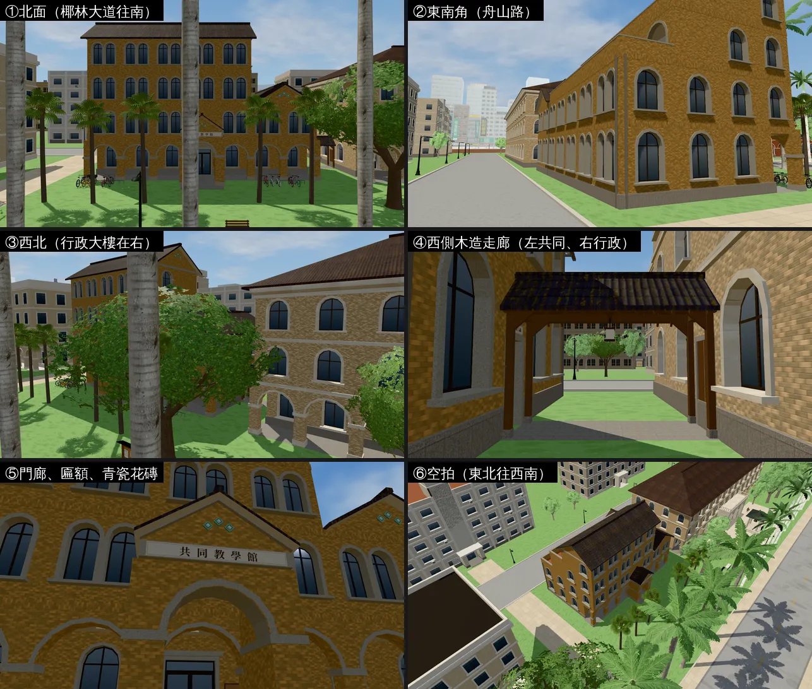
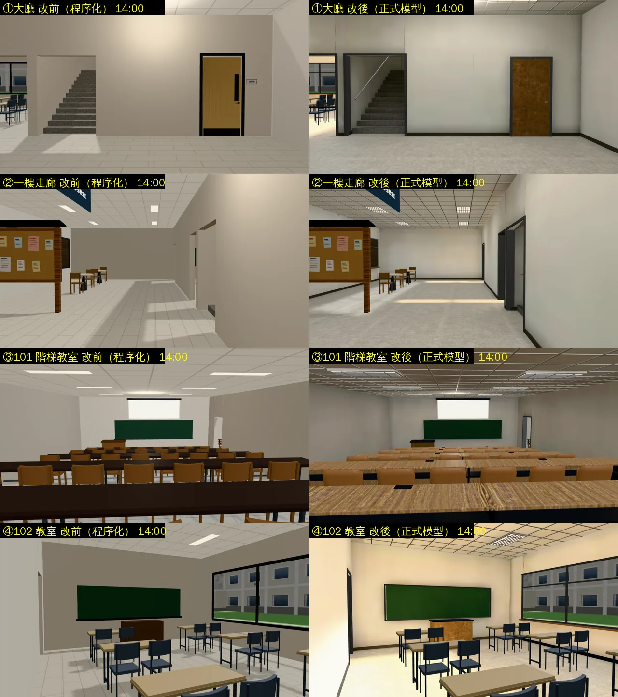
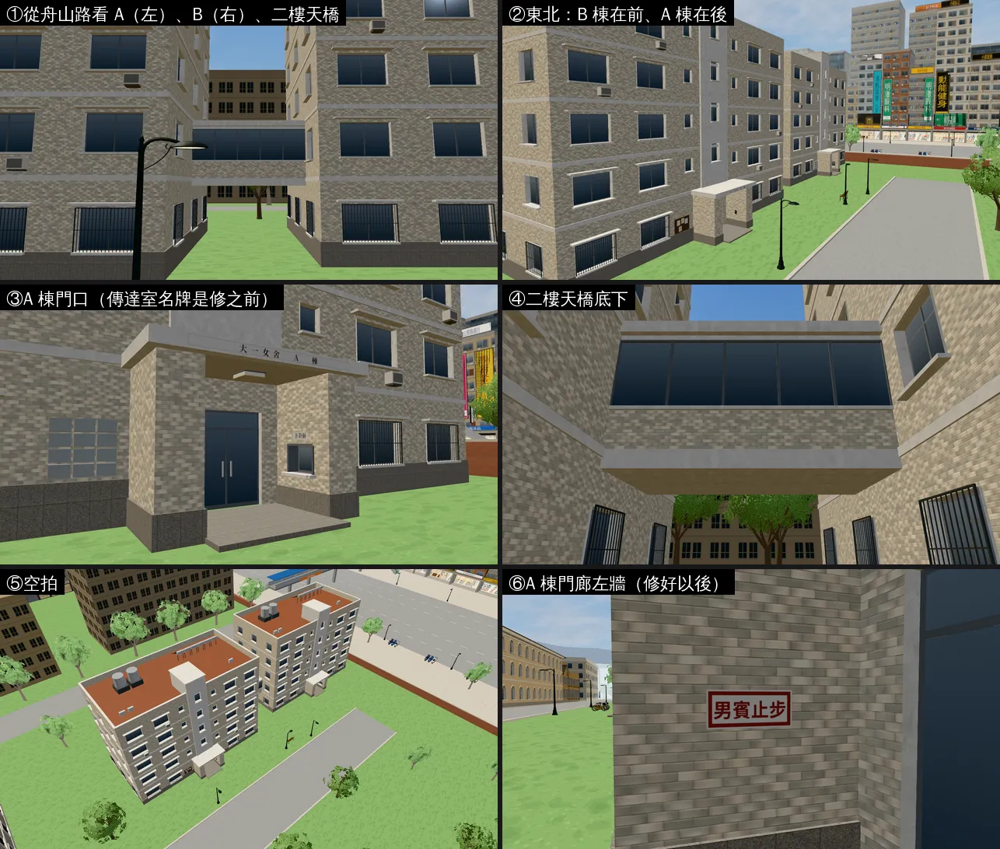
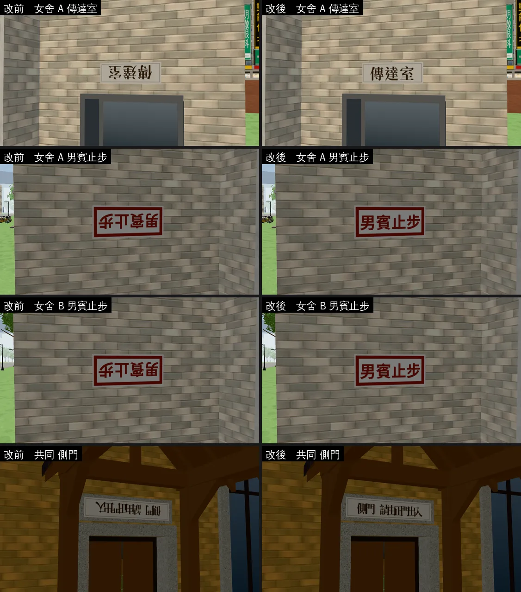

# 共同教學館、大一女舍和參考資料的差異清單（ART-PHOTO-CMP-1021；LAWWW2-B 2026-11-01）

- **起因**：LAWWW2 清查 B14、`docs/handoff/PLAYER_FEATURES_v9.10.3.md`「共同教學館、女舍和參考照片比對」；歷史清查（`history_audit/REPORT.md`）標「完全未開工」。LAWWW-B 20:44 佇列：美國室內光照之後做這一件。
- **收件人**：LAWWW-B（P3，不急）。兩件事：
  1. 差異清單＋截圖（第一～五節）：**沒有改模型或程式**，要決定的列在第五節。
  2. 比對時找到的 bug：側牆名牌的字是倒的（第六節，PLATE-MIRROR-1101）：**已修**，換三個 GLB，不用改程式。
- **狀態**：清單。建築、場景只有使用者能標 `ART_APPROVED`；兩棟外觀照舊 `READY_FOR_ART_REVIEW`。

## 〇、先講清楚：照片還是打不開

- 參考照片是使用者 2026-10-13 晚上給的（`research/四棟教學館與宿舍_參考資料.md` 最上面那一節）：
  - 共同教學館：Wikimedia Commons 分類「NTU Gongtong Lecture Building」（2024 年的照片）；
  - 大一女舍：住宿組官網「大一女舍」頁的官方照片。
- **2026-11-01 再試一次，兩個都打不開**：
  - `commons.wikimedia.org`、`upload.wikimedia.org`：代理回 403（`CONNECT tunnel failed`）；網頁讀取工具 `getaddrinfo ENOTFOUND`。
  - `osa_dorm.ntu.edu.tw`、`ntuinfo.ntu.edu.tw`：一樣連不上。
  - 搜尋引擎只回文字摘要，沒有新的外觀描述（共同：只查到「小小福在共同教學館旁」、「共同三松是校園文化景觀的重要地景」；女舍：和 10-13 查到的一樣）。
- 所以這一份是**第一版：遊戲畫面 ↔ 研究檔裡記下的文字事實**（確認程度 A＝兩個來源、B＝一個來源、C＝推測）。
  - 「照片才看得出來」的項目在表裡標 **📷**，第四節列成要請使用者給的照片清單。
- 要做真正的照片比對，二選一：
  1. 使用者在環境設定把 `commons.wikimedia.org`、`upload.wikimedia.org`、`*.ntu.edu.tw` 加進允許的網域；
  2. 使用者直接把照片貼進對話（我存在自己的工作資料夾，只用來核對，**不放進遊戲**）。

## 一、共同教學館外觀（`campus_gongtong.glb`，開發分支 `ef17f19d6`）

- ①⑤：北面是正門、拱廊、門廊、蒲葵；②⑥：南面貼著舟山路，三、四樓往北退的露台從路上只看得到一點；④：左邊共同、右邊行政大樓，兩棟的面磚顏色差很多。

| # | 參考資料（文字） | 確認 | 遊戲現在 | 差異 | 怎麼改、誰決定 |
|---|---|---|---|---|---|
| G1 | 南臨舟山路、鹿鳴廣場；西邊隔木造走廊和行政大樓相鄰；靠近大門 | B | 中心 (2, 33)；南牆到舟山路約 2.5 m；西邊有頂木造走廊接行政大樓 | 位置、鄰棟一致。鹿鳴廣場遊戲裡沒有 | 不用改 |
| G2 | **南側走廊多處開口，面向三株琉球松（共同三松）與庭園**；前方綠地常有社團活動 | B（三松是校園文化景觀，A） | 一樓南牆貼著舟山路，沒有庭園、沒有三松；三、四樓南面是開放走廊（拱形開口）（圖②⑥） | **最大的差異**：真實的南面是有樹、有草地的「前院」，遊戲是背面貼馬路 | 要往北挪或縮小建築才放得下（導航、DOORS.common 跟著改）→ **LAWWW-B 決定**；做法：三松、草地可以和北側蒲葵一樣做進同一個 GLB |
| G3 | （正門在哪一面：文字沒寫） | — | 正門在北面中央門廊，對著椰林大道；北面一樓是 7 開間拱廊 | 如果真實的走廊、庭園在南面，正門可能也在南面（或兩面都有） | 📷 正門、拱廊在哪一面 |
| G4 | 一、二樓在前，三、四樓在後，逐層退縮 | B（「前」是哪一面是推測） | 南面低：三樓往北退 3.5 m、四樓退 7 m，兩段紅色隔熱磚露台 | 方向是推測（「前」＝南，因為南面有走廊、三松） | 📷 南面、側面 |
| G5 | L 形量體 | B | 東半部四層＋西翼兩層（南北向雙坡屋頂）→ 空拍是 L 形 | 佔地 24 × 14 m（長方形），L 形只做在三、四樓 | 📷 空拍或側面；G7 一起看 |
| G6 | 土黃色十三溝面磚；每層樓板的位置磚豎貼 | B | 土黃面磚（Poly Haven 通用面磚改色）；每層樓板一條 0.33 m 的豎貼帶 | 十三條溝沒做（遊戲距離看不到）；**顏色、帶子寬度是推測**；遊戲裡（沒有光照烘焙、太陽直射）看起來比 Blender 渲染圖偏橘褐；和隔壁行政大樓（米色面磚）放在一起差很多（圖④） | 📷 牆面近看（顏色、帶子） |
| G7 | （規模）32 間教室、1,996 席；101 是 240 席的階梯教室 | B（教務處容量表） | 樓地板約 970 m²（一二樓 24×14 各一層＋三四樓東半部） | 照座位數推算，真實大概是遊戲的 3～4 倍 | **不建議改**：遊戲校園的建築普遍縮小（博雅 R2 使用者決定外觀不放大）；列出來讓使用者知道差多少 |
| G8 | 開口用洗石子收邊、模擬石材拱窗 | B | 二到四樓雙拱窗（兩扇 1 m 拱窗共用窗台），兩端單拱窗；洗石子窗框 | 窗的形式（雙拱或單拱、窗的大小、每層幾扇）是推測 | 📷 正面 |
| G9 | 山牆頂三塊青瓷花磚排成磬形 | B | 四面山牆＋門廊山牆，三塊菱形青瓷排成倒 V | 花磚的圖案、顏色、位置是推測；山牆在哪幾面也是推測 | 📷 山牆近看 |
| G10 | 西向的階梯教室用戶外樓梯相連 | B | 沒做（D38：走不上去的裝飾樓梯不能做） | 缺一個辨識點 | 📷 看樓梯在哪；要做的話做成走得上去、或明顯關著（鐵門）的樓梯 → LAWWW-B 決定 |
| G11 | 北側蒲葵樹列 | B（校史館） | 北面 6 棵蒲葵（真的幾何） | 株數、樹高是遊戲化的 | 📷 北面 |
| G12 | 1984 年完成；依校園規劃原則興建的第一批建築之一 | B | — | 看不出來 | 不用改 |

## 二、共同教學館室內（`gongtong_interior.glb`，10-31 整合 `753df5a8c`）

| # | 參考資料（文字） | 確認 | 遊戲現在 | 差異 | 怎麼改、誰決定 |
|---|---|---|---|---|---|
| I1 | 101：雙號階梯教室，240 席 | B | 101 階梯教室 5 排 × 8＝40 席（翻椅） | 座位只有六分之一 | 和博雅 101 同一個做法（`FOUR_BUILDINGS_REVIEW.md` 2.2：後排用不能坐的座位、照片牆或遠景補）→ LAWWW-B 排 |
| I2 | 102：單號，48 席 | B | 102 教室 12 席 | 四分之一 | 同上；小教室影響比較小 |
| I3 | 32 間教室 | B | 一樓 101、102；二樓 201、202（203 整修中關著）；三樓只有 301 考場（另一個區域） | 走得進去的只有 5 間 | 照 D38「分階段開樓層」，不用全部做 |
| I4 | 西向的階梯教室 | B | 室內 101 在西翼（和外觀一致） | 一致 | — |
| I5 | （室內的樣子） | 沒有資料 | 磨石子地板、輕鋼架＋T5 燈、木紋長桌、翻椅 | 配置檔自己寫「室內沒有查證：可替換的教學館模板」 | 📷 走廊、101、普通教室各一張 |

## 三、大一女舍外觀（`campus_freshman.glb`，開發分支 `ef17f19d6`）

- 圖③是修名牌之前拍的（「傳達室」還是倒的，見第六節）；圖⑥是修好以後。

| # | 參考資料（文字） | 確認 | 遊戲現在 | 差異 | 怎麼改、誰決定 |
|---|---|---|---|---|---|
| F1 | A、B 兩棟相鄰；**二樓天橋連通** | A／B | A (−108, 68)、B (−78, 66)；二樓天橋（x −96..−90，下面可以走） | 一致；**天橋的樣子是推測**（面磚矮牆＋帶狀鋁窗＋平屋頂） | 📷 天橋 |
| F2 | A 地上 5 層；B 地上 5 層＋地下 1 層 | A | 兩棟都是 5 層；B 棟看不出地下室 | 如果地下室有採光井、半地下的窗或坡道，外面看得到 | 📷 B 棟四周 |
| F3 | **沒有電梯** | A | 正面中間是樓梯間（白色直條、每個平台一扇窗、出屋頂），沒有電梯 | 一致。另外：女舍門口路人的一句台詞「媽，我到了。……對，有電梯。」（`crowd3d.js` `FDORM_LINES.week1`，BB_105 D7）——可能是故意的（騙媽媽放心），也可能和事實衝突 | 台詞不是我的範圍：**請 LAWWW-B 轉給 AA 確認**（台詞之後要全部重寫，X150，可以那時一起看） |
| F4 | A 棟一樓入口有服務台；24 小時傳達室 | B | A 棟門廊右牆有傳達室小窗、名牌；B 棟門邊是刷卡機 | 一致（傳達室的樣子是推測） | 📷 A 棟門口 |
| F5 | 約 728 床、四人房為主 → 約 180 間寢室 | A（床位）；寢室數是推算 | 每棟每層正面、背面各 4 扇寢室窗 → 兩棟五層約 80 間（看起來像 320 床） | 真實的樓應該長很多或深很多（推算單棟 35～45 m；遊戲 24 m） | **不建議改**（同 G7：遊戲校園縮小）；如果照片顯示樓很長，可以只在立面多加窗（佔地不變）→ 讓使用者決定 |
| F6 | 1991 年落成、2008 年整修 | B | 1990 年代台灣大學宿舍的通用樣子：米色二丁掛、花崗石勒腳、鋁框推拉窗＋遮陽板、窗型冷氣、一樓鐵窗、屋頂水塔與太陽能熱水器、背面曬衣 | **外觀完全沒有資料**，全部是推測；兩棟同一套設計（只差門口） | 📷 A、B 正面、背面、屋頂（第四節） |
| F7 | 位置：校內、公館捷運站 2、3 號出口附近、羅斯福路四段那一側的女生宿舍區（女一、二、三、五舍相鄰）；學生資料：B 棟靠舟山路、B 棟大門刷學生證 | A／B | 校園西南角、舟山路西段南側；附近沒有其他女舍 | 女生宿舍區的其他幾棟沒有做 | 不用改（D27：地圖邊界外是背景）；要的話遠景剪影 → LAWWW-B 決定 |
| F8 | （門口、周邊道路） | 沒有資料 | 門口長椅、腳踏車架、法服攤位、路燈 | 推測 | 📷 門口 |

## 四、要請使用者給的照片（有了才能做真的比對）

只用來核對模型，不放進遊戲（使用者 10-13 的規則）。各一張就夠：

1. **共同教學館**：①從椰林大道那一側看（北面）②從舟山路那一側看（南面，有三松）③西側（行政大樓、木造走廊、戶外樓梯）④牆面近看（面磚顏色、樓板的豎貼帶、拱窗）⑤山牆近看（青瓷花磚）。
2. **共同教學館室內**：走廊、101 階梯教室、一間普通教室。
3. **大一女舍**：①A 棟正面（門口、傳達室）②B 棟正面 ③二樓天橋 ④從舟山路看兩棟 ⑤背面或側面（看地下室、曬衣、屋頂）。

## 五、給 LAWWW-B 的（要決定的才列）

| # | 事 | 建議 |
|---|---|---|
| 1 | 共同三松、南側庭園（G2） | 等照片；照片確認南面是庭園的話，建議往北挪 4～6 m 留出庭園，三松做進共同的 GLB |
| 2 | 西側戶外樓梯（G10） | 等照片；做的話要走得上去或明顯關著 |
| 3 | 「對，有電梯」那一句（F3） | 轉給 AA 確認是不是故意的 |
| 4 | 規模縮小（G7、I1、F5） | 不改；只是讓使用者知道 |
| 5 | **名牌倒字的修正（第六節）** | 換三個 GLB（`campus_freshman.glb`、`campus_gongtong.glb`、`campus_socsci.glb`，從我的分支拿）＋套 `plate_text_dir_1101.patch`（只有新測試）；**不用改程式** |
| 6 | 體育館 B1 三塊門牌沒有字（第六節） | 遊戲端：`gym_b1` 接好 GLB 以後照 `us3d.js` 的 paintPlate 畫 props 的 text（你的檔案，我沒改） |

其他（顏色、窗型、山牆、天橋的樣子）都要照片才能判斷，現在不動。

## 六、比對時找到的 bug：側牆名牌的字是倒的（PLATE-MIRROR-1101，已修）

- **現象**：大一女舍 A 棟門口右牆的「傳達室」，字轉了 180°（上下顛倒、左右相反）。同樣的還有四塊：
  - 女舍 A、B 棟門廊左牆「男賓止步」；
  - 共同教學館西側木造走廊那扇門上的「側門　請由正門出入」；
  - 社科院大廳裡的「經濟系．政治系．社會系．社工系」（在大螢幕下面；遊戲裡一樓玻璃不透明，從外面看不到，照樣修）。
  - 正面的名牌（「大一女舍　A 棟」「共同教學館」「社會科學院」等）本來就是正的。
- **原因**：名牌的字是遊戲用 canvas 畫的（`zones3d.js` `wzPlateTex`），照 GLB 的 UV 貼。Blender 腳本照頂點順序給 UV（`uv01`），側牆的名牌為了讓法線朝外，頂點被倒過來，u、v 一起反。
- **修法**（模型，不用改程式）：
  - `lib2.py` 加 `uv_text()`：照幾何給 UV（站在法線那一邊看，u 往右、v 往上；匯出後＝glTF 的 v 往下）。
  - `campus_freshman.py`、`campus_gongtong.py`、`campus_socsci.py` 的名牌改用它，三個 GLB 重匯。
  - **和開發分支逐個 accessor 比對：只有這 5 塊名牌的 UV 不同**；正面名牌、其他網格、材質、貼圖、檔案大小都一樣。
- **全部有名牌的 GLB 掃一遍**（24 個）：其他都是正的。不算的：
  - 美國的門牌：`us3d.js` 自己照板面重算 UV，GLB 的 UV 不影響。
  - 社科院大樓一樓室內 `socsci_bldg1f.glb` 有 3 塊反的，但遊戲沒有用這個 GLB。
  - **體育館 B1 的三塊門牌（女更衣室、男更衣室、壁球室・桌球室）遊戲沒有畫字**：`gym_b1` 走 `attachRoomGLB`，它不畫 `PLATE_FACE_*`（只有 `gym3d.js` 樓梯口的兩塊告示自己畫）→ 遊戲裡是空白的牌子。**看程式碼判斷的，沒有拍遊戲畫面確認**。要修是遊戲端（照 `us3d.js` 的 paintPlate 畫 props 的 text）→ LAWWW-B 決定。
- **新測試** `tests/plate_text_dir_unit.js`（patch `docs/art-rebuild/second_ai/patches/plate_text_dir_1101.patch`，對開發 `ef17f19d6`）：開發分支原樣 **FAIL 5**，改後 **ALL PASS**（40 塊）。
- 遊戲內同角度改前改後：下圖（左＝開發分支原樣，右＝改後；社科院那一塊看不到，沒有放）。

## 七、截圖怎麼拍的

- Playwright＋SwiftShader，電腦 1280×720，不是實機；讀檔放位置、藏玩家和路人是 [捷徑]。
- 測試樹：開發分支（`f275a620f`；兩棟外觀、共同室內的 GLB 和 `ef17f19d6` 相同）。
- 鏡頭：`tools/blender/env_second/shots/photo_cmp_shots.py` → `fast_shots.py`。
- 名牌改前改後：同一個測試樹、同一組鏡頭，先放改後的三個 GLB 拍一次，再換回開發分支原樣的三個 GLB 拍一次。
- 名牌掃描：Blender 從名牌中心往兩邊射線，找人站的那一邊，再看 u、v 的方向（工具在我的工作資料夾；正式的檢查寫成上面那支 Node 測試）。
