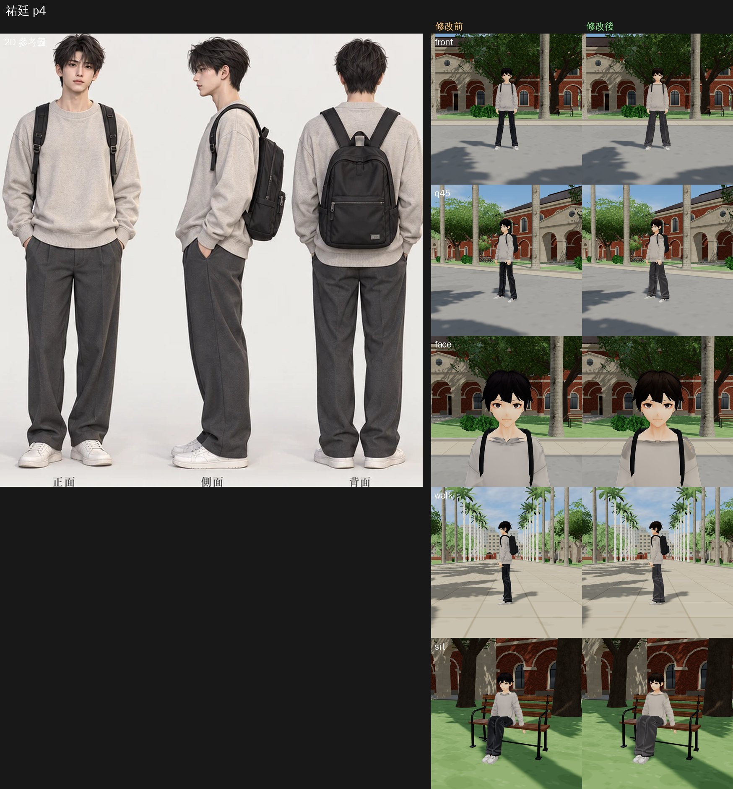
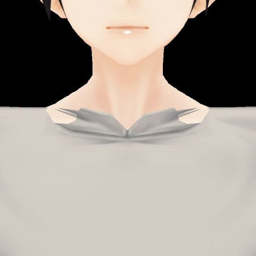
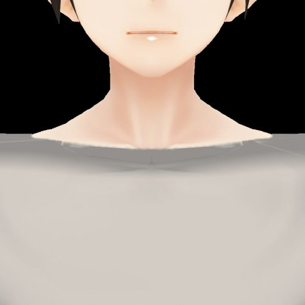

# 精修第 1 批：祐廷（玩家，預設模型 `vroid_yuting.vrm`）——遊戲內同鏡頭比較

使用者 2026-10-16 05:1x～05:2x 的指示：修好、精修現有 3D 美術，不換模型、不換工具。

- **修改前**：開發線 `5ec6a388` 的模型。
- **修改後**：`tools/char_polish.py vroid_yuting`。做法是在 `tools/vroid_build.py` 建好的結果上做局部修正，vroid_build.py 本身不動。
- **截圖工具**：`tools/shots/char_review.py`。
  - 鏡頭：椰林大道 10:30，正面、斜 45°、臉、走路；長椅坐姿。
  - 兩次截圖的鏡頭、時間、光線都相同；渲染設定是遊戲現在的 ACES，沒有改。

| # | 修改前（遊戲截圖看到的） | 參考圖 02 | 修正 | 結果 |
|---|---|---|---|---|
| 1 | 頭髮接近純黑，ACES 一壓就是一整塊黑，看不出髮束 | 深棕黑、有層次 | 頭髮貼圖改成 `#2b2320`，保留髮束的明暗，陰影色 `#4a3c36` | 看得出髮束和頭型 |
| 2 | 連帽衫拿掉帽子後，領口留下兩片三角翻領、兩根往外的尖刺，肩膀露出一塊有硬邊的皮膚 | 圓領 | 見下方說明 | 圓領，沒有尖刺和破口 |
| 3 | 脖子和臉一樣亮，臉像貼紙浮在脖子上 | 下巴下有陰影 | 下巴以下 7.5 cm 的脖子畫上由深到淺的暖色陰影；下巴底面 1.4 cm 和它接起來 | 臉和脖子分得開 |
| 4 | 上衣是偏冷的淺灰，在遊戲裡接近白色 | 燕麥灰 | 上衣改成 `#c2baae` | 淺燕麥灰 |
| 5 | 褲子在 ACES 下是發亮的黑色；褲管細、有一點喇叭 | 炭灰寬直筒西裝褲 | 褲子改成 `#58575a`，霧面（貼圖反光收掉）；褲管直筒加寬 3.5 cm | 炭灰寬直筒 |

**#2 領口的修正**（Blender 特寫：左邊是修改前，右邊是修改後）
- 圓領線：繞脖子根部一圈，前面在胸骨上緣，往後升高 4 cm。
- 上衣：線以上的三角形刪掉，剩下的頂點壓到線上。
- 線以下的皮膚：塗成上衣的顏色。
- 領口：一圈 2.8 cm，統一成羅紋色。

 

**沒有改的**
- 臉型和眼睛：還是 VRoid 的動畫臉。和參考圖的半寫實臉差距最大，但改臉型是重大外觀變更，要另外處理。
- 上衣的版型：還是合身，參考圖是寬鬆落肩。
- 渲染設定（ACES → Neutral 色調映射、皮膚明暗）：會影響所有人和場景，另外做第 2 批，交 LAWWW-B。

**狀態**：`READY_FOR_ART_REVIEW`，角色美術交 BB-B 驗收（D59），由 LAWWW-B 整合。
- 只換 `assets/models/char/vroid_yuting.vrm`，不用改程式。
- 檔案從 2.54 MB 變成 3.45 MB，因為貼圖重新編碼。
- 模型載入、走路、坐下、長椅坐姿的截圖檢查過，沒有穿模；完整的回歸測試由 LAWWW-B 跑。
