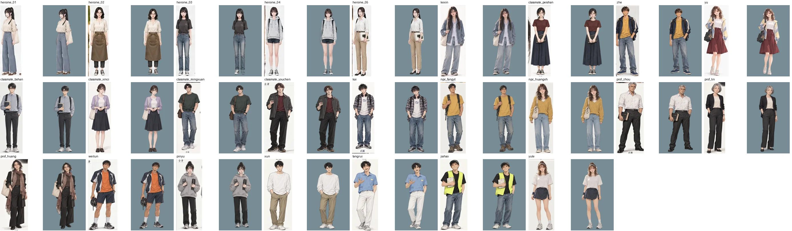

# 對話立繪 第一版：照 10/14 確認的標準圖去背（READY_FOR_ART_REVIEW，交 BB-B 對照；LAWWW2-B 2026-10-16）

需求：使用者 P0「對話立繪全部換成 10/14 和 BB 確認的人物圖」（BB-B 轉達，企劃線 `BB_131`）；LAWWW-B 00:58Z 排成 P0。

## 做法（`tools/portraits/cut_reference_portraits.py`）

- **只裁切＋去背，不重畫、不重新生成**：從每位的標準圖切出正面全身那一個人，去背，等比例放進 600×1000 透明畫布（頭頂留 4%、全身高 94%；所有人同一個構圖）。
- 來源（每一張都核對過是 BB 要求修改**之後**的版本，`BB_116` 第 10～13 節；使用者 10-16 要求確認）：
  - 五位女主角：使用者 10-16 直接提供的 06 標準圖單人大圖 `docs/art-rebuild/references/heroine_sheets/`。
  - 其他人：企劃線 `docs/story_planning/art_reference/<id>.webp`。
- 去背：rembg（插畫風用 isnet-anime；半寫實的女主角、可昕用 u2net，再拿掉邊緣接近背景色的一圈、去掉半透明邊的背景色）。只留最大的一塊（旁邊人物的手、字、格線切掉）。
- 輸出：`assets/portraits/<id>/campus/neutral.webp`（25 位）。只有 neutral；BB_131 第 3 節第 4 點：缺的表情遊戲退回 neutral，不自己生成表情。

## 對照（左：標準圖上那一個人；右：去背後的立繪，灰藍底看邊緣）

全部並排：`contact_all.webp`。

| id | 人物 | 來源 | 原圖裡人物高度 |
|---|---|---|---|
| heroine_01～05 | 以安、芷若、語彤、子晴、學姊 | heroine_sheets | 517～528 px（放大約 1.8 倍） |
| kexin | 杜可昕 | art_reference/kexin（基礎服裝正面） | 508 px |
| classmate_peishan | 郭沛珊（大一～大二） | art_reference/classmate_peishan | 586 px |
| zhe、yu、classmate_bohan、classmate_xinci、classmate_mingxuan、classmate_youchen、kai、npc_fangyt、npc_huangxh、prof_zhou、prof_lin、prof_huang | | art_reference | 427～811 px |
| weilun、pinyu、xun、tangrui、jiahao、yule | 經濟系大一、宋家豪學長、程予樂 | art_reference | 430～650 px；**遊戲 id 還沒有**，先用檔名當資料夾名，LAWWW-B 接的時候改 |

## 還不到參考品質的地方（誠實寫）

1. **女主角偏糊**：大圖裡正面全身只有約 520 px 高、本身就柔焦，放大 1.8 倍後近看比其他人糊；要更清楚需要更高解析度的單人正面圖（要的話請使用者生成，不由我重畫）。
2. 芷若的圍裙邊、子晴的左臂外側、以安的托特包邊還有很淡的白邊（灰藍底近看看得到；遊戲的對話框底色深淺不同時要再看）。
3. 以安的正面圖身體略微側轉（標準圖本身就是這樣）。
4. 學姊手上拿著書／資料夾、柏翰拿書、周教授拿六法、品妤拿計算機與保溫杯：照標準圖保留。
5. 舊立繪 `assets/portraits/heroine_0X/campus/neutral.png`（9/27 舊圖）**沒有刪**；`portrait_manifest.js`、`build/` 由 LAWWW-B 重新產生（`python3 build.py`），並確認遊戲不再讀舊 png。
6. 只有 Python 端檢查，**還沒接進遊戲、沒有遊戲內 ADV 截圖、沒有手機實機**（BB_131 第 4 節的對照截圖由 LAWWW-B 拍）。
