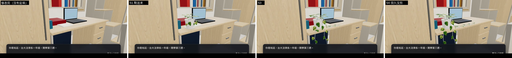
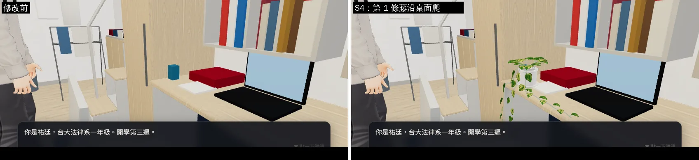
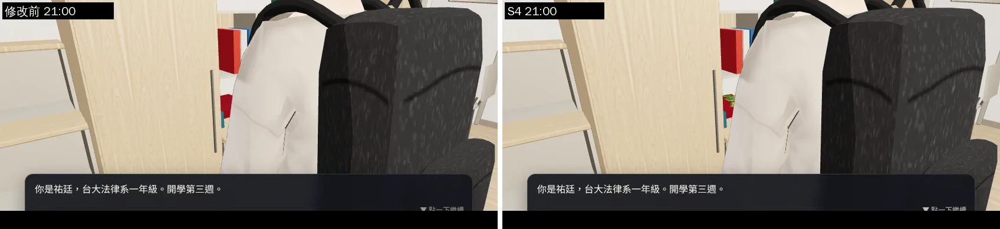
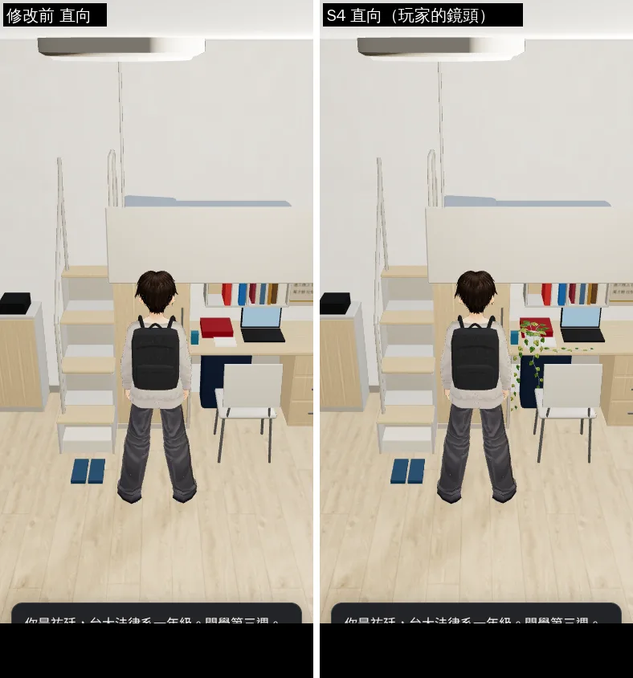

# ART-04 黃金葛：改放四人房（LAWWW2-C 2026-10-17；狀態 READY_FOR_ART_REVIEW）

- **為什麼改**：`prop_pothos.glb`（LAWWW2-B WIP 8a1af723，S1～S4 四種大小）原本照舊雙人房的書桌做（左前角 (1.11, 0.77, −2.36)）；宿舍已經換成台大四人房（ART-DORM-LOFT，LAWWW-B 已整合）。
- **新的位置**（`tools/blender/env_second/prop_pothos.py` 的 `PLACE`，寫在 GLB 根節點的 `place` 屬性）：祐廷 L2 書桌 +z 那一端的前緣 **(−2.39, 0.76, 0.145)、ry = π/2**。
  - 遊戲已有的互動點 `z.spots.pothos`＝(−1.55, 0.215)（LAWWW-B，zones3d.js）就在盆栽前面。
  - 再往 +z 會碰到 `Y203_YUTING` 的馬克杯；書桌那一端是書桌側板（u 0.315～0.337）＋整面衣櫃（u 0.34 起）。
- **藤**：第 2、3 條照舊越過書桌前緣垂下（衣櫃門面在 x −2.30，垂藤在前緣外 1～3 cm，不碰）；**第 1 條原本往書桌側緣垂、會穿進側板和衣櫃，改成沿桌面前緣往書桌另一端爬**（S4 爬得更遠），避開筆記本。
- **遊戲端接法**（LAWWW）：`ASSETS` 加 `prop_pothos`、`F.POTHOS` 時放在 `PLACE`、四種大小照 `pothosWaterN` 切換 `POTHOS_S1～S4` 的 visible；材質照宿舍家具加 `TK.bounce(0.3, 0.4)`（截圖腳本就是這樣接的）。
- **截圖**：`tools/blender/env_second/shots/pothos_dorm_shots.py`（開發分支 `a39a6812`＋這個 GLB，在頁面裡用 GLTFLoader 放上去；src 沒改）；Playwright 手機模擬（390×844、844×390），**不是真機**。修改前＝現在的遊戲（沒有盆栽）。

## 圖（遊戲內，15:30／21:00；Playwright 手機模擬，不是真機）
**注意**：這一批截圖畫面下半部有讀檔後的旁白框（「你是祐廷…開學第三週」，截圖腳本當時沒點掉）；腳本已修（藏起 `#dlg`），下一批重拍。

書桌靠衣櫃那一端（左：修改前；S1／S3／S4）：

沿著桌面看（S4 的第 1 條藤沿桌面前緣爬、沒有穿進衣櫃）：

晚上：

手機直向、玩家的鏡頭：

其他：`pothos_after_*`、`pothos_before_*`（直向、橫向、白天、晚上、四個鏡頭）。

## 八項（ART_SOP 3-2）
| 項目 | 結果 |
|---|---|
| 輪廓與倒角 | 盆、托盤是旋轉體 24 邊（口緣外翻、底部內縮）；葉子有主脈隆起、兩側往下、葉尖下垂（LAWWW2-B 原本的做法，沒改） |
| 材質 | 釉面陶盆、土＋莖（頂點色）、葉子貼圖（程式畫的斑紋、alpha clip、雙面）——沒改 |
| AO | 沒做（靠遊戲陰影；盆底和桌面的接觸看截圖） |
| 磨損 | 不適用（新盆栽） |
| 生活痕跡 | 藤繞過桌上的筆記本、垂下桌緣；四種大小跟著澆水次數長大 |
| 比例 | 盆口 12.8 cm、高 11 cm；和筆電、馬克杯並排看得出大小（截圖） |
| 效能 | 盆 720＋每個大小 934～2,768 三角形（同時只顯示一個大小）；三個材質 |
| 遊戲截圖 | 上面四組＋全部原圖 |
