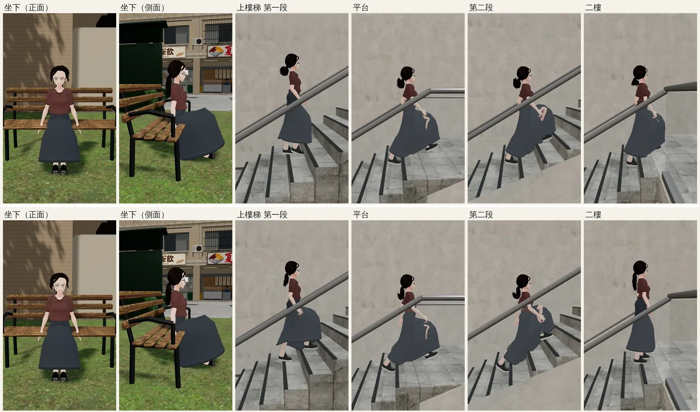
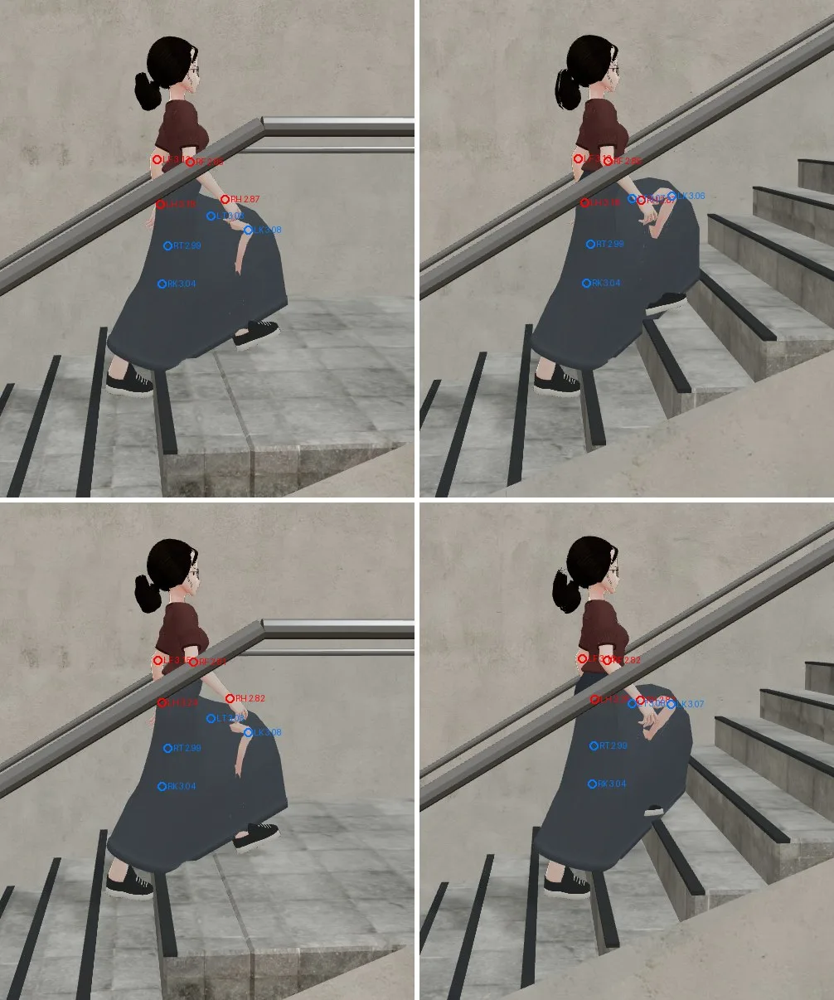

# ART-PS-SKIRT-HAND：沛珊走路、上樓梯時手穿過長裙

LAWWW2-C，2026-10-21。
- 起因：LAWWW-C 09:29Z 派工。
  - 任務表寫：裙襬加寬、裙子加骨頭、手臂擺幅三選一，LAWWW2 判斷；
  - D100a 第④點：使用者授權 LAWWW2 修人物穿模。
- 環境：Playwright（SwiftShader）；**不是 iPhone 實機**。
- 測試的工作樹：開發分支 `382236a5`。patch 在最新的 `fc645c8b` 上 `git apply --check` 也套得起來。

## 結論（先講）
1. **手確實會穿進裙子**：
   - 上樓梯手往後擺時，伸進裙子後面鼓起來的地方；
   - 下面的量測：最差的時候在裙面裡 2.2 cm。
   - **這次修好了**：選「手臂擺幅」。
2. **截圖裡最明顯的那一塊粉紅色不是手，是左小腿、膝蓋**：
   - 上樓梯抬腳時，腿從裙子前面穿出來；
   - 證據在下面的「標記圖」：手臂改了以後那一塊完全沒動，位置在左膝下面。
   - **這次沒有修**：要改裙子的骨架權重、重建 VRM，見最後一節。

## 為什麼選「手臂擺幅」
- 裙襬加寬：手在裙子外面的那一側也會變成在裡面（裙子更寬），而且會改到 BB 驗收過的輪廓。
- 裙子加骨頭（彈簧骨）：當初刻意不用（`peishan_clothes.py`：坐下時裙子會炸開）。
- 手臂擺幅：不動模型，只改動畫。
  - 長 A 字裙的人手本來就會離身體遠一點；
  - 只對沛珊這個模型生效（manifest 的參數，其他人物是 0）。

## 改了什麼（patch [`../../patches/ps_skirt_hand_1021.diff`](../../patches/ps_skirt_hand_1021.diff)）
- `src/assets3d.js`：`char.classmate_peishan` 加三個參數：
  - `armOut:9`（上臂往外張 9°）；
  - `armBack:0.45`（往後擺收掉 45%）；
  - `armFwd:0.15`（往前擺收掉 15%）。
- `src/character3d.js`（VRM 那一個 driver）：
  - 動畫片段每一幀設好上臂以後，在身體座標再轉一點：先把往前／往後的擺幅收小，再往外張；
  - 每一幀從片段的角度重算，不會累加；
  - 坐下、騎車是別的分支，不受影響；
  - VRM 0.x 的方向（`sx`）有處理。
- 沒有 `armOut` 的模型完全不變（`u.armOut` 是 0 就整段跳過）。

## 量測（[`skirt_probe.py`](skirt_probe.py)：沛珊從霖澤館大廳走上樓梯到二樓，每 0.25 秒取樣一次）
- 方法：
  - 手腕在水平面上離髖部的距離；
  - 減去「同一個高度（±4 cm）、同一個方位（±10°）」裙子頂點（蒙皮以後）最外面的距離；
  - 負的＝手在裙子裡面。

| | 取樣 | 左手最差 | 右手最差 | 離裙面不到 3 cm 的取樣（左／右） |
|---|---|---|---|---|
| 修改前 | 41～48 | **−2.2 cm**（在裡面） | +0.6 cm | 14～15 ／ 5～7 |
| 這次（外張 9°＋往後擺收 45%） | 43～46 | **+12.6 cm** | +10.1 cm | **0 ／ 0** |
| （參考）外張 14° | 45 | +14.8 cm | +13.4 cm | 0 ／ 0 |

- 9° 已經夠，不用到 14°：張太開會像企鵝。
- 同一支量測也量了腿：
  - 大腿中段最多在裙面外 6.7 cm，修改前後一樣；
  - 這就是下面那一塊粉紅色。

## 截圖
- `tools/shots/char_motion.py`，和 LAWWW-C 10-17 那張同一支工具。
  - 上：修改前；下：這次。
  - 走路的時間點每次不同，只看圖比不準，以量測為準。

- 標記圖（[`skirt_mark.py`](skirt_mark.py)）：
  - 走到平台時暫停，用 `char_motion` 同一個鏡頭；
  - 紅圈：手腕（LH／RH）、前臂（LF／RF）；藍圈：膝蓋（LK／RK）、大腿中段（LT／RT）；後面的數字是離鏡頭幾公尺。
  - 上：手臂不改；下：外張 9°。
  - 那一塊粉紅色兩張一樣，在 LK（左膝）下面：是左小腿從裙子前面穿出來，不是手。

## 測試
- `stairs_feet_unit.js`、`sit_feet_unit.js`、`nav_levels_unit.js`：ALL PASS。
- 人物的單元測試沒有一支檢查手臂，這次的效果只有上面的量測和截圖。

## 腿穿出裙子（這次沒做，下一步）
- 原因：裙子的權重只綁腰臀和大腿（`peishan_clothes.py` 的 `long_skirt_weights`）。上樓梯膝蓋抬很高時，裙子前片跟不上大腿。
- 做法：
  - 抬腿那一側的前片，膝蓋高度附近給大腿多一點權重；
  - 重建 VRM，用上面兩支量測腿和裙面的距離。
- 會動到 BB 驗收過的模型（只改權重，外觀不變），要 BB 再看一次。
- 這件我排在下一個。
