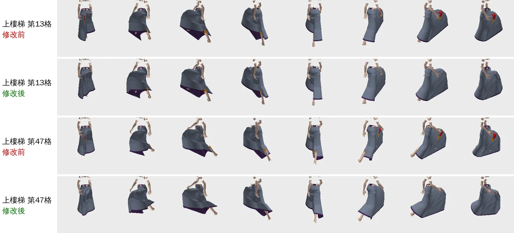
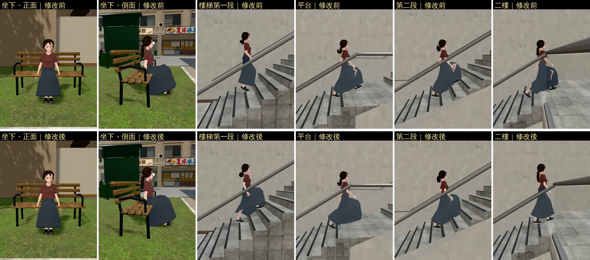

# 沛珊長裙：上樓梯膝蓋、小腿不再從裙子前面穿出來（PS-SKIRT-LEG）

帳號 A 的 LAWWW2，2026-10-22 07:5x～09:1x UTC。

- **狀態**：交件；角色美術由 LAWWW 驗收（D100 第 6 點）。正式 VRM 換成第二十八版（同檔名 `assets/models/char/second_ai/bl_classmate_peishan.vrm`），**要和 `patches/skirt_drive.diff` 一起接**。
- **起因**：
  - ART-PS-SKIRT-HAND（10-21）量手臂時發現：上霖澤館樓梯時，左膝、小腿從長裙前面穿出來。
  - 10-21 只改權重的試做（`peishan_skirt_reweight.py`）停成 WIP，結論是「只改權重兩全不了」。
  - **那次的試做左右腿接反了**：把 +x 當成人物的左邊，但 VRM 0.x 面向 −z，人物的左邊是 −x（`J_Bip_L_UpperLeg` 在 x＝−0.077）。所以那次的結論不算數。改正左右以後只改權重，上樓梯的露出也只少了約四成（下面的表）。

## 為什麼會穿出來

- 裙子前片中間的頂點一半跟左腿、一半跟右腿（中線左右 3.5 cm 一刀切）。
- 一條腿抬 70°～100°（樓梯＋腳步貼合）、另一條不動時，中間那一條被兩邊拉開、往身體縮進去，抬起那條腿的**膝蓋內側、大腿下段**就從前面中間露出來。
- 這個靜止時也看得到一點：站著（兩腿張開、腳尖朝外）時，前片中間裙襬的兩個點被拉開 34 cm，正面看是一條拉長的直線。

## 改了什麼

### VRM（第二十八版；`tools/blender/char_second/peishan_skirt_bones.py`）

- 只加骨頭、改裙子頂點的權重。臉、頭髮、衣服形狀、貼圖、其他網格都不動（靜止姿勢每個頂點的位置一樣，差 < 0.0001 mm）。
- 加 6 根骨頭，都是 hips 的子骨：
  - `skirt_F`、`skirt_F_lo`：前片中間的「第三條腿」。
    - `skirt_F` 在髖關節中間的高度，`skirt_F_lo` 在膝蓋高度。
    - 每一幀等於兩條腿旋轉的 slerp，偏向往前抬的那一條（最多 85%）。
  - `skirt_BL`、`skirt_BL_lo`、`skirt_BR`、`skirt_BR_lo`：後片。
    - 同一側的腿**往後**時才跟著轉；腿往前、坐下時不轉。
- 權重（只改髖關節下 10 cm 以下、原本就跟腿走的頂點）：
  - 前片：
    - |x| 小於 3 cm 全部跟中間那條腿，3～10 cm 漸漸換成同一側的腿。
    - 同一條腿上，跟腿的比例：膝蓋以上前面 1.0（原本 0.9），膝蓋以下照舊。
  - 後片：
    - **原本的權重一個都不動**，只把原本留在臀部的那一份分一部分給 `skirt_BL`／`BR`。
    - 腿往後時，後片跟腿的比例從原本的 0.15／0.45 加到 0.8／1.0（膝蓋以上／以下）。
    - 腿往前、坐下時，這幾根骨頭不轉，等於留在臀部：**和原本完全一樣**（單元測試 ④）。
- 骨頭怎麼動，寫在 VRM 節點的 `extras.drive`（GLTFLoader 會放進 `userData.drive`），參數也在裡面。
- 指令（從第二十七版做）：
  ```
  python3 tools/blender/char_second/peishan_skirt_bones.py assets/models/char/second_ai/bl_classmate_peishan.vrm <輸出> --back3 --kbumax 0.8 --kblmax 1.0
  ```
- 檔案 3,085,260 → 3,092,668 bytes。Clothes 的 skin 85 → 91 個關節；其他三個 skin 不動。

### 程式（`patches/skirt_drive.diff`：`src/character3d.js`＋新的 `tests/skirt_drive_unit.js`）

- 建立 VRM 人物時，找有 `userData.drive` 的節點，記下兩條腿的真實骨頭。
  - **沒有這種節點的模型完全不受影響**（祐廷等全部人物，單元測試 ①）。
- 每一幀在腳步貼合、坐下的腳、騎車之後（`updateVRM` 的 post），照兩條腿的角度算這幾根骨頭的旋轉，約 15 行。
- `CHAR._skirtDrive` 是給單元測試用的入口。

## 量測（Node，`tools/blender/char_second/skirt_vis.js`）

- 在 Node 裡用遊戲的 three.js、three-vrm、`CHAR`（動畫＋腳步貼合）讓沛珊：
  - 走上、走下一段霖澤館尺寸的樓梯（每階 16.8 cm、28 cm，13 階）；
  - 平地走路；
  - 坐下、看書。
- 每一格（1/30 秒）把裙子、身體的頂點照骨架算出來，從 16 個鏡頭（她的周圍每 45°，俯角 0.38 和 0.10，距離 4.2 m）用 CPU 畫小圖（z-buffer）。
- 數「應該被裙子蓋住的腿」露出來的像素，每格取 16 個鏡頭裡最多的那個，一個像素約 0.55 cm²：
  - 膝蓋以上：靜止時高度 ≥ 0.47 m；
  - 小腿上段：0.36～0.47 m。
  - 只算從布料穿出來的，不算從裙襬下面看到的。

| | 上樓梯（90 格） | 下樓梯（90 格） | 平地走路（66 格） | 坐下 |
|---|---|---|---|---|
| 修改前：看得到膝蓋以上的格數 | **61** | 0 | 0 | 0 |
| 修改後 | **25** | 0 | 0 | 0 |
| 修改前：膝蓋以上平均露出 | **87 像素（約 48 cm²）** | 0.1 | 0.8 | 0 |
| 修改後 | **7 像素（約 4 cm²）** | 0 | 0.2 | 0 |
| 修改前：小腿上段平均露出 | 41 | 39 | **31** | 0 |
| 修改後 | 17 | 24 | **8** | 0 |
| 修改前／後：看得到裙子內側的最多像素 | 2303／2559 | 823／892 | 710／914 | **1614／1616（一樣）** |

- 試過、沒選的（數字在 `$SP`，沒有放進 repo）：
  - 只改權重（左右改正）：上樓梯膝蓋以上平均 55、61 格裡剩 51 格。
  - 後片每條腿一組骨頭、完整取代原本的權重：走路小腿 0，但坐下時後片往後翹（會穿進椅背）。
  - 後片中間也加偏向後腳的骨頭：上樓梯變差。



- 上圖：同一格、同樣 8 個方向（俯角 0.38）；紅＝膝蓋以上露出來、橘＝小腿上段、紫＝看到裙子內側。

## 遊戲內前後（j40，`tools/shots/char_motion.py`）

- Playwright＋SwiftShader，720×960，不是 iPhone。
- 開發分支 `b857600c`；修改後＝套 `skirt_drive.diff`，用 `CHAR_SWAP` 換第二十八版 VRM（沒有覆蓋正式模型）。
- 坐下：溫州街小公園的長椅。上樓梯：霖澤館大廳的直跑樓梯，沛珊自己走上去。
- 修改前：平台、第二段、二樓都看得到膝蓋、小腿從裙子前面穿出來（裙子裡面一塊膚色）。
- 修改後：四張樓梯都沒有穿出來，裙子前片蓋在抬起來的膝蓋上；坐下兩張和原本一樣。
- 走路的時間點每次不同（SwiftShader 的幀率不固定），兩列不是同一個步伐；要比數字看上面的量測。



## 測試

- `tests/skirt_drive_unit.js`（新，Node）：
  - 修改前（舊的 `character3d.js`）FAIL 2；正式第二十七版 VRM＋新程式 FAIL 1（沒有輔助骨頭）；修改後 ALL PASS。
  - ① 沛珊有 6 根會動的輔助骨頭，祐廷沒有。
  - ② 靜止姿勢每個頂點都在原本的位置（差 0.000 mm）。
  - ③ 抬左腳 70°：`skirt_F` 往前 59.5°，前片中間膝蓋高度的 12 個頂點都跟著往前。
  - ④ 坐下：後片四根不轉，蒙皮矩陣和臀部一樣（差 3.7e-9）。
  - ⑤ 左腳往後 30°：`skirt_BL` 轉 30°、`skirt_BR` 不轉。
- 同一份程式：
  - `stairs_feet_unit`（祐廷；沛珊第二十八版）ALL PASS。
  - `sit_feet_unit`（祐廷、以安；沛珊第二十八版）ALL PASS。

## 接法（LAWWW）

1. `git apply docs/art-rebuild/second_ai/patches/skirt_drive.diff`（`src/character3d.js`＋`tests/skirt_drive_unit.js`），對開發分支 `b857600c` 乾淨。
2. 換 `assets/models/char/second_ai/bl_classmate_peishan.vrm`（第二十八版，同檔名）。**VRM 和 patch 要一起接**：
   - 只換 VRM、沒有 patch：骨頭不會動，前片中間停在臀部，上樓梯會和原本差不多、走路時前片中間不跟腿。
   - 只套 patch、不換 VRM：沒有任何改變。
3. 跑 `node tests/skirt_drive_unit.js`、`stairs_feet_unit.js classmate_peishan`、`sit_feet_unit.js classmate_peishan`。
4. `assets3d.js` 的 source 說明可以改成「第二十八版（LAWWW2 PS-SKIRT-LEG，裙子輔助骨頭）」。

## 還不到的地方（誠實寫）

- 上樓梯還有 25 格看得到一點膝蓋內側（平均約 4 cm²，最多 45 像素）。
- 下樓梯、走路還看得到一點小腿上段（平均 24、8 像素）：
  - 下樓梯是前腳的小腿伸到裙襬前面；
  - 走路是後腳的小腿貼著後片。
- 裙子還是照骨架變形，不是布料模擬：
  - 抬腳時前片會跟著膝蓋鼓起來、裙襬跟著小腿往上；
  - 從側面看，前片下緣有時會往前翹。
- 看得到裙子內側的量在上樓梯、走路時多一點（抬起的前片底下）。
- 只做沛珊；別人的長裙要用同一招，得照她們的 VRM 再做一次。
- 真機沒看過；沒在手機上量效能（每一幀 6 根骨頭、幾個四元數運算）。
