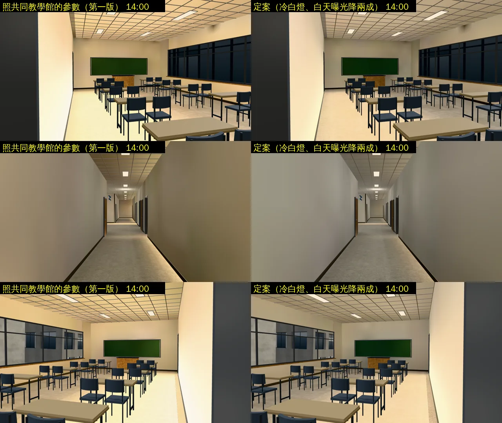
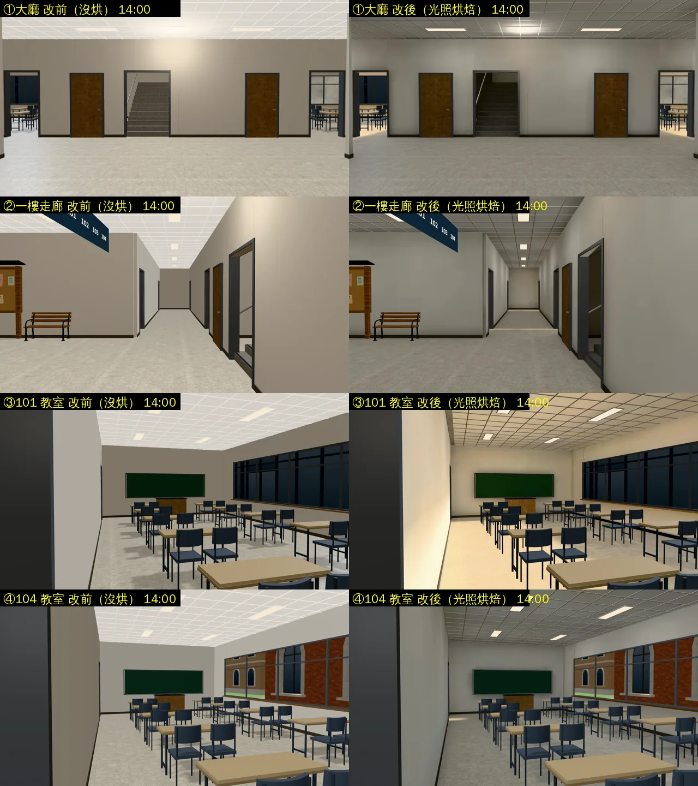
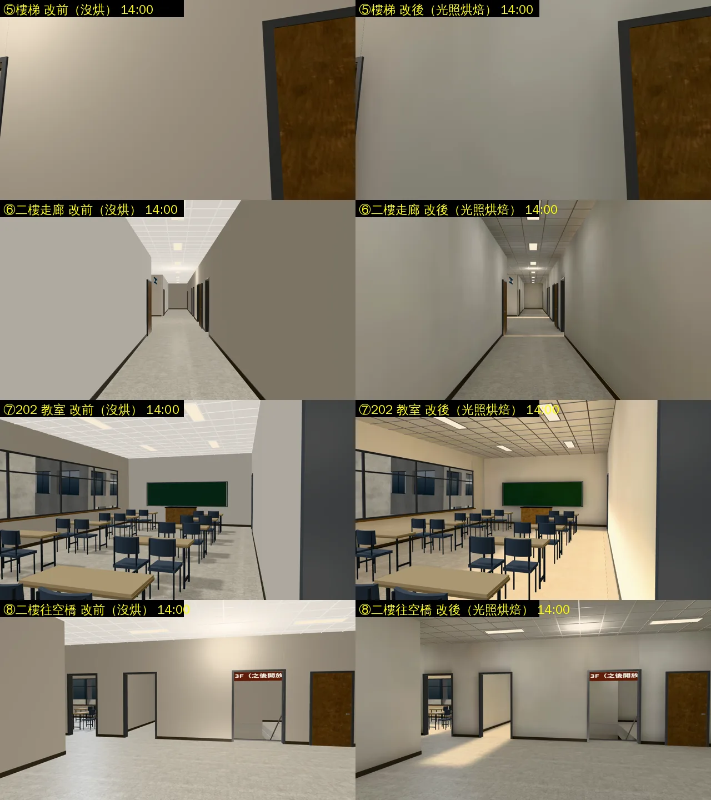
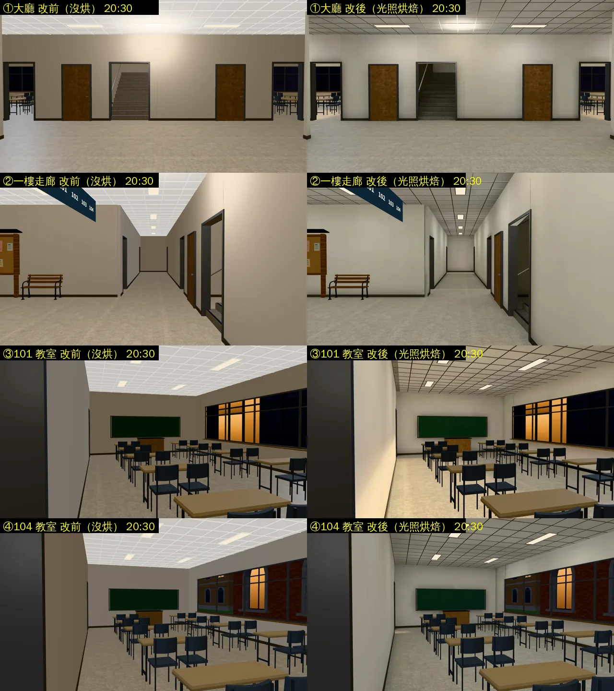
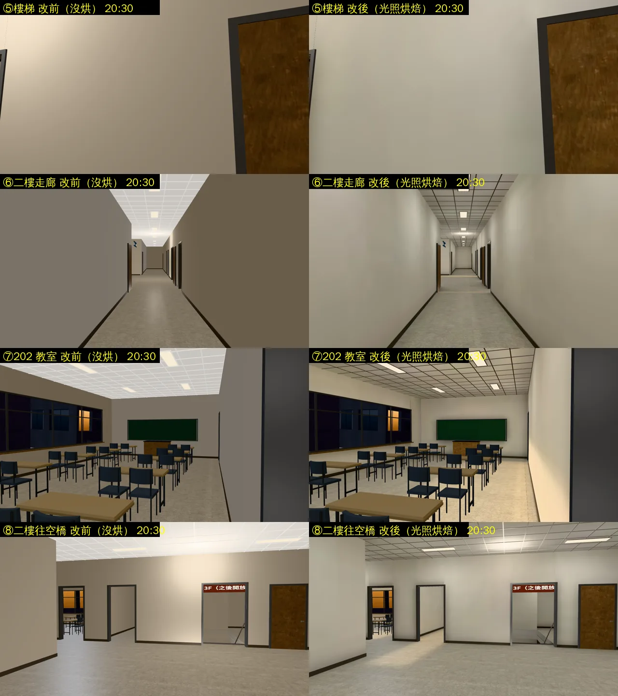

# 普通教學館室內光照烘焙（ART-ECON-3D-GAP-1021 B；LAWWW2-B 2026-10-31）

- **起因**：ART-ECON-3D-GAP-1021 現況清單（`docs/art-rebuild/second_ai/ECON_3D_GAP_STATUS_1030.md`）的 B。
  - 經濟系那一年在普通教學館上課。普通有正式模型（`putong_interior.glb`），但沒有光照貼圖；博思已經烘了。
- **狀態**：`READY_FOR_ART_REVIEW`。建築、場景只有使用者能標 `ART_APPROVED`。
  - 截圖是 Playwright＋SwiftShader（電腦 1280×720），不是實機。
  - 讀檔放位置、藏玩家和 NPC 是 [捷徑]。

## 怎麼套（給 LAWWW-B）

1. **換二進位**：
   - `assets/models/env/second_ai/putong_interior.glb`（＋`.json`）；
   - 新的 `putong_interior_lm_day.webp`、`putong_interior_lm_night.webp`。
   - 模型和開發分支一樣（只多一套光照 UV、extras.lightmap），三角形、節點不變。
   - teach3d.js 看到 extras.lightmap 就接（B3.attachFormal → Z3.roomLightmap），**遊戲程式不用改**。
2. **patch**：`docs/art-rebuild/second_ai/patches/putong_lm_1031.patch`。
   - 新測試 `tests/putong_interior_lm_unit.js`：光照貼圖兩張都在；地板、天花板、隔間牆有第二套 UV；燈板、輕鋼架照舊即時光。
     - 開發分支原樣 FAIL 2（沒有光照貼圖、沒有第二套 UV），改後 ALL PASS。
   - 新工具 `tools/blender/env_second/lightbake/bake_putong.sh`。
   - 烘焙紀錄 `putong_interior_lm.json`。
3. 烘焙要用修好的 `bake_room.py`（`lightbake_tools_1031.patch`，共同教學館那一包）。

## 白天的參數（試了六版，遊戲內）

- 照共同教學館的參數：教室牆面白天 (249,222,178)，紅色爆掉、整間偏桃橘色；走廊、大廳反而暗、偏咖啡色。
- 查原因：
  - 白天在遊戲裡把晚上那張光照貼圖強制換上去，教室就不黃了：問題在白天那一張。
  - 遊戲裡即時的太陽、三盞跟著玩家的燈，關掉都一樣，所以不是它們。
  - 普通的牆是暖白（`teach_interior.py` 的 `WARM`），燈也是暖白，光在教室裡來回反射，顏色越疊越暖。
- **定案**：
  - 燈 10 W、晝光色 0.95,0.98,1.0（台灣教室的日光燈本來就是冷白）；點光源 7 W。
  - 天光 0.1、太陽 0.6、白天燈 0.8；白天整張再乘 0.78,0.8,0.84（曝光降兩成、稍微偏冷）。
- **順便修了**：`bake_putong.sh` 第一版的點光源沒加進去（改寫時把 `out.append` 一起註解掉了），前五版試烘都少了天花板四周的光。定案那一版有。

## 改前改後（同角度；左＝開發分支原樣（沒烘），右＝光照烘焙）

- 鏡頭：`tools/blender/env_second/shots/putong_int_shots.py`。
- 改前＝開發 `44337adcb` 原樣。

### 看得到的差別

- 牆角、桌子下面、門洞旁邊有陰影；靠燈的天花板、牆比較亮，離燈遠的比較暗。原本整片一樣亮。
- 晚上：冷白的日光燈，不偏黃。
- 白天：走廊、大廳是中性的灰白。101 靠門那面牆偏奶油色：牆是暖白，又離燈很近。

### 還不夠的（照實寫）

- 從大廳看樓梯間偏暗：樓梯井那一塊一樓沒有燈（配置），只有二樓的燈和大廳的反光。
- 教室的單人桌椅還是遊戲畫的方塊（三棟教學館一樣，之後可以做正式模組）。

## 檢查

- `lm_squash_scan.py`：朝室內被壓扁 11.1 m²。全部是樓梯踏步的北面（被前一階擋住，只露出踢面那一條），博思、共同同一支腳本也有。
- 模型：三角形、節點和開發分支一樣（只加光照 UV）。效能不用另外量：只多兩張 1024² 的光照貼圖。

## 測試

（量測中）
