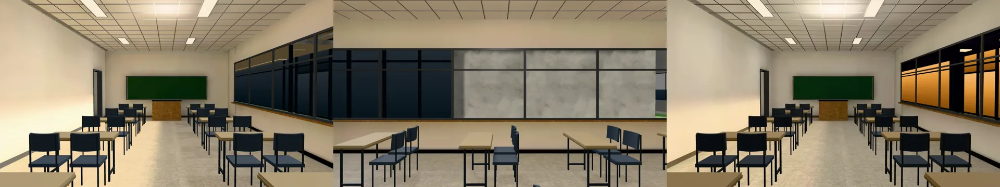
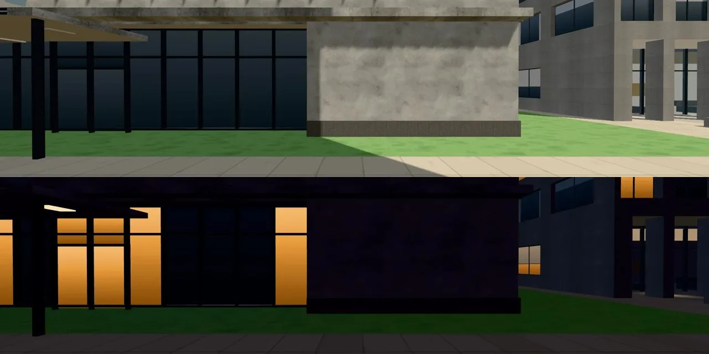

# 普通 101 從後面往黑板看，白天右邊那排窗整片黑（BB-B n28 觀察；LAWWW2-B 2026-10-31 判斷）

- **LAWWW-B 08:06（P2）**：BB-B 看到普通 101 從後面往黑板看，白天右邊（北面）那排窗整片黑，晚上是橘色；從前面看同一面窗是草地和建築。要我判斷是斜看的正常樣子，還是窗景缺了。
- **結論：不是窗景缺了。**黑的是窗景照片裡真的有的東西——普通教學館北邊就是博思教學館的南面，一樓是一整片深色玻璃帷幕。
  - 窗景照片 `assets/models/env/views/putong_north_day.webp`（遊戲裡校園的畫面拍的）：左半是博思一樓的深色玻璃，右半是混凝土量體和草地（下圖上半）。
  - 從教室後面斜看北面的窗，看到的是照片左邊那一段（玻璃帷幕），整個窗高都是玻璃，所以看起來整片深藍黑。
  - 晚上：博思一樓的燈亮了，玻璃裡是暖黃色（下圖下半），就是 BB 看到的「晚上是橘色」。
- **看起來像壞掉的原因**：遊戲裡的玻璃沒有反射天空，白天的深色玻璃幾乎是黑的（真的玻璃白天會反射天空、偏灰藍）。
- **要改的話**（你決定，我沒動）：
  - 博思外觀一樓玻璃的材質白天調亮（偏灰藍、像反射天空），重拍普通北面的窗景照片。
  - 會動到校園裡博思的外觀（從外面看那片玻璃也會變亮）；同一個做法其他深色玻璃帷幕也可以用。
  - 工作量小（一個材質＋重拍兩張窗景），要做就派 PUTONG-WINVIEW-1031。

