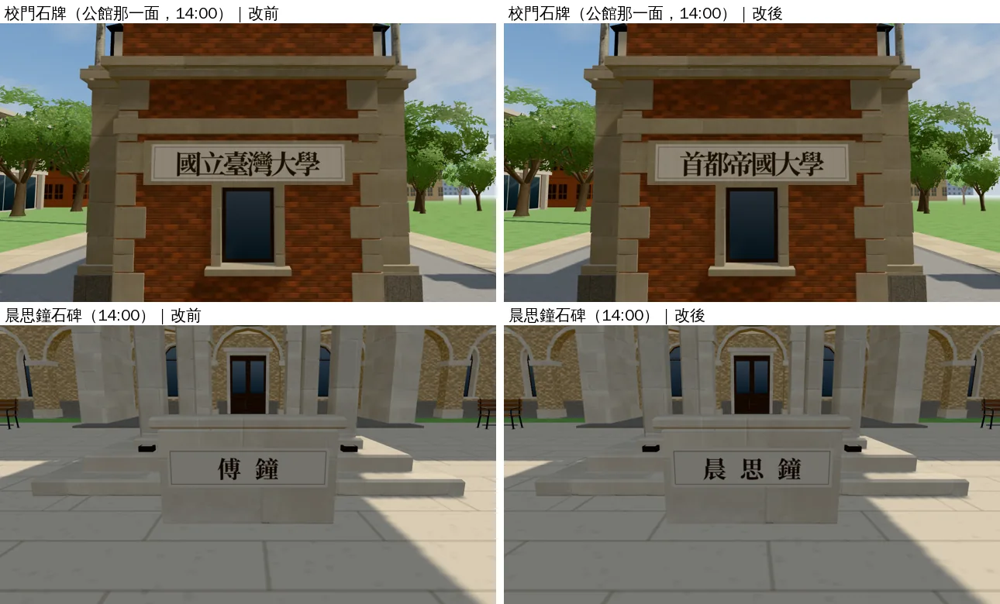
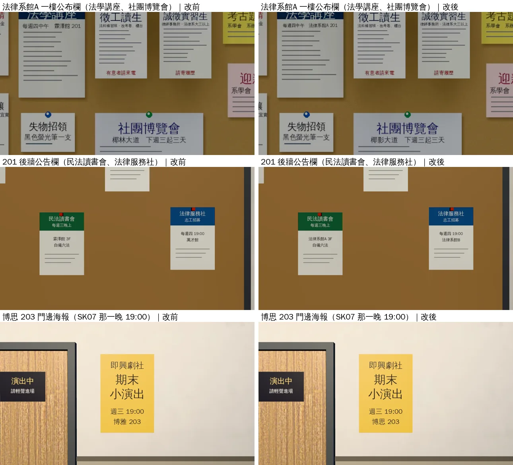
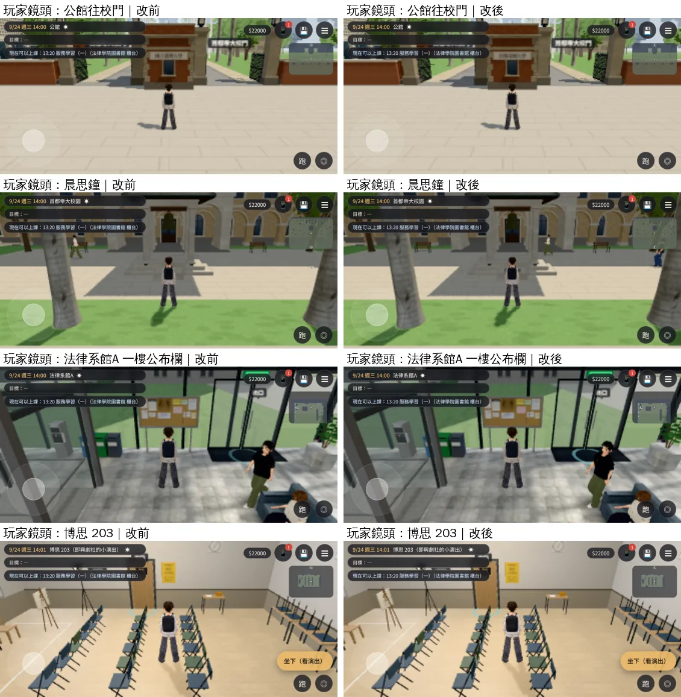

# D115 改名：美術裡的字（RENAME-ART-1030；LAWWW2-B 2026-10-30）

- **起因**：使用者 10-30 決定把真實校名、館名改成虛構的（D115，`docs/WORLD_NAMING.md`）。LAWWW-B 派工：正式 GLB 的校門石牌、博思 203 門牌字、博思教學館外牆字、201 公告欄的傳單、一樓公布欄、吉他社海報、木柵大學背景的招牌。
- **狀態**：改字已完成，遊戲內同角度改前改後在下面。只是換字，美術沒有其他變動。
- **截圖條件**：遊戲內，Playwright＋SwiftShader 模擬，**不是 iPhone 實機**。
  - 近拍是固定鏡頭（藏玩家和 NPC），1280×720。
  - 玩家鏡頭是手機橫向 844×390。
  - 讀檔放位置是 [捷徑]。
  - 改前＝開發分支 `ca5f3381c` 原樣；改後＝同一棵樹只換這次的 GLB。

## 一、改了什麼

| 位置 | 檔案（節點／貼圖） | 原本 | 現在 |
|---|---|---|---|
| 校門（公館那一面）石牌 | `campus_gate.glb` 節點 `PLATE_FACE_GATE_OUT` 的 extras | 國立臺灣大學 | 首都帝國大學 |
| 晨思鐘石碑 | `campus_bell.glb` `PLATE_FACE_BELL` | 傅鐘 | 晨思鐘 |
| 博思教學館入口雨遮名牌 | `campus_boya.glb` `PLATE_FACE_BOYA` | 博雅教學館 | 博思教學館 |
| 法律系館A 一樓公布欄 | `linze_interior.glb` 貼圖 `linze_notice` | 每週四中午　霖澤館 201／椰林大道　下週三起三天 | 每週四中午　法律系館A 201／椰影大道　下週三起三天 |
| 201 後牆公告欄的傳單 | `classroom_201.glb` 貼圖 `cls201_print` | 萬才館／霖澤館 3F | 法律系館B／法律系館A 3F |
| 博思 203 門邊的小海報 | `boya_203.glb` 貼圖 `boya_203_print` | 博雅 203 | 博思 203 |
| 子晴的吉他社成發海報 | `aa_support/wz6_items.glb` 貼圖 `wz6_items_atlas` | 萬才館大廳｜免費入場 | 法律系館B大廳｜免費入場 |
| 木柵大學的公車站牌 | `bg_nccu.py`（2D 背景的腳本） | 政大 | 木柵大學 |

- 吉他社海報：`wz6_items.glb` 是給企劃組的支援素材，遊戲沒有載入；照樣改，以後用到就是新名字。
- 木柵大學背景：公車站牌在 `nccu_gate.webp` 的鏡頭外面。三張政大背景（校門、小吃街、校園步道）畫面裡都沒有校名，**背景圖不用重算**；只改腳本，以後重算就是新字。

## 二、怎麼改的（沒有重新匯出模型、沒有重烘光照）

- 新工具 `tools/blender/env_second/glb_patch.py`：
  - 只換 GLB 裡的一張貼圖（照原本的大小、格式重新壓縮），或只改節點的 extras。
  - 其他資料原封不動：網格、UV、光照貼圖、材質都沒動。
  - 校門、晨思鐘、博思三個 GLB 逐一比對過：除了那一個字串，JSON、二進位資料完全一樣。
- 貼圖的字照原本的腳本重畫（`linze_notice_tex.py`、`classroom_201.py`、`boya_203.py`、`wz6_items.py` 的貼圖那一段），再換進 GLB。
  - 新舊貼圖逐像素比對過：只有字那一塊不同。
  - 吉他社海報：筆記本的紙紋每次重畫會有很淡的雜訊差異，所以只把海報那一塊貼回原本的貼圖。
- 腳本裡的字也都改了：以後重新匯出還是新名字。
- 所有 GLB 的節點 extras 掃過一遍。剩下 `campus_admin.glb` 的「行政大樓」，字裡有「政大」兩個字，但不是校名，不改。

## 三、改前改後（遊戲內同角度；左＝改前、右＝改後）

### 1. 牌子（近拍）

### 2. 公告、傳單、海報（近拍）

- 法律系館A 一樓公布欄：「法學講座」那張的「每週四中午　法律系館A 201」、「社團博覽會」那張的「椰影大道　下週三起三天」。
- 201 後牆：「民法讀書會」的「法律系館A 3F」、「法律服務社」的「每週四 19:00／法律系館B」。
- 博思 203：門邊小海報最下面一行「博思 203」。

### 3. 玩家鏡頭（手機橫向，有 HUD）

- 玩家平常的距離看得到牌子的字（校門、晨思鐘）；公布欄、傳單的小字要走近才看得清楚，改前改後在這個距離看起來差不多。

## 四、2D 背景、CG 查過的

- 我做的校園 2D 背景（`ntu_avenue`、`ntu_linze`、`ntu_soc`、`ntu_court_night`、`ntu_gym_*`、`law_library_gate`、`library_gate_day`）逐張看過。
  - **`ntu_linze.webp`（BG-16，法律系館A 前）外牆的大字是「霖澤館」**：這是 10-16 的遊戲內截圖，當時遊戲畫的是舊名。開發分支現在畫「法律系館A」，用同一個鏡頭重拍（見第三節）。
  - 其他張沒有舊名字。總圖的「總圖書館」、法圖的「法律學院圖書館」、社科院的「社會科學院」不在改名表上。
- BB 組的校園背景（`xiaofu`、`nccu_dorm*`、`graduation_avenue`、`linze_*`、`library_gate_night`、`wancai_seminar`、`ntu_lib_b1`、`girls_dorm_gate`、`soc_*`、`legal_aid_office`、`admin_office` 等）縮圖看過，沒有看到校名、館名的字。只是縮圖，沒有逐張放大看。
- CG（開發分支 78 張）：**還沒看**。
